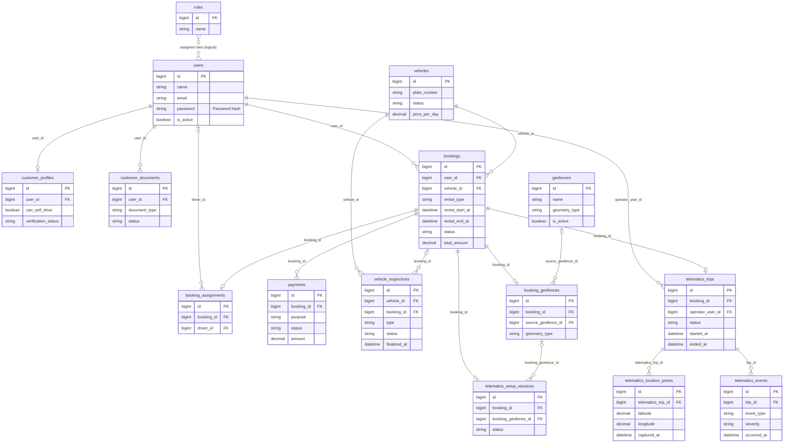

# JamJade presentation ERD

This is a **simplified view of the current database** for an ERD presentation. The live MySQL schema was checked on 2026-09-28: **45 tables, 455 columns, and 59 foreign keys**. This view shows **15 existing tables** (30 omitted from the drawing) and only their identifying, linking, and main business-state columns. It does not propose deleting tables or columns. The [complete physical ERD](ERD.md) and [database audit](database-audit-erd-readiness.md) remain the references for implementation.

## Core ERD

The printable Letter-size version uses one connected diagram, with each table shown once. Curved line jumps mark connector crossings without a relationship junction.

## How to explain it

**Roles:** A user can have multiple roles, and a role can be assigned to multiple users. The diagram summarizes this as a direct many-to-many relationship between `users` and `roles`. Its dotted connector is a logical association implemented by the omitted `model_has_roles` table, rather than a direct database foreign key. The role-assignment table remains in the database.

1. A customer **user** can have a profile and verification documents. The customer books a **vehicle**; an optional driver assignment supports rentals with an owner's driver.
2. The **booking** anchors the rental dates, status, amount, payments, and vehicle condition inspections. An inspection may also exist without a booking, such as an initial vehicle condition snapshot.
3. For a self-drive rental, a reusable **geofence** can be copied into a booking-specific geofence. The setup session records pre-release readiness. After release, the booking can have one telematics trip, with many location points and significant events. These telematics records do not apply to every booking.

The solid connectors reflect database foreign keys and uniqueness, not guaranteed row counts. For example, `bookings` can have at most one `telematics_trips` row because `telematics_trips.booking_id` is unique; the application limits trip creation to eligible self-drive rentals. A driver assignment can exist before `driver_id` is filled. `booking_geofences` stores an independent snapshot, so its source template can be absent.

## What the overview groups away

| Area | Existing tables kept in the database but omitted here |
| --- | --- |
| Customer details and notifications | `emergency_contacts`, `customer_document_files`, `notifications` |
| Booking and settlement details | `booking_terms`, `booking_events`, `booking_confirmation_emails`, `booking_additional_charges`, `payment_charge_allocations` |
| Vehicle catalog, condition evidence, and maintenance | `vehicle_images`, `vehicle_features`, `vehicle_inspection_items`, `vehicle_inspection_markers`, `vehicle_inspection_signatures`, `vehicle_maintenance_plans`, `vehicle_maintenance_records` |
| Retryable setup detail | `telematics_setup_steps` |
| Role assignments, permission details, and audit | `model_has_roles`, `permissions`, `model_has_permissions`, `role_has_permissions`, `activity_log` |
| Laravel infrastructure | `cache`, `cache_locks`, `jobs`, `job_batches`, `failed_jobs`, `migrations`, `password_reset_tokens`, `personal_access_tokens`, `sessions` |

Video recording, sending/uploads, auditing, and dashcam offerings are outside project scope. No video entity or relationship belongs in this ERD. The retirement migration removes the old permission and any Dashcam vehicle features; the existing table structure is retained.
