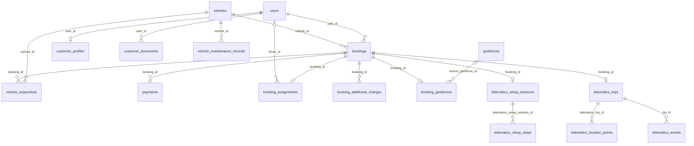
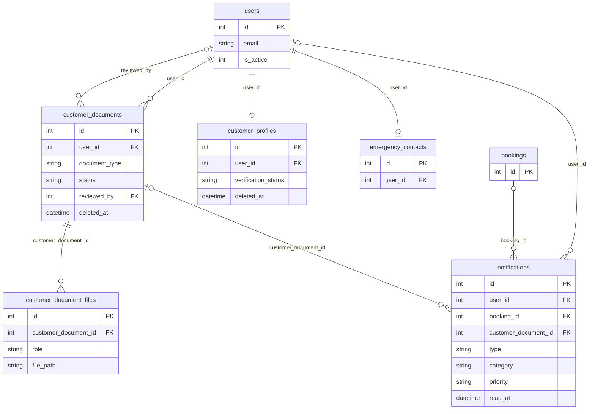
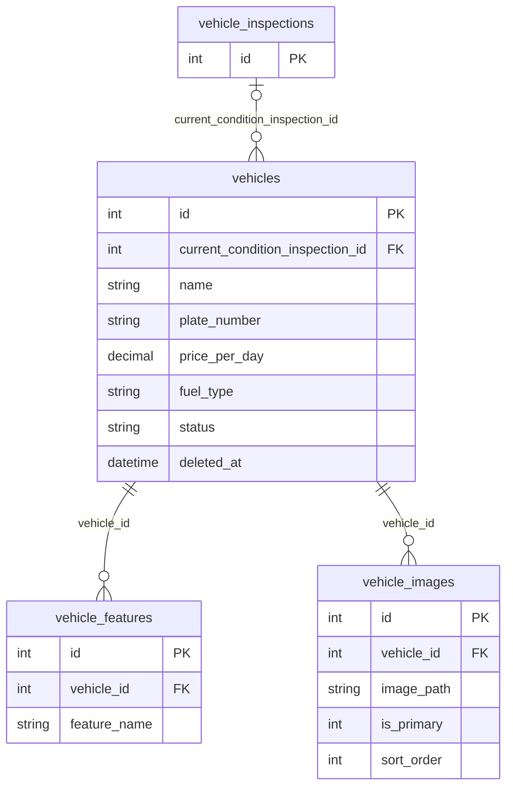
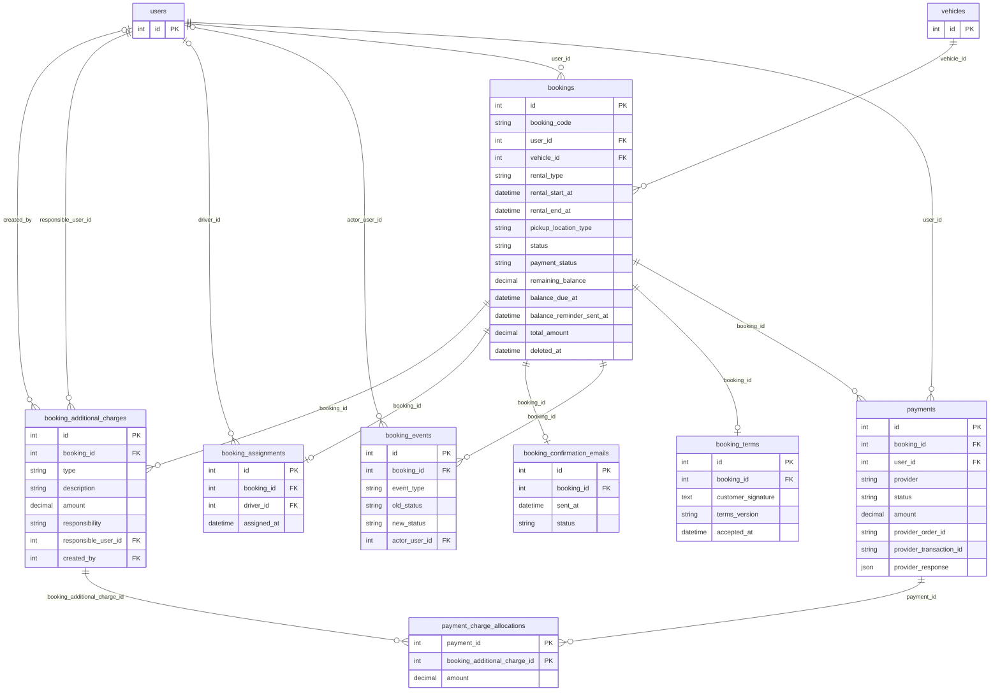
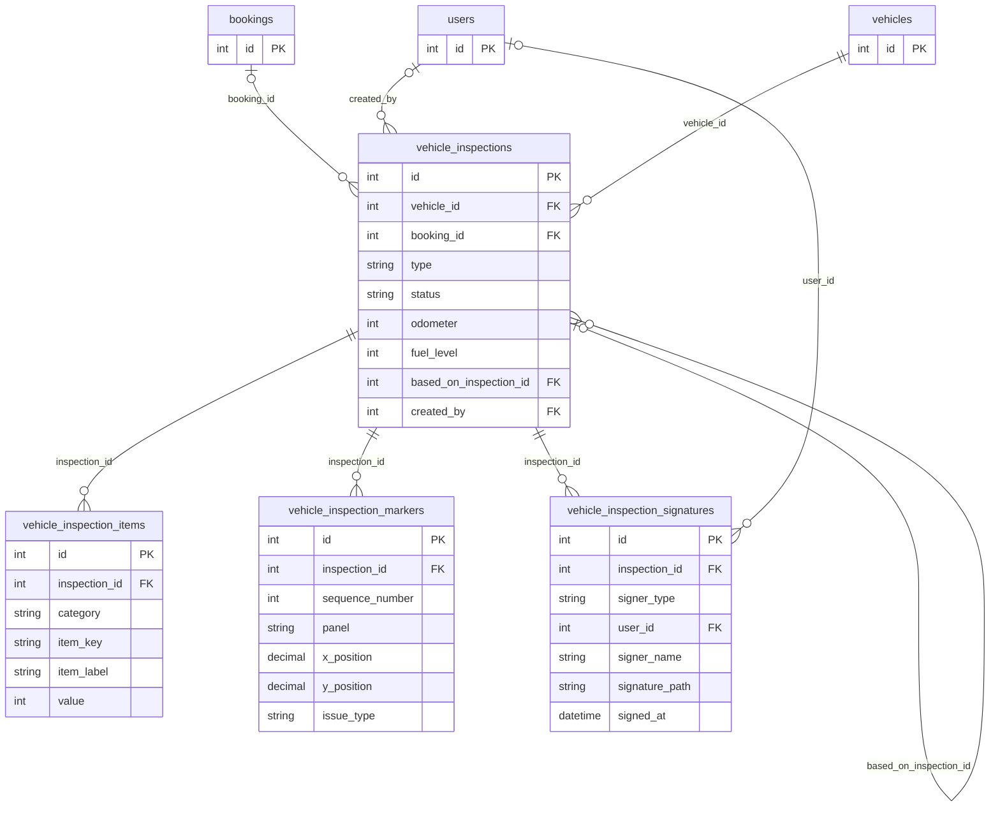
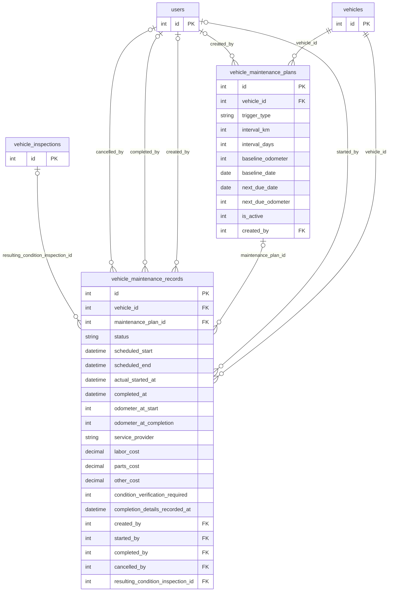
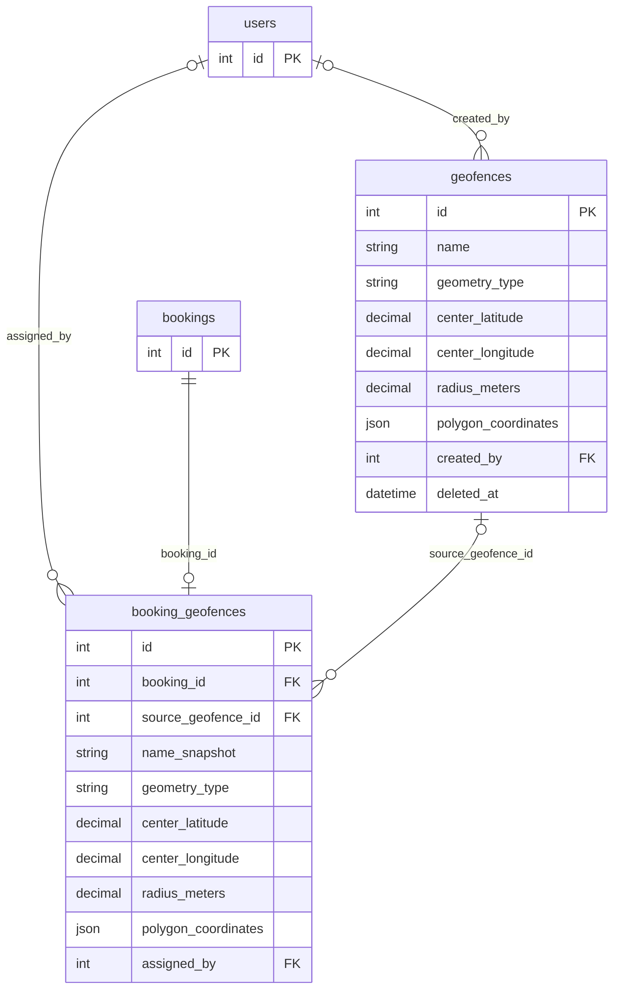
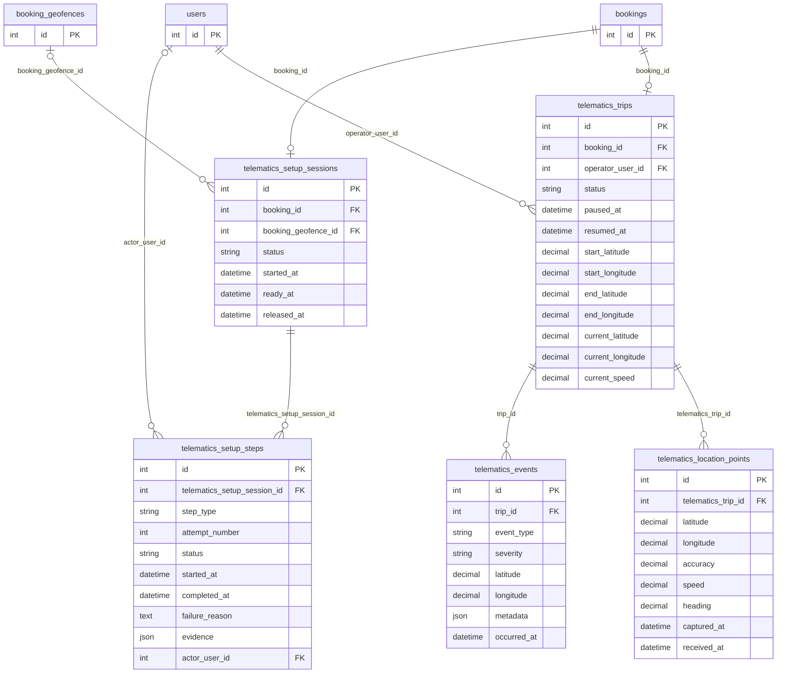
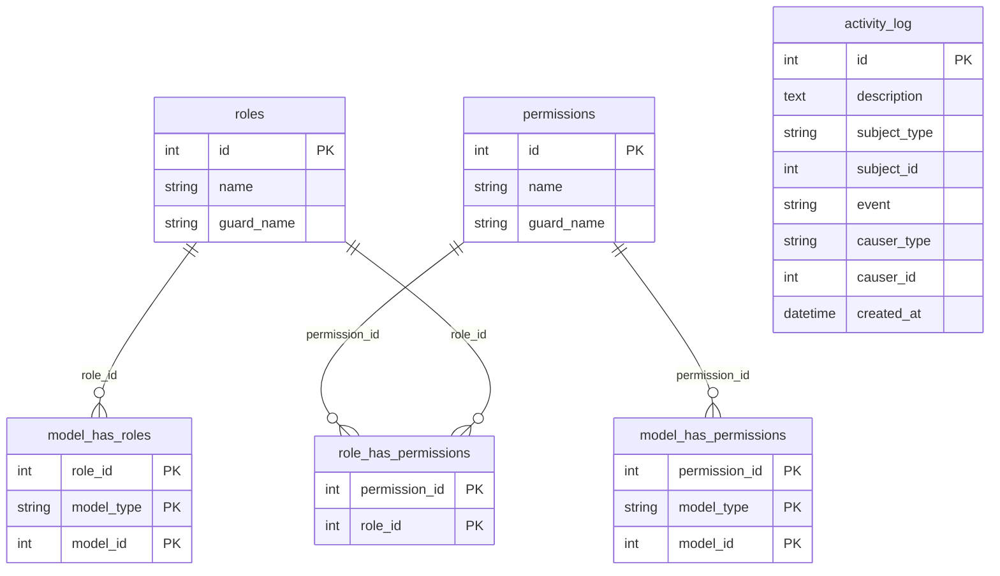

# JamJade canonical database ERD

Audited against the applied MySQL schema on 2026-09-26. The database has **45 tables**: 30 business tables, 6 authorization/audit tables, and 9 Laravel infrastructure tables. The diagrams below show persisted relationships, not merely model conveniences or planned capabilities. See [database-audit-erd-readiness.md](database-audit-erd-readiness.md) for the complete column/index inventory and every foreign key.

**Readiness: READY WITH DOCUMENTED ISSUES.** The live schema can be diagrammed accurately; the retention and model-alignment issues in the audit should be resolved before a production schema freeze.

Mermaid cardinality follows database constraints: a nullable FK makes the parent optional for that child; a unique single-column FK makes the child zero-or-one per parent. Business-service restrictions that lack a database constraint are explained in prose rather than drawn as one-to-one.

## A. Domain ERD

This overview uses only real business tables. It omits detail rows to keep the rental lifecycle readable.

The diagram expresses **database capacity**, not current row counts. An inspection may lack a booking because initial and standalone condition snapshots are vehicle-scoped. A driver assignment may have no driver while assignment is pending. A trip is physically limited to one per booking by a unique FK, even though one Eloquent relationship is named as a collection.

## B. Complete physical ERD by bounded context

Every business and authorization/audit table appears in one primary diagram below. Referenced parent tables repeated in another context are abbreviated to their primary key. Relationship labels are the actual child FK columns. Polymorphic `model_type/model_id` and `subject_type/subject_id` pairs are described separately because MySQL has no FK to a single parent table for them.
### Identity and verification

### Fleet and vehicle catalog

### Booking, payment, and driver

### Inspection and condition

### Maintenance

### Geofences

### Telematics

### Authorization and audit

## Data dictionary: business tables

| Table | Purpose | Primary owner / parent | Important relationships |
| --- | --- | --- | --- |
| `users` | Authenticated account for renters, personnel, and drivers. | Identity root | No FK parent |
| `customer_profiles` | Customer details and self-drive eligibility projection. | users | `users` via `user_id` |
| `emergency_contacts` | One emergency contact per account. | users | `users` via `user_id` |
| `customer_documents` | Customer document metadata and review decision. | users | `users` via `reviewed_by`, `users` via `user_id` |
| `customer_document_files` | Document file roles and stored paths. | customer_documents | `customer_documents` via `customer_document_id` |
| `vehicles` | Fleet master record and pointer to accepted current condition. | Fleet root | `vehicle_inspections` via `current_condition_inspection_id` |
| `vehicle_images` | Catalog image paths and display order. | vehicles | `vehicles` via `vehicle_id` |
| `vehicle_features` | Named vehicle amenities. | vehicles | `vehicles` via `vehicle_id` |
| `bookings` | Renter, vehicle, rental period, quote, and payment projection. | users + vehicles | `users` via `user_id`, `vehicles` via `vehicle_id` |
| `booking_events` | Booking status and operational milestone history. | bookings | `users` via `actor_user_id`, `bookings` via `booking_id` |
| `booking_assignments` | One current assigned driver per booking. | bookings | `bookings` via `booking_id`, `users` via `driver_id` |
| `booking_terms` | Accepted rental terms and customer signature. | bookings | `bookings` via `booking_id` |
| `booking_confirmation_emails` | Confirmation-email delivery state. | bookings | `bookings` via `booking_id` |
| `payments` | Manual and provider-backed payment/order records. | bookings + users | `bookings` via `booking_id`, `users` via `user_id` |
| `booking_additional_charges` | Post-return charge and responsible account. | bookings | `bookings` via `booking_id`, `users` via `created_by`, `users` via `responsible_user_id` |
| `payment_charge_allocations` | Amount of a payment allocated to a charge. | payments + booking_additional_charges | `booking_additional_charges` via `booking_additional_charge_id`, `payments` via `payment_id` |
| `vehicle_inspections` | Initial, condition-update, outgoing, or incoming condition snapshot. | vehicles; optionally bookings | `vehicle_inspections` via `based_on_inspection_id`, `bookings` via `booking_id`, `users` via `created_by`, `vehicles` via `vehicle_id` |
| `vehicle_inspection_items` | Historical checklist answer and label. | vehicle_inspections | `vehicle_inspections` via `inspection_id` |
| `vehicle_inspection_markers` | Body issue marker and location. | vehicle_inspections | `vehicle_inspections` via `inspection_id` |
| `vehicle_inspection_signatures` | Signer identity, time, and private file reference. | vehicle_inspections | `vehicle_inspections` via `inspection_id`, `users` via `user_id` |
| `vehicle_maintenance_plans` | Editable mileage/date maintenance reminder. | vehicles | `users` via `created_by`, `vehicles` via `vehicle_id` |
| `vehicle_maintenance_records` | Scheduled and completed service work with costs. | vehicles; optionally a plan | `vehicle_inspections` via `resulting_condition_inspection_id`, `users` via `cancelled_by`, `users` via `completed_by`, `users` via `created_by`, `vehicle_maintenance_plans` via `maintenance_plan_id`, `users` via `started_by`, `vehicles` via `vehicle_id` |
| `geofences` | Reusable circle or polygon boundary template. | Template root | `users` via `created_by` |
| `booking_geofences` | One copied rental boundary snapshot per booking. | bookings; optionally geofences | `users` via `assigned_by`, `bookings` via `booking_id`, `geofences` via `source_geofence_id` |
| `telematics_setup_sessions` | One pre-release handover workflow per self-drive booking. | bookings | `booking_geofences` via `booking_geofence_id`, `bookings` via `booking_id` |
| `telematics_setup_steps` | Retryable, typed setup check attempts. | telematics_setup_sessions | `users` via `actor_user_id`, `telematics_setup_sessions` via `telematics_setup_session_id` |
| `telematics_trips` | One post-release driving lifecycle per booking. | bookings + operator users | `bookings` via `booking_id`, `users` via `operator_user_id` |
| `telematics_location_points` | Timestamped active-trip GPS route points. | telematics_trips | `telematics_trips` via `telematics_trip_id` |
| `telematics_events` | Significant active-trip occurrences. | telematics_trips | `telematics_trips` via `trip_id` |
| `notifications` | Recipient-facing in-app messages and optional subject links. | users; optionally bookings/documents | `bookings` via `booking_id`, `customer_documents` via `customer_document_id`, `users` via `user_id` |

## Historical integrity and physical boundaries

- `booking_geofences` copies circle or polygon geometry from an optional reusable `geofences` template, or from a custom definition. The booking FK is unique. Editing or deactivating the source does not change the copied values. The model rejects updates, and the assignment service rejects a second snapshot. A hard-deleted template would set `source_geofence_id` null but leave the copied boundary.
- `vehicles.current_condition_inspection_id` points to the accepted finalized condition. `vehicle_inspections.based_on_inspection_id` records snapshot lineage: current to outgoing to incoming/new current. Initial and standalone condition-update rows have no booking. Finalized inspections and child rows are protected against ordinary model updates/deletes; DB cascades still apply if their parent is physically deleted.
- Inspection checklist rows and marker rows contain snapshot values, and signature rows keep signer identity/time plus a private file path. Vehicle catalog images and document files also use path rows; the image/signature bytes are stored outside MySQL.
- `booking_events` is the persisted booking lifecycle/milestone timeline. `booking_terms` and `booking_confirmation_emails` each have a unique booking FK. `booking_assignments` stores only the current driver assignment; reassignment activity is logged separately, not as multiple assignment rows.
- `payments` contains manual and PayPal transactions/orders. A PayPal checkout is an Eloquent view over rows with `provider = paypal`, not a physical `paypal_checkouts` table. `payment_charge_allocations` gives each payment/charge pair an allocated amount. Booking status and the booking payment-status projection are distinct.
- A self-drive `telematics_setup_session` is pre-release, with multiple append-only `telematics_setup_steps` attempts. A post-release `telematics_trip` is separate and has at most one row per booking. `telematics_location_points` stores route history; trip current-location fields are an intentional latest-state cache; `telematics_events` stores significant occurrences.
- `activity_log` has polymorphic `subject` and `causer` pairs, without SQL FKs. `model_has_roles`, `model_has_permissions`, and `personal_access_tokens` likewise use polymorphic model references. Those are not drawn as direct user FKs.

## Implemented database architecture

The physical schema and Laravel services support customer verification, vehicles, booking/payment/charge records, driver assignment, condition inspections, maintenance, circle and polygon templates, one immutable booking boundary, pre-release setup attempts, and the trip/location/event data structure. The mobile application currently performs only seven real setup-readiness checks. Trip APIs and storage exist, but the current mobile flow does not start an active trip or stream location. Reports are computed from existing business records rather than a report table.

## Planned or not yet operational

The five calibration step **types** exist in the PHP enum and can be represented by `telematics_setup_steps`, but calibration capture is not implemented. Background active-trip GPS streaming, an offline telemetry queue, driver scoring, AI/ML classification, expressway/corridor zones, and multiple booking geofence zones are not present as working database domains. No AI-specific tables were found. The possible future Python ML service is an external processing boundary; no classification table or flow is implied by this ERD.

The proposed future ML path is mobile sensor capture → Laravel → MySQL telemetry → Python feature extraction/classification → Laravel → significant event or analytics. It is a plan, not an implemented relationship in these diagrams.

## Infrastructure outside the business diagrams

`migrations`, `cache`, `cache_locks`, `jobs`, `job_batches`, `failed_jobs`, `sessions`, `personal_access_tokens`, and `password_reset_tokens` are present in MySQL. Their schemas and indexes are inventoried in the audit document; they are not JamJade rental entities.
