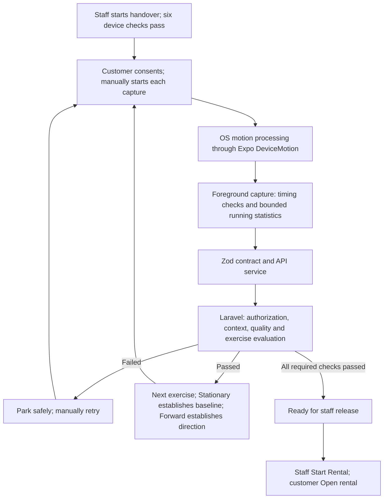

> **Historical archive — 2026-10-24.** This is a superseded working-copy snapshot, not current coding guidance. Read the [central implementation guide](../../telematics-master-plan.md). Historical plans, exclusions, platform targets, and verification statements below retain their original dates; relative Markdown links were rebased for this archive.

# Telematics calibration: computation and sensor fusion

Android-only scope — 2026-10-24: `mobile-frontend` now targets Android only; iOS and mobile-browser support are retired. Earlier dated multi-platform descriptions and results below are historical. Shared Laravel contracts, saved records and the separate Next.js website are unchanged. Current physical verification is required on Android. See [Android-only mobile scope](../../android-only-mobile.md).

Code reconciliation: **2026-10-18, calibration protocol 3**. This is the current
mathematical reference for pre-release calibration. The [calibration workflow
guide](telematics-calibration.md) records consent, UI phases and dated verification;
the [architecture](telematics-architecture.md) defines setup/trip boundaries.
Application code remains authoritative. This document introduces no algorithm,
threshold change or new collection capability.

Profile update — 2026-10-19: standard revision 4 and RC revision 5 retain the first
horizontal acceleration sample at or above 3 m/s². Later fluctuations cannot
reset that direction. The retained evidence has one sample, zero window duration
and coherence 1; this does not establish consistency across multiple readings.
The one-second minimum capture and shared quality checks still apply. Standard
Forward allows a 60°/s rotation peak and 180° total yaw; RC Forward does not gate
on gyro rotation or yaw. These are workflow thresholds, not validated vehicle limits.
The [RC demonstration procedure](telematics-rc-demonstration.md)
defines a separate local/testing `rc_demo` profile. Equations remain shared;
revision 5 uses evidence-based early completion and the single-sample Forward trigger. Its settings and
limitations are listed in the RC guide. All limits below describe the standard defaults.
Each new evaluation saves its resolved profile/settings snapshot, and the opaque
context also binds the profile fingerprint. RC findings do not validate full-size
vehicle calibration.

RC movement evaluation uses `calibration.movementLimits` rather than Stationary's
rotation/tilt caps. For a turn it additionally requires `requestedYaw >=
1.5 × oppositeYaw`; both separate angular totals still include all accepted
samples. Full-capture quality/consistency checks remain unchanged. The local live
reading exposes derived braking magnitude `max(0, -longitudinal_min)` and the
existing yaw totals for presentation only; these are not new persisted fields.

## What calibration currently establishes

Calibration establishes a fixed mounted phone reference, measures parked
vibration, learns a supervised forward acceleration direction, and checks that
gentle braking and turns produce the expected summaries. It does **not** calibrate
the phone's hardware, prove a physical holder exists, classify driving quality,
or estimate a continuous vehicle trajectory.

Six device-readiness checks precede these five exercises. In standard mode all
eleven effective results must pass. Staff then performs the existing **Start
Rental** release action; the customer can subsequently **Open rental**. Passing
calibration does not release the vehicle or start mobile background monitoring.
The separate local test exceptions are documented in the [handover
guide](telematics-handover-lifecycle.md).



## Are we using sensor fusion?

**We consume platform-processed motion data and combine its measurements for
calibration. We do not implement a custom continuous sensor-fusion estimator.**

| Layer | Current implementation | Accurate claim |
| --- | --- | --- |
| iOS platform | Expo uses `CMMotionManager.startDeviceMotionUpdates`, reading Core Motion user acceleration, gravity and rotation rate | Core Motion combines accelerometer/gyroscope information to separate gravity and user motion; see [Apple CMDeviceMotion](https://developer.apple.com/documentation/coremotion/cmdevicemotion?language=objc) |
| Android platform | Expo subscribes to accelerometer, linear acceleration, gravity, gyroscope and rotation-vector sensor types | Android provides processed/virtual motion sensors; implementations vary by device. AOSP gravity/linear acceleration/rotation-vector processing can use multiple sensors; see [Android motion sensors](https://developer.android.com/develop/sensors-and-location/sensors/sensors_motion) |
| JamJade geometry | Gravity defines a reference axis; acceleration is projected onto its horizontal plane; gyro is projected onto the reference vertical; independent quality gates are combined | Gravity-based frame alignment and combined motion checks using platform-processed inputs |
| JamJade state estimation | No custom Kalman, complementary, Madgwick/Mahony or quaternion filter; no GPS–IMU fusion | No application-level continuous attitude, velocity or position fusion algorithm |

Expo also exposes an attitude/rotation value, but this calibration code does not
consume it. JamJade does not request magnetometer readings or select a custom
fusion algorithm. Platform internals may use additional inputs; their exact
filter and tuning are not established by our source inspection. Do not describe
the OS implementation as a specific Kalman filter without device-specific evidence.

A suitable capstone description is: **“Supervised smartphone calibration using
platform-processed inertial measurements, gravity-based frame alignment,
gyroscope projection, and server-validated noise-aware thresholds.”** It is not
evidence of a novel fusion algorithm or an implemented AI classifier.

## Inputs, coordinate conventions and units

The inspected dependency is **Expo SDK 54 / expo-sensors 15.0.8**. Native sources
are `mobile-frontend/node_modules/expo-sensors/ios/DeviceMotionModule.swift` and
`mobile-frontend/node_modules/expo-sensors/android/src/main/java/expo/modules/sensors/modules/DeviceMotionModule.kt`.
Recheck them when upgrading; API labels alone do not establish axis ordering.

| Symbol | Code/input | Unit |
| --- | --- | --- |
| `a_i` | DeviceMotion `acceleration`: platform-processed acceleration excluding gravity | m/s² |
| `g_i` | `accelerationIncludingGravity - acceleration`, component by component | m/s² |
| `ω_i` | Normalized XYZ rotation rate | degrees/second |
| `t_i`, `Δt_i` | Acceleration sensor timestamp and successive difference | seconds |
| `N` | Accepted distinct, advancing samples | count |
| `d` | Stored gravity reference, named `reference.down` | unit vector |
| `f` | Stored learned forward direction, `reference.forward` | unit vector |

All vectors use device XYZ coordinates, independent of the screen's layout.
The code maps iOS `(alpha,beta,gamma)` to `(gamma,beta,alpha)` and Android to
`(alpha,beta,gamma)`. Both installed native modules emit rotation rate in
degrees/second, even though Android's underlying gyroscope reports radians/second.
iOS native acceleration is converted from g using 9.80665 m/s².

The name `accelerationIncludingGravity` refers to Expo's exported convention.
In the installed Android adapter it is `rawAccelerometer - 2 × gravitySensor`;
on iOS it is `(userAcceleration + gravity) × 9.80665`. JamJade takes the stated
difference to derive `g_i`; it does not separately read Android's gravity event.
Do not substitute a raw-accelerometer formula without revisiting this adapter.
The resulting reference sign and left/right interpretation still require
physical Android/iOS verification; synthetic axis tests establish code behavior.

Acceleration magnitude `||a|| = sqrt(ax² + ay² + az²)` is a three-axis norm,
not one axis. Dot products and norms below operate in this normalized device frame.

## Foreground capture and timing

`calibration-capture.ts` requests a 50 ms update interval (20 Hz). This is a
request, not a guaranteed delivered sample rate. The screen receives aggregate
feedback at most once per 200 ms; UI update frequency is not capture frequency.

Before recording it requires Android/iOS, available motion, existing granted
motion permission, and foreground state. Startup has a three-second deadline.
It requires 200 ms of advancing timestamps that track arrival time: sensor
increments must be positive and at most 250 ms, arrival gaps at most 250 ms,
and their difference at most 100 ms. Cached packets or jumps restart startup
qualification. The configured recording clock starts **after** warmup. Stationary measures the
full interval. Movement capture stops once its movement and quality gates qualify,
after at least 1,000 ms, or at the configured maximum timeout. This floor is
a provisional engineering setting requiring physical validation.

Each packet needs finite acceleration, including-gravity and rotation-rate
values, with their exported timestamps within 100 ms of acceleration. The
accumulator ignores non-finite inputs, gravity magnitude below 1 m/s², and
duplicate/out-of-order timestamps; over 2,000 accepted samples aborts capture.
Real post-start gaps remain in the evidence. They are not trimmed away to make
an interrupted capture pass.

The maximum gap is the largest sensor timestamp gap, callback arrival gap or
silence between the last accepted sample and capture completion. Sensor span
is `(t_last - t_first) × 1000`, not the wall-clock recording duration. UTC start/end
dates use `YYYY-MM-DDTHH:mm:ss.sssZ`; elapsed capture timing uses a monotonic clock.

Stop, navigation and backgrounding remove subscriptions and timers and discard
unsent data. There is no raw recording file, offline queue or automatic retry.
The workflow checks connectivity before recording and before submission.

## Running computations

All statistics retain fixed-size sums, counts, extrema and timing metadata.
No motion sample array is retained, uploaded or persisted.

### 1. Mean, RMS and variation

For accepted acceleration samples, and identically for rotation:

```text
μa = Σa_i / N
A_RMS = sqrt(Σ||a_i||² / N)
A_STD = sqrt(max(0, A_RMS² - ||μa||²))

μω = Σω_i / N
Ω_RMS = sqrt(Σ||ω_i||² / N)
Ω_STD = sqrt(max(0, Ω_RMS² - ||μω||²))
Ω_peak = max_i ||ω_i||
g_mean = Σg_i / N
```

`linear_stddev` and `rotation_stddev` are **composite population deviations**
(`N`, not `N−1`). They equal the square root of the summed per-axis population
variances, not the deviation of vector magnitudes or a standard error. RMS
includes a nonzero mean; deviation removes it mathematically for this statistic.
These are equally weighted sample statistics, not time-weighted integrals.

Mean vectors are recorded for consistency checks. JamJade does **not** subtract
the parked means as bias corrections from subsequent acceleration or gyro
samples. It adds no custom low-pass/median filter; OS processing, warmup and
window aggregation must not be described as a custom denoising filter.

### 2. Gravity reference, horizontal acceleration and tilt

During Stationary, the first accepted sample establishes a temporary
`d = g_first / ||g_first||` for that recording's projection, tilt and yaw.
For each sample:

```text
d_i = g_i / ||g_i||
vertical_i = a_i · d
h_i = a_i - vertical_i × d
H_RMS = sqrt(Σ||h_i||² / N)
tilt_i = acos(clamp(d_i · d, -1, 1)) × 180/π
tilt_max = max_i tilt_i
```

After **server acceptance**, the saved Stationary reference is
`d = g_mean / ||g_mean||`, with `forward = null`. Later exercises use that
saved axis throughout capture. The server additionally compares each later
capture's normalized mean gravity with the saved `d`. Stationary's horizontal
RMS therefore uses its temporary first-sample axis; later projections use the
accepted mean axis. There is no retrospective recomputation of the parked RMS.

Flat, upright and tilted mounts are supported mathematically without assuming
a particular phone axis is vehicle forward. Gravity alone cannot detect a flat
phone rotating within the horizontal plane. A changed mount requires restarting
calibration; the current code does not continuously rotate the reference frame.

### 3. Parked vibration and the adaptive Forward minimum

Stationary records one complete six-second parked/idling interval. It does not
reset whenever a displayed value turns red, or retain only quiet sub-windows.
The full bounded interval must pass the fixed Stationary and quality limits.
Only a passing attempt supplies `noiseBaseline`:
`linearRms`, `horizontalRms`, `linearStddev`, `rotationRms`, `rotationStddev`.

Here “noise” means measured background activity under the supervised parked
condition: sensor noise, bias, mount/engine vibration and possible handling.
The algorithm cannot independently label their physical cause or prove parking.

Laravel derives the Forward threshold and sends it to both learner and UI:

```text
T_forward = max(A_floor, k × H_parked_RMS)
Current defaults: A_floor = 3 m/s²; k = 3
```

| Measured parked horizontal RMS | Other Stationary checks pass? | Result |
| --- | --- | --- |
| 0.10 m/s² | Yes | Forward minimum 3 m/s² |
| 0.30 m/s² | Yes | Forward minimum 3 m/s² |
| 0.36 m/s² | No: horizontal energy implies total RMS over the 0.35 m/s² cap | Retry Stationary; no accepted baseline |

This is an **engineering RMS margin**, not “three sigma,” a 99.7% confidence
rule or a statistical proof that motion is intentional. Total Stationary RMS
remains capped at 0.35 m/s²; noise does not relax mounting/rotation limits.
The baseline remains fixed until invalidated by a prerequisite retry. Gyro RMS
is measured but does not adapt the separate Stationary or Forward gyro limits. Braking and turn
thresholds are not adapted from parked noise in this implementation.

### 4. Learning Forward and checking braking

The current profiles request zero minimum window duration and one Forward
sample. The learner retains the first horizontal acceleration `h_i` with
`||h_i|| ≥ T_forward`. It saves that vector, a sample count of one, duration zero
and coherence one. Lower, opposite or fluctuating later acceleration does not
replace it. All readings still contribute to full-capture RMS, rotation, tilt,
yaw, count and gap evidence. Capture finishes once the retained trigger and the
one-second minimum observation and quality checks qualify.

The accumulator also supports explicitly configured sustained windows for
prior profile settings. That path retries inconsistent candidates and retains
the first qualifying window, with a 750 ms target and 250 ms continuity limit.

For its `K` contributing samples:

```text
b = Σh_j / K
coherence = min(1, ||Σh_j|| / Σ||h_j||)   # zero if denominator is zero
f = b / ||b||                          # stored only after server acceptance
longitudinal_i = a_i · f               # used in later captures
```

Coherence describes agreement of directions (0 to 1); it is not confidence or
probability. With one retained sample, `b = h_i` and coherence is one by
construction. Both current profiles require `||b|| ≥ T_forward`, one sample and
zero window duration. Standard retains rotation/yaw gates; RC skips those
Forward gates. Shared quality and mount checks remain active. Staff must
direct forward movement from rest: the learned direction alone cannot
distinguish intended forward movement from reverse.

Braking uses the minimum longitudinal acceleration over its capture, with
extrema initialized to zero. It passes the exercise criterion when that
minimum is at most −0.5 m/s². There is currently no sustained braking-window
criterion, speed verification or noise-adaptive braking threshold.

The normal workflow passes all freshly fetched server Forward limits
(acceleration, minimum duration, coherence and sample count) to the learner.
The standalone accumulator's sustained defaults are only used when callers
omit those limits; the booking workflow always uses freshly fetched settings.
Released snapshots without a saved sample minimum retain their original
five-sample interpretation. Request fields and protocol 3 remain unchanged.

### 5. Gyroscope projection and turns

```text
yawRate_i = -(ω_i · d)
yaw_left  = Σ max(0,  yawRate_i) × Δt_i
yaw_right = Σ max(0, -yawRate_i) × Δt_i
```

Integration uses the current sample rate (a rectangular integration rule),
only for `Δt_i ≤ 0.25 s`. Larger intervals are skipped rather than inventing
rotation across missing data, while still contributing to the gap evidence.
The first interval is zero. Left/right totals accumulate separately; opposite
motion does not cancel. This is short-window projected angular travel, not an
absolute heading, full three-dimensional attitude integration or drift correction.

## Server thresholds and consistency checks

The following are current **provisional development defaults**, sourced from
[`backend/config/telematics.php`](../../../backend/config/telematics.php). They were
not established by an automotive standard, a validated device dataset or the
papers discussed during development. Physical evidence must justify revisions.

| Exercise | Recording | Exercise-specific acceptance, in addition to shared quality checks |
| --- | --- | --- |
| Stationary | 6 s | Linear RMS ≤0.35 m/s²; rotation peak ≤6°/s; left + right yaw ≤5° |
| Forward | Up to 12 s | First horizontal sample ≥3 m/s² retained; window duration 0, sample count 1; peak rotation ≤60°/s and total yaw ≤180° |
| Braking | Up to 12 s | Longitudinal minimum ≤−0.5 m/s² |
| Left turn | Up to 15 s | Left yaw ≥20°; right yaw ≤10° |
| Right turn | Up to 15 s | Right yaw ≥20°; left yaw ≤10° |

Shared evaluation in `TelematicsCalibrationService::evaluate` requires:

- End time no older than 60 s, no more than 10 s in the future; wall-clock
  Stationary duration from configured duration minus 250 ms to plus 2,000 ms.
  Movement duration from 1,000 ms to configured maximum plus 2,000 ms.
- Sensor span at least 85% of configured duration for Stationary or actual elapsed
  duration for movement, and no greater than wall-clock duration plus 250 ms.
  Count at least `8 × configured seconds` for Stationary or `8 × actual seconds`
  for movement, at most
  `30 × actual seconds + 5`; maximum observed gap 500 ms. These bounds do not
  guarantee regular sampling. The stricter 250 ms integration/window rule remains.
- Mean gravity magnitude from 8 to 12 m/s²; maximum tilt at most 10°; later
  captures' mean-gravity tilt at most 10° relative to the accepted reference.
- RMS² − squared mean norm − deviation² within absolute tolerance 0.0001 for
  acceleration and rotation; horizontal RMS ≤ linear RMS + 0.0001;
  rotation RMS ≤ peak + 0.0001.
- Total yaw ≤ `rotation peak × sensor span seconds + 0.01`;
  largest absolute longitudinal extremum ≤ `linear RMS × sqrt(N) + 0.01`.

Forward also requires window count ≤ total count and ≤ `30 × window seconds + 2`,
window duration ≤ sensor span, `||b|| ≤ linear RMS × sqrt(N/K) + 0.01`, and
`|b · d| ≤ 0.05 × ||b||`. These are bounded-summary plausibility checks, not
hardware attestation or proof that the submitted values came from a real car.
All numeric tolerances are implementation constants, with the units of their
compared quantities; they are not empirical noise thresholds.

## UI feedback, contracts and persistence

Stationary displays elapsed measurement time, cumulative linear RMS and rotation
peak. Its red state warns about measured quality; protocol 3 still finishes the
complete interval. Forward displays current horizontal acceleration, its retained
window progress/mean/coherence, and the accepted parked baseline. “Captured”
means a local window exists, not that Laravel has passed the exercise.

Only a server-confirmed pass produces success. Stationary and Forward transition
after about 1.6 s to the next idle exercise. Each capture requires a new manual
start. Exercises 3–5 currently retain the existing basic presentation; dedicated
visual guides remain pending. A UI color/animation never overrides server outcome.

The existing booking-scoped setup attempt API accepts protocol 3 with an opaque
context, consent/supervision, dates, scalar timing/quality statistics, mean
vectors, extrema and Forward-window statistics. Exact required keys and numeric
bounds live in the Form Request and mirrored Zod schema linked below. Extra keys,
raw arrays and client-selected pass/fail are rejected. Laravel rechecks ownership,
booking eligibility and staff-started handover. The timing-only local allowance
does not relax motion evaluation.

The context is an HMAC over the session, latest attempt IDs and active profile
fingerprint. Stale context or
wrong order returns 422 without creating an attempt. An evaluated quality failure
creates an append-only failed attempt; a native/transport interruption does not
fabricate one. Network uncertainty after submission requires refreshing state.
Retrying a device prerequisite or earlier exercise invalidates later effective
progress, not stored history. In-progress protocol 1/2 history requires fresh
Stationary; already completed/released legacy results remain preserved.

Accepted Stationary evidence receives the server-derived `mount_reference` and
`noise_baseline`; accepted Forward receives the normalized forward reference.
Bounded submitted summaries are stored in `telematics_setup_steps.evidence`, with
the transient context removed and a server-owned profile/settings snapshot added.
The owning handover read projects profile identity/revision/fingerprint, the normalized
reference, five-value accepted noise baseline, durations and feedback limits;
mean vectors and private evidence are not returned. There are no raw motion
tables, stream JSON, calibration GPS route points or classifier outputs.

## Code ownership and verification

| Concern | Source |
| --- | --- |
| Native sampling, units boundary, lifecycle cleanup | [calibration-capture.ts](../../../mobile-frontend/services/telematics/calibration-capture.ts) |
| Projection, statistics, Forward learner and feedback decisions | [calibration.ts](../../../mobile-frontend/lib/telematics/calibration.ts) |
| Fresh settings, consent validation, API sequencing | [calibration-workflow.ts](../../../mobile-frontend/services/telematics/calibration-workflow.ts) |
| Accepted server evidence shape | [StoreSetupAttemptRequest.php](../../../backend/app/Http/Requests/Telematics/StoreSetupAttemptRequest.php) |
| Mirrored mobile evidence schema | [calibration.ts](../../../mobile-frontend/validation/telematics/calibration.ts) |
| Derived limits, context, ordering, acceptance and saved reference | [TelematicsCalibrationService.php](../../../backend/app/Services/TelematicsCalibrationService.php) |
| Engineering defaults | [telematics.php](../../../backend/config/telematics.php) |
| Synthetic regression cases | [Mobile computation tests](../../../mobile-frontend/lib/telematics/calibration.test.mjs), [backend calibration tests](../../../backend/tests/Feature/TelematicsCalibrationTest.php) |

The [dated verification record](telematics-calibration.md#parked-noise-verification--2026-10-17)
reports 591 backend tests and 61 focused mobile tests passing for protocol 3,
plus lint/type, formatting and Android/iOS bundle checks. These are historical
code checks. The subsequent Forward candidate-retry revision is recorded in the
[workflow guide](telematics-calibration.md#forward-candidate-retries--2026-10-17).
The user's reported Stationary
success is useful manual feedback, not a completed cross-device validation study.
Physical sensor signs, fixed/adaptive limits, moving-vehicle exercises, mount
robustness and Android/iOS behavior remain evidence gates.

Before treating the thresholds as validated, record consented supervised trials
across known phones, mount orientations, vehicles and parked/idling conditions.
Compare full parked intervals with independently identified gentle movements;
report parked rejection, false maneuver acceptance, missed maneuvers and capture
interruption separately. Hold back devices/trials for validation after tuning.
Record sampling/firmware/protocol/configuration with each result. If parked and
intended movement overlap, investigate mounting, adapter signs, coverage and
measurement design before simply loosening caps. A multiplier over one short
baseline cannot establish a universal noise/movement boundary.

## Platform references

- [Apple: CMDeviceMotion](https://developer.apple.com/documentation/coremotion/cmdevicemotion?language=objc) — processed motion, gravity and user acceleration.
- [Apple: Getting processed device-motion data](https://developer.apple.com/documentation/coremotion/getting-processed-device-motion-data) — platform motion service.
- [Android: Motion sensors](https://developer.android.com/develop/sensors-and-location/sensors/sensors_motion) — sensor types, units and implementation differences.

These references support platform behavior, **not JamJade's numerical limits**.
The exact installed Expo adapters and repository computation are the implementation
evidence. A future dependency upgrade or custom fusion design must reconcile
these equations, contracts, native conventions and physical tests together.
