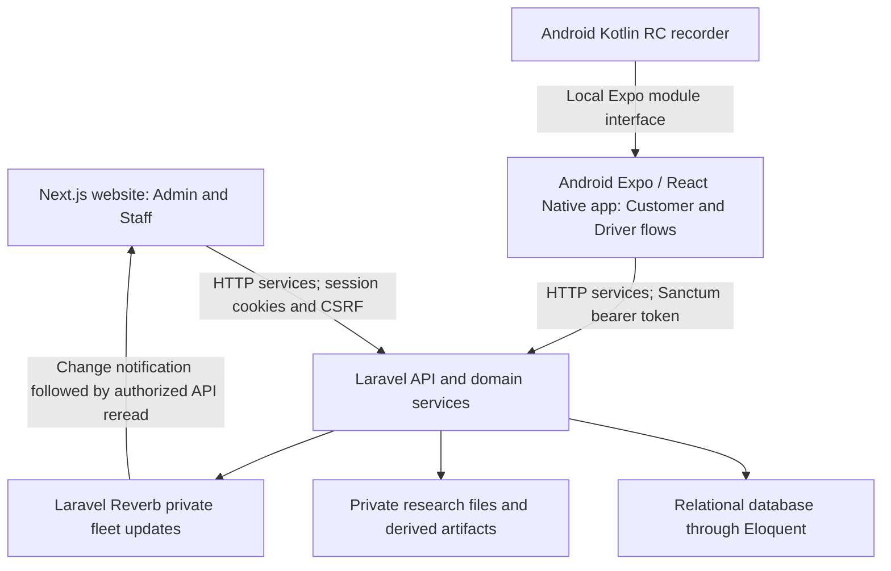

# System architecture and technologies

Source review: **2026-11-12**. This is the programmer's overview of the current
architecture, technologies used, and agreed future additions. It describes the
inspected checkout, not a verified production deployment. Versions below are
resolved versions in the repository lockfiles, not measurements of a running server
or installed phone build.

The [roadmap](project-status-and-roadmap.md) owns project status. The
[central telematics guide](telematics-master-plan.md) owns detailed RC workflows,
processing methods, contracts, experiments, evidence, and the AI delivery plan.

## Application architecture

JamJade has three independently managed applications in one repository. Both
frontends use Laravel as the shared API and business-rule authority. Each
application has its own dependencies and commands.

RC research uses owner-bound mobile collection and shared Admin web review. Its native
module and development/standalone Android builds extend the mobile codebase;
recording a research trial does not require a rental booking.

Rental setup is a separate server-owned flow: six device checks followed by
stationary and forward reference captures, then Staff release. The captures
use the same native Android sensor source as RC collection and submit bounded
summaries to Laravel. See the
[native calibration contract](telematics-master-plan.md#native-pre-release-calibration).

| Layer | Responsibility and implementation pattern | Source |
| --- | --- | --- |
| Laravel backend | Routes/middleware and authorization control entry; Form Requests validate input; services own domain workflows; Eloquent handles persistence; API Resources shape model responses. | [Routes](../backend/routes), [requests](../backend/app/Http/Requests), [services](../backend/app/Services), [resources](../backend/app/Http/Resources) |
| Web frontend | Next.js App Router composes management modules. Forms and Zod schemas provide client feedback; domain services use the shared HTTP client for Laravel requests. | [App routes](../web-frontend/src/app), [modules](../web-frontend/src/modules), [forms](../web-frontend/src/forms), [services](../web-frontend/src/services) |
| Management dashboard | Calendar-centered Next.js module reads the shared Laravel dashboard response. `ReportService` owns calendar/receipt metrics; `DashboardOverviewService` supplies permission-scoped daily operations, balances and fleet/maintenance summaries. | [Dashboard implementation and checks](web-ui-refinement.md#calendar-centered-dashboard--2026-11-11) |
| Mobile frontend | Expo Router composes Android screens; domain services isolate API calls and device behavior. The secure-storage abstraction persists authentication tokens. | [Routes](../mobile-frontend/app), [services](../mobile-frontend/services), [token storage](../mobile-frontend/services/http/auth-storage.ts) |
| Native RC recorder | A local Expo module bridges TypeScript to Kotlin. An Android foreground service and SensorManager collect original streams into encrypted local files. Explicit upload transfers them to Laravel. | [TypeScript adapter](../mobile-frontend/services/telematics/native-recorder.ts), [Kotlin implementation](../mobile-frontend/modules/rc-recorder/android/src/main/java/com/jamjade/rcrecorder) |

Vehicle image delivery — 2026-11-12: the public vehicle showcase, management
gallery, and 64 px management detail thumbnail use Next.js image optimization for
responsive, cached variants; uploaded originals remain intact. When the website is
opened through its public tunnel, the web client uses same-origin API/storage paths
and Next.js rewrites `/storage` to Laravel, so image URLs do not point at the
visitor's own loopback address. See [`CarShowcase`](../web-frontend/src/modules/marketing/CarShowcase.tsx),
[`VehicleImageGallery`](../web-frontend/src/modules/management/vehicles/components/VehicleImageGallery.tsx),
[`VehicleDetailsPage`](../web-frontend/src/modules/management/vehicles/VehicleDetailsPage.tsx),
[web URL resolution](../web-frontend/src/services/http/config.ts), and
[Next.js rewrites](../web-frontend/next.config.ts). Lint passed and Next.js
compiled the optimized build; the production build did not finish type-checking
because of existing errors in `FleetTrackerModule.tsx`. Browser/network timing
was not measured.

Backend validation and authorization remain authoritative even when a frontend
validates or hides a control. Web authentication uses Laravel's stateful
session/cookie/CSRF flow; mobile authentication uses Sanctum bearer tokens through
the existing secure storage abstraction. See the
[web HTTP client](../web-frontend/src/services/http/client.ts),
[mobile HTTP client](../mobile-frontend/services/http/client.ts), and
[backend middleware configuration](../backend/bootstrap/app.php).

New mobile Customer registration uses a separate pending-registration record and
Laravel's configured Gmail SMTP transport. A six-digit code expires after 15
minutes; only successful verification creates the Customer/profile and issues a
Sanctum token. Mobile retains pending metadata in memory and persists the verified
session through the existing secure-storage boundary. No new runtime dependency
or native configuration is introduced. Existing login and account-email changes
remain separate. See [registration contracts](user-roles-and-access.md#mobile-registration-email-verification).

Customer mobile password recovery uses a distinct Laravel-managed email-code
challenge and one-use reset token; it does not modify the registration challenge
or web sign-in. The mobile auth service owns these requests, and successful reset
revokes mobile sessions. See the [account guide](user-roles-and-access.md#mobile-registration-email-verification).

## Technologies currently used

Hosted-demo preparation — 2026-11-12: BerryPanel is the selected deployment
target, with `main` as source and `jamjadecarrental.tech` managed in Hostinger DNS.
The current Composer production lock requires PHP 8.4 despite the manifest's
broader PHP 8.3 constraint. Production RC access is now an explicit opt-in through
`TELEMATICS_HOSTED_RC_DEMO` plus the `rc_demo` profile. No additional server runtime
was introduced. See [deployment setup](deployment-berrypanel.md) and the
[central RC boundary](telematics-master-plan.md#hosted-rc-demo-deployment--2026-11-12).
Public deployment and Android acceptance remain pending.

| Area | Technologies and role | Version/source evidence |
| --- | --- | --- |
| Backend | PHP and Laravel; Eloquent ORM; Sanctum authentication; Reverb broadcasting. | PHP requirement `^8.3` in [composer.json](../backend/composer.json); Laravel **13.9.0**, Sanctum **4.3.2**, Reverb **1.12.0** in [composer.lock](../backend/composer.lock) |
| Database | Laravel database configuration and migrations. The example environment selects MySQL; the configuration fallback is SQLite. The deployed database engine/version is not established by this source review. | [Example configuration](../backend/.env.example), [database configuration](../backend/config/database.php), [migrations](../backend/database/migrations), [ERD](ERD.md) |
| Web application | Next.js **16.2.4**, React **19.2.4**, TypeScript **5.9.3**. | [Manifest](../web-frontend/package.json), [lockfile](../web-frontend/package-lock.json) |
| Web interface and forms | Tailwind CSS **4.3.0**, shadcn/ui primitives with Radix UI, React Hook Form **7.76.0**, Zod **4.4.3**, Recharts **3.8.1** for charts. | [Web dependencies](../web-frontend/package.json), [resolved versions](../web-frontend/package-lock.json), [UI primitives](../web-frontend/src/components/ui) |
| Web maps and fleet updates | Shared Google Maps JavaScript loader; Laravel Echo and the Pusher-compatible client connect to Reverb. Fleet updates invalidate data and trigger authorized rereads. | [Map loader](../web-frontend/src/lib/google-maps.ts), [fleet subscription](../web-frontend/src/services/fleet/fleet-realtime.ts) |
| Android application | Expo SDK **54.0.37**, React Native **0.81.5**, Expo Router **6.0.24**, TypeScript **5.9.3**, NativeWind **4.2.4**; React Hook Form and Zod for forms. | [Manifest](../mobile-frontend/package.json), [lockfile](../mobile-frontend/package-lock.json) |
| Device services | Expo SecureStore **15.0.8** for persisted auth tokens; Expo Location **19.0.8** and TaskManager for location flows; Expo Sensors **15.0.8** for existing sensor-related flows. Original RC v2 recording uses the custom Kotlin module. | [Mobile dependencies](../mobile-frontend/package.json), [telematics services](../mobile-frontend/services/telematics), [native recorder](../mobile-frontend/modules/rc-recorder) |
| Native recording protection | Android Keystore-backed AES-GCM encryption for local research storage. | [RecorderStore.kt](../mobile-frontend/modules/rc-recorder/android/src/main/java/com/jamjade/rcrecorder/RecorderStore.kt), [EncryptedFrames.kt](../mobile-frontend/modules/rc-recorder/android/src/main/java/com/jamjade/rcrecorder/EncryptedFrames.kt) |
| Current research processing | PHP services perform bounded server synchronization, filtering, and fixed vehicle-frame projection; TypeScript provides inspection/preview behavior. These are experimental signal-processing implementations. | [RcMotionProcessing.php](../backend/app/Services/RcMotionProcessing.php), [RcProcessingRunService.php](../backend/app/Services/RcProcessingRunService.php), [web research module](../web-frontend/src/modules/management/research) |
| Offline pilot preparation | Local Laravel commands create encrypted frozen interval exports and versioned development-only statistics (30 numeric features per selected interval). No Python dependency or trained model is added by this step. | [RcPilotDatasetExportService.php](../backend/app/Services/RcPilotDatasetExportService.php), [RcPilotFeatureService.php](../backend/app/Services/RcPilotFeatureService.php), [feature contract](telematics-master-plan.md#development-interval-features--2026-11-08) |
| Offline development training | A local Laravel command passes verified development features through memory to isolated Python **3.14.3** / scikit-learn **1.9.1**, NumPy **2.5.4** and SciPy **1.18.1**. Fixed majority/logistic/forest comparisons use whole-session validation; reports/candidates remain encrypted in Laravel private storage. | [Pinned dependencies](../backend/ml/requirements.txt), [trainer](../backend/ml/train_pilot.py), [Laravel orchestration](../backend/app/Services/RcPilotTrainingService.php), [model comparison contract/results](telematics-master-plan.md#first-development-model-comparison--2026-11-08) |
| Admin RC monitoring | Native synchronized/filter/vehicle-frame windows feed the unchanged forest through Laravel. The private PHP tree export preserves scikit-learn float32 splits and leaf voting, removing Python startup from each request. Encrypted queues retain delivery intent; the Admin view polls grouped events every two seconds. | [Native pipeline](../mobile-frontend/modules/rc-recorder/android/src/main/java/com/jamjade/rcrecorder/DriveMotionPipeline.kt), [runtime](../backend/app/Services/RcRuntimeForestService.php), [connected runtime contract/checks](telematics-master-plan.md#connected-admin-rc-monitoring--2026-11-10) |
| Admin Model Explorer | Local-only, owner-bound Admin view for comparing reviewed maneuvers using saved prepared signals. Saved contact review timing is stored separately from annotations and training data. | [Comparison service](../backend/app/Services/RcManeuverComparisonService.php), [implementation boundary](telematics-master-plan.md#reviewed-maneuver-comparison--2026-11-11) |
| Rental RC monitoring | Separate consented Customer/current-Driver native foreground collector reuses the tested feature pipeline and private forest. Feature segments belong to the existing released rental trip; Fleet details show trip-scoped events. The booked vehicle and RC sensor source remain distinct. | [Rental motion contract](telematics-master-plan.md#connected-rental-rc-motion-monitoring--2026-11-10) and [final driving reports](telematics-master-plan.md#final-driving-reports--2026-11-12). Physical rental acceptance and remount realignment remain pending. |
| Verification tools | Pest **4.7.0** and Pint for backend checks; ESLint and TypeScript for frontends; focused `.test.mjs` checks exist for selected frontend contracts/domain behavior. General frontend component-test foundations remain pending. | [Backend tooling](../backend/composer.json), [web scripts](../web-frontend/package.json), [mobile scripts](../mobile-frontend/package.json), root [verification rules](../AGENTS.md#testing-and-verification) |

## How the research implementation currently works

1. An authorized operator uses Collect to organize recording sessions and mount
   versions, complete the applicable bounded setup steps, and explicitly start/stop
   the native Android recorder.
2. Kotlin records original sensor streams locally with their timestamps. Encrypted
   originals and recovery metadata are retained on the device.
3. The operator explicitly uploads resumable chunks. Laravel validates ownership,
   the recording contract, and file integrity before marking a recording verified.
4. The web review follows **Check recording → Prepare signals → Label and review**.
   Bounded processing runs and revisioned interval annotations preserve their
   source/version information. Human review remains necessary.
5. Researcher-operated local commands freeze selected interval measurements into
   an encrypted package, then compute development-only interval statistics. Source
   hashes, session splits and metadata remain separate from numeric model inputs.
6. A local training command compares three fixed classifiers with one development
   research session held out at a time, then encrypts fitted candidates and the
   comparison report. It does not serve predictions to the website or phone.

This flow is implemented in code with experimental processing and limited physical
evidence. It does not establish approved training data or classifier accuracy. See
the central guide's [runtime boundary](telematics-master-plan.md#phase-2-pilot-implementation-current-runtime-boundary)
and [current baseline](telematics-master-plan.md#current-implementation-baseline)
for exact capabilities and outstanding checks.

## Agreed future additions

These are roadmap targets. A specific library, version, deployment layout, or model
is recorded as selected only when the implementation decision has actually been made.

| Planned addition | Intended approach | Current boundary and owning reference |
| --- | --- | --- |
| Reproducible training dataset | Reviewed annotations, explicit inclusion decisions and versioned processing/feature provenance. Local frozen-pilot export and development statistics are implemented. | General web dataset approval/export, validated preprocessing and live window parity remain pending; [dataset boundaries](telematics-master-plan.md#processing-dataset-inclusion-and-model-use-boundaries) |
| Offline model training and evaluation | Pinned local Python/scikit-learn whole-session comparison selects a 35-feature random forest. Reserved isolated-interval evaluation and experimental continuous replay are implemented. | Admin RC and first rental RC inference are connected; broader continuous validation remains pending; [comparison/results](telematics-master-plan.md#first-development-model-comparison--2026-11-08) |
| Private backend inference | Native 35-feature windows pass through Laravel to a private PHP export of the frozen forest. Owner-bound sessions retain encrypted, idempotent receipts and grouped events. | Rental motion is connected. Physical rental acceptance and dynamic realignment remain pending. See the [inference plan](telematics-master-plan.md#live-inference-reporting-and-scoring). |
| Driving-event alerts and reports | Authorized Reverb channels update Fleet Monitoring. A Laravel scheduled command stores the final grade, coverage and deduction breakdown after completed-rental sync and creates the main-inbox report notice. | [Report implementation](telematics-master-plan.md#final-driving-reports--2026-11-12). |

## Keeping the implementation record useful

For each completed change, update the owning domain guide with the purpose,
implemented behavior and data flow, technology/method and version where relevant,
source files/contracts, checks actually completed, and remaining limitations.
Update this overview when a technology or application responsibility changes;
update the roadmap when a phase changes status.

Keep experimental results dated and traceable. Promote planned work to implemented
only after checking the source, and record physical verification separately from
builds or automated tests. This documentation is the persistent project record for
programming, maintenance, and explaining the system during the capstone defense.

### Owner verification for management writes

Laravel issues and consumes one-time owner email codes at protected web write endpoints. `OwnerVerificationService` binds the actor, action, validated data and locked state, and commits consumption with the mutation. The web HTTP service opens a shared confirmation/code dialog when the server requires verification. Fee pricing uses one combined transaction; legacy pricing writes remain protected. See [roles and access](user-roles-and-access.md#owner-verification).

The shared Personnel form uses the role-scoped `/admin/personnel` endpoints: only the Owner can manage Admin accounts, Admins manage Staff and Drivers, and Staff can manage Drivers. Invitation issuance and acceptance are disabled. See [roles and access](user-roles-and-access.md#owner-and-admin-accounts).

Mobile profile address selection uses the server-side PSGC directory and a bounded
PHLPost postal-code snapshot; see [Roles and access: mobile profile address directory](user-roles-and-access.md#mobile-profile-address-directory--2026-11-13)
for source, validation, and coverage limits.

The Admin-only Activity Log combines allowlisted business activity records and selected
operational failures into a paginated, read-only Success/Failed view with actor,
module, action and search filters. Technical/address-directory issues, telematics and research are excluded. See [Activity Log](user-roles-and-access.md#activity-log).

Personnel photo updates use Laravel-authorized web endpoints and public storage. The Owner web profile uses Laravel session authentication, a database-backed emailed verification challenge for email changes, and the shared password rules. See `user-roles-and-access.md` for permissions and current verification limits.
