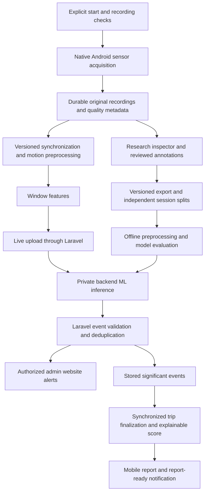

# Telematics and RC Research: central implementation guide

Last reconciled: **2026-11-04**. Scope: Laravel, the Next.js management website,
and the Android-only Expo application. The active workspace uses the native v2
recorder, explicit resumable chunk upload and protected v2
signal inspection, local stationary/forward-reference preparation with automatic
reference-interval suggestions, and bounded saved server synchronization/filtering/
vehicle-axis results, including experimental reuse of a reviewed forward reference
for a separate maneuver trial. Signals and Prepare data are separate; earlier standalone
diagnostic panels have been retired. Validated noise filtering, reusable accepted references,
accepted vehicle alignment and AI remain pending; compilation and
short recording tests do not establish general Redmi recording reliability.

## Authority and status

This is the active reference for telematics, RC research, calibration, collection,
fleet monitoring, and their AI roadmap. Read the applicable source files before
editing. Laravel Form Requests, Resources, services, migrations, and the installed
native adapter establish what the current application actually does.

Use these distinctions in code reviews, documentation, and defense claims:

- **Implemented:** present in the inspected code; not necessarily physically verified.
- **Agreed target:** selected in the planning discussion, but still requires implementation.
- **Experimental:** a setting or approach to select using development recordings.
- **Historical evidence:** an attributed result from an earlier check, not a fresh verification.
- **Pending:** no applicable completed verification is established.

The target design below replaces earlier planning exclusions of native research
recording, AI alerts, and a behavior score. It does not make those features exist,
remove authorization, or permit silently changing rental release rules. Preserve
existing data and implemented behavior unless the scoped implementation requires
a documented change. Do not request repeated approval for an already agreed
direction; clarify genuinely unresolved requirements before implementing them.

The [documentation index](README.md) covers other domains. The [project roadmap](project-status-and-roadmap.md)
provides project-wide status. [Archived guides](archive/telematics-2026-10-24/README.md)
are historical evidence only: do not use them as competing implementation instructions.
The external `telematics_blueprint.md` was a proposal reviewed during planning,
not an authoritative description of this codebase or a verified industry standard.

## Agreed scope and requirements

- Rental and booking management continue to represent real cars. RC experiments
  use an identified experimental profile, not unmarked real-customer telemetry.
- The panel suggested RC testing. RC results support claims about the tested RC
  setup only. Real cars need separate collection, calibration, training, and validation.
- User-reported equipment: MN-82S Supertourer; Redmi Note 8 Pro, Android 11
  `RP1A.200720.011`, MIUI 12.5.8; one operator and one sensing phone. A teammate
  observes and annotates controlled trials. These are reported setup facts, not
  independently verified hardware specifications.
- Use one rigid, repeatable mount initially. The user confirmed position A:
  screen upward, tilted above horizontal, with the phone's top toward the RC
  front. The earlier 10° estimate is uncertain; the current form does not ask for
  degrees and stores the angle as unmeasured. Measure the gravity reference and
  verify rigidity before derived vehicle-axis processing. Do not assume
  arbitrary-mount support.
- The user confirmed an adjustable phone holder with a rotating screw lock,
  fixed to the top of the RC. The Collect form uses **Adjustable screw** as the
  fixed mount-method label for this holder; actual rigidity still needs a
  physical check. Do not infer a specific holder brand or joint design.
- The RC has user-reported gradual throttle and steering, slight straight-line
  drift, a braking action before reverse, and some coasting from higher speed.
- Use **harsh**, not abrupt, in maneuver labels: harsh acceleration, harsh braking,
  harsh cornering, and swerving. Ordinary steering corrections and reversing
  belong in normal examples.
- During a drive, AI-based event alerts should reach the admin website. After a
  drive, provide an evaluated report and explainable behavior score, with a mobile
  report-ready notification. Actual phone push delivery is distinct from the
  currently implemented in-app notification feed.
- Collection must support screen lock/minimizing through a native Android recording
  service, retain measurements through network loss, and recover uploads. Force-stop,
  reboot, and runtime loss must not be described as uninterrupted collection.
- Direction handling must be automatic during operation. Observer direction labels
  are training/evaluation annotations, never a required live Forward/Reverse switch.
- Prioritize a reliable recorder and inspection UI before training. Retain original
  measurements so filtering and feature experiments can be repeated.
- Working-prototype target: October 31, 2026. Checking: October 26; mock defense:
  second week of November; defense: first week of December. Dates are user goals,
  not promises of accuracy or completed physical validation.

## Current implementation baseline

| Area | Inspected implementation | Outstanding boundary |
| --- | --- | --- |
| Mobile stack | Expo SDK 54 (`~54.0.37`), React Native 0.81.5, `expo-sensors ~15.0.8`, Android-only local `modules/rc-recorder` Kotlin module | New development build required for the native recorder; Expo Go cannot capture v2 |
| Builds | Generated Android project; development and standalone preview APK profiles | A successful build does not prove device reliability |
| Research capture | Collect uses native independent original streams, fixed MN-82S preset, encrypted persistent collection groups/defaults/numbering, automatic phone power metadata, requested 20 ms updates and explicit native Start/Stop | Actual sensor axes/rates, lock-screen continuity, interruption and power behavior require Redmi validation |
| Research storage and inspection | Encrypted local v2 originals, explicit chunk upload/retry and server verification; separate signal review and reference preparation; bounded saved server processing with run-specific references and explicit experimental reuse for maneuver trials | V1 list retired; no validated filter setting, reusable accepted alignment, background transfer queue, dataset export or annotation revisions; remote v2 deletion UI remains pending |
| Calibration | Six readiness checks and five supervised foreground exercises, summary-only evidence | Provisional settings; moving RC/reference accuracy not established |
| Released rental GPS | Explicit foreground/background latest-location sharing, consent, pause/resume, server eligibility | No continuous rental motion collector, offline recording queue, or route-history collection in this flow |
| Fleet website | Ongoing rentals, latest-location map, private Reverb invalidations and authorized rereads | No connected AI driving-event dashboard |
| Notifications | Customer/Driver in-app records, unread counts, booking activity | No implemented report-ready flow or remote phone push delivery |
| ML and score | Harsh-event enum values and data foundations | No trained model, training/inference pipeline, or behavior-score/report implementation found |

Existing enum values and old mock presentation components do not establish AI
functionality. Research `eligible_for_training` is a provisional quality/annotation
flag, not proof of correct axes, sound labels, independent splits, or model accuracy.

## Existing rental and handover boundaries

Keep these implemented business rules while extending research:

- Self Drive operator: owning Customer. With Assigned Driver operator: currently
  assigned Driver. Entry/navigation does not establish eligibility.
- Laravel determines eligibility, validation, authorization, and step outcomes.
  Mobile uses Sanctum bearer tokens; web management uses cookies/session/CSRF.
- Pre-release data belongs to `telematics_setup_sessions` and retryable
  `telematics_setup_steps`, not `booking_assignments`. Retain attempt history.
- Staff starts eligible handover (`setup_required -> in_progress`). The combined
  outgoing-inspection/handover action finalizes required signatures transactionally.
  Existing finalized inspections can continue without replacement.
- Setup mutations normally require a confirmed booking, server time inside
  `[rental_start_at, rental_end_at)`, the applicable operator, and in-progress
  handover; Self Drive also requires verified Customer documents. Reassignment
  requires fresh readiness for the new Driver.
- Standard release requires payment, inspection/signature, vehicle/operator, and
  all eleven effective setup/calibration requirements. Staff's authorized
  **Start Rental** is the only `ready_for_release -> released` action.
- A booking has at most one post-release trip. Pause/resume stays in that trip.
- Active default zones are copied into `booking_geofences` at release; all booking
  geometry and alert settings are then frozen. Zone configuration and containment
  never gate setup or release. See [geofence monitoring](geofence-monitoring.md).
- Local/testing `RENTAL_EARLY_START_TEST_MODE` permits same-start-date early
  preparation while preserving other gates. The broader
  `TELEMATICS_HANDOVER_TEST_MODE` has separate documented test exceptions in source,
  including Self Drive readiness relaxation with real mount evidence. Neither flag
  applies to production/staging, changes booked times, or fabricates passed checks.
  Do not enable either as a shortcut to collect research recordings.
- Research trials do not need customer bookings or rental release. Preserve their
  separate session/trial storage and access boundary.

Current entry points include `GET /api/mobile/telematics/rentals`,
`GET /api/mobile/telematics/setup`,
`GET /api/mobile/bookings/{booking}/telematics-setup`, and
`POST /api/mobile/bookings/{booking}/telematics-setup/steps/{step}/attempt`.
Use [routes](../backend/routes/api.php), [setup services](../backend/app/Services/TelematicsSetupService.php),
and the [booking lifecycle](booking-rental-lifecycle.md) for exact contracts.
Returned/Completed owning-booking setup reads can be read-only history; they do
not reopen mutation or collection eligibility.

## Existing calibration and sensor conventions

Readiness order: `device_check`, `motion_permission`, `location_permission`,
`background_location`, `gps_check`, `phone_mount`. These checks do not start
continuous recording. A fresh setup GPS fix is quality evidence, not route history.

Calibration order: stationary, forward, braking, left turn, right turn. Captures
are explicitly consented, supervised, foreground-only, and bounded. Cancel,
navigation, or backgrounding stops capture. Laravel receives bounded summaries,
not sample streams, and evaluates fresh context, order, consent, quality, and
profile. A local success animation cannot replace server acceptance.

Current geometry uses a gravity reference, horizontal acceleration projection,
a learned forward reference, and projected angular motion. It is not a custom
continuous Kalman/complementary/PCA fusion estimator or a speed/gear detector.
Current profiles retain the first qualifying Forward sample at 3 m/s², subject
to other quality gates. That single sample does not demonstrate sustained
direction consistency. Stationary is six seconds; other configured maximums and
RC overrides are in [configuration](../backend/config/telematics.php).
The active profile is standard revision 4 or local/testing RC revision 5;
profile/settings fingerprints bind attempts. These are operational demonstration
settings, **not learned harsh-event thresholds or training labels**.

Important existing adapter details, verified by source inspection:

- Current Expo linear acceleration is platform-processed, in m/s².
- Installed Android DeviceMotion exports `accelerationIncludingGravity` as
  raw accelerometer minus twice the native gravity value. Do not assume that
  field is identical to direct `SensorManager` accelerometer output.
- The application derives its current gravity vector from including-gravity
  minus linear acceleration. Reference signs therefore depend on that adapter.
- Expo exports rotation rate in degrees/second; direct Android gyroscope values
  use radians/second. `rotationAxes` maps Android alpha/beta/gamma to XYZ.
- Current research's `gravity_timestamp_s` identifies the including-gravity
  measurement timestamp, not an independently retained native gravity event.
- Screen orientation is not full three-dimensional attitude.

Preserve original source conventions and conversion versions. Physically check
signs/reference orientation before reusing geometry with native channels. Never
silently reinterpret old records or edit installed dependency sources to change
their meaning. Research reference capture should reuse suitable pure mathematics,
not customer setup attempts, release thresholds, or mutable released calibration.

Sources: [installed Android adapter](../mobile-frontend/node_modules/expo-sensors/android/src/main/java/expo/modules/sensors/modules/DeviceMotionModule.kt),
[calibration math](../mobile-frontend/lib/telematics/calibration.ts),
[foreground capture](../mobile-frontend/services/telematics/calibration-capture.ts),
[server evaluation](../backend/app/Services/TelematicsCalibrationService.php).

## Existing RC Research v1

### Access and lifecycle

An active Admin signs in through normal mobile login when the local/testing
`rc_demo` profile is active. The server issues an eight-hour research-only token;
ordinary Customer/Driver mobile access and web cookies cannot substitute for it.
Reads and mutations are owner-bound. The token cannot use ordinary mobile
features; revocation remains available after research access is disabled.

Current API:

- `GET /api/mobile/rc-research`
- `POST /api/mobile/rc-research/sessions`
- `POST /api/mobile/rc-research/sessions/{session}/trials`
- `GET /api/mobile/rc-research/trials`
- `DELETE /api/mobile/rc-research/trials/{trial}`

The current screen retains Data / Collect / Logout. **Collect now mounts the
local native v2 recorder described below.** The legacy Data screen can still read
v1 endpoints, but the old local development v1 records were removed at the user's
request on 2026-10-26. The retained v1 collector/forms are no longer mounted in
Collect; their foreground, memory-only, cancel-on-background behavior is historical.
V1 validation and APIs remain available; do not recreate retired dummy data as
part of normal setup.

### Implemented web inspection (2026-10-24)

This section records the **historical v1 implementation**. The Earlier trials
tab was retired from the active list on 2026-10-26; the old local data was removed
with a private encrypted recovery copy. Retained v1 routes/contracts below are
not the current collection or inspection entry point.

The Admin portal included **RC Research** at `/admin/research` and recording
review at `/admin/research/{trialId}`. Normal web sessions use separate read-only
`GET /admin/rc-research/trials` and `GET /admin/rc-research/trials/{trial}` endpoints.
Active Admin, local/testing `rc_demo`, and existing session ownership remain
required. A mobile research token cannot substitute for web authentication.
The list is paginated (maximum ten), searchable by session/surface/device, and
filterable by saved label certainty. Sample reads are private/no-store, bounded
by the existing v1 recording limit, and verify decryption plus the original hash.
Deleted/other-owner trials are not found; unavailable/unverifiable files fail
without returning measurements or private storage paths.

Review shows saved linear/including-gravity acceleration and rotation, shared
sensor-time plots, gaps over 250 ms, click/keyboard moment inspection, drag or
keyboard interval selection, zoom, and selected-point peak/RMS/mean statistics.
Each channel uses its saved timestamp with a common clock origin anchored to
the first accepted snapshot. Display times are rounded to microseconds; saved
measurements are unchanged. Reused channel timestamps collapse only in the
plot/statistics view. Recorder-elapsed annotation bounds map to the sensor
timeline for highlighting. These are v1 combined snapshots, not independent
native raw streams. Peak magnitude is a three-axis norm, not maneuver severity.

The saved observer label/interval/notes, setup metadata, requested versus actual
rate, provisional timing flags, and provenance are inspectable. Known synthetic
seeder records carry **Demo data**. Missing hardware fields stay **Not recorded**;
the agreed phone/RC profile is never backfilled into unrelated historical records.
Integrity and label certainty remain separate; the UI does not display the old
eligibility boolean as scientific training approval. No vehicle reference or
versioned cleaning exists for these v1 records, and the interface says so.

The historical v1 workspace does **not** implement annotation editing/revisions,
processed overlays, dataset export or AI. The separate native v2 view added
2026-10-26 is described below. Existing v1 immutable-file contracts remain.

Sources: [web workspace](../web-frontend/src/modules/management/research/ResearchModule.tsx),
[recording review](../web-frontend/src/modules/management/research/RecordingReviewModule.tsx),
[timing/statistics](../web-frontend/src/modules/management/research/recording-analysis.ts),
[web read controller](../backend/app/Http/Controllers/Web/Admin/RcResearchController.php),
[query request](../backend/app/Http/Requests/Research/ListRcResearchRecordingsRequest.php).

### Capture and storage contract

Protocol 1 requests a fixed 20 ms interval (nominal 50 Hz), minimum one second
and eight accepted snapshots, at most 10,000 snapshots and 4,000,000 JSON bytes.
Capacity exhaustion fails the recording; there is no automatic completion/save.
The three-second startup deadline and 200 ms warmup are stream-health checks.
They do not establish a stable 50 Hz independent native acquisition rate.

Each accepted snapshot retains relative callback time, three exported channel
timestamps, linear XYZ, including-gravity XYZ, rotation XYZ, and screen orientation.
Incomplete, nonfinite, nonadvancing, or sufficiently misaligned snapshots can
be skipped. This is not a lossless archive of independent sensor events.

Session context includes name, surface, slope, mount orientation, battery
condition, platform/app version, and consent. Legacy phone/RC/mount/configuration
fields are optional and absent from the current setup form. No extra load is
recorded (`added_load_g = 0`); this does not mean the phone/mount has zero mass.

Trial validation currently requires intended/observed movement and intensity,
certainty, quality, event bounds, capture times, and a bounded multipart
`samples_json` string. Laravel validates and recomputes summaries, then stores
samples in an immutable, encrypted private file. Database rows hold metadata
and summaries, not raw streams. API Resources do not expose sample paths/files.
Matching retries are idempotent; changed content or deleted IDs produce conflict.

Provisional flags: average rate below 8 Hz, gap over 250 ms, or sensor span below
85% of wall duration. Confirmed labels plus usable quality and no flags set the
current eligibility flag. Do not promote these provisional checks to scientific
acceptance limits without pilot evidence.

Saved records remain until explicit owner deletion. Deletion removes ciphertext,
notes, and summaries while retaining a minimal tombstone to prevent upload
resurrection. Failed file deletion remains visible/retryable. Protect the server
encryption key; deletion cannot promise erasure of external backups or exports.

Current movements are stationary, steady movement, acceleration, braking, left
turn, right turn, with normal/harsh or not-applicable intensity. Swerving,
direction annotations, comparison conditions, pending labels, and annotation
revisions need contract extensions. The retained v1 form initially copies intended
labels and selects the full recording interval; the target review must not
silently confirm those defaults as observed ground truth.

Sources: [protocol](../backend/app/Support/RcResearchProtocol.php),
[research service](../backend/app/Services/RcResearchService.php),
[session request](../backend/app/Http/Requests/Research/StoreRcResearchSessionRequest.php),
[trial request](../backend/app/Http/Requests/Research/StoreRcResearchTrialRequest.php),
[mobile recorder](../mobile-frontend/services/telematics/rc-research-capture.ts),
[mobile schemas](../mobile-frontend/validation/research/rc-research.ts),
[research screen](../mobile-frontend/screens/research/RcResearchScreen.tsx).

## Existing released GPS and mobile activity

The current released-rental collector is latest-location GPS only. It is separate
from research and calibration. Its foreground mode uses an app-wide watch;
explicit foreground/background mode uses the separate
`jamjade-rental-latest-location` native location task and visible service
notification. The setup readiness task remains inert. A location task is not a
continuous motion recorder.

Current API base: `/api/mobile/bookings/{bookingCode}/location-monitoring` with
GET state and POST `/start`, `/location`, `/pause`. Requests use the existing
mobile service and Form Requests. Start requires current accepted consent and
`sharing_mode = foreground | foreground_background`. Current consent version is
3; configuration defines a five-second upload interval, maximum 50 m accuracy,
60-second age, 10-second future skew, and 24-hour latest-point retention.

Laravel rechecks operator, ongoing/released rental, no physical receipt, valid
session, and point freshness/accuracy. Overdue ongoing rentals are not stopped
merely because their reserved return time passed. Starts reuse the one trip and
rotate an ephemeral collection token; only its hash is retained server-side.
The latest encrypted point is overwritten, not appended to route history.
Legacy trip/location endpoints are separate and cannot bypass the consented flow.
Accepted reliable latest fixes also drive frozen-zone evaluation and enabled
named in-app crossing alerts; see [geofence monitoring](geofence-monitoring.md).

Foreground mode stops when backgrounded; background mode is explicitly selected
with appropriate native permission. Current runtime consent/session state and
collection tokens are in memory. Stop, interruption, sign-out, runtime loss, and
cold tasks do not silently restart sharing. There is no persistent GPS route queue.
Receipt/expiry clears retained location and invalidates collection as implemented.

The shared mobile drawer has Full details, Device setup, and Activity. Explicit
setup agreement can prepare one GPS start after fresh server-confirmed release
while the same screen/runtime remains active. Saved consent preferences alone
do not start collection. Existing-trip resume uses an explicitly started local
Stationary check, valid for 60 seconds and consumed once; it does not update
released setup or upload raw motion. The map does not create another watcher.

Activity reuses account-owned notification records with optional booking filtering,
cursor pagination, unread counts, and existing read actions. Current GPS lifecycle
and enabled zone alerts create in-app records; no remote phone push is implemented.

Sources: [location service](../backend/app/Services/LocationMonitoringService.php),
[mobile API](../mobile-frontend/services/api/location-monitoring.service.ts),
[background collector](../mobile-frontend/services/telematics/background-location-collector.ts),
[mobile screen](../mobile-frontend/screens/telematics/TelematicsHandoverScreen.tsx),
[notification guide](mobile-notifications.md).

## Existing fleet monitoring

`GET /admin/fleet-tracker` uses stateful web authorization and `view fleet tracker`.
It lists ongoing rentals, including overdue and no-trip cases, with bounded
search/filter/pagination and tracking status. Its map receives authorized,
unexpired latest points; it is implemented, not an unavailable placeholder.
Statuses and stale points do not prove the phone is currently connected.

Current transport: latest-point transaction commits -> queued empty `fleet.changed`
notice -> private `fleet-monitoring` channel -> authorized HTTP reread -> map update.
Socket notices contain no GPS, samples, model, or rental payload. Authorization
uses `POST /admin/broadcasting/auth`, the web guard, and repeated permission checks.
Reads reconcile on notices/reconnect and periodically while visible. The native
collector does not depend on keeping a WebSocket open.

Reverb and its queue worker need reachable deployment configuration and running
processes; HTTPS sites need a reachable TLS WebSocket endpoint. The existing
Google Maps singleton remains the only loader. Reuse chart/table primitives and
installed Recharts for research; do not revive mock driving-log components as
real measurements or replace the JamJade visual identity.

Sources: [fleet service](../backend/app/Services/FleetTrackerService.php),
[publisher](../backend/app/Services/FleetMonitoringPublisher.php),
[event](../backend/app/Events/FleetMonitoringChanged.php),
[module](../web-frontend/src/modules/management/fleet-tracker/FleetTrackerModule.tsx),
[web subscription](../web-frontend/src/services/fleet/fleet-realtime.ts).

## Target pipeline

This section describes the **complete agreed target**. Native v2 acquisition,
explicit resumable upload, original-signal inspection, local reference preparation,
and bounded saved server processing runs
are implemented subsets. Automatic background transfer, full-recording processing/export,
validated noise filtering, reviewed annotation revisions,
ML, scores and reports remain pending.



### Native recording and protocol upgrade

Keep Expo/React Native screens and add an Android-only local Kotlin module/service.
The native service must own sensor capture, durable storage, processing/transmission
needed while locked, and lifecycle state; forwarding every measurement to screen
JavaScript does not establish reliable background collection. Use a visible
notification, explicit start/stop, appropriate service configuration, and measured
power handling. Validate on the Redmi before claiming lock-screen reliability.
Keep custom sources outside disposable generated-project edits; use module
manifests/config plugins as appropriate. Follow the installed SDK 54 documentation
and existing Android build/signing workflow; do not routinely clean generated
projects or uninstall the app and lose installed state.

Introduce a versioned capture contract; preserve readable v1 records with their
source and units. Capture original Android accelerometer and gyroscope events
with individual monotonic timestamps. Retain supporting gravity, linear acceleration,
rotation estimates, sensor accuracy/range, and availability where supported.
Do not fabricate unavailable channels or discard all source events because
another channel did not arrive simultaneously. Record omissions/rejections.

Store originals separately from derived datasets. The local implementation below
provides encrypted chunks, checksums, sequences and interrupted-file recovery.
Server acknowledgments and explicit upload retry/deduplication are now implemented.
Automatic background upload/resume remains pending. Recovery never silently
restarts collection.

### V2 acquisition contract and local implementation

Specified and implemented locally **2026-10-25** in `modules/rc-recorder`, with
phone setup/Start/Stop, per-channel diagnostics, saved-record inspection and
deletion. The development APK compiles; user-operated stationary foreground and
short screen-lock captures on the Redmi have been reviewed through saved summaries.
The second capture included a reported approximately 22 seconds locked while
charging. The third followed a requested 60-second unplugged/locked interval,
saved 69.9 seconds overall and showed charging No at the end. Neither showed a
long gap in the required-sensor summaries. Raw motion noise, physical axes,
longer-duration background continuity and interruption recovery remain unverified.
The upload/final-acknowledgment implementation below was added 2026-10-26.
V1 APIs and immutable historical files remain unchanged. Keep `RcResearchProtocol`
at version 1 for those endpoints. V2 has separate server validation, storage and
inspection; never send it to v1 `samples_json`.

Native adapter **1.1.0** adds the setup/group contract below. Its group APIs must
exist before the current Collect UI becomes available; older v2 development APKs
show an update requirement. Sensor event protocol/source/units remain version 2.
Existing files keep their original metadata, including any older angle/battery
entries; they are neither rewritten nor assigned guessed group IDs.

`GET /api/mobile/rc-research/native-access` is a private/no-store **access read**,
not sensor ingestion. Existing Admin, active-account, `rc_demo` and restricted-token
middleware still apply. It returns owner ID, remaining lifetime, effective token
expiry, protocol 2 and `upload_available = true`; no new token or broader ability
is issued. The local monotonic lease is capped at eight hours, token expiry and
global Sanctum expiry. The client conservatively subtracts request duration.
Starting or unlocking after process loss requires online access verification;
an already authorized recording can continue offline until lease expiry. Sign-out
revokes the local permit before cleanup. Delayed access/permission responses cannot
start capture after an account transition. Authorization is not persisted in files.

This increment records original Android API readings. It does not resample,
rotate, subtract gravity, filter, normalize, classify, score, or automatically
confirm labels during acquisition. Android itself may calibrate/fuse outputs;
"original" means before JamJade processing, not unprocessed sensor-chip counts.
Future derived artifacts retain the source recording ID/hash, processing version,
parameters, references and their own time-grid/missing-data policy.

#### Channels, units and coordinates

| Channel ID | Android sensor type | Values and units | Availability policy |
| --- | --- | --- | --- |
| `accelerometer` | `TYPE_ACCELEROMETER` (1) | Original XYZ, m/s²; includes gravity response | Required for a research capture |
| `gyroscope` | `TYPE_GYROSCOPE` (4) | Original XYZ angular rates, rad/s | Required for a research capture |
| `gravity` | `TYPE_GRAVITY` (9) | Android-estimated XYZ gravity, m/s² | Optional supporting stream |
| `linear_acceleration` | `TYPE_LINEAR_ACCELERATION` (10) | Android-estimated XYZ acceleration without gravity, m/s² | Optional supporting stream |
| `rotation_vector` | `TYPE_ROTATION_VECTOR` (11) | Preserve native values array and length; first components are unitless, an available heading-accuracy component is radians | Optional supporting stream; not vehicle heading |

Each channel is a separate event sequence. Request `sampling_period_us = 20000`
(50 Hz pilot) and `max_report_latency_us = 0`; preserve the actual registration
result and delivery timing. These are engineering requests, not a guaranteed
rate. Do not throttle away additional delivered events to manufacture 50 Hz.
Optional streams report `unavailable`, `registration_failed`, or `registered`
independently; after capture, a registered stream with no events is explicitly
`no_data`. Missing one optional event must not discard another channel's event.
Absent required sensors prevent Start with a clear reason; a required stream
failing during capture preserves the partial recording and flags the failure.

Use `coordinate_frame = android_device_natural` for all original motion vectors.
Android's axes follow the device's natural orientation, not display rotation.
Record natural orientation and screen rotation separately, including `unknown`
when not established. Do not infer vehicle forward from a portrait screen lock.
There is no v1 conversion on these originals: rad/s must not be displayed as
deg/s, and direct accelerometer values must not inherit Expo's gravity convention.
Physical sign/axis checks remain mandatory on the mounted Redmi.

#### Time and event records

Use each `SensorEvent.timestamp` and native receipt `elapsedRealtimeNanos()`.
They use the same monotonic clock domain. UTC is for display/correlation only;
phone clock adjustments and network arrival must not determine feature timing.
Store every absolute nanosecond integer as a **decimal string**, parsed as
Kotlin `Long`/PHP 64-bit integer and JavaScript `BigInt` where necessary. Subtract
the origin before converting a relative interval to floating-point milliseconds.
Validate integer range as well as string syntax; do not round originals through
a JavaScript `number` or use timestamp equality to join different sensors.

Each finite event has this logical shape; these are **synthetic format examples**,
not measurements or a collection instruction:

```json
{
  "sequence": 0,
  "sensor_timestamp_ns": "1234567890000",
  "received_elapsed_ns": "1234567990000",
  "accuracy": 3,
  "values": [0.02, -0.01, 9.80]
}
```

The enclosing stream declares channel ID, sensor type, units and value layout.
`sequence` starts at zero **per channel** and increments for every callback,
before validation/queuing. Copy the event's values immediately; Android can
reuse callback objects. XYZ streams have exactly three finite numbers. Rotation
vector streams preserve supported native component counts and declare the layout.
`accuracy` preserves the reported Android accuracy code; it is not ML confidence.

Preserve callback order and original finite readings even if timestamps repeat
or move backward; flag those anomalies for processing rather than silently sorting
or deleting them. Nonfinite/malformed values cannot be JSON numbers: reject that
row, record its channel/sequence/reason in capture diagnostics, and increment the
appropriate counter. Never replace it with zero. Known queue/write drops likewise
leave accounted sequence gaps. The application cannot know the exact number of
events a sensor/OS never delivered; do not label a gap-derived estimate as a
measured hardware loss count.

The manifest binds `started_elapsed_ns`, `ended_elapsed_ns`, an ISO-8601 UTC
start/end, and UTC/monotonic clock anchors with their measurement uncertainty.
Retain pre-start/batched or post-stop source timestamps with out-of-interval flags;
analysis chooses the active interval explicitly. Record wall-clock changes and
interruption boundaries without rewriting earlier samples. A restart/reboot
cannot append to the previous recording's clock domain or imply continuity.

#### Manifest and session context

The manifest has `protocol_version = 2`, `source = android_sensor_manager_v2`,
an immutable client-generated `recording_id` UUID and local `collection_session_id`
UUID. Server ownership/session mapping belongs to the authenticated ingestion
envelope; tokens, server file paths and account credentials never belong in files.
Store these distinct facts:

- **Purpose:** `maneuver_trial`, `stationary_reference`, or `forward_reference`.
  Reference recordings are original measurements too; capturing one does not
  automatically establish a usable calibration.
- **Device/app:** manufacturer/model, Android release/API, app/build and native
  adapter version. Avoid serials, IMEI, advertising IDs, contacts and location.
- **Sensor inventory:** channel availability, actual Android type/name/vendor/
  version, range/resolution, min/max delay and wake-up capability where reported;
  declared value layout/units and registration settings. Unknown fields remain
  null with a reason; do not substitute a guessed Redmi specification.
- **Fixed setup preset:** `mn82s_roof_v1` locks `MN-82S Supertourer`, tilted
  orientation, upper/roof location, screen up and phone top toward the RC front.
  The native validator supplies these values; client overrides are rejected.
  This is the selected experimental setup, not measured calibration. New angle
  and RC battery fields are null with `not_measured` provenance, never guessed
  10°/Full values. No RC battery telemetry is claimed.
- **Mount method:** the current Collect form displays **Adjustable screw** as
  read-only for the confirmed phone holder. The shared client schema requires
  this value for new groups and recordings, including when an older group's
  saved defaults mention another mount. The existing native 1.1.0 contract
  accepts and stores the supplied method as text; this UI/service restriction
  requires only a Metro reload, not a native rebuild. Historical group defaults
  and recordings are not rewritten.
- **Conditions:** actual surface, slope and recording purpose
  are editable per recording, initialized from the selected group's defaults.
  New group defaults must be entered once.
  Each recording stores its actual snapshot without changing prior recordings
  or the group's saved defaults.
- **Phone power:** read percentage using the reported level/scale, charging/full
  state and Battery Saver automatically. The setup view reads current state;
  recording manifests retain start/latest/end snapshots plus up to 256 observed
  changes and an omitted-change count. Changes are observed on the one-second
  native health tick, not exact system transition times. Unknown states remain
  null. Low percentage does not itself assign a quality failure; rate/gap evidence
  and interruptions remain separate. No battery-based sampling change is made.
- **Consent:** current research consent version 3 includes phone power diagnostics
  alongside motion, with capture scope and native start time;
  explicit start/stop and visible recording indication are required. Indoor RC
  research does not require GPS, camera, microphone or ordinary rental records.
- **References:** nullable `stationary_reference_id` and `forward_reference_id`.
  Missing references allow raw acquisition, while vehicle-axis derived output
  remains unavailable. Never claim alignment from stationary gravity alone.
- **Integrity and completeness:** finalized chunk descriptors, channel counts/
  timing diagnostics, capture end reason and an explicit interrupted state.
  Processing version and model version are absent until those artifacts exist.

Reuse a physical session/reference only while the mount remains valid. Sensor
timestamps are fresh for each recording. Keep intended maneuver, observer labels,
direction, event intervals, certainty and notes in separate annotation records.
Initial annotation state is `unlabeled`; saving never requires normal/harsh labels.
A synthetic fixture must explicitly identify itself as synthetic. No timing check
or intention copied from the setup form becomes observed ground truth.
`collection_session_id` still identifies the current entered physical context
within one native runtime (recording name/purpose excluded). It cannot detect an
unreported remount and does not validate references; reference links remain null.

#### Persistent collection groups and preset selection

`recording_group_id` is a separate, permanent UUID created for an owner-bound
collection group. Groups survive ordinary process restart and compatible APK
updates through the encrypted private `groups.rc2` index. The current library
allows create/select for up to 50 groups; rename/delete and server sync are not
implemented. Group names are required, trimmed, bounded to 100 characters and
case-insensitively unique within the local owner's library. The current client
generates names as `Surface - Slope - Group 01`, with no typing field. The preview
updates from selected conditions; purpose is excluded so reference captures and
maneuver trials can share a group. Before creation, the service reads the latest
catalog inside its serialized mutation queue and chooses the first unused number
for that surface/slope name, ignoring case. Long surface values are shortened to
keep the complete name within 100 characters. The existing native API still
validates and stores the final name; no native rebuild is needed. Names stay fixed
after creation, and existing groups/recordings are not renamed. Each group references
the fixed preset and stores default surface, slope, mount method and purpose.
Selecting it fills editable defaults; the current client always supplies the
confirmed screw-lock holder for new captures. Selection never starts sensors or
confirms labels.

The native actor allocates and durably commits a monotonically increasing
`recording_number` before creating each recording. Display names are generated
as `Group name · Recording 001`, `002`, etc. Failed starts can leave gaps; a number
is not a count of completed or valid trials. Each recording still has its own
immutable `recording_id` UUID and retains group ID/name/number in its context.
The most recently created or used group is remembered. Reference validity and independent
training/evaluation splits cannot be inferred from group membership alone.

The group index uses the same owner Keystore key and authenticated AtomicFile
replacement as manifests, with distinct AAD `$ownerHash/groups/$frameIndex`.
Group creation/numbering never writes plaintext files. Corrupt/unlockable indexes
fail rather than being silently overwritten. Sign-out/account boundaries are the
same as original recordings. Historical ungrouped files remain inspectable.

Quality metadata is **per channel**: received/persisted/rejected/known-drop
counts; first/last event times; observed rate; interval median/p95/maximum;
startup and trailing gaps; timestamp anomalies; receipt delay; and accuracy-code
changes. Rates/interval statistics are null when insufficient events exist, never
fabricated zeros. Preserve short/failed captures as diagnostic partial records;
do not discard them merely for failing v1's minimum length or label requirements.
An available stream with zero events is not valid stationary motion. Integrity,
signal quality, annotation review and dataset inclusion remain separate judgments.

#### File, recovery and upload boundary

Use a manifest plus channel-specific chunks; the local implementation embeds its
bounded rejection diagnostics and lifecycle journal in the encrypted manifest.
The **logical decrypted event format is UTF-8 NDJSON** (one event per
line). On-device files must be encrypted and private, excluded from Android backup
and public/media storage; do not leave plaintext NDJSON or JSON manifests on disk.
The implemented frame codec uses AES-256-GCM with a fresh generated 12-byte IV
and 16-byte tag per frame, up to 65,536 plaintext bytes. Files begin with `JJRC2\n`;
each frame has a four-byte big-endian ciphertext length, IV and ciphertext/tag.
AAD binds owner hash, recording ID, channel/chunk (or manifest) and frame index.
Append checkpoints flush and fsync; manifest replacements use Android AtomicFile
and contain encrypted frames only. A partial last frame cannot invalidate prior
authenticated frames. Full-frame authentication failure makes the recording
unavailable rather than silently accepting altered data. JVM tests cover codec
round-trip, truncation, tampering, cross-owner replay and allocation bounds.

Initial engineering chunk bounds are **1 MiB logical payload or 10 seconds,
whichever comes first**, independently per channel. A durable authenticated
checkpoint targets one second during active delivery; seal/flush
on Stop. These are implementation budgets to validate on the Redmi, not accuracy
thresholds or proof that zero samples can be lost. Recover only verified complete
frames/chunks after a crash, retain the interrupted status, and report any missing
tail. Never resume collection automatically. Native lifecycle/timing and Android
storage recovery still need process-kill and reboot testing on the Redmi. A
normal sealed record is not re-read/fully reverified by the local summary screen;
server acceptance must independently verify every chunk when implemented.
Recovered duration is a lower-bound span to the last verified receipt
(`end_time_source = last_verified_receipt`), with unknown actual stop/UTC end.

Current budgets are 64 MiB per recording, 256 MiB per account, 100 local records,
a 64 MiB device-free-space reserve and 32 KiB plaintext channel buffers. Disk
budgets are checked once per second and may be exceeded by in-flight checkpoints;
they stop acquisition with a reason and never trigger automatic deletion. Required
streams have experimental three-second startup and five-second stall deadlines.
These are safety/health budgets, not maneuver thresholds. Timing quantiles use
bounded one-millisecond bins, with overflow quantiles explicitly unavailable.

Each finalized chunk records recording/channel ID, zero-based chunk index,
sequence bounds, event count, logical byte length, sensor-time bounds and SHA-256
of the exact decrypted payload bytes. Do not parse/re-serialize before checking
that hash. Finalization binds the ordered descriptors in a versioned manifest
hash, avoiding a self-referential checksum field. Local encryption nonces/key
aliases are not research payload fields or server encryption instructions.

Upload finalized chunks over authenticated HTTPS through the existing mobile
service boundary. Server validation binds the owner, version, channel layout,
bounds and hash. Identical retries for a recording/channel/chunk are idempotent;
different content under the same identity conflicts. A final server acknowledgment
requires the complete expected chunk inventory and finalization checks. Otherwise
the record stays incomplete. Recalculate quality from accepted originals; a client
summary cannot declare a recording verified or fit for training. The implemented
native v2 HTTP boundary is described immediately below.

#### Implemented explicit upload and native web inspection (2026-10-26)

Native adapter **1.2.0** adds owner-authorized `exportManifest`, `exportChunk` and
`setTransfer` bridge methods. A compatible APK update preserves earlier 1.1.0
recordings and their original capture-adapter metadata. Only stopped/sealed or
verified-prefix recovered recordings can upload. Each chunk is decrypted in
bounded memory and authenticated against its descriptor's exact byte length/hash;
unexpected truncated tails are rejected. Original event payloads are never
reserialized. The exported manifest uses native canonical JSON; original files
are not rewritten and no plaintext export file is created.

Collect provides explicit **Upload recording**, retry/progress, and **Verify
uploaded copy**. The confirmation identifies motion/setup/phone diagnostics and
private Admin review. Transfers run sequentially through the existing mobile HTTP
service while this workflow is active; they are not an Android background uploader.
An encrypted, separate `transfer.rc2` sidecar persists transfer state/receipt without
changing the original manifest or its hash. An unreadable transfer receipt is
shown as retryable and cannot hide otherwise readable originals; missing-key
recordings retain their unavailable/deletion behavior. An interrupted `uploading` state is
retryable, not proof of completion; reopening does not automatically transmit.
Sign-out revisions block subsequent exports/requests/receipt updates, and the
transfer captures the original bearer token so an account change cannot redirect
old measurements into another account's upload. Local copies remain after success.

The restricted bearer-only mobile API is:

- `POST /api/mobile/rc-research/native-recordings` with exact `manifest_json`.
- `POST /api/mobile/rc-research/native-recordings/{id}/chunks` with channel,
  zero-based chunk index and exact NDJSON `payload`.
- `POST /api/mobile/rc-research/native-recordings/{id}/finalize`.

The manifest is limited to 1 MiB, 2,000 descriptors and 64 MiB logical payload.
Each chunk is at most 1 MiB / 10,000 events. These are transport bounds, not
maneuver-quality thresholds. PHP validates decimal-string nanoseconds within
signed 64-bit range, protocol/source/frame, channel types/units, layout lengths,
finite values, sequence order, consent, bounds and inventory hash. The original
payload newline is preserved by skipping string trimming only on these routes.
Exact manifest/chunk retries are idempotent; changed content conflicts. Account
locking serializes manifest creation; recording locking serializes chunk/finalize.
Finalization requires the complete inventory and re-verifies every encrypted
chunk before recomputing per-channel timing, anomalies, means, population standard
deviation and magnitude summaries. Finite repeated/backward sensor timestamps
remain original and are reported, not sorted or silently discarded.

Laravel stores encrypted originals on the private local disk under `rc-research-v2`.
`rc_native_recordings` and `rc_native_recording_chunks` contain bounded metadata,
hashes, file indexes and summaries, never sample rows. Server allocation is bounded
to 100 recordings / 256 MiB logical payload per owner, including incomplete uploads.
There is no automatic purge. Remote v2 deletion/retention-management UI remains
pending; **Delete local recording** removes only the phone copy and says that
complete or partial server copies are separate. Do not silently delete originals
or advertise the local action as server deletion.

The web reads retain session authentication, active Admin/`rc_demo` checks,
owner filtering, no-store headers and no private-path exposure:

- `GET /admin/rc-research/native-recordings` (maximum 10 records, literal search).
- `GET /admin/rc-research/native-recordings/{id}` (verified manifest/metadata).
- `GET /admin/rc-research/native-recordings/{id}/window` with channel/start/end.

The `/admin/research` view lists native uploads only. The **Earlier trials (v1)**
tab was removed on 2026-10-26. `/admin/research/native/{id}` uses the vehicle-detail
breadcrumb pattern: Recordings / actual recording name, with the recording date
at the right. The duplicate Recording review heading/description, Native v2 badge,
header status chips and Understand this recording heading were removed. File
integrity, capture and label state remain plain data in Data quality. Setup/source
and server-recomputed quality remain accessible. Technical explanations are
collapsed under Signal details and reference calculation/method sections; units,
errors, confirmation, short-rest/missing-settling warnings and one concise tilt
limitation remain visible where applicable. Sample reads are channel-specific windows of at most
30 seconds / 10,000 events. Excess density requires a narrower interval; no silent
training-data decimation occurs. Web times subtract the monotonic origin using
BigInt before converting relative milliseconds. Independent original channels
are plotted without joining or interpolation. Axis toggles and automatic native
chart scaling expose small stationary variation; gaps above 250 ms and non-forward
timestamps break lines. That is a visualization boundary, not a harsh threshold.
Rotation-vector components 4–5 remain preserved but only the first three are plotted.
Selected-window means/std/peak/RMS support inspection, not automatic calibration:
accelerometer means include gravity. No labels, alignment references, filtering,
training approval or AI predictions are assigned by this workflow.

#### Time synchronization preview (2026-10-26)

**UI superseded on 2026-11-04:** the separate panel was removed during the Signals cleanup. The mathematics and tests remain; use the saved combined result described below. The following records the earlier diagnostic behavior.

The original Accelerometer view offers **Preview synchronization**, independent
of the stationary/forward-reference confirmations. It adds two synchronized
**phone-axis** plots below original interval statistics. Existing raw plots,
reference fitting and fixed vehicle-axis plots still use their original independent
events. Synchronization does not silently replace those sources or combine the
stages into a finalized preprocessing pipeline.

`linear-grid-50hz-v1` is a bounded, unsaved browser diagnostic:

1. Use the recording's monotonic start as origin and generate 20 ms grid ticks
   within the loaded window (at most 30 s / 1,501 rows). Window boundaries do not
   reset grid phase. Source absolute nanoseconds and grid arithmetic use BigInt;
   only relative durations and interpolation ratios become numbers. Callback
   receipt time and wall-clock time are not synchronization inputs.
2. Validate both original three-component streams: at least two readings per
   channel inside the window, finite values/statistics, strictly increasing sensor
   times, safe nonnegative integer callback sequences and no sequence jumps.
   Refuse anomalies rather than sort, deduplicate or silently repair them.
3. At each grid tick, retain an **Original** value only for an exact nanosecond
   match. Otherwise use the immediately surrounding original events to calculate
   each axis linearly, `v = (1 - f)*v_before + f*v_after`, where `f` uses sensor
   time differences. Each channel is evaluated independently. A short source
   segment can support multiple grid ticks; those are interpolated values, not
   additional measurements. Zero exact matches is possible with offset clocks.
4. Allow interpolation only when the two source readings are at most **60 ms**
   apart, inclusive. This is an experimental three-nominal-period search budget,
   not a validated RC noise/quality criterion. A longer bracket is **Missing · long
   gap**. A tick before the first/after the last loaded reading is **Missing ·
   window edge**, with no extrapolation, forward fill or zero substitution. Only
   loaded events are used; no neighboring-window reads are made.
5. Preserve every grid row with per-channel state, source bracket timestamps and
   span, plus a paired-row count. A row is paired only when both values exist;
   that does not certify training suitability. Null values break chart lines.
   Counts distinguish exact, interpolated, internal-gap and edge-missing values.

Signals uses concise labels and short, local guidance; formulas remain in the
statistic info popovers, and method notes stay in expandable details. Units,
source states, required confirmations and interpretation limits remain visible
where needed. This copy cleanup does not change calculations or saved data.

Both new plots share the existing cursor/interval controls. Selected counts and
the nearest grid row show actual XYZ, units and source state; collapsed details
show source timestamps, spans, original counts and method settings.
Source timestamps are displayed as seconds since recording start (six decimal
places), with Before/After labels or one Exact time for a matched original reading.
Grid time uses the same recording-relative timeline. Original nanosecond values
and exact-match/interpolation calculations remain unchanged.
**Select whole window** changes only inspection selection. Hiding the preview, navigating or
changing channel/window does not save or apply anything. Invalid/missing sources
show an inline error; a valid sparse window can have zero paired rows and remains
inspectable without fabricated values.

50 Hz is an experimental inspection grid matching the requested nominal capture
rate, not a claim that hardware delivered exactly 50 Hz or the final ML rate.
Linear interpolation can change peaks between sampled times; it is neither a
vibration filter nor an anti-aliasing design. No alternate lower-rate export,
dynamic gravity correction, normalization, filtering, saved calibration, dataset
export, inference or training approval is introduced. Android linear acceleration,
gravity and quaternion channels are not interpolated by this feature. Future
live processing needs bounded buffering for the later bracketing event; no
zero-latency or live/offline parity has been established.

Sources: [synchronization helper](../web-frontend/src/modules/management/research/synchronization-preview.ts),
[linear interpolation definition](https://numpy.org/doc/stable/reference/generated/numpy.interp.html),
[Android sensor timestamp contract](https://developer.android.com/reference/android/hardware/SensorEvent#timestamp).
The NumPy reference defines the mathematical basis; no NumPy dependency or its
default edge-value extension is used in the browser implementation.

#### Vibration filter comparison preview (2026-10-26)

**UI superseded on 2026-11-04:** the separate panel was removed during the Signals cleanup. The mathematics and tests remain; use the saved combined result described below. The following records the earlier diagnostic behavior.

After opening synchronization, **Preview filter** adds a local before/after
comparison using that exact 50 Hz grid. It does not replace the synchronized
source plots, raw reference fitting or vehicle-axis preview. Both source channels
retain phone XYZ: acceleration includes gravity; gyro retains its resting offset.
There is no gravity removal, axis refitting or saved preprocessing output.

`butterworth2-causal-50hz-v1` implements one causal second-order Butterworth
low-pass section per axis and per channel. Experimental cutoff choices are
**3, 5 and 8 Hz**, with **5 Hz** as the initial comparison control value, not a
selected optimum or learned threshold. With `K = tan(pi*cutoff/50)` and
`N = 1/(1 + sqrt(2)*K + K²)`, coefficients are:

```
b = [K²*N, 2*K²*N, K²*N]
a = [1, 2*(K²-1)*N, (1-sqrt(2)*K+K²)*N]
y[n] = b0*x[n] + b1*x[n-1] + b2*x[n-2] - a1*y[n-1] - a2*y[n-2]
```

Initialization extends the first valid vector as both prior inputs and outputs,
so resting gravity/DC does not ramp from zero. Every missing vector resets only
that channel's history; no gap is filled or filtered across. The first **500 ms**
of each valid segment (25 rows) are warm-up: internal recursion runs, but plotted
After values remain null and comparisons exclude those rows. This exclusion is
an experimental budget, not proof that arbitrary transients have settled. Short
segments can have no post-warm-up output. The helper refuses partial/malformed
vectors, nonfinite/overflow output, unsupported cutoffs, unmatched channel grids,
more than 1,501 rows or grids not spaced at 20 ms with missing rows retained.

The overlay reuses `SignalTimeline`: **Before is dashed/translucent; After is
solid**, with paired tooltip labels and shared XYZ visibility, cursor and interval
controls. Selectors choose acceleration or gyro and the cutoff. Selected counts
separate compared, warm-up and missing rows. For each phone axis, the table shows
population standard deviation, largest absolute component and largest-peak time
difference, computed on identical post-warm-up rows for Before/After. Ties choose
the earliest peak; zero peaks have no time-difference result. This statistic may
compare different movements and is **not measured event latency**. Reduced
variation alone is not proof of removed noise or preserved driving events.

Filter state is computed over the entire loaded window before selecting summary
ranges; changing inspection selection does not restart it. Cutoff/window/source
changes recompute the window. The method uses no future samples, reverse pass,
zero-phase filtering, timestamp compensation, data normalization, event detection
or automatic acceptance. The overlay keeps original timestamps, so causal phase
effects remain visible. Synchronization still needs a later bracketing source
event; this local causal recurrence does not establish live end-to-end parity.
No downsampling is introduced, and this is not a completed anti-aliasing design.

Keep the setting provisional until multiple development runs demonstrate acceptable
movement preservation and delay. Do not pick the smoothest trace alone or tune
on held-out evaluation data. Rest/starting/stopping selections in Recording 025
are pilot comparisons, not a noise-ground-truth dataset or harsh-event thresholds.

Sources: [filter and comparison math](../web-frontend/src/modules/management/research/filter-preview.ts),
[Butterworth definition](https://docs.scipy.org/doc/scipy/reference/generated/scipy.signal.butter.html),
[steady-state initialization](https://docs.scipy.org/doc/scipy/reference/generated/scipy.signal.lfilter_zi.html),
[frequency-dependent filter delay](https://docs.scipy.org/doc/scipy/reference/generated/scipy.signal.group_delay.html).
SciPy documents the mathematical basis; no SciPy/runtime package was added to
the browser. Its routines are not invoked by the app.

#### Stationary-reference preview (2026-10-26)

For captures other than `forward_reference`, **Prepare data** now contains the
stationary-reference check and its original-acceleration chart. The earlier UI
placed **Stationary reference** beneath the selected-interval
statistics. The operator confirms that
the RC was stationary and the phone untouched throughout the selected interval,
then explicitly requests a preview. Changing the interval, channel or recording
clears that confirmation/result. No recording is automatically certified stationary.

`stationary-mean-v1` operates on the existing bounded original accelerometer and
gyroscope windows, separately on their original sensor timestamps. It uses
sample arithmetic means and population standard deviations, without filtering,
resampling or joining the streams. It displays:

- Mean resting acceleration XYZ, its magnitude, and its normalized **up** direction
  in Android phone axes. This includes accelerometer bias; one stationary position
  cannot separate that bias from gravity. This is not a vehicle-forward reference.
- Remaining gyro mean XYZ as a candidate resting offset, plus gyro variation.
- The angle between first- and second-half acceleration means as a descriptive
  consistency indicator; no angle or noise pass/fail threshold is assigned.
- Per-channel sample counts, observed spans, maximum gaps and leading/trailing
  gaps. Missing data remains missing; a computed preview does not approve coverage.

Five seconds is an initial **preview minimum**, not a learned stationarity or
harsh-event threshold. Empty/one-reading channels, nonfinite/malformed vectors,
repeated/backward sensor times, in-interval callback sequence gaps, invalid time
bounds and a zero-length acceleration mean cannot produce a preview. A large
delivery gap without a callback sequence loss remains visible in timing diagnostics;
it is not silently interpolated or automatically accepted as a usable calibration.

Results and the operator checkbox exist only in page memory. They do not submit
an annotation, save a reference ID, change source metadata, alter booking setup,
apply a correction, create a vehicle rotation matrix or authorize training.
Persisted references must be versioned and recomputed/validated by Laravel
from the authorized originals, not trusted from these browser values. The saved
combined-run workflow below now does this for run-specific forward references. Continuous
gravity estimation during RC motion remains separate work; do not subtract this
fixed resting mean throughout turns or changing pitch/roll and call it cleaned motion.

Sources: [preview mathematics](../web-frontend/src/modules/management/research/stationary-reference.ts),
[preview panel](../web-frontend/src/modules/management/research/components/StationaryReferencePreview.tsx),
[Android motion sensor conventions](https://developer.android.com/develop/sensors-and-location/sensors/sensors_motion).

#### Forward-reference preview (2026-10-26)

**UI updated on 2026-11-04:** reference selection now belongs to **Prepare data**. **Inspect** highlights a proposed range in its single original-acceleration chart. Manual assignment is under **Adjust intervals**. Confirming the procedure computes the same local candidate automatically; no separate preview button or vehicle-axis charts are needed before processing. The mathematical contract below is unchanged; older button names describe the previous UI.

For `forward_reference` captures, the accelerometer view instead shows **Forward
reference**. It proposes Resting, Starting and Stopping intervals automatically
when the loaded signals support candidates. **Show in chart** selects a proposed
interval and scrolls to the plots. Manual selection/assignment remains available
when suggestions are unavailable or need adjustment. All ranges must lie within
the currently loaded window (at most 30 s), be non-overlapping and ordered, and
last at least 0.5 s.
The 0.5 s minimum is a pilot preview budget, not a scientific validity threshold.
Short resting ranges below the 5 s collection guide remain inspectable with an
explicit short-pilot warning; this does not relax the separate stationary-preview
minimum or certify those ranges as calibration. No per-recording ranges are hardcoded.

The operator confirms stillness in the resting interval, a forward start and stop,
and a fixed phone. Small steering corrections while following a mostly straight
tile guide are allowed; zero steering input is not a requirement. These reports
describe the research procedure, not verified trajectories or automatic ground truth.

`reference-sections-v1` is an **experimental offline suggestion algorithm**, not a
trained classifier, stillness detector or live direction switch. It processes only
the loaded 2.5–30 s window, with no recording-specific ranges:

1. Validate both original channels and refuse sequence/timestamp anomalies,
   internal gaps above 125 ms, or window edge gaps above 250 ms. Group independent
   samples into 250 ms analysis bins; do not interpolate or replace the originals.
   Bins need at least 200 ms, three readings per channel and edge gaps no larger
   than 125 ms. At least eight usable bins are required; invalid bins break
   contiguous sections.
2. Compute per-bin acceleration vector variation and gyro vector RMS. For each,
   use the lowest 20% of bin values (at least two) to calculate median `m` and MAD.
   The quiet boundary is `max(1e-6, 1.5*m, m + 6*1.4826*MAD)`. The relative margin
   prevents nearly uniform low-tail noise from collapsing the boundary. Adjacent
   valid-bin acceleration means must differ by no more than three times the
   acceleration boundary. These are provisional search settings, not measured
   device specifications or harsh-event thresholds.
3. The first quiet run of at least 0.5 s supplies a provisional up/phone-top frame.
   Compute a forward-mean boundary of six times its projected population standard
   deviation, with a 1e-6 numerical floor. Look for positive then negative runs
   of at least 0.5 s. A bin must be non-quiet or exceed three times that boundary
   in magnitude, as well as exceeding the signed boundary. Choose the first
   positive run and last subsequent negative run. Separate start/stop candidates
   across a quiet run require manual review; a quiet cruise alone does not.
4. Suggest up to 5 s from the longest preceding quiet run, up to the first 1 s
   of starting and the last 1 s of stopping. Reuse the PCA preview's numeric and
   ordering checks; refuse a direction opposing the phone top or a non-opposing
   stop. A missing subsequent quiet run remains a visible review note, never an
   invented resting interval. The quiet-run check also requires forward mean
   within three times the search boundary.

Quiet IMU signals cannot distinguish a stationary RC from sufficiently steady
motion. Phone tilt, a reversed maneuver, handling, or sustained acceleration can
also confound these candidates. The operator still reviews the procedure and
confirms the three intervals; no interval is accepted automatically. Search uses
future samples and the current phone-top mounting assumption, so it is not the
future live event pipeline. Wider recordings, real cars and repeatability need
separate validation. Search diagnostics are available with the preview method.

`horizontal-pca-v1` uses original events independently per channel, with no
interpolation, smoothing, whitening or learned thresholds:

1. Normalize the resting accelerometer mean to estimate up in phone coordinates.
   Form a horizontal basis from the projected phone top and its right vector.
2. Center the Starting interval's horizontal projections and compute the leading
   eigenvector of its 2D covariance matrix. PCA estimates an unsigned axis;
   orient it toward the observed forward start's mean acceleration. The Stopping
   interval is not used to fit that axis.
3. Compare start/stop forward and right means and the angle between the start mean
   and the negated stopping mean. Project independent gyro events onto the fixed
   estimated up direction after subtracting the resting gyro mean; display RMS.
   This is a fixed-frame rotation diagnostic, not validated trajectory/yaw estimation.
4. Display the candidate matrix with rows **Right, Forward, Up**. It is a
   right-handed phone-XYZ-to-RFU rotation; swapping the first two rows changes
   handedness. Show variance share as a data descriptor, never ML confidence or
   an accuracy percentage.

Empty/malformed/nonfinite channels, numerical overflow, repeated/backward timestamps,
in-interval sequence gaps, a zero up vector, a vertical phone top, degenerate PCA
or an unresolved sign reject the preview. Numerical tolerances are 1e-9 for vector
normalization/sign, 1e-12 for covariance trace and a relative eigenvalue separation
of 1e-6; these are numerical guards, not measured RC noise specifications.
Delivery gaps remain unfilled and visible in per-phase timing diagnostics.
An opposing-phone-top estimate or a stop that does not oppose the start produces
review notes. Rotation, lateral means and consistency remain visible; there is
no automatic stillness, coverage, alignment or training pass.

Changing an assigned range or restoring the automatic suggestions clears the
confirmation/result. Merely inspecting or moving the timeline selection does not
change assigned ranges. Channel/window,
recording, retry or page changes discard the page-only references. Nothing is
submitted, saved, applied to originals or linked to mobile setup. Research labels
used to orient this preview must never become required live direction inputs.
The separate saved-run action below recomputes a run-specific reference and
filtered projection on Laravel; it does not save this browser candidate.
Dynamic pitch/roll gravity correction, reusable accepted references and physical
validation remain separate increments.

Sources: [forward mathematics](../web-frontend/src/modules/management/research/forward-reference.ts),
[automatic interval suggestions](../web-frontend/src/modules/management/research/reference-suggestions.ts),
[forward panel](../web-frontend/src/modules/management/research/components/ForwardReferencePreview.tsx),
[PCA definition](https://scikit-learn.org/stable/modules/decomposition.html#pca).

#### Vehicle-axis window preview (2026-10-26)

**UI superseded on 2026-11-04:** the separate panel was removed during the Signals cleanup. The mathematics and tests remain; use the saved combined result described below. The following records the earlier diagnostic behavior.

After a confirmed forward-reference preview succeeds, **Vehicle axes · preview**
plots all original acceleration and gyro events in the currently loaded window,
not only the three reference intervals. For Recording 025, that window covers
the entire 10.67 s capture. Longer recordings retain the bounded 30 s inspector
window; this feature does not load an unbounded trip or carry references into a
different window. It makes no additional requests or saved-reference assignments.

`fixed-vehicle-frame-v1` uses the candidate matrix with rows Right, Forward, Up:

- **Including gravity:** `R * a(t)`. Rotation preserves the original vector
  magnitude; the Up component retains resting gravity and sensor bias.
- **Relative to resting mean** (default): `R * (a(t) - mean(a_rest))`. This is a
  fixed resting baseline subtraction, not dynamic gravity removal or validated
  linear acceleration. Changing pitch/roll, mount position or slope remains
  visible as apparent acceleration; the preview states this limitation.
- **Rotation around vehicle axes:** `R * (gyro(t) - mean(gyro_rest))`, independently
  on original gyro timestamps, in rad/s. This is angular velocity, not a heading,
  trajectory or integrated angle. Up-axis RMS describes rotation about the fixed
  candidate up axis.

The chart's presentation slots are Forward, Right, Up, while matrix rows remain
RFU. Forward is positive toward the RC front; Right is positive toward its right;
Up is positive upward. Forward acceleration alone does not establish travel
direction or velocity. Original phone-axis plots remain visible and unchanged.
All plots share the interval/cursor controls; selections do not refit the candidate.
**Select whole window** resets the inspection selection without altering references.
Per-axis visibility, both acceleration views and selected interval means/population
standard deviations retain the inspector's existing controls and design.

The helper checks all source events in the loaded window, not only those in the
fitting intervals. Missing channels, malformed/nonfinite values, timestamp/sequence
anomalies and arithmetic overflow refuse the derived preview while original plots
remain inspectable. It also rejects non-orthonormal or left-handed matrices rather
than repairing them (1e-6 numeric tolerance, not a measured accuracy threshold).
Unfilled time gaps above 250 ms remain line breaks, with original counts and
leading/trailing/largest-gap diagnostics. Channels are not synchronized,
interpolated, smoothed, resampled or assigned training labels.

Reassigning a reference, restoring suggestions, unchecking confirmation, or
changing the channel/window discards these local plots with the candidate. Page
reload loses them. The preview neither saves a matrix nor alters recording files,
mobile setup, rental release or accepted alignment. The separate saved-run action
below combines synchronization/filtering/projection with a server-owned
run-specific reference. Reusable accepted references, dynamic orientation/gravity
estimation and validated filter selection remain separate work.

Sources: [projection and interval statistics](../web-frontend/src/modules/management/research/vehicle-axis-preview.ts),
[shared timeline](../web-frontend/src/modules/management/research/components/SignalTimeline.tsx).

Keep capture (`preparing`, `recording`, `stopping`, `stopped`, `interrupted`,
`failed`), transfer (`local_only`, `queued`, `uploading`, `uploaded`,
`upload_failed`) and annotation (`unlabeled`, `reviewed`, `uncertain`) separate.
Losing connectivity does not end capture. Queue/disk exhaustion must stop safely,
preserve the verified prefix and expose the reason; never silently discard the
whole trial or report it complete. A notification Stop must work without screen
JavaScript. Force-stop, process death and reboot are interruptions, not guaranteed
continuous recording. App reopening lists recoverable drafts without starting sensors.

Research files remain tied to the account that captured them. Sign-out stops
capture and locks pending transfers; another account cannot inspect/upload them.
The local retention policy is explicit owner deletion, without automatic purge.
Uploaded originals are separately retained under the bounded server allocation
above; remote deletion management remains pending.
Files live under app-private `noBackupFilesDir/rc-research-v2`, excluded from
Android backup, with one non-exportable Android Keystore key per owner. Keys are
not biometric-bound so the explicitly started service can write while locked.
Sign-out retains encrypted files/keys but stops and locks access; returning as the
same authorized owner can inspect/recover them. Another owner cannot read them.
Owner IDs assume this app's configured backend account namespace; switching to a
different database with reused IDs needs explicit namespace isolation first.
Uninstall/app-data clearing or lost/invalidated keys makes local-only originals
unrecoverable. A missing key is never silently replaced while files remain; the
UI lists unavailable records and permits explicit deletion. Account removal has
no new local purge integration; access still requires fresh server authorization.

#### Saved combined processing runs (2026-11-04)

The recording inspector separates **Signals**, **Prepare data**, **Data quality**
and **Setup & source**. For a forward-reference capture, Signals automatically
opens the latest saved result; no result is created or accepted automatically.
It shows one filtered chart (Forward acceleration initially, Up-axis rotation
when switching sensors), a compact mean/absolute-peak table, and relevant
experimental/short-reference warnings. **Compare before / after** adds the
synchronized pre-filter series on demand. **Review interval** selects Whole
window, Resting, Starting or Stopping; drag selection is still supported, with
keyboard/touch sliders in Technical details. Saved-run selection appears only
when there is more than one result; pagination appears only when needed.
Original channels are accessible through **Original readings**, one sensor chart
at a time, with interval statistics/timing collapsed. The duplicate top-level
largest-gap metric was removed; it remains in Data quality.

**Prepare data** owns the bounded source window, automatically suggested reference
intervals, one original-acceleration chart, **Inspect**, collapsed **Adjust intervals**,
the operator confirmation, cutoff selection and **Process & save run**. Confirmation
computes the local solvability preview automatically; algorithm/PCA/matrix details
are collapsed under Reference diagnostics. Saving returns to Signals and opens
the server result. Changing assigned ranges resets confirmation. Stationary/other
captures retain their unsaved stationary check under Prepare data. The separate
browser synchronization, filter comparison and raw vehicle-projection panels were
removed; pure helpers/tests and the combined server pipeline remain intact.
No originals, saved runs, API contracts, processing mathematics or annotations
were changed by this UI reorganization. Recording/route changes still discard
unsaved page state.

`rc-sync-filter-fixed-frame-v1` is a bounded offline pilot, not accepted calibration,
training approval, dynamic orientation correction or live inference:

1. Laravel reads the authenticated owner's verified v2 recording and verifies the
   encrypted manifest and relevant original chunks. Self-fitting uses `forward_reference`
   recordings and a window of at most 30 seconds. Separate `maneuver_trial` windows
   can use a saved reference through the reuse contract below.
2. Resting, Starting and Stopping intervals must be ordered, nonoverlapping and
   at least 500 ms within that window. Each channel needs at least two readings
   per reference interval. The full loaded channel refuses duplicate/backward
   timestamps, sequence discontinuities or invalid components; it never sorts,
   repairs or silently drops them. Numerical solvability does not certify quality.
3. The server recomputes `horizontal-pca-v1` **from independent original channels**.
   It saves the RFU matrix, original resting acceleration/gyro means, PCA
   diagnostics and warnings. Browser matrices/results are never trusted or stored
   as authority. Self-fitted references belong to that run/window; explicit reuse
   links a separate research run to its source. Neither changes rental setup.
4. It performs `linear-grid-50hz-v1` interpolation, then
   `butterworth2-causal-50hz-v1`, then fixed RFU projection. Constants remain
   20 ms origin-anchored grid, 60 ms maximum interpolation bracket and 500 ms
   excluded warm-up per valid segment/channel. No extrapolation or future-looking
   reverse filter pass is used. Each missing channel restarts independently.
5. The **Before** series is synchronized data projected with the same fixed frame
   and resting offsets. **After** filters phone XYZ and then projects/subtracts
   the original resting means. Both chart slots are Forward/Right/Up; matrix rows
   remain Right/Forward/Up. Gaps and warm-up remain null. Comparisons use only
   matching post-warm-up rows. Fixed rest subtraction does not track changing gravity.

`StoreRcProcessingRunRequest` and `src/validations/research/processing-run.ts` own
the create contract: window bounds, `cutoff_hz`, affirmative `confirmed`, and
three exact two-element `ranges` for self-fitting, or `reference_run_id` plus
affirmative `same_mount_confirmed` for reuse (target ranges prohibited).
Recording eligibility, ownership, integrity,
duration containment and axis solvability remain server checks. The website
uses its existing stateful cookie/CSRF HTTP service; mobile contracts are unchanged.
GET/POST `/admin/rc-research/native-recordings/{recording}/processing-runs` and
GET `.../processing-runs/{run}` retain active Admin/research-enabled and owner
boundaries, return private/no-store responses, and bind a run to its recording.
Creation is additionally throttled to 10 requests/minute. History is paginated
at a maximum of 10; list responses contain metadata, never sample arrays.

`rc_processing_runs` stores only identity/version/cutoff, an optional restricted
foreign key to its source reference run, configuration fingerprint,
private payload path/hash and creation time. The complete result (config,
reference, coefficients/policies, original manifest/inventory hashes, row
provenance/source timestamps and before/after arrays) is encrypted through the
existing Laravel application encryption boundary in dedicated private v2 files.
No source or derived high-volume samples go into database rows, public assets,
ordinary recording-list responses or logs. There are at most 1,501 grid rows,
a 4 MiB plaintext result budget and 100 runs per recording. File hashes are
verified on reads/retries; failed database saves clean up the new file.

The server-generated SHA-256 fingerprint binds source identity/hashes, pipeline
version and normalized parameters/intervals. Identical retries reuse the same
immutable result; changing a cutoff or interval creates a different run.
Algorithm/constants changes must bump the pipeline version. Existing artifacts
remain readable without recomputation under newer code. Remote deletion,
processing retention cleanup, full-trip streaming state, live/offline feature
parity and training export are still pending. Rollback removes only the new
metadata table; private run files require a separate deliberate retention policy.

Sources: [server mathematics](../backend/app/Services/RcMotionProcessing.php),
[run storage](../backend/app/Services/RcProcessingRunService.php),
[Admin workflow](../web-frontend/src/modules/management/research/components/ProcessingRuns.tsx).

#### Experimental forward-reference reuse

`rc-reused-fixed-frame-v1` processes a separate uploaded, verified
`maneuver_trial` using the axes and original resting acceleration/gyro offsets
from an original `rc-sync-filter-fixed-frame-v1` forward-reference run. It never
fits PCA from the maneuver. The target retains its own original clock, window,
channel values and hashes. Source Resting/Starting/Stopping ranges are provenance
on the source timeline, never target intervals, labels or runtime direction inputs.
The original self-fitting version and fingerprints are unchanged.

In **Prepare data**, choose a saved reference, review it through its recording
link, confirm the same physical phone/RC/mount was used without moving or
remounting the phone, choose the experimental cutoff and Process & save run.
Success opens Signals, with one reference link. Only Whole window/custom
selection is offered for a maneuver; reference phases are collapsed technical data.
No Android update is needed for this website/backend increment.

GET `.../native-recordings/{recording}/reference-runs` returns at most ten
owner-bound metadata choices per page, with compatibility and an unavailable
reason. Reuse requires a different completed forward recording captured before
the target, the same saved group UUID, complete matching phone/sensor conventions,
RC/mount/preset and surface/slope metadata. Sensor details include the vendor,
version, units/layout/range/resolution and requested acquisition settings. A new
app collection session is allowed; its changing session ID is not a device ID.
Matching models and metadata cannot prove physical identity or mount rigidity;
the operator confirmation remains necessary. Remounting requires a new reference.

A source resting range of **at least five seconds** is a conservative pilot entry
rule, not a validated calibration-quality or accuracy threshold. Shorter existing
runs remain readable but cannot be reused. Recovered/incomplete sources and
references already borrowed from another run are ineligible. This increment does
not introduce accepted calibration status, an automatic calibration-validity
monitor, dynamic gravity removal, training labels or learned harsh thresholds.

At submission Laravel revalidates compatibility, verifies the saved source
artifact and reopens/hash-verifies original source chunks. It recomputes the
source axes/offsets using its original configuration and requires them to match
the saved version. Client matrices are ignored. The encrypted target result
records the source run/version/fingerprint/payload and original hashes, source
window/ranges, setup fingerprint and confirmation. Its own fingerprint includes
that origin snapshot; identical retries are idempotent. The source foreign key
restricts deletion. Existing window/filter/gap/warm-up policies remain unchanged;
full-recording/live continuity, retention/export and physical validation remain
pending. Reusing a frame assumes unchanged orientation and resting offsets;
changes in tilt or gyro bias can invalidate that assumption during a trial.

#### Required evidence before moving to formal trials

First implement/test serialization, channel metadata and timing using **synthetic**
fixtures. Then verify on the actual Redmi: sensor inventory, stationary source
signs, requested versus delivered rate per channel, screen-lock/minimize continuity,
Stop from the notification, offline save/retry, interrupted-file recovery, owner
isolation and storage-limit failure. A stationary test can establish acquisition
integrity; it cannot establish forward direction, moving-vibration filtering,
harsh thresholds or classifier accuracy. Processing/alignment trials follow.

Platform basis: [Android SensorEvent fields and units](https://developer.android.com/reference/android/hardware/SensorEvent),
[Android sensor coordinates, rates and background restrictions](https://developer.android.com/develop/sensors-and-location/sensors/sensors_overview),
[Android cryptography guidance](https://developer.android.com/privacy-and-security/cryptography).
The non-exported Android service declares `specialUse` and its subtype; it is RC
research, not a fitness activity. Android 13+ notification permission is required
before Start. It holds a bounded partial wake lock, supplies a native Stop action,
uses `START_NOT_STICKY`, and has no boot receiver. Removing the task stops capture.
Service starts are bound to one-use native reservations, and old service callbacks
cannot stop a replacement instance. Start has a ten-second service watchdog.
Disabling notifications stops capture on the next native health tick.
Process death/force-stop/reboot interrupt it. Google Play special-use review is a
separate distribution gate, not approval established by this local build. Modern
platform rules were checked against official Android documentation. The SDK 54
documentation URLs redirected to latest, so implementation used the official
[Expo sdk-54 module API source](https://github.com/expo/expo/blob/sdk-54/docs/pages/modules/module-api.mdx)
and installed SDK 54 sources. No new runtime dependency was introduced.

Sources: [native module/service/store](../mobile-frontend/modules/rc-recorder/android/src/main/java/com/jamjade/rcrecorder/),
[native facade](../mobile-frontend/services/telematics/native-recorder.ts),
[phone controls](../mobile-frontend/screens/research/RcNativeCollectionPanel.tsx),
[local form schema](../mobile-frontend/validation/research/native-recorder.ts),
[collection groups](../mobile-frontend/modules/rc-recorder/android/src/main/java/com/jamjade/rcrecorder/CollectionGroups.kt),
[phone power](../mobile-frontend/modules/rc-recorder/android/src/main/java/com/jamjade/rcrecorder/PhonePower.kt),
[access Resource](../backend/app/Http/Resources/RcResearchNativeAccessResource.php).

### Collection and inspection UI

Keep the mobile Data / Collect navigation and shared controls. Target Collect:
hardware/session profile -> sensor/recording checks -> research reference capture ->
manual Start/Stop -> durable local save/upload -> quality and waveform review ->
annotation review. Saving an unlabeled recording must not require a confirmed
normal/harsh label. Preserve observer trial notes from the first pilot.

Extend the implemented v1 Admin inspector toward these target capabilities:

- Session/trial browser, recording/upload/processing states, and quality summary.
- Timestamped acceleration/rotation plots, axis toggles, zoom, and visible gaps.
- Original-versus-processed overlays with processing version/settings.
- Event-interval selection on the timeline and observed labels/uncertainty/notes.
- Reviewed annotation revisions and separation of integrity, label review, and
  dataset inclusion states. Never overwrite the original recording.
- Versioned export with samples, annotation revisions, exclusions, grouping/split
  assignments, units, processing/feature definitions, and checksums.

Use bounded/windowed sample reads and visualization downsampling where necessary;
do not send an unbounded dataset through list APIs or use visual decimation as
the training data. Any live observer markers must map to the recording's time
reference, remain annotations, and never become runtime classifier inputs.

The mobile bearer-only research endpoints deliberately reject web sessions.
The separate web reads use normal web sessions and explicit Admin access,
reusing domain services. Future web mutations must retain CSRF protection.
An internet-accessible demo needs an explicitly enabled
research deployment boundary; do not make `APP_ENV=local` the public access plan.
Keep research streams separate from rental setup evidence, customer records,
location history, and ordinary significant-event lists.

### Preprocessing and sampling

Process original recordings reproducibly: inspect integrity -> establish explicit
gravity/mount references -> align channels with bounded interpolation -> reduce
noise without erasing genuine maneuvers -> rotate into vehicle axes -> generate
windows/features. The current pilot fits its fixed reference from original
channels before applying synchronization/filtering to the window. Specify exact
units, axes, timing, warmup, filter behavior, missing-data policy, and versions.
Use filtering appropriate to live operation; offline future-looking processing
must not create a falsely favorable live-inference evaluation. Apply appropriate
anti-alias filtering when reducing sampling frequency.

Requested **50 Hz** is the initial pilot acquisition setting, not an RC or fleet
standard, guaranteed delivered rate, or proven optimum. Compare properly filtered
10 Hz and 20 Hz representations on development recordings. Select the lowest
rate meeting measured requirements; test actual lower-rate acquisition separately
for battery effects. Hz is neither acceleration range nor API/alert frequency.
Do not assume an RC necessarily needs higher rates merely because it is smaller.

Measure per-channel timing, gaps, coverage, clipping, and stationary stability.
Do not fill long gaps with zero, smooth away large values because they look harsh,
normalize each trip so its intensity disappears, or use callback/network arrival
as sensor time. Python and live Kotlin feature implementations must agree on
reference recordings within specified tolerances before deploying a model.

### Maneuvers, reversing, and dataset evaluation

Proposed primary targets: normal motion, harsh acceleration, harsh braking,
harsh cornering, and swerving. Left/right can remain observation attributes;
preserve existing left/right records. Missing or unusable data is not normal.
Define annotation and event-overlap policies before formal collection; isolate
pilot/tuning sessions from final evaluation. Start with isolated maneuvers, then
evaluate mixed maneuvers and deduplication rather than assuming support.

Include normal starts/stops/turns, drift corrections, normal reversing, reverse
turns/stops, direction transitions, bumps, surface vibration, and disturbed-mount
cases. Give confounders explicit quality/observation metadata rather than forcing
them into harsh classes. Phone handling is not evidence of harsh driving.

Reversing must be automatic in operation. Acceleration sign alone cannot distinguish
forward braking from reverse acceleration, or infer constant-velocity direction.
Evaluate temporal context/direction estimation; annotations available only during
research cannot be live model features. Do not promise reliable automatic direction
from phone-only indoor measurements without evidence. Keep ambiguous decisions
explicit and do not turn them into confirmed harsh-braking alerts or unjustified
score deductions. Normal reversing false alerts are an acceptance criterion.

Define repeatable controlled procedures; teammate labels describe actual observed
movement and uncertainty, not merely the intended instruction. Detector thresholds
and model predictions cannot supply their own ground truth. Label event intervals,
not entire recordings as harsh when only a short maneuver occurred.

Start offline with version-pinned Python tools, a simple baseline, and a candidate
Random Forest. More complex models are optional comparisons. Fifty or one hundred
trips do not guarantee accuracy. Keep entire sessions and related windows/augmented
copies together; fit learned transforms on training data only. Reserve final
evaluation from sampling/filter/feature/threshold/model selection.

Report per-class precision/recall/F1, macro-F1, confusion matrix, session/trial counts,
uncertain/excluded data, false alerts on normal/reverse/confounding cases, recording
completeness, and full motion-to-website delay. For continuous detection, measure
event-level matching and duplicates, not just isolated-window accuracy. One
operator/phone supports conclusions about that setup, not unseen drivers/devices.

### Live inference, reporting, and scoring

Initially send features for every valid analysis window through Laravel to a
private backend inference component; a hard threshold gate must not silently
remove examples the ML model is supposed to assess. Retain enough raw research
data to reproduce feature results. No 50-requests-per-second requirement is implied.

Laravel owns validated model/version association, quality/rejection handling,
event identity, occurrence versus receipt times, and aggregation of overlapping
predictions into one maneuver. Client-supplied event names or confidence alone
are not verified AI results. Do not bolt this onto a legacy endpoint that bypasses
current consent/ownership or rejects the current latest-only trip flow.

Reuse authorized Reverb infrastructure for website updates. Backend inference
requires connectivity: record locally while offline, show disconnected status,
and label recovered events delayed with original times. A short measured delay
is the aim; no zero-latency claim. Public HTTPS API and TLS socket reachability
must be tested across Wi-Fi/mobile data; sharing Wi-Fi alone does not prove reachability.

Trip finalization must reconcile outstanding uploads and late events before a
report is final. Distinguish completed and incomplete recording coverage. Existing
ended-trip guards do not automatically support delayed motion ingestion; design
the finalization state and authorization explicitly without reopening rental actions.

The score is an agreed project-defined RC behavior index, not accident probability,
liability, a financial penalty, or proof that a driver is safe. Select transparent
weights, intensity/duration/exposure treatment, and duplicate rules using development
data; freeze them before final evaluation. Model confidence is not event severity.
Do not base indoor RC scoring on unvalidated GPS distance. Explain contributing
events and withhold/qualify scores when coverage is inadequate.

Reuse mobile in-app notifications for report-ready records and an authorized report
link. Actual lock-screen/remote push needs its own delivery implementation and
device testing; the current restricted Admin research token cannot read ordinary
Customer/Driver notifications. Specify the demo report recipient and access in
the report increment without widening research tokens to unrelated mobile APIs.

## Implementation sequence and acceptance gates

| Increment | Deliverable | Evidence required |
| --- | --- | --- |
| 1. Recording contract/service | Local native v2 implemented with encrypted durable files, metadata, explicit lifecycle and recovery; compiled development APK | Actual independent timestamps, exportable recordings, screen-lock and interruption tests on Redmi remain required |
| 2. Inspection workflow | V1/native v2 original review, explicit resumable upload, verified files, channel windows and unlabeled states implemented; annotation revisions and automatic transfer pending | Real trials visible and traceable; authorization/corruption/retry checks exercised; physical recovery and broader network-failure testing remain |
| 3. Reproducible processing | Local diagnostics and saved bounded server synchronization/filtering/projection with explicit experimental forward-reference reuse implemented; quality approval, accepted calibration, features/export remain pending | Original data preserved; plots reviewed; live/offline parity and rate comparisons |
| 4. Dataset/model | Reviewed annotations, split sessions, baseline/model evaluation, versioned bundle | Held-out metrics, normal reverse/confounder tests, uncertainty and limits reported |
| 5. Live AI/report | Server-owned event ingestion, admin alerts, deduplication, finalization, score and notification | End-to-end delay, offline recovery, no duplicate deductions, incomplete-report handling, recipient access |

The first end-to-end milestone is: **record on the mounted Redmi -> preserve through
screen lock/network loss -> upload -> inspect the waveform on the website**.
Do not prioritize a polished score screen over this evidence. Exact filters,
window/stride, thresholds, dataset size, automatic direction method, score formula,
and hosting capacity are experimental or implementation decisions, not established facts.

## Verification and historical evidence

- **2026-11-04 Recording 033 real reference reuse:** The user uploaded a
  `maneuver_trial` and confirmed one normal forward start–stop without reversing,
  with the physical phone/mount unchanged since 031. The verified/stopped upload
  was **17.407 s**, with **872 acceleration / 867 gyro** readings, approximately
  **50.51 / 50.54 Hz**, largest gaps **29.03 / 19.79 ms**, and no sequence gaps,
  duplicate/backward timestamps or out-of-interval readings. In Admin, 031's
  saved 5 Hz reference was offered as compatible; the confirmed reuse submitted
  successfully and opened a saved `rc-reused-fixed-frame-v1` result at **5 Hz**.
  Technical details and a read-only artifact check verified the unchanged source
  axes/resting offsets, source-phase provenance kept on source time, and the
  target's own 0–17.407 s window without copied phase ranges. The target had
  **871 grid / 857 paired / 832 filtered paired rows**, with edge exclusions
  and per-channel warm-up retained. The start/brake waveform was visible.
  Selected quiet intervals **1.5–5.0 s** and **13.0–16.5 s** had filtered Forward
  means **0.0150 / 0.0270 m/s²** and standard deviations **0.00356 / 0.00384 m/s²**;
  Right means were **0.0073 / 0.0465 m/s²**. These residuals remain experimental
  fixed-frame diagnostics, not validated stillness/quality limits. This establishes
  one real saved-reference reuse path, not general mount validity, classifier
  accuracy, cutoff selection or full-trip reliability. The recording remains
  Unlabeled; the normal-drive description is user-reported, not an AI label or
  persisted observer interval. Repeatability and formal annotations remain pending.
  No application code or mobile build changed; documentation content review and
  `git diff --check` passed.
- **2026-11-04 Recording 031 after remount:** The user reported a fresh forward
  reference after remounting, then confirmed stationary → forward → brake without
  reversing and a fixed phone (small steering corrections allowed). The private
  upload was verified/stopped: **18.164 s**, **910 accelerometer / 905 gyro**
  readings, approximately **50.53 / 50.55 Hz**, largest gaps **23.88 / 19.78 ms**,
  with no repeated/backward timestamps, sequence gaps or out-of-interval samples.
  Automatic suggestions selected rest **1.75–6.25 s** (only 4.5 seconds) and
  stopping **9.00–9.50 s**. Read-only original-channel review found a stronger
  braking candidate around **11.75–12.00 s** followed by settling; the automatic
  selector's 500 ms minimum can miss short braking pulses. Suggestions remain
  review candidates and this selection issue is unresolved in the algorithm.
  After reviewing adjacent resting diagnostics and the user's physical account,
  Admin manually selected **rest 1.25–6.25 s**, **start 6.75–7.50 s**, and
  **stop 11.50–12.25 s** (a wider interval around the short pulse), confirmed
  the reported sequence/mount and saved a **5 Hz** experimental processing run.
  The saved artifact's intervals and processed chart were verified in the browser.
  Original resting data had 253 readings/channel and half-to-half gravity-direction
  difference about **0.014°**; the fitted axis was **1.58°** from phone top,
  start variance share **78.6%**, and start/opposite-stop difference **18.03°**.
  These are pilot diagnostics, not accuracy or physical calibration certification.
  Browser result showed **894 synchronized paired / 869 filtered paired rows**;
  edge exclusions and filter warm-up remain explicit. No trained threshold,
  event label, model, accepted calibration or new mobile build was produced.
  The fixed frame may be reused only under the existing unchanged-mount/setup
  checks; a separate real maneuver reuse trial remains pending. Documentation
  was content-reviewed and `git diff --check` passed; no application code changed.
- **2026-11-04 experimental reference reuse:** Added owner-bound reference choices,
  unchanged-physical-phone/mount confirmation, complete matching setup/sensor/group
  checks, original source replay and encrypted origin provenance for separate
  maneuver windows. Existing self-fitting version/fingerprints are retained;
  source phases never become target labels. The nullable restricted source-run
  migration was applied locally without changing existing recording files.
  Focused backend tests passed **36 tests / 190 assertions**; full `composer test`
  passed **959 tests / 5,758 assertions**. Pint, web lint, TypeScript and production
  build passed. Research mathematics/parity and request-schema checks passed
  **56 tests**, including preservation of original sources, fresh target clocks,
  axis/offset reuse, warm-up, idempotency, mismatch/ownership/corruption failures,
  disabled source choices and prohibited copied target phase ranges. Synthetic
  source and target native session IDs differ deliberately; no hardware identity
  is inferred from the phone model. No real maneuver processing result, source
  reference, label or mobile build was created in this increment. The browser
  reached the existing Admin login after its session expired; a populated
  maneuver-form visual check and physical RC reuse remain pending.
- **2026-11-04 standalone Android test build:** A locally signed ARM64 release
  APK was built, verified for matching certificate/bundled JS/HTTPS API and
  installed over the Redmi's development app with `adb install -r`. Existing
  package/version and app data were retained through the update path; no
  recording was started or uploaded. The Metro USB forward was removed and the
  standalone process launched without observed fatal startup markers. After USB
  disconnected, the user confirmed the app opens without the QR/development screen
  and the saved recordings are visible. A new unplugged capture/upload remains
  pending. The current API uses the existing website HTTPS
  tunnel/proxy, so Laravel, Next.js and that tunnel still need to run for online
  access; Metro/USB are not app-runtime requirements. The [Android build evidence](android-only-mobile.md#standalone-redmi-test-apk--2026-11-04)
  records checks and limits. No collector, API contract, alignment or ML change
  was introduced; standalone launch does not prove background reliability.

- **2026-11-04 Signals organization:** removed the three superseded standalone
  synchronization/filter/vehicle-axis presentation components; their pure math
  helpers and regression coverage remain. Signals automatically opened Recording
  025's existing saved 5 Hz run, with only filtered Forward acceleration enabled,
  an optional before/after comparison and collapsed technical details. Desktop
  appearance and the loading-to-populated state were observed through the browser.
  Browser access subsequently became disabled in Work settings, so revised
  Prepare data/save-return navigation, original-channel selection, small-screen
  layout and failure feedback were not interactively reverified. No new run,
  recording or annotation was written by this cleanup. All **52 math tests**,
  web lint, TypeScript, production build and `git diff --check` passed. The form's
  existing Form Request/Zod/service contract was reviewed and kept unchanged;
  backend and mobile code were not changed in this UI increment. The nearest
  precedents were the existing research tabs, SignalTimeline, FilterSelect,
  DetailsList and shared JamJade cards/controls. A two-column tab grid at small
  widths is implemented but remains a pending visual check. A subsequent user
  screenshot showed the selected trigger overflowing the list: the shared
  `group-data-horizontal/tabs:h-8` list height overrode the local `h-auto`, while
  `min-h-9` triggers remained taller than the list. The recording screen now
  overrides that same group variant to `h-auto` and sets each trigger to `h-9`;
  the shared Tabs primitive and other screens are unchanged. Tailwind class
  merging was checked; browser visual verification remains blocked by Work settings.
  A further screenshot prompted consolidating the reading-view, sensor, interval,
  Compare and saved-result controls into one wrapping toolbar. The existing compact
  FilterSelect height matches the regular Button/icon sizes; saved-result date and
  Refresh remain together rather than occupying opposite ends of a separate row.
  Original-reading view/sensor controls share the same composition. Loading/error
  states retain the view switch. No API or calculation contract changed.

- **2026-11-04 combined processing run:** The additive metadata migration was
  applied to the local development database. A read-only calculation on private
  Recording 025 with the previously reviewed 1.50–2.50 s / 2.50–3.25 s /
  9.00–9.75 s intervals produced 534 grid rows and 521 paired synchronized
  rows; 501 acceleration and 496 gyro rows survived their independent 500 ms
  warm-ups. The original-channel reference remained 2.0622° from phone top.
  At experimental 5 Hz, mean forward acceleration remained positive during
  starting (0.27346 → 0.26192 m/s²) and negative during stopping
  (−0.51353 → −0.51583 m/s²). Absolute forward peaks fell from 1.05872 to
  0.76217 m/s² and from 2.27650 to 1.70529 m/s² respectively; resting forward
  std. deviation fell from 0.02706 to 0.00856 m/s². These are diagnostic changes,
  not noise-removal accuracy or proof that maneuver peaks are preserved.
  No actual 025 run/reference was saved during this read-only check; originals
  and annotations were unchanged. All **52 web timing/math tests** passed,
  including PHP/browser comparisons at 3/5/8 Hz using synthetic tilted/asynchronous
  streams with independent gaps and nanosecond origins above JS safe integer
  range (component tolerance 1e-9). All **937 backend tests** passed, including
  14 new request/ownership/encryption/idempotency/corruption/rollback cases.
  Web lint, TypeScript, production build and PHP formatting passed. The default
  Homebrew Node 25 executable had a missing dynamic library; web checks used
  the installed Node 24.22.1 without changing project dependencies or system links.
  The initial browser check reached Admin login. After the user signed in,
  Recording 025's experimental 5 Hz run was saved through the Admin screen at
  10:01 AM. Repeating the identical save retained one run with the same identity
  and creation time. A page reload cleared the local confirmation/preview;
  selecting the saved run reopened its stored signals without recreating it.
  Starting/Stopping controls, acceleration/gyro switching, individual
  axis toggles and the provenance disclosure were exercised. Starting/stopping
  comparisons matched the derived statistics above; rotation retained rad/s.
  Layouts were reviewed at 390, 768 and 1280 px: no page-wide horizontal
  overflow was observed, and the narrow comparison table retained its own
  horizontal scroll container. The viewport override was reset. Browser-only
  invalid-client/422/network-failure toast paths and manual chart dragging were
  not separately exercised; backend validation/failure tests remain the evidence
  for those server paths. This is bounded offline processing, not physical model
  validation or live parity.

- **2026-10-26 low-pass comparison preview:** the actual TypeScript
  synchronization/filter helpers were run against Recording 025 through a
  read-only local backend analysis. At every cutoff, the 534-row grid retained
  8 acceleration / 13 gyro missing edge rows, excluded 25 warm-up rows per
  channel, and compared **501 acceleration / 496 gyro rows** independently.
  Each channel had one valid segment. Source events remained unchanged; no
  recording, reference, annotation or settings were saved. At **5 Hz**, the
  1.50–2.50 s phone-Y acceleration standard deviation changed from **0.027458
  to 0.008610 m/s²**. In the selected 2.50–3.25 s start, its largest absolute
  component changed from **1.077467 to 0.781100 m/s²**, with the largest peak
  appearing **40 ms** later. In the 9.00–9.75 s stop, it changed from **2.258854
  to 1.690031 m/s²**, with a **60 ms** largest-peak time difference. These are
  selection-dependent phone-axis comparisons, not a noise-removal accuracy,
  physical forward-axis result or measured event/alert latency. The reduction
  of movement peaks is a reason to keep all candidate settings provisional;
  no cutoff was selected as the optimum. Other axes' maxima can correspond
  to different movements and give large or negative time differences.
  All **49 web timing/math tests**, lint, TypeScript, production build and
  `git diff --check` passed. New checks cover reference coefficients, analytical
  frequency gain including the cutoff response, steady gravity/offset retention,
  independent gap resets, warm-up/missing masks, same-row statistics, causal
  prefix invariance, peak changes and invalid/mismatched-grid refusal. Browser
  checks could not run because local browser use remained disabled in Work
  settings; actual rendered overlays/tooltips, selections, responsive states,
  cutoff/channel switching and empty/error states remain unverified. The
  existing research timeline, FilterSelect, table and data panels were reused.
  No backend/mobile runtime, API/Form Request/Zod contract or dependency changed.
- **2026-10-26 synchronization preview:** the actual synchronization helper was
  run against Recording 025's authorized private source window through a local
  read-only backend analysis. Original counts remained **532 acceleration / 528
  gyro**; the 0–10.674292578 s window produced **534 grid rows** from 0 to
  10.660 s, with **521 paired rows** from 0.140 to 10.540 s. Acceleration had
  526 interpolated / 8 edge-missing rows; gyro had 521 interpolated / 13
  edge-missing rows. Neither channel had exact grid matches or long-gap missing
  rows; exact zero is expected for these offset clocks and does not mean the
  originals were lost. The largest bracket actually used was **33.991984 ms**.
  Input events were unchanged after calculation; no sample file was saved in
  plaintext, uploaded or modified. These diagnostics establish this bounded
  calculation only, not reliable acquisition or training suitability.
  All **42 web timing/math tests**, lint, TypeScript, production build and
  `git diff --check` passed. New tests cover known linear trajectories, gravity
  retention, asynchronous clocks, exact/estimated provenance, one-nanosecond
  distinctions above JS safe integer origin, grid phase/window bounds, 60 ms
  inclusive cutoff, unfilled long gaps/edges, no paired coverage, source anomaly
  refusal, preserved originals/recorded peaks and the 1,501-row bound. Browser
  smoke/visual checks could not run because local browser use was disabled in
  Work settings; responsive, interaction and rendered empty/error states remain
  unverified. The existing research timeline, buttons and data panel patterns
  were reused. No backend/mobile code, API/Form Request/Zod contract, source
  recording, reference confirmation or stored annotation changed.
- **2026-10-26 v1 retirement and inspector copy cleanup:** at the user's explicit
  request, the local development owner's six v1 sessions and 102 trial rows
  (100 synthetic demos, one active legacy capture and one already-deleted row)
  were removed. The 101 remaining v1 encrypted sample files were deleted after
  validating a private encrypted recovery bundle containing original database
  rows and encrypted samples under `storage/app/private/rc-research-archive/`.
  Existing trial deletion behavior and a database transaction were used; native
  manifest identities/hashes/state/chunk counts were compared before/after and
  all seven native recordings were preserved. The archive is ignored by Git and
  remains local/private, protected by the existing application encryption key.
  It is a recovery artifact, not an active dataset or an automatic purge policy.
  No backend/mobile runtime or API/Form Request/Zod contract changed. V1 routes,
  protocol code and the explicitly invoked synthetic seeder remain retained;
  normal research navigation no longer offers v1.
  The updated breadcrumb/name/date, removed header chips and quality/setup tabs
  were inspected in the desktop browser. Later browser verification was blocked
  because local browser use was disabled in Work settings; the final list view,
  reference interactions and small viewport could not be rechecked in that state.
  All **33 web timing/math tests**, lint, TypeScript, production build and
  `git diff --check` passed for this cleanup. The existing vehicle-detail breadcrumb
  and research panel/control patterns were reused.
- **2026-10-26 vehicle-axis preview:** Recording 025's user-confirmed reference
  intervals produced local vehicle-axis plots across its complete 10.67 s window,
  retaining **532 acceleration / 528 gyro events**. The browser showed the
  expected gravity-included Up mean (**9.8242 m/s²**) and a near-zero Up mean
  relative to the selected resting baseline; neither is an accuracy measure.
  The selected 9.00–9.75 s stopping interval showed rest-relative Forward/Right/Up
  means **-0.5250 / 0.1516 / -0.0279 m/s²** and Up-axis gyro RMS **0.02394 rad/s**.
  Both acceleration views, axis toggles/last-visible protection, shared raw/vehicle
  selection, chart dragging, whole-window reset and confirmation invalidation
  were checked in the desktop browser. The full-window preview was left open
  with the user's previously confirmed candidate; no reference/annotation was
  saved. All **33 web timing/math tests**, lint, TypeScript and production build
  passed. New checks cover RFU mapping/inverse reconstruction, magnitude/gravity
  retention, rest subtraction, independent clock/count preservation, unfilled
  gaps, bad full-window data/matrices, selected statistics and the deliberate
  lack of dynamic tilt correction. The existing inspector's timeline, controls
  and nested data panels were reused. No API/Form Request/Zod, backend or mobile
  behavior changed. Small web viewport verification remains pending; physical
  alignment accuracy, filtering and repeatability are still unverified.
- **2026-10-26 automatic reference suggestions:** `reference-sections-v1`
  proposed Resting **1.50–2.50 s**, Starting **2.50–3.25 s** and Stopping
  **9.00–9.75 s** for Recording 025 without preset recording IDs or intervals.
  No continuous post-brake quiet run met the search settings; the UI displayed
  that uncertainty. During a page-only smoke test, the candidate preview showed
  **2.06°** from phone top, **77.7%** start-axis variance share and **13.08°**
  start/opposite-stop direction difference. These selection-dependent descriptors
  do not replace the earlier manually selected result, establish accuracy or
  accept a calibration. Automatic population, initially unchecked/disabled
  preview, chart navigation, manual replacement invalidation, restore/reset,
  successful preview and incomplete-window fallback were checked in the desktop
  browser. All **28 web timing/math tests**, lint, TypeScript and production build
  passed. New synthetic checks cover noise/independent clocks, ordered sections,
  tilted mounts, offset windows/large timestamps, sparse/malformed streams,
  stationary-only and missing-stop refusal, multiple trials, quiet cruising and
  short post-brake settling. Small web viewport verification remains pending.
  The existing inspector cards, buttons and timeline were reused. This increment
  changes no backend/mobile behavior, API/Form Request/Zod contract, original,
  persisted reference or annotation. The review checkbox was reset after testing.
- **2026-10-26 forward-reference preview:** user-reported Recording 025 followed
  a tile guide with small steering corrections and a fixed phone. The uploaded
  10.67 s capture has 532 accelerometer and 528 gyro events at approximately
  50.47 / 50.54 Hz; both required channels showed no repeated/backward timestamps,
  sequence gaps or out-of-interval readings. Browser preview used exploratory
  ranges Resting 0.30–2.20 s, Starting 2.40–3.40 s and Stopping 8.80–9.60 s.
  These ranges were inferred for inspection, not independently timestamped labels.
  The candidate axis displayed 0.48° from projected phone top, 79.5% starting
  horizontal variance share, and a 15.84° start/opposite-stop mean-direction
  difference. Start forward/right means were 0.2167 / 0.0034 m/s²; stop means
  were -0.4936 / 0.1318 m/s². These describe this selection, not mounting-angle
  accuracy, an accepted calibration or an established correction tolerance.
  The short-rest warning, incomplete/disabled state, assigning/inspecting ranges,
  replacement invalidation and misordered/overlapping-range rejection were checked
  in the desktop browser. All **20 web timing/math tests**, web lint, TypeScript
  and production build passed. Synthetic cases cover tilted-axis recovery,
  right-handed matrix/sign, degeneracy, malformed data, missing channels,
  interval boundaries, delivery coverage and small rotation. Small web viewport
  verification remains pending. No backend/mobile code, API/Form Request/Zod
  contract, persisted reference/annotation or original file changed in this increment.
- **2026-10-26 stationary-reference preview:** the real recording 003's 30–60 s
  interval displayed resting acceleration XYZ **0.3982 / -0.0654 / 9.8004 m/s²**,
  magnitude **9.8087 m/s²**, normalized up XYZ **0.04060 / -0.00667 / 0.99915**,
  and residual gyro mean XYZ **-0.000073 / 0.000032 / 0.000033 rad/s**.
  First/second-half mean-direction change displayed **0.005°**; this is a
  descriptive calculation, not a verified mounting angle or accuracy bound.
  The browser check used the user's reported stationary procedure, not an
  independently observed trial. It verified initial disabled state, explicit
  preview, timing expansion, selection-change invalidation and under-five-second
  rejection. The shared waveform tooltip now reads the source point's time
  instead of formatting a series label as a number. All **15 web timing/math
  tests**, web lint, TypeScript and production build passed. The build needed
  network access for the existing Poppins Google Fonts fetch. Desktop visual
  review used the existing interval/detail/checkbox patterns; a small web
  viewport was unavailable. No backend/mobile code, API/Form Request/Zod contract,
  stored reference, label or original recording was changed by this increment.
- **2026-10-26 native upload/inspection increment:** adapter 1.2.0 was installed
  over the existing app by USB; all three earlier 1.1.0 captures remained. The user
  explicitly approved uploading these originals/diagnostics to the private JamJade
  backend. The 31.2-, 34.0- and 69.9-second recordings uploaded with final server
  verification, and all three remained **Uploaded and verified** on the phone.
  Browser review of recording 003 showed original acceleration/gyro charts with
  correct m/s² / rad/s, independent timing, window navigation, interval selection,
  axis toggles, source metadata and server-recomputed quality. Its original capture
  adapter remained 1.1.0. Both required channels had 3,525 readings, approximately
  50.54 Hz, zero repeated/backward timestamps, sequence gaps and out-of-interval
  readings. Server largest gaps were approximately 19.93 ms acceleration / 19.90 ms
  gyro. A selected 30–60 s interval displayed acceleration std XYZ approximately
  0.0077 / 0.0073 / 0.0092 m/s². This is an observed example interval, not a frozen
  noise specification, calibration or model-accuracy claim.
  The completed backend suite passed **923 tests / 5,568 assertions** (19 new upload
  cases); mobile **255 Node tests**, native **20 JVM tests**, web **10 timing/math
  tests**, both frontend lints/TypeScript, PHP formatting, production web build,
  Android export, **18/18 Expo Doctor**, native lint and debug APK assembly passed.
  Negative checks cover missing chunks, changed identities, malformed payloads,
  owner/auth/profile restrictions, timestamp precision/units, corrupt encrypted
  files and sign-out during transfer. Actual network-drop/retry, long-duration
  background capture and interruption recovery were not physically tested here.
  Web visual checks used the available desktop browser viewport; small web
  viewport behavior remains a separate check. No new sensor recording was started.
- **2026-10-25 third capture, reported unplugged screen-lock trial:** the user
  reported saving the requested unplugged/60-second-locked stationary run.
  Recording number 3 showed `stopped` / `operator_stopped` and **69.9 s** in the
  Redmi UI. Accelerometer and gyroscope each showed **3,525 saved events,
  50.5 Hz, largest gap 19.9 ms**. No warning appeared in the inspected required-sensor
  sections. Battery start/end showed 86%, end/latest charging **No**, Battery Saver
  Off; the phone was reconnected for inspection. These rounded UI statistics
  support a short unplugged screen-lock continuity smoke check under the reported
  procedure. Screen-state and unplug duration were not independently timestamped,
  and no raw samples were read. This does not establish stationary signal noise,
  vehicle-axis alignment, long-duration reliability, interruption recovery,
  server transfer or training readiness. Preserve the original local recordings.
- **2026-10-25 second capture, reported screen-lock trial:** recording number 2
  showed `stopped` / `operator_stopped` and **34.0 s** in the connected Redmi UI.
  Accelerometer: **1,710 saved events, 50.5 Hz, largest gap 23.9 ms**. Gyroscope:
  **1,704 saved events, 50.5 Hz, largest gap 20.1 ms**. No warning appeared in the
  inspected required-sensor sections. Battery start/end showed 84%, charging Yes,
  Battery Saver Off. These rounded UI statistics show no reported multi-second
  sensor gap. The user clarified that the entire recording was roughly 30 seconds,
  with **approximately 22 seconds screen locked**. This supports a preliminary
  short-lock continuity check under the reported procedure while USB-connected
  and charging; the initially requested 10-second-on/30-second-locked timing was
  not followed exactly. Screen-state timestamps were not independently recorded.
  Longer/unplugged behavior, interruption recovery and raw-file integrity checks
  remain pending; do not generalize this smoke check to full background reliability.
- **2026-10-25 first native foreground stationary capture:** the user reported
  securing the phone to the RC on a level surface with the motor off and completed
  a screen-on capture. The connected Redmi's saved summary showed `stopped`,
  `operator_stopped`, duration **31.2 s**, accelerometer **1,567 saved events,
  50.5 Hz, largest gap 29.0 ms**, and gyroscope **1,562 saved events, 50.5 Hz,
  largest gap 19.8 ms**. Gravity and linear acceleration each showed 1,561 saved
  events; rotation vector showed 1,562; these optional channels displayed 50.5 Hz
  and largest gaps of 19.8 ms. No warning appeared in the inspected required-sensor
  sections. Battery start/end showed 82%, charging Yes, Battery Saver Off.
  Labels remained unassigned and storage local only. These are rounded values
  read from the phone UI over USB, not an independent raw-file analysis. This
  supports foreground acquisition/timing/save smoke validation only: it does not
  establish stationary noise, bias, axis alignment, screen-lock/offline continuity,
  recovery, unplugged power behavior or ML-training readiness. No additional
  sensor capture was started by the inspection.
- **2026-10-25 automatic group naming:** the client generates group names from
  selected surface/slope with an unused number and no text input. The native
  name contract is unchanged. The mount label is shortened to **Adjustable screw**
  for new entries; historical metadata is preserved. Mobile lint, TypeScript,
  all 252 Node tests, Android export and `git diff --check` passed. Regression
  checks cover existing-name collisions, length limits, queued creation and
  sign-out during catalog reads. A visual check on the connected Redmi confirmed
  the read-only `Tiles - Level - Group 01` preview and shortened mount label after
  loading a fresh Metro session. No group was created or motion captured by this
  check; native persistence and physical recording reliability remain separate.
  No native rebuild was required.
- **2026-10-25 confirmed mount method:** Collect now displays the screw-lock
  phone holder as read-only and requires it through shared client validation for
  new groups/captures. Existing native 1.1.0 APIs are reused; no native code or
  APK changed for this increment. Mobile lint, TypeScript, all 248 Node tests,
  Android export and `git diff --check` passed. Phone UI and physical mount
  rigidity were not verified.
- **2026-10-25 setup/group increment:** the fixed preset, encrypted persistent
  group index, generated names/counters, removed manual angle/RC-battery entry
  and phone power snapshots are implemented in adapter 1.1.0. JVM tests include
  restoring identity/counters from saved metadata, commit failure, owner-bound
  index access, duplicate names, locked-field overrides and unknown power values.
  All 247 mobile Node regressions and 17 JVM tests passed, together with mobile
  TypeScript/lint, Expo Android export, 18/18 Expo Doctor checks, native module
  lint (no issues) and debug APK assembly. Backend/web application code was not
  changed for this increment; their suites were not rerun for this update.
  These synthetic tests do not establish Android Keystore/AtomicFile recovery or
  a successful phone UI/lock-screen trial; actual Redmi verification is pending.
- **2026-10-25 local native v2 implementation:** 10 JVM tests passed for encrypted
  framing/authentication/truncated-tail recovery and bounded channel timing;
  244 mobile Node regressions passed, including access expiry/owner mismatch,
  denied permissions, late Start after sign-out and account cleanup. The completed
  backend suite passed 904 tests/5,492 assertions, including 10 native-access cases.
  Mobile TypeScript/lint, PHP formatting, Expo Android export and 18/18 Expo Doctor
  checks passed. Native module lint reported no issues; debug APK assembly passed,
  with expected toolchain deprecation notices. Autolinking and the merged manifest
  include the non-exported special-use service and required permissions. These
  tests do not exercise actual Android Keystore/filesystem lifecycle, MIUI power
  management, screen-lock continuity or phone UI. No Android device was available;
  no new RC samples were captured. V2 upload and web waveform integration remain
  unimplemented. This is a compiled local increment, not completion of the first
  phone-to-web milestone or formal-trial readiness.
- **2026-10-25 v2 contract specification:** documentation-only review of the
  existing contracts, Android sensor references and pinned Expo adapter. The
  synthetic JSON example, timestamp representation, local source links and
  Markdown fences were checked; `git diff --check` passed. No application/native
  build, API v2 acceptance or new device capture is claimed by this step.
- **2026-10-24 source review:** current mobile/backend/web paths were inspected.
  Focused mobile research/calibration checks passed 41 tests; backend research
  access/collection checks passed 47 tests and 192 assertions. Native events in
  those tests are synthetic; no model accuracy or physical RC performance follows.
- **2026-10-24 web inspector implementation:** the completed backend suite passed
  894 tests/5,468 assertions, including 13 new web read/access/integrity cases;
  seven pure frontend timing/statistics regressions passed. Web lint, TypeScript,
  production build, and PHP formatting passed. Browser inspection used an existing
  clearly marked synthetic recording; interval selection, quality/setup views,
  and responsive layouts were checked. This is UI/API evidence, not a new RC trial.
- **2026-10-24 device availability check:** `adb devices -l` listed no connected
  device. No current native visual, moving-RC, screen-lock, or live phone-to-web
  validation was performed during the review or this documentation consolidation.
- **Historical 2026-10-16 Android smoke record:** the old checklist reports a
  consented six-second stationary DeviceMotion capture on Redmi Note 8 Pro /
  Android 11, using an isolated temporary development bundle: 91 readings over
  5.89 seconds, maximum gap 88 ms, acceleration RMS 0.107 m/s². This is attributed
  historical evidence, not rerun here, not a 50 Hz RC trial, not full handover,
  and not background or direction/classifier validation.
- **Historical Android-only build record (2026-10-24):** the retained
  [Android-only guide](android-only-mobile.md) records lint, type checks, 232 Node
  regressions, diagnostics, export, Prebuild, and offline debug assembly. Those
  results were not rerun for this documentation-only task and do not prove physical behavior.
- Older browser, iOS, backend, and transport results remain attributed in the
  archive. iOS and mobile-browser support are retired; do not restore them as
  current verification requirements. The Next.js website remains supported.

For implementation, run the relevant checks in root/application AGENTS guides.
For documentation-only changes, review claims, source links, active/archive
references, preservation, and `git diff --check`; no application build is required.
Do not report pending native or AI gates as passed based on code/tests/docs alone.

## Scope limits and maintenance

Video/audio recording, video sending/upload/auditing, dashcam offerings, LLM-based
cleansing/classification, regional weekly rankings, arbitrary mounting, and
unvalidated real-car AI deployment are outside the first prototype. GPS/geofences
remain useful existing rental features; they are not required to label an indoor
RC maneuver or establish a valid distance-based score.

Never put raw motion streams in setup evidence, ordinary event metadata, logs,
public files, or high-volume database JSON. Keep research file storage, metadata,
derived artifacts, and significant occurrences distinct. Preserve consent,
access control, server validation, encryption, deletion, and provenance across
exports/model versions. A checksum proves file integrity, not truthful labels.

When implementation changes, update this guide's baseline, target status, source
references, and evidence together. Update the project roadmap/index summaries
without copying the detailed contracts back into competing documents. Amend
Form Requests, Resources, schemas, services, native adapters, tests, and affected
client mapping together for contract changes. Preserve release snapshots and
existing historical recordings. Ask about material uncertainty; do not invent
thresholds, accuracy, completed work, permissions, or an approval requirement.
