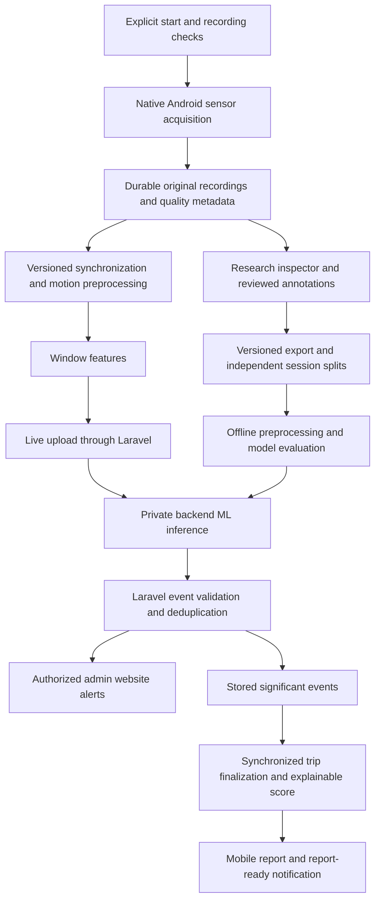

# Telematics and RC Research: central implementation guide

Last reconciled: **2026-10-25**. Scope: Laravel, the Next.js management website,
and the Android-only Expo application. The baseline includes the read-only v1
Admin inspector and local native v2 recorder. V2 upload, processing and AI remain
pending; native compilation does not establish Redmi recording reliability.

## Authority and status

This is the active reference for telematics, RC research, calibration, collection,
fleet monitoring, and their AI roadmap. Read the applicable source files before
editing. Laravel Form Requests, Resources, services, migrations, and the installed
native adapter establish what the current application actually does.

Use these distinctions in code reviews, documentation, and defense claims:

- **Implemented:** present in the inspected code; not necessarily physically verified.
- **Agreed target:** selected in the planning discussion, but still requires implementation.
- **Experimental:** a setting or approach to select using development recordings.
- **Historical evidence:** an attributed result from an earlier check, not a fresh verification.
- **Pending:** no applicable completed verification is established.

The target design below replaces earlier planning exclusions of native research
recording, AI alerts, and a behavior score. It does not make those features exist,
remove authorization, or permit silently changing rental release rules. Preserve
existing data and implemented behavior unless the scoped implementation requires
a documented change. Do not request repeated approval for an already agreed
direction; clarify genuinely unresolved requirements before implementing them.

The [documentation index](README.md) covers other domains. The [project roadmap](project-status-and-roadmap.md)
provides project-wide status. [Archived guides](archive/telematics-2026-10-24/README.md)
are historical evidence only: do not use them as competing implementation instructions.
The external `telematics_blueprint.md` was a proposal reviewed during planning,
not an authoritative description of this codebase or a verified industry standard.

## Agreed scope and requirements

- Rental and booking management continue to represent real cars. RC experiments
  use an identified experimental profile, not unmarked real-customer telemetry.
- The panel suggested RC testing. RC results support claims about the tested RC
  setup only. Real cars need separate collection, calibration, training, and validation.
- User-reported equipment: MN-82S Supertourer; Redmi Note 8 Pro, Android 11
  `RP1A.200720.011`, MIUI 12.5.8; one operator and one sensing phone. A teammate
  observes and annotates controlled trials. These are reported setup facts, not
  independently verified hardware specifications.
- Use one rigid, repeatable mount initially. The user confirmed position A:
  screen upward, tilted above horizontal, with the phone's top toward the RC
  front. The earlier 10° estimate is uncertain; the current form does not ask for
  degrees and stores the angle as unmeasured. Measure the gravity reference and
  verify rigidity before derived vehicle-axis processing. Do not assume
  arbitrary-mount support.
- The user confirmed an adjustable phone holder with a rotating screw lock,
  fixed to the top of the RC. The Collect form uses **Adjustable screw** as the
  fixed mount-method label for this holder; actual rigidity still needs a
  physical check. Do not infer a specific holder brand or joint design.
- The RC has user-reported gradual throttle and steering, slight straight-line
  drift, a braking action before reverse, and some coasting from higher speed.
- Use **harsh**, not abrupt, in maneuver labels: harsh acceleration, harsh braking,
  harsh cornering, and swerving. Ordinary steering corrections and reversing
  belong in normal examples.
- During a drive, AI-based event alerts should reach the admin website. After a
  drive, provide an evaluated report and explainable behavior score, with a mobile
  report-ready notification. Actual phone push delivery is distinct from the
  currently implemented in-app notification feed.
- Collection must support screen lock/minimizing through a native Android recording
  service, retain measurements through network loss, and recover uploads. Force-stop,
  reboot, and runtime loss must not be described as uninterrupted collection.
- Direction handling must be automatic during operation. Observer direction labels
  are training/evaluation annotations, never a required live Forward/Reverse switch.
- Prioritize a reliable recorder and inspection UI before training. Retain original
  measurements so filtering and feature experiments can be repeated.
- Working-prototype target: October 31, 2026. Checking: October 26; mock defense:
  second week of November; defense: first week of December. Dates are user goals,
  not promises of accuracy or completed physical validation.

## Current implementation baseline

| Area | Inspected implementation | Outstanding boundary |
| --- | --- | --- |
| Mobile stack | Expo SDK 54 (`~54.0.37`), React Native 0.81.5, `expo-sensors ~15.0.8`, Android-only local `modules/rc-recorder` Kotlin module | New development build required for the native recorder; Expo Go cannot capture v2 |
| Builds | Generated Android project; development and standalone preview APK profiles | A successful build does not prove device reliability |
| Research capture | Collect uses native independent original streams, fixed MN-82S preset, encrypted persistent collection groups/defaults/numbering, automatic phone power metadata, requested 20 ms updates and explicit native Start/Stop | Actual sensor axes/rates, lock-screen continuity, interruption and power behavior require Redmi validation |
| Research storage and inspection | Local v2 unlabeled saves, recovery, metadata review and explicit deletion; historical server v1 encrypted files with protected web waveform/quality review | No v2 server ingestion/web waveform, upload queue, processed overlays, export or annotation revisions |
| Calibration | Six readiness checks and five supervised foreground exercises, summary-only evidence | Provisional settings; moving RC/reference accuracy not established |
| Released rental GPS | Explicit foreground/background latest-location sharing, consent, pause/resume, server eligibility | No continuous rental motion collector, offline recording queue, or route-history collection in this flow |
| Fleet website | Ongoing rentals, latest-location map, private Reverb invalidations and authorized rereads | No connected AI driving-event dashboard |
| Notifications | Customer/Driver in-app records, unread counts, booking activity | No implemented report-ready flow or remote phone push delivery |
| ML and score | Harsh-event enum values and data foundations | No trained model, training/inference pipeline, or behavior-score/report implementation found |

Existing enum values and old mock presentation components do not establish AI
functionality. Research `eligible_for_training` is a provisional quality/annotation
flag, not proof of correct axes, sound labels, independent splits, or model accuracy.

## Existing rental and handover boundaries

Keep these implemented business rules while extending research:

- Self Drive operator: owning Customer. With Assigned Driver operator: currently
  assigned Driver. Entry/navigation does not establish eligibility.
- Laravel determines eligibility, validation, authorization, and step outcomes.
  Mobile uses Sanctum bearer tokens; web management uses cookies/session/CSRF.
- Pre-release data belongs to `telematics_setup_sessions` and retryable
  `telematics_setup_steps`, not `booking_assignments`. Retain attempt history.
- Staff starts eligible handover (`setup_required -> in_progress`). The combined
  outgoing-inspection/handover action finalizes required signatures transactionally.
  Existing finalized inspections can continue without replacement.
- Setup mutations normally require a confirmed booking, server time inside
  `[rental_start_at, rental_end_at)`, the applicable operator, and in-progress
  handover; Self Drive also requires verified Customer documents. Reassignment
  requires fresh readiness for the new Driver.
- Standard release requires payment, inspection/signature, vehicle/operator, and
  all eleven effective setup/calibration requirements. Staff's authorized
  **Start Rental** is the only `ready_for_release -> released` action.
- A booking has at most one post-release trip. Pause/resume stays in that trip.
- Active default zones are copied into `booking_geofences` at release; all booking
  geometry and alert settings are then frozen. Zone configuration and containment
  never gate setup or release. See [geofence monitoring](geofence-monitoring.md).
- Local/testing `RENTAL_EARLY_START_TEST_MODE` permits same-start-date early
  preparation while preserving other gates. The broader
  `TELEMATICS_HANDOVER_TEST_MODE` has separate documented test exceptions in source,
  including Self Drive readiness relaxation with real mount evidence. Neither flag
  applies to production/staging, changes booked times, or fabricates passed checks.
  Do not enable either as a shortcut to collect research recordings.
- Research trials do not need customer bookings or rental release. Preserve their
  separate session/trial storage and access boundary.

Current entry points include `GET /api/mobile/telematics/rentals`,
`GET /api/mobile/telematics/setup`,
`GET /api/mobile/bookings/{booking}/telematics-setup`, and
`POST /api/mobile/bookings/{booking}/telematics-setup/steps/{step}/attempt`.
Use [routes](../backend/routes/api.php), [setup services](../backend/app/Services/TelematicsSetupService.php),
and the [booking lifecycle](booking-rental-lifecycle.md) for exact contracts.
Returned/Completed owning-booking setup reads can be read-only history; they do
not reopen mutation or collection eligibility.

## Existing calibration and sensor conventions

Readiness order: `device_check`, `motion_permission`, `location_permission`,
`background_location`, `gps_check`, `phone_mount`. These checks do not start
continuous recording. A fresh setup GPS fix is quality evidence, not route history.

Calibration order: stationary, forward, braking, left turn, right turn. Captures
are explicitly consented, supervised, foreground-only, and bounded. Cancel,
navigation, or backgrounding stops capture. Laravel receives bounded summaries,
not sample streams, and evaluates fresh context, order, consent, quality, and
profile. A local success animation cannot replace server acceptance.

Current geometry uses a gravity reference, horizontal acceleration projection,
a learned forward reference, and projected angular motion. It is not a custom
continuous Kalman/complementary/PCA fusion estimator or a speed/gear detector.
Current profiles retain the first qualifying Forward sample at 3 m/s², subject
to other quality gates. That single sample does not demonstrate sustained
direction consistency. Stationary is six seconds; other configured maximums and
RC overrides are in [configuration](../backend/config/telematics.php).
The active profile is standard revision 4 or local/testing RC revision 5;
profile/settings fingerprints bind attempts. These are operational demonstration
settings, **not learned harsh-event thresholds or training labels**.

Important existing adapter details, verified by source inspection:

- Current Expo linear acceleration is platform-processed, in m/s².
- Installed Android DeviceMotion exports `accelerationIncludingGravity` as
  raw accelerometer minus twice the native gravity value. Do not assume that
  field is identical to direct `SensorManager` accelerometer output.
- The application derives its current gravity vector from including-gravity
  minus linear acceleration. Reference signs therefore depend on that adapter.
- Expo exports rotation rate in degrees/second; direct Android gyroscope values
  use radians/second. `rotationAxes` maps Android alpha/beta/gamma to XYZ.
- Current research's `gravity_timestamp_s` identifies the including-gravity
  measurement timestamp, not an independently retained native gravity event.
- Screen orientation is not full three-dimensional attitude.

Preserve original source conventions and conversion versions. Physically check
signs/reference orientation before reusing geometry with native channels. Never
silently reinterpret old records or edit installed dependency sources to change
their meaning. Research reference capture should reuse suitable pure mathematics,
not customer setup attempts, release thresholds, or mutable released calibration.

Sources: [installed Android adapter](../mobile-frontend/node_modules/expo-sensors/android/src/main/java/expo/modules/sensors/modules/DeviceMotionModule.kt),
[calibration math](../mobile-frontend/lib/telematics/calibration.ts),
[foreground capture](../mobile-frontend/services/telematics/calibration-capture.ts),
[server evaluation](../backend/app/Services/TelematicsCalibrationService.php).

## Existing RC Research v1

### Access and lifecycle

An active Admin signs in through normal mobile login when the local/testing
`rc_demo` profile is active. The server issues an eight-hour research-only token;
ordinary Customer/Driver mobile access and web cookies cannot substitute for it.
Reads and mutations are owner-bound. The token cannot use ordinary mobile
features; revocation remains available after research access is disabled.

Current API:

- `GET /api/mobile/rc-research`
- `POST /api/mobile/rc-research/sessions`
- `POST /api/mobile/rc-research/sessions/{session}/trials`
- `GET /api/mobile/rc-research/trials`
- `DELETE /api/mobile/rc-research/trials/{trial}`

The current screen retains Data / Collect / Logout. **Collect now mounts the
local native v2 recorder described below.** Data reads historical uploaded v1
trials. The retained v1 collector/forms are no longer mounted in Collect; their
foreground, memory-only, cancel-on-background behavior is historical. V1 server
validation and existing files remain unchanged and readable.

### Implemented web inspection (2026-10-24)

The Admin portal now includes **RC Research** at `/admin/research` and recording
review at `/admin/research/{trialId}`. Normal web sessions use separate read-only
`GET /admin/rc-research/trials` and `GET /admin/rc-research/trials/{trial}` endpoints.
Active Admin, local/testing `rc_demo`, and existing session ownership remain
required. A mobile research token cannot substitute for web authentication.
The list is paginated (maximum ten), searchable by session/surface/device, and
filterable by saved label certainty. Sample reads are private/no-store, bounded
by the existing v1 recording limit, and verify decryption plus the original hash.
Deleted/other-owner trials are not found; unavailable/unverifiable files fail
without returning measurements or private storage paths.

Review shows saved linear/including-gravity acceleration and rotation, shared
sensor-time plots, gaps over 250 ms, click/keyboard moment inspection, drag or
keyboard interval selection, zoom, and selected-point peak/RMS/mean statistics.
Each channel uses its saved timestamp with a common clock origin anchored to
the first accepted snapshot. Display times are rounded to microseconds; saved
measurements are unchanged. Reused channel timestamps collapse only in the
plot/statistics view. Recorder-elapsed annotation bounds map to the sensor
timeline for highlighting. These are v1 combined snapshots, not independent
native raw streams. Peak magnitude is a three-axis norm, not maneuver severity.

The saved observer label/interval/notes, setup metadata, requested versus actual
rate, provisional timing flags, and provenance are inspectable. Known synthetic
seeder records carry **Demo data**. Missing hardware fields stay **Not recorded**;
the agreed phone/RC profile is never backfilled into unrelated historical records.
Integrity and label certainty remain separate; the UI does not display the old
eligibility boolean as scientific training approval. No vehicle reference or
versioned cleaning exists for these v1 records, and the interface says so.

The web inspector does **not** implement annotation editing/revisions, v2
ingestion, processed overlays, dataset export or AI. Local native v2 saves are
unlabeled but cannot yet appear here. Existing v1 immutable-file contracts remain.

Sources: [web workspace](../web-frontend/src/modules/management/research/ResearchModule.tsx),
[recording review](../web-frontend/src/modules/management/research/RecordingReviewModule.tsx),
[timing/statistics](../web-frontend/src/modules/management/research/recording-analysis.ts),
[web read controller](../backend/app/Http/Controllers/Web/Admin/RcResearchController.php),
[query request](../backend/app/Http/Requests/Research/ListRcResearchRecordingsRequest.php).

### Capture and storage contract

Protocol 1 requests a fixed 20 ms interval (nominal 50 Hz), minimum one second
and eight accepted snapshots, at most 10,000 snapshots and 4,000,000 JSON bytes.
Capacity exhaustion fails the recording; there is no automatic completion/save.
The three-second startup deadline and 200 ms warmup are stream-health checks.
They do not establish a stable 50 Hz independent native acquisition rate.

Each accepted snapshot retains relative callback time, three exported channel
timestamps, linear XYZ, including-gravity XYZ, rotation XYZ, and screen orientation.
Incomplete, nonfinite, nonadvancing, or sufficiently misaligned snapshots can
be skipped. This is not a lossless archive of independent sensor events.

Session context includes name, surface, slope, mount orientation, battery
condition, platform/app version, and consent. Legacy phone/RC/mount/configuration
fields are optional and absent from the current setup form. No extra load is
recorded (`added_load_g = 0`); this does not mean the phone/mount has zero mass.

Trial validation currently requires intended/observed movement and intensity,
certainty, quality, event bounds, capture times, and a bounded multipart
`samples_json` string. Laravel validates and recomputes summaries, then stores
samples in an immutable, encrypted private file. Database rows hold metadata
and summaries, not raw streams. API Resources do not expose sample paths/files.
Matching retries are idempotent; changed content or deleted IDs produce conflict.

Provisional flags: average rate below 8 Hz, gap over 250 ms, or sensor span below
85% of wall duration. Confirmed labels plus usable quality and no flags set the
current eligibility flag. Do not promote these provisional checks to scientific
acceptance limits without pilot evidence.

Saved records remain until explicit owner deletion. Deletion removes ciphertext,
notes, and summaries while retaining a minimal tombstone to prevent upload
resurrection. Failed file deletion remains visible/retryable. Protect the server
encryption key; deletion cannot promise erasure of external backups or exports.

Current movements are stationary, steady movement, acceleration, braking, left
turn, right turn, with normal/harsh or not-applicable intensity. Swerving,
direction annotations, comparison conditions, pending labels, and annotation
revisions need contract extensions. The retained v1 form initially copies intended
labels and selects the full recording interval; the target review must not
silently confirm those defaults as observed ground truth.

Sources: [protocol](../backend/app/Support/RcResearchProtocol.php),
[research service](../backend/app/Services/RcResearchService.php),
[session request](../backend/app/Http/Requests/Research/StoreRcResearchSessionRequest.php),
[trial request](../backend/app/Http/Requests/Research/StoreRcResearchTrialRequest.php),
[mobile recorder](../mobile-frontend/services/telematics/rc-research-capture.ts),
[mobile schemas](../mobile-frontend/validation/research/rc-research.ts),
[research screen](../mobile-frontend/screens/research/RcResearchScreen.tsx).

## Existing released GPS and mobile activity

The current released-rental collector is latest-location GPS only. It is separate
from research and calibration. Its foreground mode uses an app-wide watch;
explicit foreground/background mode uses the separate
`jamjade-rental-latest-location` native location task and visible service
notification. The setup readiness task remains inert. A location task is not a
continuous motion recorder.

Current API base: `/api/mobile/bookings/{bookingCode}/location-monitoring` with
GET state and POST `/start`, `/location`, `/pause`. Requests use the existing
mobile service and Form Requests. Start requires current accepted consent and
`sharing_mode = foreground | foreground_background`. Current consent version is
3; configuration defines a five-second upload interval, maximum 50 m accuracy,
60-second age, 10-second future skew, and 24-hour latest-point retention.

Laravel rechecks operator, ongoing/released rental, no physical receipt, valid
session, and point freshness/accuracy. Overdue ongoing rentals are not stopped
merely because their reserved return time passed. Starts reuse the one trip and
rotate an ephemeral collection token; only its hash is retained server-side.
The latest encrypted point is overwritten, not appended to route history.
Legacy trip/location endpoints are separate and cannot bypass the consented flow.
Accepted reliable latest fixes also drive frozen-zone evaluation and enabled
named in-app crossing alerts; see [geofence monitoring](geofence-monitoring.md).

Foreground mode stops when backgrounded; background mode is explicitly selected
with appropriate native permission. Current runtime consent/session state and
collection tokens are in memory. Stop, interruption, sign-out, runtime loss, and
cold tasks do not silently restart sharing. There is no persistent GPS route queue.
Receipt/expiry clears retained location and invalidates collection as implemented.

The shared mobile drawer has Full details, Device setup, and Activity. Explicit
setup agreement can prepare one GPS start after fresh server-confirmed release
while the same screen/runtime remains active. Saved consent preferences alone
do not start collection. Existing-trip resume uses an explicitly started local
Stationary check, valid for 60 seconds and consumed once; it does not update
released setup or upload raw motion. The map does not create another watcher.

Activity reuses account-owned notification records with optional booking filtering,
cursor pagination, unread counts, and existing read actions. Current GPS lifecycle
and enabled zone alerts create in-app records; no remote phone push is implemented.

Sources: [location service](../backend/app/Services/LocationMonitoringService.php),
[mobile API](../mobile-frontend/services/api/location-monitoring.service.ts),
[background collector](../mobile-frontend/services/telematics/background-location-collector.ts),
[mobile screen](../mobile-frontend/screens/telematics/TelematicsHandoverScreen.tsx),
[notification guide](mobile-notifications.md).

## Existing fleet monitoring

`GET /admin/fleet-tracker` uses stateful web authorization and `view fleet tracker`.
It lists ongoing rentals, including overdue and no-trip cases, with bounded
search/filter/pagination and tracking status. Its map receives authorized,
unexpired latest points; it is implemented, not an unavailable placeholder.
Statuses and stale points do not prove the phone is currently connected.

Current transport: latest-point transaction commits -> queued empty `fleet.changed`
notice -> private `fleet-monitoring` channel -> authorized HTTP reread -> map update.
Socket notices contain no GPS, samples, model, or rental payload. Authorization
uses `POST /admin/broadcasting/auth`, the web guard, and repeated permission checks.
Reads reconcile on notices/reconnect and periodically while visible. The native
collector does not depend on keeping a WebSocket open.

Reverb and its queue worker need reachable deployment configuration and running
processes; HTTPS sites need a reachable TLS WebSocket endpoint. The existing
Google Maps singleton remains the only loader. Reuse chart/table primitives and
installed Recharts for research; do not revive mock driving-log components as
real measurements or replace the JamJade visual identity.

Sources: [fleet service](../backend/app/Services/FleetTrackerService.php),
[publisher](../backend/app/Services/FleetMonitoringPublisher.php),
[event](../backend/app/Events/FleetMonitoringChanged.php),
[module](../web-frontend/src/modules/management/fleet-tracker/FleetTrackerModule.tsx),
[web subscription](../web-frontend/src/services/fleet/fleet-realtime.ts).

## Target pipeline

This section describes the **complete agreed target**. V1 web inspection and local
native v2 acquisition are implemented subsets. V2 upload/web integration, cleaning,
reviewed annotation revisions, ML, scores and reports remain pending.



### Native recording and protocol upgrade

Keep Expo/React Native screens and add an Android-only local Kotlin module/service.
The native service must own sensor capture, durable storage, processing/transmission
needed while locked, and lifecycle state; forwarding every measurement to screen
JavaScript does not establish reliable background collection. Use a visible
notification, explicit start/stop, appropriate service configuration, and measured
power handling. Validate on the Redmi before claiming lock-screen reliability.
Keep custom sources outside disposable generated-project edits; use module
manifests/config plugins as appropriate. Follow the installed SDK 54 documentation
and existing Android build/signing workflow; do not routinely clean generated
projects or uninstall the app and lose installed state.

Introduce a versioned capture contract; preserve readable v1 records with their
source and units. Capture original Android accelerometer and gyroscope events
with individual monotonic timestamps. Retain supporting gravity, linear acceleration,
rotation estimates, sensor accuracy/range, and availability where supported.
Do not fabricate unavailable channels or discard all source events because
another channel did not arrive simultaneously. Record omissions/rejections.

Store originals separately from derived datasets. The local implementation below
provides encrypted chunks, checksums, sequences and interrupted-file recovery.
Server acknowledgments, upload retry/deduplication and transfer states beyond
`local_only` remain pending. Recovery never silently restarts collection.

### V2 acquisition contract and local implementation

Specified and implemented locally **2026-10-25** in `modules/rc-recorder`, with
phone setup/Start/Stop, per-channel diagnostics, saved-record inspection and
deletion. The development APK compiles; user-operated stationary foreground and
short screen-lock captures on the connected, charging Redmi have been reviewed
through saved summaries. The user reported approximately 22 seconds locked in
the second capture, with no long gap shown in the required-sensor summaries.
Raw motion noise, physical axes, longer/unplugged screen-lock continuity and
interruption recovery remain unverified. The upload/final-acknowledgment portions
below remain specifications.
V1 APIs and immutable historical files remain unchanged. Keep `RcResearchProtocol`
at version 1 for those endpoints. V2 needs its own server validation, storage and
inspection before ingestion is enabled; never send it to v1 `samples_json`.

Native adapter **1.1.0** adds the setup/group contract below. Its group APIs must
exist before the current Collect UI becomes available; older v2 development APKs
show an update requirement. Sensor event protocol/source/units remain version 2.
Existing files keep their original metadata, including any older angle/battery
entries; they are neither rewritten nor assigned guessed group IDs.

`GET /api/mobile/rc-research/native-access` is a private/no-store **access read**,
not sensor ingestion. Existing Admin, active-account, `rc_demo` and restricted-token
middleware still apply. It returns owner ID, remaining lifetime, effective token
expiry, protocol 2 and `upload_available = false`; no new token or broader ability
is issued. The local monotonic lease is capped at eight hours, token expiry and
global Sanctum expiry. The client conservatively subtracts request duration.
Starting or unlocking after process loss requires online access verification;
an already authorized recording can continue offline until lease expiry. Sign-out
revokes the local permit before cleanup. Delayed access/permission responses cannot
start capture after an account transition. Authorization is not persisted in files.

This increment records original Android API readings. It does not resample,
rotate, subtract gravity, filter, normalize, classify, score, or automatically
confirm labels during acquisition. Android itself may calibrate/fuse outputs;
"original" means before JamJade processing, not unprocessed sensor-chip counts.
Future derived artifacts retain the source recording ID/hash, processing version,
parameters, references and their own time-grid/missing-data policy.

#### Channels, units and coordinates

| Channel ID | Android sensor type | Values and units | Availability policy |
| --- | --- | --- | --- |
| `accelerometer` | `TYPE_ACCELEROMETER` (1) | Original XYZ, m/s²; includes gravity response | Required for a research capture |
| `gyroscope` | `TYPE_GYROSCOPE` (4) | Original XYZ angular rates, rad/s | Required for a research capture |
| `gravity` | `TYPE_GRAVITY` (9) | Android-estimated XYZ gravity, m/s² | Optional supporting stream |
| `linear_acceleration` | `TYPE_LINEAR_ACCELERATION` (10) | Android-estimated XYZ acceleration without gravity, m/s² | Optional supporting stream |
| `rotation_vector` | `TYPE_ROTATION_VECTOR` (11) | Preserve native values array and length; first components are unitless, an available heading-accuracy component is radians | Optional supporting stream; not vehicle heading |

Each channel is a separate event sequence. Request `sampling_period_us = 20000`
(50 Hz pilot) and `max_report_latency_us = 0`; preserve the actual registration
result and delivery timing. These are engineering requests, not a guaranteed
rate. Do not throttle away additional delivered events to manufacture 50 Hz.
Optional streams report `unavailable`, `registration_failed`, or `registered`
independently; after capture, a registered stream with no events is explicitly
`no_data`. Missing one optional event must not discard another channel's event.
Absent required sensors prevent Start with a clear reason; a required stream
failing during capture preserves the partial recording and flags the failure.

Use `coordinate_frame = android_device_natural` for all original motion vectors.
Android's axes follow the device's natural orientation, not display rotation.
Record natural orientation and screen rotation separately, including `unknown`
when not established. Do not infer vehicle forward from a portrait screen lock.
There is no v1 conversion on these originals: rad/s must not be displayed as
deg/s, and direct accelerometer values must not inherit Expo's gravity convention.
Physical sign/axis checks remain mandatory on the mounted Redmi.

#### Time and event records

Use each `SensorEvent.timestamp` and native receipt `elapsedRealtimeNanos()`.
They use the same monotonic clock domain. UTC is for display/correlation only;
phone clock adjustments and network arrival must not determine feature timing.
Store every absolute nanosecond integer as a **decimal string**, parsed as
Kotlin `Long`/PHP 64-bit integer and JavaScript `BigInt` where necessary. Subtract
the origin before converting a relative interval to floating-point milliseconds.
Validate integer range as well as string syntax; do not round originals through
a JavaScript `number` or use timestamp equality to join different sensors.

Each finite event has this logical shape; these are **synthetic format examples**,
not measurements or a collection instruction:

```json
{
  "sequence": 0,
  "sensor_timestamp_ns": "1234567890000",
  "received_elapsed_ns": "1234567990000",
  "accuracy": 3,
  "values": [0.02, -0.01, 9.80]
}
```

The enclosing stream declares channel ID, sensor type, units and value layout.
`sequence` starts at zero **per channel** and increments for every callback,
before validation/queuing. Copy the event's values immediately; Android can
reuse callback objects. XYZ streams have exactly three finite numbers. Rotation
vector streams preserve supported native component counts and declare the layout.
`accuracy` preserves the reported Android accuracy code; it is not ML confidence.

Preserve callback order and original finite readings even if timestamps repeat
or move backward; flag those anomalies for processing rather than silently sorting
or deleting them. Nonfinite/malformed values cannot be JSON numbers: reject that
row, record its channel/sequence/reason in capture diagnostics, and increment the
appropriate counter. Never replace it with zero. Known queue/write drops likewise
leave accounted sequence gaps. The application cannot know the exact number of
events a sensor/OS never delivered; do not label a gap-derived estimate as a
measured hardware loss count.

The manifest binds `started_elapsed_ns`, `ended_elapsed_ns`, an ISO-8601 UTC
start/end, and UTC/monotonic clock anchors with their measurement uncertainty.
Retain pre-start/batched or post-stop source timestamps with out-of-interval flags;
analysis chooses the active interval explicitly. Record wall-clock changes and
interruption boundaries without rewriting earlier samples. A restart/reboot
cannot append to the previous recording's clock domain or imply continuity.

#### Manifest and session context

The manifest has `protocol_version = 2`, `source = android_sensor_manager_v2`,
an immutable client-generated `recording_id` UUID and local `collection_session_id`
UUID. Server ownership/session mapping belongs to the authenticated ingestion
envelope; tokens, server file paths and account credentials never belong in files.
Store these distinct facts:

- **Purpose:** `maneuver_trial`, `stationary_reference`, or `forward_reference`.
  Reference recordings are original measurements too; capturing one does not
  automatically establish a usable calibration.
- **Device/app:** manufacturer/model, Android release/API, app/build and native
  adapter version. Avoid serials, IMEI, advertising IDs, contacts and location.
- **Sensor inventory:** channel availability, actual Android type/name/vendor/
  version, range/resolution, min/max delay and wake-up capability where reported;
  declared value layout/units and registration settings. Unknown fields remain
  null with a reason; do not substitute a guessed Redmi specification.
- **Fixed setup preset:** `mn82s_roof_v1` locks `MN-82S Supertourer`, tilted
  orientation, upper/roof location, screen up and phone top toward the RC front.
  The native validator supplies these values; client overrides are rejected.
  This is the selected experimental setup, not measured calibration. New angle
  and RC battery fields are null with `not_measured` provenance, never guessed
  10°/Full values. No RC battery telemetry is claimed.
- **Mount method:** the current Collect form displays **Adjustable screw** as
  read-only for the confirmed phone holder. The shared client schema requires
  this value for new groups and recordings, including when an older group's
  saved defaults mention another mount. The existing native 1.1.0 contract
  accepts and stores the supplied method as text; this UI/service restriction
  requires only a Metro reload, not a native rebuild. Historical group defaults
  and recordings are not rewritten.
- **Conditions:** actual surface, slope and recording purpose
  are editable per recording, initialized from the selected group's defaults.
  New group defaults must be entered once.
  Each recording stores its actual snapshot without changing prior recordings
  or the group's saved defaults.
- **Phone power:** read percentage using the reported level/scale, charging/full
  state and Battery Saver automatically. The setup view reads current state;
  recording manifests retain start/latest/end snapshots plus up to 256 observed
  changes and an omitted-change count. Changes are observed on the one-second
  native health tick, not exact system transition times. Unknown states remain
  null. Low percentage does not itself assign a quality failure; rate/gap evidence
  and interruptions remain separate. No battery-based sampling change is made.
- **Consent:** current research consent version 3 includes phone power diagnostics
  alongside motion, with capture scope and native start time;
  explicit start/stop and visible recording indication are required. Indoor RC
  research does not require GPS, camera, microphone or ordinary rental records.
- **References:** nullable `stationary_reference_id` and `forward_reference_id`.
  Missing references allow raw acquisition, while vehicle-axis derived output
  remains unavailable. Never claim alignment from stationary gravity alone.
- **Integrity and completeness:** finalized chunk descriptors, channel counts/
  timing diagnostics, capture end reason and an explicit interrupted state.
  Processing version and model version are absent until those artifacts exist.

Reuse a physical session/reference only while the mount remains valid. Sensor
timestamps are fresh for each recording. Keep intended maneuver, observer labels,
direction, event intervals, certainty and notes in separate annotation records.
Initial annotation state is `unlabeled`; saving never requires normal/harsh labels.
A synthetic fixture must explicitly identify itself as synthetic. No timing check
or intention copied from the setup form becomes observed ground truth.
`collection_session_id` still identifies the current entered physical context
within one native runtime (recording name/purpose excluded). It cannot detect an
unreported remount and does not validate references; reference links remain null.

#### Persistent collection groups and preset selection

`recording_group_id` is a separate, permanent UUID created for an owner-bound
collection group. Groups survive ordinary process restart and compatible APK
updates through the encrypted private `groups.rc2` index. The current library
allows create/select for up to 50 groups; rename/delete and server sync are not
implemented. Group names are required, trimmed, bounded to 100 characters and
case-insensitively unique within the local owner's library. The current client
generates names as `Surface - Slope - Group 01`, with no typing field. The preview
updates from selected conditions; purpose is excluded so reference captures and
maneuver trials can share a group. Before creation, the service reads the latest
catalog inside its serialized mutation queue and chooses the first unused number
for that surface/slope name, ignoring case. Long surface values are shortened to
keep the complete name within 100 characters. The existing native API still
validates and stores the final name; no native rebuild is needed. Names stay fixed
after creation, and existing groups/recordings are not renamed. Each group references
the fixed preset and stores default surface, slope, mount method and purpose.
Selecting it fills editable defaults; the current client always supplies the
confirmed screw-lock holder for new captures. Selection never starts sensors or
confirms labels.

The native actor allocates and durably commits a monotonically increasing
`recording_number` before creating each recording. Display names are generated
as `Group name · Recording 001`, `002`, etc. Failed starts can leave gaps; a number
is not a count of completed or valid trials. Each recording still has its own
immutable `recording_id` UUID and retains group ID/name/number in its context.
The most recently created or used group is remembered. Reference validity and independent
training/evaluation splits cannot be inferred from group membership alone.

The group index uses the same owner Keystore key and authenticated AtomicFile
replacement as manifests, with distinct AAD `$ownerHash/groups/$frameIndex`.
Group creation/numbering never writes plaintext files. Corrupt/unlockable indexes
fail rather than being silently overwritten. Sign-out/account boundaries are the
same as original recordings. Historical ungrouped files remain inspectable.

Quality metadata is **per channel**: received/persisted/rejected/known-drop
counts; first/last event times; observed rate; interval median/p95/maximum;
startup and trailing gaps; timestamp anomalies; receipt delay; and accuracy-code
changes. Rates/interval statistics are null when insufficient events exist, never
fabricated zeros. Preserve short/failed captures as diagnostic partial records;
do not discard them merely for failing v1's minimum length or label requirements.
An available stream with zero events is not valid stationary motion. Integrity,
signal quality, annotation review and dataset inclusion remain separate judgments.

#### File, recovery and upload boundary

Use a manifest plus channel-specific chunks; the local implementation embeds its
bounded rejection diagnostics and lifecycle journal in the encrypted manifest.
The **logical decrypted event format is UTF-8 NDJSON** (one event per
line). On-device files must be encrypted and private, excluded from Android backup
and public/media storage; do not leave plaintext NDJSON or JSON manifests on disk.
The implemented frame codec uses AES-256-GCM with a fresh generated 12-byte IV
and 16-byte tag per frame, up to 65,536 plaintext bytes. Files begin with `JJRC2\n`;
each frame has a four-byte big-endian ciphertext length, IV and ciphertext/tag.
AAD binds owner hash, recording ID, channel/chunk (or manifest) and frame index.
Append checkpoints flush and fsync; manifest replacements use Android AtomicFile
and contain encrypted frames only. A partial last frame cannot invalidate prior
authenticated frames. Full-frame authentication failure makes the recording
unavailable rather than silently accepting altered data. JVM tests cover codec
round-trip, truncation, tampering, cross-owner replay and allocation bounds.

Initial engineering chunk bounds are **1 MiB logical payload or 10 seconds,
whichever comes first**, independently per channel. A durable authenticated
checkpoint targets one second during active delivery; seal/flush
on Stop. These are implementation budgets to validate on the Redmi, not accuracy
thresholds or proof that zero samples can be lost. Recover only verified complete
frames/chunks after a crash, retain the interrupted status, and report any missing
tail. Never resume collection automatically. Native lifecycle/timing and Android
storage recovery still need process-kill and reboot testing on the Redmi. A
normal sealed record is not re-read/fully reverified by the local summary screen;
server acceptance must independently verify every chunk when implemented.
Recovered duration is a lower-bound span to the last verified receipt
(`end_time_source = last_verified_receipt`), with unknown actual stop/UTC end.

Current budgets are 64 MiB per recording, 256 MiB per account, 100 local records,
a 64 MiB device-free-space reserve and 32 KiB plaintext channel buffers. Disk
budgets are checked once per second and may be exceeded by in-flight checkpoints;
they stop acquisition with a reason and never trigger automatic deletion. Required
streams have experimental three-second startup and five-second stall deadlines.
These are safety/health budgets, not maneuver thresholds. Timing quantiles use
bounded one-millisecond bins, with overflow quantiles explicitly unavailable.

Each finalized chunk records recording/channel ID, zero-based chunk index,
sequence bounds, event count, logical byte length, sensor-time bounds and SHA-256
of the exact decrypted payload bytes. Do not parse/re-serialize before checking
that hash. Finalization binds the ordered descriptors in a versioned manifest
hash, avoiding a self-referential checksum field. Local encryption nonces/key
aliases are not research payload fields or server encryption instructions.

Upload finalized chunks over authenticated HTTPS through the existing mobile
service boundary. Server validation binds the owner, version, channel layout,
bounds and hash. Identical retries for a recording/channel/chunk are idempotent;
different content under the same identity conflicts. A final server acknowledgment
requires the complete expected chunk inventory and finalization checks. Otherwise
the record stays incomplete. Recalculate quality from accepted originals; a client
summary cannot declare a recording verified or fit for training. No native v2
HTTP endpoint is enabled by this specification.

Keep capture (`preparing`, `recording`, `stopping`, `stopped`, `interrupted`,
`failed`), transfer (`local_only`, `queued`, `uploading`, `uploaded`,
`upload_failed`) and annotation (`unlabeled`, `reviewed`, `uncertain`) separate.
Losing connectivity does not end capture. Queue/disk exhaustion must stop safely,
preserve the verified prefix and expose the reason; never silently discard the
whole trial or report it complete. A notification Stop must work without screen
JavaScript. Force-stop, process death and reboot are interruptions, not guaranteed
continuous recording. App reopening lists recoverable drafts without starting sensors.

Research files remain tied to the account that captured them. Sign-out stops
capture and locks pending transfers; another account cannot inspect/upload them.
The implemented retention policy is explicit owner deletion, without automatic
purge. There is no uploaded-copy retention yet because v2 upload is unavailable.
Files live under app-private `noBackupFilesDir/rc-research-v2`, excluded from
Android backup, with one non-exportable Android Keystore key per owner. Keys are
not biometric-bound so the explicitly started service can write while locked.
Sign-out retains encrypted files/keys but stops and locks access; returning as the
same authorized owner can inspect/recover them. Another owner cannot read them.
Owner IDs assume this app's configured backend account namespace; switching to a
different database with reused IDs needs explicit namespace isolation first.
Uninstall/app-data clearing or lost/invalidated keys makes local-only originals
unrecoverable. A missing key is never silently replaced while files remain; the
UI lists unavailable records and permits explicit deletion. Account removal has
no new local purge integration; access still requires fresh server authorization.

#### Required evidence before moving to formal trials

First implement/test serialization, channel metadata and timing using **synthetic**
fixtures. Then verify on the actual Redmi: sensor inventory, stationary source
signs, requested versus delivered rate per channel, screen-lock/minimize continuity,
Stop from the notification, offline save/retry, interrupted-file recovery, owner
isolation and storage-limit failure. A stationary test can establish acquisition
integrity; it cannot establish forward direction, moving-vibration filtering,
harsh thresholds or classifier accuracy. Processing/alignment trials follow.

Platform basis: [Android SensorEvent fields and units](https://developer.android.com/reference/android/hardware/SensorEvent),
[Android sensor coordinates, rates and background restrictions](https://developer.android.com/develop/sensors-and-location/sensors/sensors_overview),
[Android cryptography guidance](https://developer.android.com/privacy-and-security/cryptography).
The non-exported Android service declares `specialUse` and its subtype; it is RC
research, not a fitness activity. Android 13+ notification permission is required
before Start. It holds a bounded partial wake lock, supplies a native Stop action,
uses `START_NOT_STICKY`, and has no boot receiver. Removing the task stops capture.
Service starts are bound to one-use native reservations, and old service callbacks
cannot stop a replacement instance. Start has a ten-second service watchdog.
Disabling notifications stops capture on the next native health tick.
Process death/force-stop/reboot interrupt it. Google Play special-use review is a
separate distribution gate, not approval established by this local build. Modern
platform rules were checked against official Android documentation. The SDK 54
documentation URLs redirected to latest, so implementation used the official
[Expo sdk-54 module API source](https://github.com/expo/expo/blob/sdk-54/docs/pages/modules/module-api.mdx)
and installed SDK 54 sources. No new runtime dependency was introduced.

Sources: [native module/service/store](../mobile-frontend/modules/rc-recorder/android/src/main/java/com/jamjade/rcrecorder/),
[native facade](../mobile-frontend/services/telematics/native-recorder.ts),
[phone controls](../mobile-frontend/screens/research/RcNativeCollectionPanel.tsx),
[local form schema](../mobile-frontend/validation/research/native-recorder.ts),
[collection groups](../mobile-frontend/modules/rc-recorder/android/src/main/java/com/jamjade/rcrecorder/CollectionGroups.kt),
[phone power](../mobile-frontend/modules/rc-recorder/android/src/main/java/com/jamjade/rcrecorder/PhonePower.kt),
[access Resource](../backend/app/Http/Resources/RcResearchNativeAccessResource.php).

### Collection and inspection UI

Keep the mobile Data / Collect navigation and shared controls. Target Collect:
hardware/session profile -> sensor/recording checks -> research reference capture ->
manual Start/Stop -> durable local save/upload -> quality and waveform review ->
annotation review. Saving an unlabeled recording must not require a confirmed
normal/harsh label. Preserve observer trial notes from the first pilot.

Extend the implemented v1 Admin inspector toward these target capabilities:

- Session/trial browser, recording/upload/processing states, and quality summary.
- Timestamped acceleration/rotation plots, axis toggles, zoom, and visible gaps.
- Original-versus-processed overlays with processing version/settings.
- Event-interval selection on the timeline and observed labels/uncertainty/notes.
- Reviewed annotation revisions and separation of integrity, label review, and
  dataset inclusion states. Never overwrite the original recording.
- Versioned export with samples, annotation revisions, exclusions, grouping/split
  assignments, units, processing/feature definitions, and checksums.

Use bounded/windowed sample reads and visualization downsampling where necessary;
do not send an unbounded dataset through list APIs or use visual decimation as
the training data. Any live observer markers must map to the recording's time
reference, remain annotations, and never become runtime classifier inputs.

The mobile bearer-only research endpoints deliberately reject web sessions.
The separate web reads use normal web sessions and explicit Admin access,
reusing domain services. Future web mutations must retain CSRF protection.
An internet-accessible demo needs an explicitly enabled
research deployment boundary; do not make `APP_ENV=local` the public access plan.
Keep research streams separate from rental setup evidence, customer records,
location history, and ordinary significant-event lists.

### Preprocessing and sampling

Process original recordings reproducibly: inspect integrity -> align channels
with bounded interpolation -> establish gravity/mount references -> reduce noise
without erasing genuine maneuvers -> generate windows/features. Specify exact
units, axes, timing, warmup, filter behavior, missing-data policy, and versions.
Use filtering appropriate to live operation; offline future-looking processing
must not create a falsely favorable live-inference evaluation. Apply appropriate
anti-alias filtering when reducing sampling frequency.

Requested **50 Hz** is the initial pilot acquisition setting, not an RC or fleet
standard, guaranteed delivered rate, or proven optimum. Compare properly filtered
10 Hz and 20 Hz representations on development recordings. Select the lowest
rate meeting measured requirements; test actual lower-rate acquisition separately
for battery effects. Hz is neither acceleration range nor API/alert frequency.
Do not assume an RC necessarily needs higher rates merely because it is smaller.

Measure per-channel timing, gaps, coverage, clipping, and stationary stability.
Do not fill long gaps with zero, smooth away large values because they look harsh,
normalize each trip so its intensity disappears, or use callback/network arrival
as sensor time. Python and live Kotlin feature implementations must agree on
reference recordings within specified tolerances before deploying a model.

### Maneuvers, reversing, and dataset evaluation

Proposed primary targets: normal motion, harsh acceleration, harsh braking,
harsh cornering, and swerving. Left/right can remain observation attributes;
preserve existing left/right records. Missing or unusable data is not normal.
Define annotation and event-overlap policies before formal collection; isolate
pilot/tuning sessions from final evaluation. Start with isolated maneuvers, then
evaluate mixed maneuvers and deduplication rather than assuming support.

Include normal starts/stops/turns, drift corrections, normal reversing, reverse
turns/stops, direction transitions, bumps, surface vibration, and disturbed-mount
cases. Give confounders explicit quality/observation metadata rather than forcing
them into harsh classes. Phone handling is not evidence of harsh driving.

Reversing must be automatic in operation. Acceleration sign alone cannot distinguish
forward braking from reverse acceleration, or infer constant-velocity direction.
Evaluate temporal context/direction estimation; annotations available only during
research cannot be live model features. Do not promise reliable automatic direction
from phone-only indoor measurements without evidence. Keep ambiguous decisions
explicit and do not turn them into confirmed harsh-braking alerts or unjustified
score deductions. Normal reversing false alerts are an acceptance criterion.

Define repeatable controlled procedures; teammate labels describe actual observed
movement and uncertainty, not merely the intended instruction. Detector thresholds
and model predictions cannot supply their own ground truth. Label event intervals,
not entire recordings as harsh when only a short maneuver occurred.

Start offline with version-pinned Python tools, a simple baseline, and a candidate
Random Forest. More complex models are optional comparisons. Fifty or one hundred
trips do not guarantee accuracy. Keep entire sessions and related windows/augmented
copies together; fit learned transforms on training data only. Reserve final
evaluation from sampling/filter/feature/threshold/model selection.

Report per-class precision/recall/F1, macro-F1, confusion matrix, session/trial counts,
uncertain/excluded data, false alerts on normal/reverse/confounding cases, recording
completeness, and full motion-to-website delay. For continuous detection, measure
event-level matching and duplicates, not just isolated-window accuracy. One
operator/phone supports conclusions about that setup, not unseen drivers/devices.

### Live inference, reporting, and scoring

Initially send features for every valid analysis window through Laravel to a
private backend inference component; a hard threshold gate must not silently
remove examples the ML model is supposed to assess. Retain enough raw research
data to reproduce feature results. No 50-requests-per-second requirement is implied.

Laravel owns validated model/version association, quality/rejection handling,
event identity, occurrence versus receipt times, and aggregation of overlapping
predictions into one maneuver. Client-supplied event names or confidence alone
are not verified AI results. Do not bolt this onto a legacy endpoint that bypasses
current consent/ownership or rejects the current latest-only trip flow.

Reuse authorized Reverb infrastructure for website updates. Backend inference
requires connectivity: record locally while offline, show disconnected status,
and label recovered events delayed with original times. A short measured delay
is the aim; no zero-latency claim. Public HTTPS API and TLS socket reachability
must be tested across Wi-Fi/mobile data; sharing Wi-Fi alone does not prove reachability.

Trip finalization must reconcile outstanding uploads and late events before a
report is final. Distinguish completed and incomplete recording coverage. Existing
ended-trip guards do not automatically support delayed motion ingestion; design
the finalization state and authorization explicitly without reopening rental actions.

The score is an agreed project-defined RC behavior index, not accident probability,
liability, a financial penalty, or proof that a driver is safe. Select transparent
weights, intensity/duration/exposure treatment, and duplicate rules using development
data; freeze them before final evaluation. Model confidence is not event severity.
Do not base indoor RC scoring on unvalidated GPS distance. Explain contributing
events and withhold/qualify scores when coverage is inadequate.

Reuse mobile in-app notifications for report-ready records and an authorized report
link. Actual lock-screen/remote push needs its own delivery implementation and
device testing; the current restricted Admin research token cannot read ordinary
Customer/Driver notifications. Specify the demo report recipient and access in
the report increment without widening research tokens to unrelated mobile APIs.

## Implementation sequence and acceptance gates

| Increment | Deliverable | Evidence required |
| --- | --- | --- |
| 1. Recording contract/service | Local native v2 implemented with encrypted durable files, metadata, explicit lifecycle and recovery; compiled development APK | Actual independent timestamps, exportable recordings, screen-lock and interruption tests on Redmi remain required |
| 2. Inspection workflow | V1 web review and local v2 unlabeled save/metadata review implemented; v2 upload/waveforms and annotation revisions pending | Real trial visible and traceable; owner/access failures, gaps, retry and recovery exercised |
| 3. Reproducible processing | Research references, quality reports, synchronization/filtering/features, export manifest | Original data preserved; plots reviewed; live/offline parity and rate comparisons |
| 4. Dataset/model | Reviewed annotations, split sessions, baseline/model evaluation, versioned bundle | Held-out metrics, normal reverse/confounder tests, uncertainty and limits reported |
| 5. Live AI/report | Server-owned event ingestion, admin alerts, deduplication, finalization, score and notification | End-to-end delay, offline recovery, no duplicate deductions, incomplete-report handling, recipient access |

The first end-to-end milestone is: **record on the mounted Redmi -> preserve through
screen lock/network loss -> upload -> inspect the waveform on the website**.
Do not prioritize a polished score screen over this evidence. Exact filters,
window/stride, thresholds, dataset size, automatic direction method, score formula,
and hosting capacity are experimental or implementation decisions, not established facts.

## Verification and historical evidence

- **2026-10-25 second capture, reported screen-lock trial:** recording number 2
  showed `stopped` / `operator_stopped` and **34.0 s** in the connected Redmi UI.
  Accelerometer: **1,710 saved events, 50.5 Hz, largest gap 23.9 ms**. Gyroscope:
  **1,704 saved events, 50.5 Hz, largest gap 20.1 ms**. No warning appeared in the
  inspected required-sensor sections. Battery start/end showed 84%, charging Yes,
  Battery Saver Off. These rounded UI statistics show no reported multi-second
  sensor gap. The user clarified that the entire recording was roughly 30 seconds,
  with **approximately 22 seconds screen locked**. This supports a preliminary
  short-lock continuity check under the reported procedure while USB-connected
  and charging; the initially requested 10-second-on/30-second-locked timing was
  not followed exactly. Screen-state timestamps were not independently recorded.
  Longer/unplugged behavior, interruption recovery and raw-file integrity checks
  remain pending; do not generalize this smoke check to full background reliability.
- **2026-10-25 first native foreground stationary capture:** the user reported
  securing the phone to the RC on a level surface with the motor off and completed
  a screen-on capture. The connected Redmi's saved summary showed `stopped`,
  `operator_stopped`, duration **31.2 s**, accelerometer **1,567 saved events,
  50.5 Hz, largest gap 29.0 ms**, and gyroscope **1,562 saved events, 50.5 Hz,
  largest gap 19.8 ms**. Gravity and linear acceleration each showed 1,561 saved
  events; rotation vector showed 1,562; these optional channels displayed 50.5 Hz
  and largest gaps of 19.8 ms. No warning appeared in the inspected required-sensor
  sections. Battery start/end showed 82%, charging Yes, Battery Saver Off.
  Labels remained unassigned and storage local only. These are rounded values
  read from the phone UI over USB, not an independent raw-file analysis. This
  supports foreground acquisition/timing/save smoke validation only: it does not
  establish stationary noise, bias, axis alignment, screen-lock/offline continuity,
  recovery, unplugged power behavior or ML-training readiness. No additional
  sensor capture was started by the inspection.
- **2026-10-25 automatic group naming:** the client generates group names from
  selected surface/slope with an unused number and no text input. The native
  name contract is unchanged. The mount label is shortened to **Adjustable screw**
  for new entries; historical metadata is preserved. Mobile lint, TypeScript,
  all 252 Node tests, Android export and `git diff --check` passed. Regression
  checks cover existing-name collisions, length limits, queued creation and
  sign-out during catalog reads. A visual check on the connected Redmi confirmed
  the read-only `Tiles - Level - Group 01` preview and shortened mount label after
  loading a fresh Metro session. No group was created or motion captured by this
  check; native persistence and physical recording reliability remain separate.
  No native rebuild was required.
- **2026-10-25 confirmed mount method:** Collect now displays the screw-lock
  phone holder as read-only and requires it through shared client validation for
  new groups/captures. Existing native 1.1.0 APIs are reused; no native code or
  APK changed for this increment. Mobile lint, TypeScript, all 248 Node tests,
  Android export and `git diff --check` passed. Phone UI and physical mount
  rigidity were not verified.
- **2026-10-25 setup/group increment:** the fixed preset, encrypted persistent
  group index, generated names/counters, removed manual angle/RC-battery entry
  and phone power snapshots are implemented in adapter 1.1.0. JVM tests include
  restoring identity/counters from saved metadata, commit failure, owner-bound
  index access, duplicate names, locked-field overrides and unknown power values.
  All 247 mobile Node regressions and 17 JVM tests passed, together with mobile
  TypeScript/lint, Expo Android export, 18/18 Expo Doctor checks, native module
  lint (no issues) and debug APK assembly. Backend/web application code was not
  changed for this increment; their suites were not rerun for this update.
  These synthetic tests do not establish Android Keystore/AtomicFile recovery or
  a successful phone UI/lock-screen trial; actual Redmi verification is pending.
- **2026-10-25 local native v2 implementation:** 10 JVM tests passed for encrypted
  framing/authentication/truncated-tail recovery and bounded channel timing;
  244 mobile Node regressions passed, including access expiry/owner mismatch,
  denied permissions, late Start after sign-out and account cleanup. The completed
  backend suite passed 904 tests/5,492 assertions, including 10 native-access cases.
  Mobile TypeScript/lint, PHP formatting, Expo Android export and 18/18 Expo Doctor
  checks passed. Native module lint reported no issues; debug APK assembly passed,
  with expected toolchain deprecation notices. Autolinking and the merged manifest
  include the non-exported special-use service and required permissions. These
  tests do not exercise actual Android Keystore/filesystem lifecycle, MIUI power
  management, screen-lock continuity or phone UI. No Android device was available;
  no new RC samples were captured. V2 upload and web waveform integration remain
  unimplemented. This is a compiled local increment, not completion of the first
  phone-to-web milestone or formal-trial readiness.
- **2026-10-25 v2 contract specification:** documentation-only review of the
  existing contracts, Android sensor references and pinned Expo adapter. The
  synthetic JSON example, timestamp representation, local source links and
  Markdown fences were checked; `git diff --check` passed. No application/native
  build, API v2 acceptance or new device capture is claimed by this step.
- **2026-10-24 source review:** current mobile/backend/web paths were inspected.
  Focused mobile research/calibration checks passed 41 tests; backend research
  access/collection checks passed 47 tests and 192 assertions. Native events in
  those tests are synthetic; no model accuracy or physical RC performance follows.
- **2026-10-24 web inspector implementation:** the completed backend suite passed
  894 tests/5,468 assertions, including 13 new web read/access/integrity cases;
  seven pure frontend timing/statistics regressions passed. Web lint, TypeScript,
  production build, and PHP formatting passed. Browser inspection used an existing
  clearly marked synthetic recording; interval selection, quality/setup views,
  and responsive layouts were checked. This is UI/API evidence, not a new RC trial.
- **2026-10-24 device availability check:** `adb devices -l` listed no connected
  device. No current native visual, moving-RC, screen-lock, or live phone-to-web
  validation was performed during the review or this documentation consolidation.
- **Historical 2026-10-16 Android smoke record:** the old checklist reports a
  consented six-second stationary DeviceMotion capture on Redmi Note 8 Pro /
  Android 11, using an isolated temporary development bundle: 91 readings over
  5.89 seconds, maximum gap 88 ms, acceleration RMS 0.107 m/s². This is attributed
  historical evidence, not rerun here, not a 50 Hz RC trial, not full handover,
  and not background or direction/classifier validation.
- **Historical Android-only build record (2026-10-24):** the retained
  [Android-only guide](android-only-mobile.md) records lint, type checks, 232 Node
  regressions, diagnostics, export, Prebuild, and offline debug assembly. Those
  results were not rerun for this documentation-only task and do not prove physical behavior.
- Older browser, iOS, backend, and transport results remain attributed in the
  archive. iOS and mobile-browser support are retired; do not restore them as
  current verification requirements. The Next.js website remains supported.

For implementation, run the relevant checks in root/application AGENTS guides.
For documentation-only changes, review claims, source links, active/archive
references, preservation, and `git diff --check`; no application build is required.
Do not report pending native or AI gates as passed based on code/tests/docs alone.

## Scope limits and maintenance

Video/audio recording, video sending/upload/auditing, dashcam offerings, LLM-based
cleansing/classification, regional weekly rankings, arbitrary mounting, and
unvalidated real-car AI deployment are outside the first prototype. GPS/geofences
remain useful existing rental features; they are not required to label an indoor
RC maneuver or establish a valid distance-based score.

Never put raw motion streams in setup evidence, ordinary event metadata, logs,
public files, or high-volume database JSON. Keep research file storage, metadata,
derived artifacts, and significant occurrences distinct. Preserve consent,
access control, server validation, encryption, deletion, and provenance across
exports/model versions. A checksum proves file integrity, not truthful labels.

When implementation changes, update this guide's baseline, target status, source
references, and evidence together. Update the project roadmap/index summaries
without copying the detailed contracts back into competing documents. Amend
Form Requests, Resources, schemas, services, native adapters, tests, and affected
client mapping together for contract changes. Preserve release snapshots and
existing historical recordings. Ask about material uncertainty; do not invent
thresholds, accuracy, completed work, permissions, or an approval requirement.
