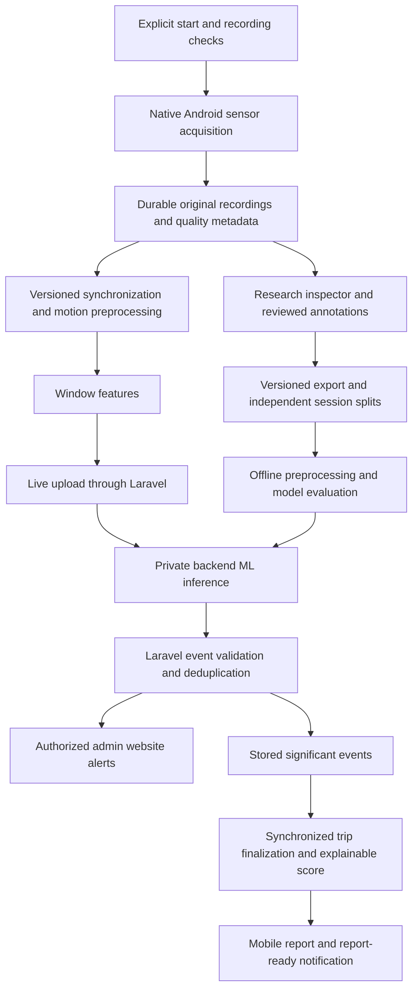

# Telematics and RC Research: central implementation guide

### Shared Admin research review — 2026-11-12

All active Admin accounts can review verified and uploaded native research recordings in Data Collection and the shared reviewed maneuver comparison in Model Explorer, including annotation revisions, processing and contact review. Annotation revisions retain the actual reviewer; original recording ownership, encrypted originals, session identity and same-owner reference compatibility remain unchanged. Mobile research uploads, context and observations remain restricted to their original account. The older Expo v1 routes remain owner-bound; the pinned classifier examples are shared among authorized Admins. Sources: `RcNativeRecordingController`, `RcProcessingRunController`, `RcAnnotationController`, `RcNativeResearchService`, `RcCollectionService`, `RcAnnotationService`, and `RcManeuverComparisonService`. Hosted access still requires RC demo configuration and the original encrypted data and application key. Focused web and mobile research tests cover shared Admin access and continued mobile ownership enforcement.

### Forward-reference sensor feedback — 2026-11-11

`mobile-frontend/services/telematics/rental-motion-capture.ts` reports live
forward-check feedback as soon as a valid sensor stream arrives, while retaining
the stationary settling requirement before accepting movement. Three seconds
without valid readings now ends the check with a retry message and cleans up the
recorder instead of waiting indefinitely. The forward movement itself still has
no fixed waiting deadline. Mobile lint, TypeScript and 23 capture/workflow tests
passed; physical validation is pending.

### Device setup disclosure — 2026-11-11

Customer and Driver device setup now presents one explicit agreement covering
background GPS and, for the RC demo profile, motion monitoring. Agree prepares
both for the existing release checks; Not now cancels setup. Saved GPS-only
consent is not reused as motion consent. `DeviceSetupDisclosureDialog.tsx` and
`TelematicsSetupChecklist.tsx` own this flow; release and native permission gates
remain unchanged. Mobile lint, TypeScript, and 11 release/motion tests passed;
physical device acceptance is pending.

Last reconciled: **2026-11-06**. Scope: Laravel, the Next.js management website,
and the Android-only Expo application. The active workspace uses the native v2
recorder, explicit resumable chunk upload and protected v2
signal inspection, local stationary/forward-reference preparation with automatic
reference-interval suggestions, and bounded saved server synchronization/filtering/
vehicle-axis results, including experimental reuse of a reviewed forward reference
for a separate maneuver trial. Native recording review also supports encrypted,
revisioned interval labels with explicit source and uncertainty. Signals, Prepare data
and Labels are separate; earlier standalone
diagnostic panels have been retired. Validated noise filtering, reusable accepted references,
accepted vehicle alignment and AI remain pending; compilation and
short recording tests do not establish general Redmi recording reliability.
The [Phase 1 collection contract](#collection-workflow-redesign-phase-1-contract)
defines the collection metadata design. Native/mobile pilot collection and the
guided three-step web review are implemented subsets; dataset review/export and
separate v2 label-confidence semantics remain pending.

## Authority and status

This is the active reference for telematics, RC research, calibration, collection,
fleet monitoring, and their AI roadmap. Read the applicable source files before
editing. Laravel Form Requests, Resources, services, migrations, and the installed
native adapter establish what the current application actually does.

Use these distinctions in code reviews, documentation, and defense claims:

- **Implemented:** present in the inspected code; not necessarily physically verified.
- **Agreed target:** selected in the planning discussion, but still requires implementation.
- **Experimental:** a setting or approach to select using development recordings.
- **Historical evidence:** an attributed result from an earlier check, not a fresh verification.
- **Pending:** no applicable completed verification is established.

The target design below replaces earlier planning exclusions of native research
recording, AI alerts, and a behavior score. It does not make those features exist,
remove authorization, or permit silently changing rental release rules. Preserve
existing data and implemented behavior unless the scoped implementation requires
a documented change. Do not request repeated approval for an already agreed
direction; clarify genuinely unresolved requirements before implementing them.

The [documentation index](README.md) covers other domains. The [project roadmap](project-status-and-roadmap.md)
provides project-wide status. [Archived guides](archive/telematics-2026-10-24/README.md)
are historical evidence only: do not use them as competing implementation instructions.
The external `telematics_blueprint.md` was a proposal reviewed during planning,
not an authoritative description of this codebase or a verified industry standard.

## Collection workflow redesign: Phase 1 contract

**Status, 2026-11-06:** Phase 1 definitions are complete. Phase 2 pilot collection
is implemented in native/mobile code and the owner-bound Laravel metadata API;
the standalone app is installed on the Redmi, with limited UI checks recorded below.
Full physical acceptance and Phases 3–5 are not complete. Web review now uses three
ordered steps and Details, while retaining `rc-phase-labels-v1` semantics.
No accepted alignment, approved dataset, trained model or physical verification
is implied by a successful build or synthetic test.

The design-time, language-independent contract pack is:

- [schema.json](contracts/rc-collection-v1/schema.json): strict resource shapes and
  a synthetic specimen envelope, using JSON Schema Draft 7.
- [catalog.json](contracts/rc-collection-v1/catalog.json): the versioned exercise
  catalog, fixed mounting preset, abbreviation meanings and mobile protocol text.
- [example.json](contracts/rc-collection-v1/example.json): synthetic linked resource
  examples only, with inconclusive preflight, pending alignment and pending dataset
  review. It is not recording 038, a seed, a measurement or a production request.
- [contract checks](../web-frontend/src/validations/research/collection-contract.test.mjs):
  schema, invalid-combination, catalog, naming, snapshot and example-link checks.

`rc-collection-v1` versions the **new collection metadata design**; it is not the
retired Expo sensor v1 protocol. Original Android streams remain protocol 2,
`android_sensor_manager_v2`, natural device axes, existing units and original
nanosecond timestamps. Phase 2 deploys checked copies of the provisional catalog to each application;
the resource schema and synthetic envelope remain design artifacts, not HTTP payloads.
Laravel Form Requests/Resources remain authoritative for the **active** APIs.
When wiring a new operation, implement the Laravel contract and owner/relationship
checks, then matching native/client schema, service, Resource and tests together.
A passing design-schema check is not server authorization or a working API.

### Phase 2 pilot implementation: current runtime boundary

Adapter **1.3.0** adds **Collect / Recordings**. Session creation uses an existing
collection group's fixed surface/slope; new conditions require a new group/session.
Sessions and mount versions survive JS/runtime restarts in an owner-scoped encrypted
native index. Initial session+mount allocation is one atomic write. New session
starts a new collection block; a declared remount preserves that session and creates
another mount version with pending alignment. Explicit server close/reopen lifecycle
operations are not exposed yet; the index selects the current block and source
contexts retain their original session snapshots. Do not infer accepted alignment
or a dataset boundary solely from these IDs.

**Session-flow correction, 2026-11-06:** Opening a group resumes that group's
latest locally remembered session, including after app restart. Opening the same
session never increments its number. Each group keeps its latest session/mount
entry in the encrypted owner index; switching groups changes the active entry.
Create session is separate from Continue session. Explicit new-session creation
is available only after the preceding session has recording evidence; the native
boundary also reuses an empty latest session if called repeatedly. A first
session for a group allocates once. Allocation failures do not advance persisted
counters. Previously assigned numbers are not reset or reused.

The selection screen identifies the active group/session separately from the
selected group's latest session and whether it has recordings. The setup screen
shows the active group name, session code and mount number. Create group uses
the existing group form; Create new session is an explicit confirmed action.
Saving a collection sidecar durably marks its session as used, so removing a
local recording later does not make that session empty again. Existing active
session/mount identity is imported from the prior single-current-session index;
older replaced sessions without index entries are not reconstructed from history.
Original recording contexts retain their existing identities.

A declared remount advances a device-wide mount generation in this owner index.
Returning to a group's older mount after a remount elsewhere keeps its session
but allocates a pending `suspected_shift` mount version once. This prevents a
remembered group from reviving a pre-remount frame. Setup checks still remain
explicit, one-use and invalidated by setup actions; selecting or continuing a
session does not collect motion or accept alignment. This local selection flow
does not add server close/reopen lifecycle operations or an all-session browser.

Verification of this correction: mobile lint/TypeScript, 280 Node checks, 39 native
recorder tests (including repeat-open, empty-session reuse, group return/restart,
failed allocation/activation, legacy-current import and cross-group remount cases),
10 native network tests and the ARM64 standalone release build passed. The
signature-matched APK was installed over the connected Redmi app without
uninstalling or clearing data. After the user unlocked Collect, the Redmi showed
the active group and empty session S05, with New session disabled. Continue was
opened twice with a return to selection between them; both opened the same S05
setup/code, without advancing the session number. Selection/setup screenshots
were inspected, and no recorder service was active afterward. This check did not
create a group/session, collect motion, upload, delete or renumber history.

**Observation save feedback, 2026-11-06:** The native observation form now shows
Saving… and Saved on phone beside its action; validation/storage/access failures
remain beside that action and preserve the draft. The former screen action wrapper
swallowed save failures into a page-top error and supplied no success feedback.
The form now receives a confirmed local revision directly, resets its revision
baseline on success, and disables unchanged saved reports rather than appending
duplicate revisions on repeat taps. Native acknowledgment must match the recording,
next revision and submitted observation values before success is shown. A separate
details read is no longer required after writing. Local save is not upload/sync.

Mobile lint/types, 286 Node checks (including local save success/failure and
mismatched acknowledgment recovery), the standalone ARM64 build and signature
verification passed. The update was installed over the Redmi app without data
clearing. A read-only reopen of S05-FSS-R038 confirmed its previously saved answers
and the disabled Saved on phone action/confirmation. No observation was invented,
resubmitted or uploaded during that verification; recording accuracy was not
evaluated by this feedback correction.

The native, explicitly consented **Agree & check setup** action measures five
consecutive steady seconds in the foreground with the operator's holder/top-forward/
still confirmations. Collect displays the mounted-phone progress ring and restarts
the count and summary when motion is detected or sensor readings are interrupted.
The operator can cancel, and **Agree & start recording** remains a separate action.
The native pilot restarts the window for an acceleration-vector change above
0.5 m/s² relative to its first accelerometer reading, gyroscope magnitude above
0.10 rad/s, or a reading gap above 250 ms. Missing sensors or a three-second
sensor timeout stop the check with a retry message.

Only the completed window contributes to Welford per-axis rest means and sample
standard deviations, vector RMS, delivered rate and largest inter-event gap for
accelerometer and gyro. The accelerometer mean retains gravity. The local reset
limits are provisional feedback settings. The evidence result stays
**inconclusive / pilot only**, with no criteria version or accepted vehicle frame.
The preflight DTO and its evidence window bounds remain the same.

Unused check evidence is held only in the native runtime, is one-use, and is
cancelled by app background/destruction, logout/account change, session change,
declared remount and successful capture binding. Lease expiry prevents further
capture. Restart therefore needs fresh evidence and physical confirmation even
when the encrypted session/mount is restored. There is no additional wall-time
freshness timeout; applicability is current owner/session/mount/native clock,
continuous foreground presence and one use. Start still verifies restricted
research access online, and an already authorized recording can continue offline
within its existing lease. Cached protocols never extend access.

New originals remain protocol 2 and add an optional `collection_binding` containing
session/mount/preflight/clock/catalog/protocol identifiers and protocol hash. Existing
installed clients' unbound protocol-2 originals remain accepted. New metadata sync
requires an exact match with the sealed binding, original group/capture/conditions,
source hash and check-before-recording monotonic times. Native elapsed nanoseconds
remain decimal strings; subtraction occurs as integers before unit conversion.
Fractional UTC ordering is retained. No old original is rewritten to add a binding.

Full protocol snapshots and collection context live in a separate encrypted native
sidecar, with append-only observation revisions and independent sync receipts.
Stop seals the raw original before observations. Reported phone shift/loose holder
starts a suspected-shift mount version; the later report does not prove the shift's
actual onset. The protocol viewer never starts/resets capture and keeps Stop visible.
The phone Stop action does not wait for a server-status request or upload queue.

The **Recordings** library pages ten phone originals (at most the existing 100-record
limit), filters Current collection/Pilot history/All, and reads owner-bound server
status for those same UUIDs. It does not duplicate phone/server copies. Current
collection means the new structured context, not approved training data: those
captures are still pilot. Historical names remain unchanged. Live server label
state explicitly identifies the current v1 semantics; unavailable/cached metadata
is labelled accordingly. Original verification, context sync and observation sync
remain separate. Retrying observations revalidates each ID/content even when a
server revision count is already equal or higher. The local original stays after
verified upload. The main v1 Data tab is retired; historical APIs/data are retained.

Authoritative write DTOs are `StoreRcCollectionContextRequest` and
`StoreRcObservationRequest`, mirrored in mobile `validation/research/collection.ts`.
They are narrower **write DTOs**, not the Phase 1 synthetic resource envelope.
`rest-welford-v1` uses `preflight.measurements.{accelerometer,gyroscope}` summaries
and source/check metadata. Server status is `RcCollectionStatusResource`; it never
exposes the encrypted sensor summaries or observation notes in a library read.

| Restricted mobile route | Current contract |
| --- | --- |
| `GET /api/mobile/rc-research/catalog` | Trusted immutable `rc-exercises-v1` catalog |
| `GET /api/mobile/rc-research/native-recordings/status?ids[]=UUID` | At most ten unique original client UUIDs; owner-bound status only |
| `POST /api/mobile/rc-research/native-recordings/{server UUID}/context` | Verified original first; atomically create/check session, mount and one-use preflight/context; exact retries succeed, changed identities conflict |
| `POST /api/mobile/rc-research/native-recordings/{server UUID}/observations` | Independent append with UUID/base revision/reported time; server owner/commit time; stale or different-content retries conflict |

Metadata tables are additive: `rc_collection_sessions`, `rc_mount_versions`,
`rc_collection_contexts`, `rc_observation_revisions`. Sensor summaries and reports
use encrypted model payloads, distinct from original encrypted files. User and
record locks serialize relevant writes; existing Customer/Driver and restricted
Admin-token boundaries are preserved. Admin list/detail displays the same compact
alias when context is synced, and alias search does not rename the raw original.
New bound processing-reference reuse also requires the same research-session and
mount UUIDs in both originals; a declared remount cannot be overridden by the old
unchanged-mount checkbox. Legacy-to-legacy reference behavior remains available.
Abbreviation guides exist in both libraries. Full Check/Prepare/Label review,
v2 confidence separation, dataset decisions/export and automatic accepted alignment
are still later phases.

Runtime catalog copies are checked byte-for-byte by mobile
`validation/research/collection.test.mjs`; keep the exact version immutable after
physical use. Neither that check nor a protocol hash validates a physical procedure.

### Mobile research UI refinement, 2026-11-06

Collect/Recordings reuse mobile disclosure and upload/delete row patterns, with
the requested compact control treatment. Header icons are plain 18px glyphs
without circular frames. Research buttons/cards opt into shared compact density
(44px action height, smaller corners/padding, no decorative icon circles); other
feature defaults remain unchanged. Collect uses the same ordinary tab treatment
as Recordings. Opened recordings and new-session/group
views have header Back navigation, mirrored by Android Back; root tabs have no
back arrow or duplicate module title. Nested views hide the bottom tab bar.
Collect opens at session entry: continue the current session or start a new one
from a collection group. It does not list historical sessions. The setup view's
Back returns to this entry without closing or replacing the saved session.
Its header places Refresh immediately before the rightmost Settings action;
the notes Info icon sits beside the Session/Mount summary. Back is unavailable
during setup checks and recording; native Stop remains independently available.
Returning retains the library's filter and page. Leaving unsaved observations
requires confirmation; opening sensor details retains the draft.

The Info action opens Research notes (general protocol/storage/pilot/name
explanations). Exercise instructions remain beside the exercise selector; explicit
consent stays beside Check/Start, and failures/deletion consequences stay at the
action. Session changes/remount declarations use a header options dialog. One
primary collection action changes from Agree & check setup to Agree & start
recording, with a separate native Stop & save while active; checks never auto-start
recording. Stop remains independent of network requests.

Library cards place Upload/Sync & verify and icon-only delete in a 3:1 row.
Detailed source/label/sensor information lives inside the opened recording.
`collectionPage(offset, filter)` adds a bounded native response with `records`,
`total`, effective `offset`, and `limit: 10`; legacy list APIs keep their array
shape and offset behavior. Count reflects the active filter and excludes the
active capture. Pagination is hidden for 0–10 entries; deletion clamps an empty
last page to the preceding page. Remote status reads no longer block native
status polling. This requires an updated standalone APK; stored originals and
capture/upload schemas are unchanged.

Verification for this UI increment: mobile lint/type checks, 273 Node checks,
29 native unit tests, Expo Doctor 18/18 and the standalone ARM64 release build
passed. APK signature and bundled protocol checks passed. The updated APK was
installed over the existing Redmi app without uninstalling it. Read-only Redmi
UI checks confirmed the compact Collect and Recordings layouts, visible existing
recordings, the notes dialog, and opened-recording header Back navigation to the
library. No capture, upload or deletion was performed during these UI checks.
These checks do not establish physical collection/calibration accuracy or replace
operator acceptance of the layout.

The subsequent approved app-only backend DNS fallback is recorded in
[Android-only mobile scope](android-only-mobile.md#app-only-backend-dns-fallback--2026-11-06).
A read-only vehicle API request reached Laravel over Wi-Fi after installation;
this transport check does not validate research authorization, uploads or sensors.

### Guided web review and reference order, 2026-11-06

The native recording inspector now uses three ordered steps: **Check recording →
Prepare signals → Label and review**. It reuses the existing chart, selection,
processing and annotation forms with JamJade controls. Summary metrics are inline;
setup, channel timing, label history and fingerprints are in Details. Reopening
shows existing saved label/processing progress; switching steps retains the label
draft. The bounded original window, cursor and interval selection are shared across
original review, reference preparation, saved-result review and labeling; changing
window clips/resets the selection when needed. No automatic refit, annotation,
training approval or filter promotion is performed.

The existing owner-bound Admin detail response now includes `review` through
`RcRecordingReviewResource`/`RcRecordingReviewService`, mirrored by `NativeReview`.
It includes a bounded collection summary, the latest encrypted observation's
permitted review fields, and processing/reference progress. It does not expose
private storage paths, owner IDs or raw preflight measurements. Existing controller
research-enabled/owner/active-account checks remain. No write Form Request,
processing/annotation payload, migration or original file contract changed.

Reference state is explicit: `missing`, `needs_processing`, `review_required` or
`not_required`. Matching sources must already have finished before the trial and
pass existing phone/sensor/group/session/mount compatibility. A recorded reference
without a root processing run is linked to its own preparation screen. An existing
run still requires review and unchanged-mount confirmation through the established
processing form; its presence is not accepted calibration. Missing references
block new vehicle-axis processing controls but preserve original review and labels.
A later reference cannot be backdated to make R038 compatible. R038 retains its
reported neutral stop and protocol deviation; observations and interval labels are
separate, and the v1 annotation contract still does not approve training data.

For future guided captures, the native recorder now checks for an existing stopped,
sealed, nonempty local forward-reference original bound to the active session/mount
before a maneuver trial can start. This order check is independent of the UI and
runs on the native recorder actor. It does not accept the physical procedure or
produce a reusable validated frame. Collect defaults to Setup reference/FR when
that evidence is absent, shows the prerequisite and disables maneuver actions.
New sessions, remounts or unavailable/deleted local reference originals require a
new local reference. Legacy unbound capture/upload contracts remain intact;
existing originals and histories are not rewritten. A locally captured reference
can be uploaded/prepared later, provided its actual capture precedes the trial.

Verification for this increment: web lint/types, 132 Node checks and production
build; mobile lint/types, 286 Node checks, 40 native recorder tests and ARM64 APK
build; Expo Doctor 18/18; backend 1,051 tests / 6,281 assertions and Pint all passed.
The backend suite used isolated SQLite memory/test storage. Browser checks on
R038 verified corrected observations, missing-reference handling, accessible
original labeling, retained saved labels, shared selection and the Details dialog.
At 375 px and 1280 px the page had no horizontal overflow; temporary viewport
overrides were cleared. Checks were read-only: no actual labels, observations or
processing runs were created by the agent. The phone update was installed with
matching signature and without uninstalling or clearing its data. On the unlocked
Redmi, Collect retained S05 and opened Setup reference/Forward Reference with
preview code S05-FR-R039 and the missing-reference prerequisite visible. No recorder
service was active. This is not RC accuracy, background
reliability, an approved dataset or full Phase 3/5 completion.

### Phase 2 verification, 2026-11-06

- PHP 8.4 full `composer test` (with process timeout disabled and an isolated
  test-storage token): **1,047 tests / 6,246 assertions passed**. An
  earlier invocation selected local PHP 8.5 and timed out; that is not a pass.
- Mobile lint/type check, 270 existing/new Node checks, 27 native unit tests,
  Android release compilation/bundling and APK signature verification passed.
  Expo Doctor passed 18/18 checks. These are automated/synthetic evidence only.
- Web lint/type check, production build and 111 research contract/render/analysis
  checks passed. Concurrent unrelated development briefly left stale generated
  route types; the completed build regenerated them successfully.
- The additive collection migration was applied locally. Existing motion files,
  source hashes and previous recording IDs were not rewritten or deleted.
- Standalone release APK includes bundled JS and the checked protocol catalog;
  adapter is 1.3.0 (the existing app package version remains 1.0.0). Install as an
  update to retain encrypted phone data. No public download link was created.
- No Android device was attached at the final ADB check. Installation, Redmi UI,
  foreground/background transitions, physical remount/noise/sign behavior and the
  first guided FSS end-to-end run remain pending. Do not mark those verified from
  unit tests or build output. Browser visual acceptance was not performed here.

### Agreed structure and identity

One recording contains **one planned exercise**, with initial/final quiet periods.
An exercise can contain multiple phases: FSS has starting and stopping, and
Mixed Drive can contain several maneuvers in one evaluation run. Review assigns
labels to intervals according to the observed maneuvers.

| Entity | Identity and required contract | Lifecycle/meaning |
| --- | --- | --- |
| Collection group | Existing `recording_group_id`; local preset/default library | Retained organization; membership alone proves neither mount validity nor independence for evaluation |
| Research session | `id`, server-owned `owner_id`, `device_profile_id`, `session_number`, `recording_group_id`, `conditions`, `preset_id`, `catalog_version`, participant codes, open/close times | An explicit collection block; conditions are snapshotted. A remount creates a mount version within this session rather than forcing a new group/session |
| Mount version | `id`, `research_session_id`, `mount_number`, reason, orientation preset, creation/invalidation times, alignment status/method/evidence/reference IDs | A declared physical mounting episode. References apply to the relevant episode, never silently across a remount |
| Preflight evidence | `id`, `mount_version_id`, consent version/time, clock context/bounds, window, channel counts/measured summaries, summary-method/criteria versions, results and physical confirmations | Bounded explicit setup check; not a rental setup session, maneuver recording, observed event label or proof of accepted alignment |
| Recording context | Original client `recording_id`, optional `server_recording_id`, research session/mount/preflight IDs, capture number, kind, planned protocol, course snapshot, source fingerprint and capture/upload states | A separately linked metadata projection. Preserve the sealed original name, timestamps, measurements, IDs and hashes |
| Observation revision | `id`, `recording_id`, revision/time, source/observer code, completion report, flags, actual stopping method and optional notes | Saved after the original; encrypted, append-only and independently synchronized. Incomplete observations never prevent saving original data |
| Annotation revision | `id`, `recording_id`, explicit version/revision, previous revision ID, review state/time, source fingerprint and intervals | Actual human-reviewed interval descriptions; distinct from the planned protocol and from dataset approval |
| Processing profile | `id`, version, experimental/validated state and evidence, sampling/grid/filter/gap/warm-up/projection settings | Reproducible researcher configuration; no operator cutoff selector before each run |
| Dataset review | `id`, `recording_id`, revision, decision/reason, policy version, source fingerprint, selected artifact/revision IDs and included intervals | Explicit inclusion/exclusion judgment; immutable exports later pin this exact review and its dependencies |

`research_session_id` is deliberately separate from the existing native
`collection_session_id`. The latter depends on entered context and the native
runtime, can change on restart, and cannot detect an unreported remount. Never
reinterpret historical runtime IDs as the new research-session identity.

New session numbering is durable and owner/device-profile scoped. Existing
recording numbering remains the native group-scoped monotonic capture allocation;
it does not reset when a research session changes. Failed starts can leave gaps.
Neither number counts successful recordings or usable training examples. UUIDs
remain the authoritative keys; display codes are not globally unique identifiers.

A session contains a fixed surface/slope/device/preset/protocol context. A changed
surface/slope, phone or protocol collection block starts a new session. A changed
cone layout creates a layout revision in recording metadata; it does not claim
that the mount changed. App restart can restore a persisted research session only
with a physical-mount confirmation; restart is not proof of either unchanged or
changed physical mounting. Closing/reopening a collection block does not rewrite
old records or automatically accept a reference.

Only fixed participant codes such as `OP01`/`OB01` are needed for research provenance.
They are not new personnel roles or login identities. Do not collect personal
names, contacts or identifiers for this purpose. Ownership/reviewer identity is
assigned by authentication, not trusted from a submitted specimen's `owner_id`.

### Compact display naming and original preservation

Use `S02-FSS-R038`, without spaces:

| Part | Meaning |
| --- | --- |
| `S02` | Research session 02; pad to at least two digits |
| `FSS` | Selected planned protocol code |
| `R038` | Existing recording allocation 038; pad to at least three digits, using zero rather than letter O |

Padding expands for larger numbers; never truncate or reuse numbers. Derive the
code from structured values and retain the full readable protocol label in
Details. Surface, slope and date belong to the session header. Add an
**Abbreviation guide** action in both recording-library headers, populated from
the same catalog meanings, rather than repeating explanations on each row.

The display code is an overlay, not a replacement for `context.name` in existing
sealed originals. Do not rename/reseal existing phone files, change source hashes,
renumber history or use a display-code rename as a new upload identity. Older
records without verified new session/protocol metadata keep their original names;
do not invent `S01` or infer an exercise from their waveform to fill a missing code.

### Fixed mounting and pre-run checks

The user confirmed one Redmi Note 8 Pro and one mounting pattern for the capstone:
MN-82S Supertourer roof, **Adjustable screw**, screen up, phone length along the
RC front–back direction, **camera/notch end toward the RC front**. The user's
confirmation resolves the ambiguous photograph. Mount angle is unmeasured, not
10 degrees; RC battery percentage remains unmeasured. A photo does not prove
rigidity, exact tilt, grip, levelness or reference validity.

Target flow: **Mount -> explicitly run setup checks -> show the result -> explicit
Start recording**. Explain what correction is needed. Opening a protocol must not
start collection; opening it during an active recording must not pause, restart
or reset that recording, and Stop must remain accessible.

The preflight record separates:

- Sensor availability and usable event timing.
- Expected tilt/orientation and acceleration/gyro stability over a bounded window.
- Operator confirmations that the RC is still, the holder is locked and the phone
  top points forward. Stillness alone cannot prove holder rigidity or horizontal
  front alignment.
- Alignment applicability for this mount. `pending`, `experimental`, `accepted`
  and `invalidated` are distinct. Acceptance requires registered validation
  evidence and method version, not merely a non-null identifier supplied by a client.

No numerical orientation/stability/cadence acceptance thresholds have been
validated. They remain null in the Phase 1 catalog. `passed` requires an approved,
registered criteria version, all required check results and physical confirmations;
clients cannot produce a trusted pass by inventing their own criteria. A tested
experimental criteria version can describe an experimental setup check without
claiming validated vehicle alignment. Actual limits must come from the physical
pilot and be versioned before wiring the Ready decision.

Evidence includes the measured rest-acceleration mean and standard-deviation
vectors, gyroscope RMS, per-channel delivered rates and maximum gaps, not only
status flags. Acceleration includes gravity; stationary does not mean an all-zero
accelerometer. Missing summaries are null, not fabricated zero/noise-free values.
Retain summary-method version, source window and original units. The synthetic
specimen's numbers are deliberately artificial and must never become default
measurements or acceptance thresholds.

`start_elapsed_ns`/`end_elapsed_ns` are decimal strings in a native
`clock_context_id`; use integer/BigInt subtraction before conversion to relative
milliseconds. Check signed-64-bit bounds, ordering and agreement with `window_ms`
server-side. Preflight `started_at` denotes the start of that source window;
reported consent must precede it and the access grant must be valid independently.
Recording context identifies the same clock domain; a runtime/clock restart
requires new evidence even when the physical session/mount can be restored.
UTC or explicit-offset source times remain explicit internally, with server
revision times and reported check times distinguished when wiring writes.
Display dates in Asia/Manila without a visible timezone suffix.

Preflight is an explicit consented motion-capture action. Verify its registered
consent version and access grant before starting sensors; opening a guide or
screen is not consent. The Phase 1 consent fields do not add a consent flow or
authorize collection by themselves. Preserve the existing raw recording's own
consent evidence rather than copying an invented result into it.

Keep capture eligibility separate from derived-data/AI readiness. Diagnostic raw
collection can preserve an inconclusive setup result with explicit status;
it must not silently become an approved controlled/dataset capture. Define the
freshness/one-use rule in the native implementation: evidence must precede Start,
match the current owner/session/mount/clock context and be invalidated on declared
remount/repositioning. No arbitrary expiry duration is frozen in Phase 1.

A remount creates a new mount ID/number and requires rechecking. Automated
fixed-mount reorientation from quiet evidence is an agreed investigation, not an
implemented replacement for forward-reference capture. Preserve the short guided
forward-reference fallback until repeated remount/sign/turn checks establish
confidence. An old reference can never pass simply because a new mount's setup
strings look identical. Phone-only sensing cannot guarantee detecting every shift;
operator reports must remain usable evidence. Suspension rocking and mount slip
are different phenomena and must not be silently conflated.

`invalidated_at` records the end of applicability from the known invalidation
time. A later remount does not by itself make correctly prepared earlier recordings
bad. If a shift's actual onset is unknown, preserve that uncertainty and review the
affected period; the time someone reported a shift is not its proven onset.

### Authorized research reset — 2026-11-06

The operator explicitly requested permanent removal of the development/pilot RC
research data before a fresh collection. The owner-scoped backend reset removed
15 native recordings, 180 chunks, 9 processing runs, 6 annotation revisions,
11 observation revisions, one collection context/session and 204 encrypted files,
plus the retired v1 encrypted recovery bundle. No legacy session/trial rows remained.
Account, booking and vehicle row counts were unchanged. Earlier evidence below
is historical and no longer implies those originals remain available.

Mobile now provides a confirmed **Delete local research data** action in Research
notes. It clears only the authorized owner's native research directory and its
Keystore key, including groups, sessions, local observations, originals and transfer
receipts. Capture, setup checks and service shutdown must finish first. It preserves
login and other application data. Server deletion is separate; this local action
must never imply remote erasure. A reset creates new identities and restarts local
numbering. The ARM64 standalone update built and installed over the existing package.
After the operator signed in, the confirmed local reset completed on the Redmi.
The recording list showed **No recordings**; after restarting, Collect retained
**No session yet** and an unselected group. No recording or setup check was started.
A final read-only backend check found zero rows in all ten RC research tables. Focused backend checks (30 tests), the complete
backend suite (1,052 tests), mobile lint/types and 285 Node checks, 40 native unit
tests and the standalone build passed; web lint/types, 44 contract checks and
the production build passed. The build required network access to fetch the
existing Google Font.

### Capstone baseline collection close — 2026-11-10

The first RC demo integration component is the private local worker
`backend/ml/infer_rc_demo.py`. It accepts versioned JSON containing
1–100 uniquely identified windows, each with exactly 35 finite feature
values in the frozen feature order. It verifies the trusted candidate
and source provenance, then returns the predicted class and forest vote
with the model checksum. Requests are bounded to 1 MiB and rejected
without raw input in error messages. A check with a real development
feature vector and invalid boolean, nonfinite and wrong-length inputs
passed. Laravel routing, native streaming and the Admin demo interface
are still required to expose this worker through the intended flow.

Laravel now exposes local RC-demo window classification at
`POST /admin/rc-research/demo/inference` through the existing stateful
Admin authentication, CSRF and research throttle group. The
`InferRcDemoRequest` validates version, unique window IDs and exactly
35 finite numerical features. `RcDemoInferenceService` owns the
15-second bounded worker invocation, verifies its model checksum and
prediction contract, and returns a safe 503 on worker failure. The
response is private/no-store. This standalone endpoint accepts experimental
feature windows and does not persist events or establish sensor provenance.
The connected session runtime below uses the same model contract.
Verification passed the actual Laravel-to-worker smoke check, three
endpoint tests and all 1,111 backend tests (6,729 assertions).
The Android service now has a matching Zod request schema and an
authenticated classification transport at
`POST /api/mobile/rc-research/drive-monitoring/inference`.
It uses the existing restricted Admin research token, profile gate
and request validation. Four focused inference tests passed.
This is the mobile prediction transport. The later runtime below connects
native capture, reference/filter feature parity, session persistence and controls.

The runtime feature transform now lives in
`DriveMonitoringFeatureService`. It reuses the frozen 30 statistics
and calculates the five temporal yaw inputs in the same order as
the selected Python model. PHP and Python agreed on all five
temporal values for all 505 development intervals. Focused checks
also passed for mirrored turns, merged same-direction phases,
zero yaw and a single sustained phase. Continuous native capture
must preserve the same paired 20 ms grid and axis/unit conventions
before calling this transform.

The operator selected continued monitoring while the screen is locked
with a persistent Stop notification. The native
`startDriveMonitoring` entry point now reuses the recorder's foreground
service, actor, encrypted originals and explicit stop/recovery behavior.
It requires the Mixed Drive protocol, foreground user start, notification
access, authorized research access and the existing reference/setup
checks. Its notification is titled Drive Monitoring with Stop monitoring.
The native release compilation and recorder unit suite passed.
This entry point now connects to the native pipeline and uploader below.
It is an Admin RC flow; rental monitoring remains a separate boundary.

Drive Monitoring now has owner-bound session start/stop and batch
receipt endpoints beneath the mobile research token boundary.
Session creation requires explicit versioned consent, unchanged-mount
confirmation and an owned, verified 5 Hz reference. Start retries use
the same client UUID. A user row lock serializes competing starts.
Stop retries retain their original end time. The batch endpoint
serializes on the session, hashes each versioned request, and saves
encrypted prediction receipts with a unique client batch ID. Identical
retries return the receipt, changed retries conflict, and stopped
sessions reject new batches. Raw features are not stored in those
tables. The mobile Zod schemas and API service mirror the contracts.
The focused tests cover retries, consent, reference ownership and
post-stop batch behavior. Native scheduling and explicit foreground recovery
connect to these endpoints.

The native uploader now persists feature batches in an owner-bound
AES-GCM/AtomicFile queue under the recorder's existing private storage.
Its worker uses the configured HTTPS backend host allowlist, existing
OkHttp/DNS client, disabled redirects, bounded responses and network
timeouts. Credentials remain in memory. Acknowledgement requires the
expected model/version and ordered window identities. Network failures
retry with bounded exponential delay. Authorization/conflict/validation
failures pause transfer with the encrypted batch retained. Queue access
is serialized on the recorder actor and duplicate IDs require identical
payloads. The queue is bounded by 100 batches and the 1 MiB metadata limit.
The TypeScript transfer adapter validates each batch before enqueueing.

The Stop path now ends sensor capture locally, then drains acknowledged
batches before posting the idempotent server Stop request. A server receipt
is required before removing each batch. Network failure retains the same
batch identity and retries; authorization or content conflicts pause transfer.
The encrypted queue also persists the session's completion intent and its
local recording binding. After process loss, an explicit foreground transfer
reconnection can drain that session and finish it without restarting sensors.
Tokens remain memory-only. Transfer status exposes pending batch counts and
unfinished session IDs. Collect shows Reconnect transfer when access or
interrupted delivery needs attention. Process-loss recovery never restarts
sensors. Queue capacity remains bounded;
this is not an unlimited offline raw-sensor upload guarantee.

The Admin website now offers **Drive Monitoring** under Insights at
`/admin/drive-monitoring`. Its owner-scoped session list and detail poll the
existing authenticated Laravel service every two seconds, showing received
batch counts, last receipt, grouped events and expandable classification windows. Shared page
heading, cards, controls and counted pagination follow Data Collection's
management patterns. Open session status does not imply current connectivity;
window votes are classifier votes, not a validated probability or behavior score.
No sample sessions or predictions are seeded into the user's database.

The earlier 50-test recorder / 1,118-test backend checkpoint verified the transfer
foundation. The connected runtime and newer checks are recorded below.

#### Connected Admin RC monitoring — 2026-11-10

Mobile **Collect → Mixed Drive → Start monitoring** uses the existing setup
check and an explicit consent dialog describing private feature transfer,
unchanged mounting, background capture and Stop. Ordinary exercise recordings
keep their previous behavior. Observer labels never enter live inference.
`drive-monitoring-workflow.ts` obtains an owned prepared 5 Hz forward reference
for the current research session and mount. Laravel recomputes it from verified
originals, checks source hashes and saved reference equality, then snapshots the
matrix/rest offsets encrypted on the monitoring session. A durable client start
identity supports a lost-response retry. Failed starts close empty server
reservations; queued windows must drain before server closure.

`DriveMotionPipeline.kt` consumes the recorder actor's copied Android readings:

- A 20 ms grid, linear interpolation across brackets no longer than 60 ms,
  per-channel causal second-order Butterworth filtering at 5 Hz and 500 ms
  segment warm-up match `RcMotionProcessing`. Gaps reset usable window history.
- Native m/s² and rad/s units, resting mean subtraction and the saved
  right-handed R/F/U matrix emit F/R/U components. Encrypted raw protocol 2
  originals remain separate and retain their explicit original-upload flow.
- Trailing windows contain 20/40/80/160/280 paired readings, every ten grid points.
  Each has the frozen 30 statistics plus five temporal yaw features. The native
  actor queues batches every second, including capture-relative times and nearby
  vertical/pitch evidence around minimum forward force.

`StoreDriveMonitoringBatchRequest` and the mobile Zod schema require the same
versioned timing/evidence fields, complete window lengths, ordered ends, unique
window IDs and finite measurements. Laravel rejects new out-of-order batches
but returns existing receipts for identical retry identities. Raw feature vectors
are not persisted in the ordinary session/batch tables.

The selected forest remains unchanged. `ml/export_runtime_forest.py` exports its
300 learned trees without fitting or reading reserved evaluation examples. The
runtime artifact is encrypted in Laravel private storage with plaintext-content
SHA-256 `cb4dbcbde174c7401b306c8edd7bd9445eedd6cae7db925c98f12c011d0fdbf1`.
`RcRuntimeForestService` checks that hash, original model hash, class order and
feature count before using float32 inputs, original split thresholds and
averaged normalized leaf probabilities. `RcDemoInferenceService` invokes this
PHP runtime; the original Python worker remains an offline reference. Model
weights are not exposed to either frontend. Local-only inference remains enforced.

Export/verification commands, from `backend/`:

```sh
ml/.venv/bin/python ml/export_runtime_forest.py
ml/.venv/bin/python ml/verify_runtime_forest.py
```

All class probabilities were compared on 353 development examples and 656
synthetic/float32 boundary cases. All 1,009 classifications matched; maximum
absolute probability error was `2.220446049250313e-16`. A local 25-window service
check fell from approximately 2,033 ms with per-request Python startup to 22 ms
using the export. These are local compute timings, not phone-to-website latency
or new classification-accuracy estimates.

`DriveMonitoringEventService` persists experimental grouped events within the
same locked batch transaction: harsh vote ≥0.65, 600 ms same-class grouping,
1,200 ms corner hold/folding into an overlapping swerve, 50% reused-window swerve
suppression and repeated braking-peak suppression. Braking with vertical peak
≥2 m/s² and pitch-rate peak ≥0.8 rad/s needs review. Stop does not invent future
sensor time to confirm a pending corner. Normal windows remain inspectable
predictions and do not create harsh alerts. Event spans describe the first
supporting analysis window, not reviewed ground-truth onset/offset times.
The offline six-phase close-swerve heuristic is not in this first runtime;
very close repeated swerves may merge and must not be used for validated grading.

Checks passed: 53 native tests, including 181 windows from independent PHP
synthetic synchronization/filter/projection fixtures (all 35 features compared);
32 focused mobile workflow/recorder tests; mobile lint/TypeScript; web
lint/TypeScript/production build; all 1,126 backend tests (6,808 assertions),
followed by focused checks for final numeric/resource refinements; Pint and
whitespace checks. The ARM64 standalone APK built and installed as a
matching-certificate update without clearing phone data. Physical foreground,
lock-screen, network-loss/recovery and populated browser acceptance remain
separate checks. No extra training collection is required for these checks.

Offline transfer is bounded by 100 batches and the existing 1 MiB queue-document
limit. A full/unwritable queue interrupts capture visibly and keeps the raw
original for review; it does not claim that every feature was delivered.
Foreground reconnection can finish retained transfers after process death,
logout or expired access; capture does not restart automatically. Background
endurance, vibration/remount robustness, precise event timing and real-car
validity are not established. Scores and final reports remain planned.

First phone-to-Admin delivery check, 2026-11-10: the operator uploaded
`S10-MD-R290` (18.54 s, verified original). Its monitoring session received
14 batches / 372 classified windows through capture-relative time 18.2 s,
then reached server status Stopped. All 372 predictions were `normal_motion`;
no harsh events were stored. The authenticated Admin session detail visibly
showed S10, 14 received batches, Stopped and no driving alerts. This establishes
one short delivery/Stop check, not lock-screen, outage or driving accuracy
acceptance. The original remains outside the frozen training/evaluation snapshot.

Short screen-lock check, 2026-11-10: the operator confirmed the screen was locked
during `S10-MD-R291` (36.97 s, verified stopped original). The monitoring session
received 29 batches / 837 windows through elapsed time 36.6 s and closed
successfully. All predictions were `normal_motion`; no events were stored.
Receipts spanned 37 s with a maximum three-second receipt gap. Original required
channels stayed near 50.5 Hz with no sequence gaps, duplicate or backward
timestamps; maximum accelerometer gap was 43.87 ms and gyro gap 19.87 ms.
This supports one short stationary lock-screen capture/delivery check on this
Redmi, not background endurance or disconnected-network recovery acceptance.

Short connection-recovery check, 2026-11-10: `S10-MD-R292` is a verified stopped
45.41 s original. One monitoring session received 30 batches / 1,002 windows
through elapsed time 43.4 s, across a maximum 34-second receipt interruption,
and then reached Stopped. Recomputing the existing 50 Hz/5 Hz fixed-reference
pipeline from its verified original channels produced exactly the same 1,002
window identities: no missing, duplicate or unexpected delivered windows.
Both required sensors stayed near 50.54 Hz with no sequence gaps and a maximum
20.19 ms inter-event gap. All predictions were normal motion; no events were
created. The suggested 15-second post-reconnection wait was operator guidance,
not a configured timer or delivery guarantee. Retry timeouts/backoff and queue
draining can take longer. This establishes one short recovery check, not
unlimited offline capacity, process-death recovery or long-duration acceptance.

Monitoring review refinement, 2026-11-10: the Admin session list now uses the
shared responsive `ManagementTable` / `TableActionMenu` pattern from Data
Collection. Details use the existing `MetadataList` and `SummaryList` for status,
collection session, analyzed-through sensor time, batch receipts and closure.
Stopped status does not claim that raw originals or every expected sample were
delivered. Only the dedicated recovery audit above compared all expected windows.
`DriveMonitoringSessionResource` adds `analyzed_through_ms`; the mobile response
type recognizes the additive field without requiring an APK update.
`DriveMonitoringController` returns event totals for the entire owner-bound
session independently of its bounded latest-50 event preview. Detected, review
and pending counts exclude suppressed events appropriately. Prediction details
are collapsed and show ten rows per page from the latest ten batches, with
interval bounds and classifier votes. Ended details stop polling; open details
and the session list retain two-second polling. Manual refresh remains available.
Permission/not-found errors stop retries and do not show a false empty state.
Stopped sessions without receipts explicitly say no readings were received.

The feature presentation lives in `DriveMonitoringModule.tsx`,
`components/MonitoringSessionDetails.tsx` and `components/MonitoringPredictions.tsx`;
requests/types remain in `services/research/drive-monitoring.service.ts`.
No capture, inference, labels, dataset partitions or event-grouping rules changed.
Browser review used the existing S10 sessions, verifying details, prediction
page changes and back navigation at desktop and 390 px widths without horizontal
overflow. Error/permission states were reviewed in code and the API regression
tests; they were not visually simulated against the user's live backend.
Verification for this refinement passed web lint, TypeScript and production
build; mobile TypeScript for the additive response type; all 1,127 backend
tests (6,815 assertions); Pint and `git diff --check`. The regression covers
whole-session event totals remaining correct when the visible preview is capped
at 50. No native rebuild or new RC capture is needed for this interface change.

The operator closed further recording. Use the existing evidence to complete
the capstone prototype. The selected classifier is the encrypted 35-feature
random forest with checksum
`4812bc8090d396b414db06ed9e6373b078ba610d43e4adf5e7fbf54133c14d18`
and frozen dataset `pilot-split-v3`. Its reserved evaluation covers
201 manually bounded intervals, with 197 correct and 0.9545 macro F1.
Separate verification of the saved model/evaluation and all 14 Python
trainer tests passed at collection close.

The offline replay candidate uses five trailing window lengths (0.4,
0.8, 1.6, 3.2 and 5.6 seconds), 0.2-second stride, a 0.65 forest vote,
0.6-second same-class grouping, the 1.2-second corner hold, 50% reused
window swerve deduplication, six-phase close-swerve splitting, and
braking peak deduplication/ambiguity review documented below.
These decisions use classifier output and sensor evidence. The
close-swerve additions are heuristic events rather than new model
predictions. Preserve that provenance during integration.

The replay source hashes at collection close are
`cfb3f00ac9592f41d962ff11160c5642e4b4c541866c3225045e67680fc2914b`
for `backend/ml/replay_yaw_forest.py` and
`29ce2a912a4604f31847dab9ca785c4e03464cae166fc535ad4a9fad4ea1f776`
for `backend/ml/stream_replay_windows.php`.
The latter reads private recordings locally. It is a replay tool.

The connected Admin RC runtime now implements native ingestion, matching
feature/window state, private inference and persistent grouped events. Physical
acceptance, rental integration and post-drive scoring/reporting remain required.
Preserve consent, pause/remount/reference checks,
quality gaps, automatic-direction uncertainty, and Staff release gates.

Report the 98.01% result as isolated RC interval classification.
Session 10 checks cover few recordings from one setup. Braking
ambiguity limits were designed from two confounded stops and require
caution in grading. Bumps/body rocking can affect resting baselines.
The close-swerve rule has one fresh confirming run. Phone handling,
reverse transitions, rough-surface swerves, background endurance and
full motion-to-website latency remain limitations. The absence of
additional recordings is an explicit project constraint.

### Versioned exercise protocols

New captures use [`rc-exercises-v6`](contracts/rc-collection-v1/catalog-v6.json). Versions 1–5 remain immutable for historical captures. Every definition is provisional until the
applicable physical rehearsal. `SR`/`FR` are setup codes, not maneuver classes.
The ordinary exercise picker offers FSS, HA, HB, LT, RT, RSS, LC, SWL and SWR.
Turns and directional swerves use the same Normal or Harsh attempt selector.
The selected exercise code records the planned side and intensity. The saved
observation records the actual initial deviation and whether the RC returned
to the starting lane. Existing
sessions keep their original session metadata and use the latest catalog for
new captures.

Catalog v6 adds **Mixed Drive (MD)** under **Collect → Maneuver trial**.
The protocol uses the existing reference-first setup and records the
exercise as one original. Planned severity is unspecified. The observer
records the actual sequence and any contact, and web review labels each
maneuver interval independently. Use a fresh evaluation session, rehearse
the sequence, straighten between maneuvers, and keep the whole recording
within 30 seconds for a single processing window. Mixed drives remain
separate from the frozen pilot split.

Laravel accepts MD with v6 in the manifest and collection contracts.
Android binds the versioned catalog and the mobile picker uses its existing
exercise renderer. The web abbreviation guide reads the same definition.
The mobile catalog test checks all copies and verifies that the older
protocol definitions match v5. The backend test uploads a sealed MD fixture,
saves observations and reviews a turn and swerve in the same recording.
Verification on 2026-11-10 passed all 1,108 backend tests, targeted Pint,
17 mobile collection tests, mobile and web lint and TypeScript, and the
web and ARM64 Android release builds. The APK's v6 asset matched the
server catalog and its signing certificate matched the installed app.
The in-place update succeeded on the Redmi. Collect opened, Mixed Drive
was selectable, and the MD recording code appeared. The first physical
Mixed Drive capture and upload remain pending.

Version 5 verification completed on 2026-11-09. The backend suite passed
1,100 tests, all 44 native recorder tests passed, mobile/web lint and type
checks passed, and the web and Android release builds passed. The Android
update was installed on the Redmi. Session S07 remained available. The
Maneuver trial picker showed Lane Change, Swerve Left and Swerve Right, and
Swerve Left showed Normal and Harsh attempt intensity choices. The phone was
left on Swerve Left with Normal selected for the next trial.

| Code | Planned exercise | Procedure focus |
| --- | --- | --- |
| FSS | Forward Start-Stop | Gradual forward start and neutral-release stop |
| HA | Harsh Acceleration Attempt | Sharp start attempt followed by a normal stop |
| HB | Harsh Braking Attempt | Normal start followed by a sharp brake attempt |
| LT / RT | Left / Right Turn | One smooth turn from the RC's perspective, straighten, then stop |
| HLT / HRT | Left / Right Turn with Harsh attempt selected | Same corner at a slightly higher controlled entry speed, steady throttle through the turn, then straighten and release to neutral |
| RSS | Reverse Start-Stop | Reverse normally, release the lever to neutral, allow it to stop |
| LC | Lane Change | Move to the adjacent lane, straighten in that lane, then stop |
| SWL / SWR | Swerve Left / Right | Smoothly pass one obstacle on the selected side, return to the starting lane, straighten, then stop |
| HSWL / HSWR | Swerve Left / Right with Harsh attempt selected | Use a quicker steering input at a controlled approach speed, clear the obstacle, then return, straighten and stop |
| SR / FR | Stationary / Forward Reference | Dedicated setup evidence using the reference workflow |

After starting, allow settling and about **five usable quiet seconds**, perform
the planned exercise, stop, allow settling and about five quiet seconds, then
Stop/save. Do not force exactly seven seconds, exactly five seconds or an event
label derived from a countdown. The guidance interval is not a validated
stationarity/quality threshold. SR has no driving exercise; its initial/exercise/
final text represents continued stationary evidence, not a command to move.

For the provisional FSS straight course: pair 1–2 is A/start; pair 3–4 is B/release
to neutral; pair 5–6 is C/end of intended stopping zone. Stop between B and C and
retain a clear buffer beyond C. For RSS, B means **release lever to neutral**;
rehearse its stopping distance separately. Turn/swerve geometry and all cone
spacing/radius remain provisional. Keep unmeasured dimensions null; a tile count
can be recorded as a count without converting it to invented metres. A layout
revision must record what changed. Keep cones/cables out of the wheel path;
contacts are observations, not automatic harsh-event labels.

**Lateral courses.** The original eight-cone offset course is a
single lane change: A and B are in the starting lane, while C and D are in the
adjacent lane. Steering back to straighten at C restores the heading while the
RC stays in the adjacent lane. For new controlled trials, the
obstacle-avoidance swerve course adds a return to the starting lane after
clearing an obstacle marker. Distinguish course shape from severity. Either
course can be driven smoothly or abruptly.

The operator reports limited steering travel on this RC. Rehearse the
obstacle course at a controlled low speed and leave enough forward distance
for the RC to clear the marker, return and straighten without hitting cones.
Course dimensions remain provisional until rehearsed. Use the observation to
confirm whether the RC cleared the obstacle and returned to its lane. The first
lateral deviation and severity remain separate from the maneuver label.

Lane Change is a normal trial. Version 4 `SW` remains readable as obstacle
avoidance with no preselected side or intensity. Data Collection shows `LC`
for saved `SW` recordings bound to versions 1–3
with the original `swerve_recovery` layout. Latest-label review exposes those
legacy `swerving` intervals as effective `lane_change` intervals with the same
bounds, evidence and severity. Original manifest/context codes, stored revisions
and revision history retain their original values. The effective label is a
course reinterpretation and does not add evidence about a trial.

Show the selected maneuver's full protocol and layout before Start, a compact
reminder while recording and the version used when reviewing an older record.
No second phone or stopwatch is required. A teammate observes actual motion and
can annotate after upload. Timing estimated from observations and chart review
must remain identifiable as estimated; plots assist boundary placement and do
not independently establish event truth or the brake command.

`protocol_code`, trusted catalog version and the SHA-256 of the canonical selected
protocol definition bind the exact instructions to a recording. The full definition
must be retained in the trusted catalog/snapshot store for offline review and
exports. Changing wording/procedure creates a new immutable catalog version;
do not change historical snapshots in place. A hash proves identity, not physical
truth. Cached protocols permit offline viewing; permission/access lifetime and
new-recording offline eligibility are separate rules. Do not widen the current
research-token scope or extend authorization lifetime as a shortcut.

Before any physical recording uses this draft catalog, its wording can still be
reviewed. Once used for capture, preserve that exact version/snapshot and publish
a successor for changes. SR/FR labels and the contract version are technical
identifiers; the UI must not imply that protocol procedures are already validated.

Planned intensity and reviewed severity are separate fields. HA, HB, HLT and HRT
encode a harsh attempt. HLT and HRT use the same provisional course layout as the
corresponding normal turn. Record course deviations, sliding and contact in the
observation. Review sustained yaw and lateral acceleration in the turn interval
with the reported maneuver before assigning severity. The planned intensity
belongs to collection metadata and must stay out of model inputs. SW has
`planned_assessment = unspecified`; assess swerving severity during review.

The v2 catalog uses neutral release for ordinary forward/reverse stops, including
FR, FSS, HA recovery, turns and swerve recovery. HB explicitly attempts an applied
opposite-lever brake while moving forward, without reversing. Stop method never
establishes measured severity. FR still needs enough start/slowdown evidence for
processing; a completed procedure does not guarantee a usable reference.

On 2026-11-06 the operator clarified that earlier recordings used neutral release
throughout. Treat this as retrospective operator-reported evidence, not independent
timing truth. Do not overwrite sealed originals, old protocol snapshots, saved
observations or labels in bulk. Review discrepancies against the actual method;
an old protocol mismatch alone does not establish unusable sensor data. Session
catalog version records its creation baseline; each capture independently binds
its selected catalog version/hash, allowing v2 captures in an existing v1 session.

### Mobile post-save choices — 2026-11-06

After **Save observations** succeeds and the native acknowledgment is checked,
RC Collect opens the existing-style research dialog with **Upload now**,
**Record another** and **Stay here**. Original motion capture is already stopped
and saved before this point; no upload or observation form gates native Stop.
The dialog identifies the recording and discloses motion/setup/diagnostic/report
transfer before an explicit upload click. It reuses the existing authenticated,
resumable upload and collection-sync path without a duplicate consent dialog.
Progress stays visible; failures retain the dialog and originals for retry.
Only completed upload plus setup/observation sync changes the dialog to Upload
complete. It never claims a cached receipt is a fresh transfer.

Record another returns to Collect using the active group/session, including when
observations were saved from Recordings. It preselects the saved maneuver and
its planned intensity when the session and mount match and a local forward
reference is available. The next run has its own observations and setup evidence.
It creates no session, group, recording,
setup measurement or sensor subscription. Setup checks and any missing-reference
gate still apply. Stay here/dismiss leaves the locally saved report open. Failed
observation saves do not open the dialog; reopening an already saved report does
not automatically prompt. Backend/native contracts are unchanged.

Mobile lint/types, all 285 existing Node checks and the final ARM64 standalone
build passed. The Redmi was reconnected after checks and the APK installed successfully
as an update, without uninstalling or clearing app data. Physical dialog, small-screen/keyboard and failed-upload
UI verification remain pending. No
recording or observation was created/modified to force a smoke test.

### FSS timestamp suggestions — 2026-11-06

Website Label and review now offers **Suggest intervals** only when the trusted
collection context identifies `FSS`. It uses original accelerometer/gyroscope
streams for one complete recording of at most 30 seconds. Partial views provide
Load complete recording when supported. It reuses experimental quiet/run and
phone-top projection logic in `reference-suggestions.ts`; FSS candidates permit
250 ms event bins, while reference preparation retains its 500 ms fitting checks.
This timing mode neither fits nor accepts a vehicle frame. Its thresholds and
boundaries remain provisional, with no accuracy claim.

Proposals contain only IDs and start/end times: quiet before, initial activity,
the intervening span when long enough, opposite activity and quiet after when
found. The intervening span does not establish constant speed or even continuous
travel. Several start/stops, gaps, missing sensors or unclear signals can make
suggestions unavailable; manual interval controls remain. Missing final quiet
evidence stays missing. Existing labels/drafts are never replaced; overlapping
proposals are disabled. **Use times** only selects the chart interval; the operator
can adjust it, then chooses Label selected interval and assigns movement,
direction, assessment, source and certainty in the existing form. Draft additions
start with Other/Unknown/Unknown, Signals only and Uncertain. A timing-method note
is attached when the exact proposal is used. Saving is explicit through the
unchanged Zod/Laravel `rc-phase-labels-v1` contract. No automatic reviewed status,
classifier, event severity, dataset approval or mobile changes are introduced.

Verification: 55 focused existing/new analysis and form checks passed; an in-memory
read-only check against R002 proposed 0.75–5.75, 6.00–6.50, 6.50–13.50,
13.50–14.00 and 15.50–20.00 seconds without changing its labels. Browser control
was disabled in the session, so populated responsive visual verification remains
pending. Web lint, TypeScript, all 136 Node checks and the final production build passed. No phone reinstall is
needed for this web-only change.

### Fresh stationary control R004 — 2026-11-06

`S01-SR-R004` (20.773 s, session 1/mount 1) uploaded and verified. The operator
reported completed as planned, no flags and no stopping method applicable.
Raw accel/gyro rates were about 50.48/50.54 Hz with no sequence gaps, duplicate or
backward timestamps, or out-of-interval samples. Comparing 1.00–5.75 s with
14.00–19.00 s in R002's saved reference frame, without creating a processing run,
gave forward means 0.14603 and 0.14580 m/s² (change −0.00023 m/s²). This tests
short-term stability, not a zero-acceleration acceptance threshold or long-term
drift guarantee. Absolute resting offset relative to the earlier reference remains.

For comparison, saved 5 Hz FSS R002 resting forward means changed from 0.0572 to
0.1669 m/s²; R003 changed from 0.0353 to 0.1653 m/s². Both used FR-R001,
session 1/mount 1. These support investigating post-motion resting tilt/baseline
changes; they do not establish suspension movement as the cause or validate
motion-time gravity correction. R003's missed final suggestion was reproduced:
19 quiet bins existed after stopping, but comparison to the initial projected
baseline fragmented/rejected the candidate. R003's manually reviewed final label
13.818–19.673 s remains saved. No labels/originals/processing were changed by
these read-only inspections. Low IMU activity alone cannot prove vehicle standstill.

#### FSS final-rest timing update

`fss-intervals-v2` now permits a locally quiet terminal run at a changed mean,
without requiring a match to the initial projected baseline. This applies only
to the FSS timing mode (250 ms event candidates); reference preparation's default
500 ms fitting mode, saved processing, calibration and raw samples are unchanged.
A proposal must follow the stopping candidate, satisfy the existing accelerometer
variation, gyro RMS, neighboring-mean stability and continuous-run checks, and
end within 750 ms of the recording boundary. That terminal margin is a provisional
end-handling/partial-bin allowance, not a learned quality threshold. Terminal quiet
bins are excluded from new start/stop candidate detection, preventing a shifted
quiet plateau from becoming another event. Quiet cruise earlier in the recording
cannot substitute for a missing terminal run. Existing gap and repeated-exercise
refusals remain. Results contain timestamps only and still require human review.

Read-only checks: R003 now proposes 15.50–19.75 s as its terminal quiet interval;
its other four candidate times are unchanged. R002 remains available. R003's
saved manual 13.818–19.673 s interval is not replaced; proposal boundaries differ
because of conservative adaptive bin checks. Method-note provenance is v2 for
new proposals; saved v1 notes retain their historical value. Synthetic tests cover
positive/negative resting shifts, ongoing activity at the end, gaps and repeated
exercises. Web lint, TypeScript, all 140 Node checks, the production build and
`git diff --check` passed. No APK reinstall or saved-data migration is needed.

### LT timestamp suggestions — 2026-11-06

**Suggest intervals** now supports normal `LT` as well as `FSS`, using the existing
label editor and Use times flow. Other protocols remain manual. `lt-intervals-v1`
requires a complete recording up to 30 seconds, valid original accelerometer and
gyroscope streams and one rest/start/stop candidate from the existing timing mode.
It projects gyro samples around the initial gravity-up direction after removing
the resting gyro mean. Experimental 250 ms mean bins, a six-times-rest-RMS noise
limit (numerical floor 0.0001 rad/s) and a 750 ms minimum sustained turn identify
one left-direction candidate. These are provisional timing settings, not learned
normal/harsh thresholds or a reusable accepted frame.

A turn overlapping the starting/stopping candidate, opposite sustained turn,
multiple turns, missing channels or timing gaps causes manual fallback. The
chronological proposals are quiet-before, starting, approach when at least 500 ms,
turn, exit when at least 500 ms, stopping and quiet-after when available. Brief or
absent phases stay absent. The operator confirmed limited space: a brief straight
exit is acceptable for this provisional LT protocol; do not extend travel merely
to fill a label. The 500 ms proposal cutoff is not a physical collection minimum.
Turning that overlaps deceleration needs manual review, not forced separation. Proposal records contain only ID/time ranges: no event
judgments, normal severity, reviewed certainty or training approval is assigned.
Existing overlap guards, manual adjustments, unknown draft defaults and explicit
Save labels remain. Saved labels/originals/protocol catalogs and backend DTOs are
unchanged. New notes identify the LT timing method rather than the FSS method.

A read-only in-memory R006 check proposed 1.00–6.00, 6.25–6.75, 6.75–8.25,
8.25–12.50, 12.50–13.00, 13.00–13.50 and 16.00–20.50 s. These differ from the
operator's saved intervals and do not replace them. Source review and synthetic
checks cover tilted mounts, opposite/multiple/overlapping turns, missing channels,
gaps and omitted short phases. Web lint, TypeScript, all 145 Node checks and
the production build passed; browser visual verification remains unavailable
because browser control is disabled.
No APK reinstall is required for this web-only change.

### Post-run observations and separate annotation judgments

SW observations and Swerving intervals support optional `initial_deviation`
values `left`, `right`, and `unknown`. The mobile observation reports the
first deviation of the recorded SW trial. The web label records the reviewer’s
assessment for that interval separately. Both patterns use the Swerving
movement class, with travel direction recorded independently. Historical
revisions without this field display “Not recorded.” New selections may
explicitly record “Unknown.” Existing encrypted revision payloads support this
additive field, so the database schema and capture protocol stay the same.

**Stop -> save the original immediately -> observations -> explicit upload ->
server verification.** Save must not wait for a form, connectivity or a label.
Store later observations in an owner-encrypted sidecar/revision boundary linked
to the original ID/hash. Retry an observation upload independently and idempotently;
never edit a sealed manifest to attach notes or revised instructions.

`completed_as_planned` is true/false/null (null means unsure). Allowed flags are
steering corrections, unexpected reversing/turning, bump, cone contact, phone
shift, loose holder, interruption and not sure. Optional notes are nullable and
bounded to 1,000 characters. Flags can coexist; minor corrections do not
necessarily contradict completion. `actual_stop_method` is independently reported:
`brake_applied`, `neutral_release`, `unknown` or `not_applicable`. Do not copy the
expected protocol method into it as observed truth. RSS's neutral stop must not
be forced into a brake-command claim or automatically classified as harsh braking.
On 2026-11-06 the operator explicitly defined routine neutral-release stopping
as **normal braking** for this RC pilot. Label an observed forward slowdown as
`movement = braking`, `severity = normal` when supported by that operator report;
retain `actual_stop_method = neutral_release` independently. This is an approved
annotation convention, not proof of an applied brake command or a validated
physical severity threshold. Chart-only judgments still retain uncertainty.
The operator also clarified that the opposite lever can reverse wheel rotation.
Treat that as reported behavior pending controlled verification; opposite-lever
input does not establish harshness, and any actual reverse phase needs separate
labeling. Do not execute or expand the existing HB exercise until its reversal
risk and procedure have been reviewed. Preserve the already used v2 catalog and
publish a successor for changed instructions. No live classifier is implemented.
A dedicated deceleration class remains a future versioned taxonomy change.

The future annotation contract is **`rc-phase-labels-v2`**, not a silent change to
existing v1. Retain the original movement/direction/severity/source/notes fields
and add stable interval UUIDs, plus these independent judgments:

| Field | Values | Meaning |
| --- | --- | --- |
| Revision `review_status` | `draft`, `reviewed` | Someone inspected the revision; not certainty, coverage, quality or dataset approval |
| Interval `movement_confidence` | `confident`, `uncertain` | Confidence in the observed movement category |
| Interval `boundary_confidence` | `clear`, `approximate` | How clearly the timing can be located; clear is not perfect timestamp ground truth |
| `direction` / `severity` | Existing values including `unknown` | Unknown attributes remain unknown even if the general movement is understood |

A reviewed revision can retain approximate boundaries or uncertain judgments.
Signal-only labels cannot claim confident observed movement in this first contract.
Use source `observed`, `operator_report` or `signal_review` honestly; reviewer,
observer code, provenance and time must remain traceable. No confidence flag
proves human correctness or independent ground truth.

A normal FSS candidate has gradual input and a smooth start, one forward passage
and a routine controlled stop, fixed phone and noted corrections. HA/HB require
review of actual response; controller input or a chart spike alone cannot certify
harshness. Observers use the same written rubric and retain unclear cases. Rubric
repeatability and independent physical severity validation remain pending.

Keep at most 100 ordered, nonoverlapping half-open `[start_ms,end_ms)` intervals,
relative to original capture start, positive duration and within the recording.
Stable interval IDs cannot repeat in a revision. Adjacent boundaries are valid;
unmarked time is not normal by default. Overlapping/mixed-event modeling remains
outside the initial isolated-exercise representation. No source-reference phases
are copied onto target maneuver timelines. Filtering latency/warm-up can affect
boundary interpretation; do not silently shift a human label's original-time bounds.

Do not infer the new confidence fields from old `certainty`. Read v1 artifacts
as v1, preserve their encrypted revisions, and require an explicit v2 review to
supply separate judgments. A compatibility projection can say legacy/unknown;
it cannot promote old `reviewed` into a clear-boundary or confident-movement claim.

### Processing, dataset inclusion and model-use boundaries

The operator does not tune cutoffs for each run. A versioned researcher profile
pins timing, filtering, missing-data, warm-up, projection and reference behavior.
The current **experimental** processing baseline is requested 50 Hz, 20 ms grid,
60 ms interpolation bracket limit, 500 ms filter warm-up, second-order causal
Butterworth with candidate 3/5/8 Hz cutoffs and a fixed vehicle frame. These values
come from `RcMotionProcessing`, not an established RC standard or validated optimum.
The synthetic 5 Hz profile demonstrates provenance only. Dynamic gravity removal
and motion fidelity across remounts/rocking remain research validation tasks.

Keep measured independent original streams. Reprocessing creates a new artifact;
no smoothing of the originals, zero-filled long gaps, removed inconvenient peaks
or per-record amplitude normalization to hide intensity. Dataset review must
identify an owner-bound, recording-bound processing run/profile and all exact
reference dependencies. The current server supports only bounded 30-second runs;
longer recordings need an explicit coverage/continuity implementation before
claiming full-recording processing/export. Labels outside a processed window do
not magically acquire supported measurements.

Dataset decisions are `pending`, `included` or `excluded`. Reasons are required
for explicit inclusion/exclusion. Inclusion requires selected original-time
intervals and exact processing, annotation and observation revision IDs, source
manifest hash and policy version. Empty inclusion is invalid. Whole-recording
inclusion cannot be inferred from a label revision or an upload state. Apply
inclusion to usable intervals; preserve the rest and record exclusions separately.
A contact/bump can be a deliberately reviewed confounding example, not an automatic
reason to delete or discard the complete recording.

Future **Laravel service checks**, beyond JSON shape validation, must enforce:

1. Active Admin, enabled research profile, correct web session/CSRF or restricted
   mobile token, owner/device/session/mount association and private/no-store access.
   Assign owner/reviewer fields server-side; reject cross-account identifiers.
2. Idempotent identities, serialized local numbering, recording/mount/context
   consistency, revision concurrency, legal state transitions, storage bounds and
   immutable closed snapshots. Start/end times and consumed preflight evidence
   must match the applicable clock context; specimen IDs are not credentials.
3. A trusted catalog version and canonical protocol fingerprint matching the
   selected kind/code/planned assessment; no client-authored replacement protocol.
4. Positive, ordered, nonoverlapping interval times within the actual recording,
   unique interval IDs, reviewer provenance and explicit review outcome.
5. Manifest/chunk/run integrity; actual processing coverage, supported sample masks,
   warm-up/gap exclusions and valid alignment/reference evidence for that mount.
6. Inclusion ranges contained in the selected reviewed annotations and processed
   window, with versioned rules for uncertain labels, unknown attributes and
   approximate boundaries. The default confirmed-target policy excludes uncertain
   movement labels; approximate boundaries require an explicit documented policy,
   not automatic approval. Retain research-only examples separately when unresolved.
7. Explicit handling of stale dependencies. Updating current labels/observations
   may require another current review, but must not rewrite an already exported
   snapshot. A later mount invalidation must remain visible to future review;
   it must not mutate historical originals or erase contrary evidence.

Do not announce dataset inclusion, apply these checks or add dataset routes from
schema files alone. Phase 4 owns the immutable export manifest and selected
measurements/labels, masks, exclusions, units, protocol/reference/profile versions,
checksums, target mapping and split assignment. The compact code, intended
exercise/intensity, observer notes/direction, source identity and human confidence
are metadata/targets/grouping information, **not live model inputs**. Models must
not decode planned classes from file names. Only measured features and context
actually available during operation can become inference inputs.

### Local pilot interval export — 2026-11-08

`RcPilotDatasetExportService` and the local-only Artisan command
`rc-research:export-pilot` now export selected intervals from an encrypted frozen
pilot snapshot. This is a researcher-operated local path, not a general web
dataset approval/export feature or evidence of validated preprocessing.

The current `pilot-split-v2` snapshot has SHA-256
`4e87301fe430a1ca8f49cce0aa35d8df3c6949091fbbf33872a1a42692b06445`.
It selects **99 development recordings** from S01/S02/S03/S05 and **60 final
evaluation recordings** from S04/S06. Whole sessions and shared mount/reference
dependencies stay together. Final evaluation remains reserved; export integrity
checks do not authorize tuning against its measurements or labels.

The exporter checks ownership, verified originals and source hashes, pinned
annotation/observation revisions, processing/reference dependencies, completed
trials and unresolved deviation flags. The clean baseline excludes complete
contact/bump trials; historical originals and labels remain unchanged. Selected
intervals require complete paired acceleration/gyroscope coverage on the saved
20 ms grid, finite measurements and no warm-up or missing samples. The pinned
5 Hz filter is experimental; exporting it does not establish that it is optimal.

Private files remain encrypted under
`backend/storage/app/private/rc-research-v2/datasets/exports/`. The encrypted
manifest retains snapshot selection, exact original-time bounds, labels, units,
hashes, processing settings and reference identity. Each recording file contains
complete variable-length intervals, six vehicle-frame channels and source
timestamp/state provenance. No rescaling, label-boundary shifts or fixed-length
ML windows are introduced. Sensor nanosecond timestamps remain strings.

Only the six measured acceleration/rotation channels are listed as model inputs.
Names, session/surface identifiers, planned maneuvers and observer metadata are
excluded as model features. Stationary intervals remain separate context with a
null moving target. Targets are `normal_motion`, `harsh_acceleration`,
`harsh_braking`, `harsh_cornering` and `swerving`. The snapshot explicitly permits
confirmed legacy lateral movement with unknown severity; it preserves the original
uncertain certainty and does not turn it into a harshness judgment.
The frozen pilot splits use `swerving` for the old lane-change course. Their
hashes and targets are historical. New lane-change and obstacle-avoidance
intervals require a new target mapping and split before export. Pilot swerve
metrics describe the original offset course.

Verified export counts: development **460 intervals / 51,848 paired readings**
(308 supervised moving intervals and 152 stationary context intervals); final
evaluation **305 intervals / 31,952 paired readings** (185 supervised and 120
stationary). Counts of readings are not counts of independent training examples.

Run from `backend/` in the local environment:

```sh
php artisan rc-research:export-pilot pilot-split-v2
php artisan rc-research:export-pilot pilot-split-v2 --verify
php artisan rc-research:export-pilot pilot-split-v2 --stream=development
```

The stream verifies the encrypted package before yielding JSONL intervals; it
does not persist plaintext. A separate `--stream=final_evaluation` reader exists
for the eventual frozen evaluation procedure. Existing packages are not
overwritten. Development interval statistics and the first session-based model
comparison are implemented below. Reserved final evaluation and live integration
remain pending.

### Development interval features — 2026-11-08

`RcPilotFeatureService` and the local-only `rc-research:extract-features` command
implement **`rc-interval-statistics-v1`**. This first offline representation
summarizes complete selected intervals from the frozen pilot development
partition. It uses the existing PHP/Laravel runtime and introduces no package,
API endpoint, web/mobile change, learned transform or trained model.

Each of six vehicle-frame channels contributes five features, in stable order:
**mean, population standard deviation, signed minimum, signed maximum and RMS**.
That produces 30 numeric model inputs. Standard deviation uses Welford's M2/N;
RMS is `sqrt(sum(value²)/N)`. All retain the channel's physical units. The
population convention matches [NumPy's documented `ddof=0`
definition](https://numpy.org/doc/stable/reference/generated/numpy.std.html);
this reference does not mean NumPy is an installed application dependency.
The earlier phone-axis `RcNativeChannelAnalysis` remains a separate original-stream
diagnostic; it is not used to silently recalculate derived vehicle-frame features.

The transform accepts complete finite paired readings on the saved 20 ms grid,
checks exact half-open interval coverage, and rejects gaps, duplicates, reordered
channels and numerical overflow. It does not clip peaks, resample, pad short
events, rescale each interval or repeat minority examples. Original sensor files,
processing runs and annotation revisions remain unchanged.

The verified v2 development package contains **308 supervised examples**:
248 `normal_motion`, 18 `harsh_acceleration`, 10 `harsh_braking`,
17 `harsh_cornering` and 15 `swerving`. Another **152 stationary context
intervals** have separate feature rows and no moving target. The training reader
yields only the 308 supervised rows. Class balancing and development-only
cross-validation belong to training; the current imbalance is retained honestly.

Identity, target, exact bounds, sample count and duration are retained outside
the numeric feature object for audit/grouping. Names, intended exercise,
direction, operator reports and manual interval duration are not predictors.
Feature construction reads only the development partition; the underlying export
integrity check can verify reserved file checksums without using their values
to choose features. S04/S06 remain reserved. Learned preprocessing and model
selection must follow the [training-only fitting
boundary](https://scikit-learn.org/stable/common_pitfalls.html#data-leakage).

The immutable encrypted package is stored under
`backend/storage/app/private/rc-research-v2/datasets/features/`, addressed by a
fingerprint of the frozen source and feature definition. It pins source recording
ciphertext hashes, snapshot hash, feature definition/order, units and partition.
Verification recomputes every feature against its selected exported measurements;
changed values, definitions, membership or provenance are rejected before streaming.

```sh
php artisan rc-research:extract-features pilot-split-v2
php artisan rc-research:extract-features pilot-split-v2 --verify
php artisan rc-research:extract-features pilot-split-v2 --stream
```

The stream emits development examples as JSONL in memory; private files stay
encrypted. It has no final-evaluation extraction option at this stage.
**This is an isolated-event baseline with human-selected boundaries.** These
statistics discard temporal order and cannot establish continuous event detection,
automatic direction, swerve recognition or live performance. Fixed live windows,
sequence-sensitive features and independent live/offline parity remain separate
validation work. A model must not use annotation boundaries as hidden runtime input.

Verification on 2026-11-08: 31 focused export/feature Pest cases passed; the full
backend suite passed 1,090 cases / 6,518 assertions; full Pint and `git diff --check`
passed. An independent Python standard-library calculation matched all 13,800
statistics across the 460 development intervals (`rel_tol=1e-10`, `abs_tol=1e-12`);
the feature reader yielded exactly 308 supervised rows. Python was used only for
this in-memory verification, with no new application dependency. Example:
S03-HB-R088's selected braking interval 11.10–11.32 s contains 11 paired readings;
forward mean is -2.2880, minimum -4.7884 and RMS 2.7954 m/s². These describe that
selected interval, not a learned threshold or accuracy result.

### First development model comparison — 2026-11-08

The local `rc-research:train-pilot` command now uses `RcPilotTrainingService` to
verify the frozen feature package, pass **development examples only** through
memory to `backend/ml/train_pilot.py`, and encrypt the resulting comparison,
predictions and fitted candidate models. This is **`rc-pilot-development-models-v1`**.
No web/mobile inference route, alert, score or live detector is connected.

The isolated `backend/ml/.venv` environment was created with Python **3.14.3**.
`backend/ml/requirements.txt` pins scikit-learn **1.9.1**, NumPy **2.5.4**, SciPy
**1.18.1**, joblib **1.6.0**, threadpoolctl **3.8.0**, narwhals **2.28.0** and
cloudpickle **3.1.2**. Python verifies those package versions before training.
The job records actual Python/package versions, input hash, trainer source hash,
requirements hash, exact feature order and model parameters. No package index or
external training service receives recordings or feature data.

Three fixed comparisons, specified before the first run:

- `majority_baseline`: scikit-learn `DummyClassifier(strategy=most_frequent)`.
- `balanced_logistic`: `StandardScaler` followed by logistic regression, C=1,
  `lbfgs`, 2,000 maximum iterations and balanced class weights. Scaling fits
  **inside each training fold**, never on its held-out session.
- `balanced_random_forest`: 300 trees, maximum depth 6, minimum leaf size 2,
  square-root feature selection and `balanced_subsample` class weights.

Seed is 42; numerical/tree work is restricted to one thread. No oversampling,
synthetic data, feature search, hyperparameter search or probability-threshold
tuning is performed. Class weights derive from each training fold's labels.
The implementation follows scikit-learn's
[DummyClassifier](https://scikit-learn.org/1.9/modules/generated/sklearn.dummy.DummyClassifier.html),
[logistic regression](https://scikit-learn.org/1.9/modules/generated/sklearn.linear_model.LogisticRegression.html)
and [Random Forest](https://scikit-learn.org/1.9/modules/generated/sklearn.ensemble.RandomForestClassifier.html)
contracts for the installed version.

Validation uses [LeaveOneGroupOut](https://scikit-learn.org/1.9/modules/generated/sklearn.model_selection.LeaveOneGroupOut.html)
with the **research session** as the group. Each of the 308 examples is predicted
once by a model trained on the other development sessions. Related recording
intervals never cross the session boundary. Each training fold must contain all
five target classes or the job fails. S04/S06 remain excluded from fitting,
candidate selection and feature/model tuning.

The primary comparison is pooled out-of-session **macro-F1 across the same five
classes**, with per-class precision/recall/F1, support, confusion matrices,
session counts and individual error identities retained. Individual folds can
have absent classes: S01 contains only normal examples, and S02 has no harsh
braking/cornering. Their fixed-five-class fold macro-F1 includes zeros for absent
classes and must not be compared as if each fold covered all maneuvers. The
pooled comparison is not the average of those unequal-coverage fold scores.

| Fixed comparison | Out-of-session accuracy | Pooled macro-F1 |
| --- | ---: | ---: |
| Majority baseline | 0.8052 | 0.1784 |
| Balanced logistic regression | 0.9318 | 0.8512 |
| Balanced Random Forest | 0.8831 | 0.6447 |

The best initial development comparison is **balanced logistic regression**.
It correctly predicts 287/308 intervals. Its normal/HA/HB/cornering/swerving
recalls are respectively **238/248, 17/18, 10/10, 7/17 and 15/15**. Cornering
precision is also 7/17: 10 normal intervals are false cornering predictions.
All nine S03 harsh-turn intervals are missed when S03 is held out; seven become
normal and two swerving. One S05 harsh corner becomes swerving. Random Forest
misses all 15 swerving intervals in this comparison. These weaknesses remain
visible and are not repaired by changing labels to match predictions.

**Next research action: review development cornering errors and representation
before freezing a candidate for final evaluation.** Session/surface differences,
the mild older harsh-turn observations and the loss of temporal order are review
questions, not established causes. Do not tune using reserved final sessions or
claim continuous-drive, independent real-car or production accuracy from these
isolated manually bounded intervals. The 10/10 braking result has only 10 examples.

After scoring, each comparison is refitted on all development examples and saved
as a candidate. Training-fit accuracy is not reported as validation. Candidate
objects are standard-library pickle protocol 5 with SHA-256 checksums, carried
inside an encrypted private package under
`backend/storage/app/private/rc-research-v2/datasets/models/`. Only models created
by this trusted local trainer may be loaded; no imported model upload/loader is
exposed. The same pinned environment is required for reuse, consistent with
[scikit-learn model persistence](https://scikit-learn.org/1.9/model_persistence.html).
The trainer checks a serialization/prediction round trip before publishing.
Existing packages are immutable; `--verify` checks source/code identity and saved
candidate checksums without rerunning training.

From `backend/`, setup and execution are:

```sh
python3 -m venv ml/.venv
ml/.venv/bin/python -m pip install --only-binary=:all: -r ml/requirements.txt
ml/.venv/bin/python -m unittest discover -s ml -p test_train_pilot.py
php artisan rc-research:train-pilot pilot-split-v2
php artisan rc-research:train-pilot pilot-split-v2 --verify
```

Checks completed: seven Python tests covering grouping, training-only scaling,
metadata exclusion, invalid/reserved evidence, class coverage, minority-class
metrics and model round trips; 32 focused backend export/feature/training cases;
full backend **1,091 cases / 6,520 assertions**; full Pint; dependency `pip check`;
the actual local training and saved-package verification. Final evaluation,
continuous detection and phone/live feature parity remain pending.

#### Turn-severity consistency review — 2026-11-09

The operator clarified that S03's harsh turns used approximately half throttle
or slightly more than the earlier normal attempts; some S05 normal turns used
similar controller positions. This reports input and recollection, not measured
vehicle speed or proof that the physical turns were identical.

A read-only comparison used the unchanged frozen v2 development export and
verified `rc-interval-statistics-v1` features: nine S03 harsh-turn intervals,
ten S05 normal-turn intervals and eight S05 harsh-turn intervals. S03 was on
tiles; S05 was on rough concrete. Only the selected labeled turn bounds were
summarized. Lateral strength is `acceleration_right_rms`; turn-rate strength is
`rotation_up_rms × 180/π`, displayed in degrees/second. Neither is a validated
severity threshold. Values below are medians across recordings, with left/right
directions kept separate:

| Direction / saved label group | Count | Duration (s) | Lateral RMS (m/s²) | Turn-rate RMS (°/s) |
| --- | ---: | ---: | ---: | ---: |
| Left · S03 harsh | 5 | 2.38 | 0.532 | 38.05 |
| Left · S05 normal | 5 | 4.15 | 0.294 | 22.78 |
| Left · S05 harsh | 4 | 0.90 | 2.904 | 98.23 |
| Right · S03 harsh | 4 | 1.91 | 0.332 | 45.50 |
| Right · S05 normal | 5 | 3.02 | 0.317 | 30.23 |
| Right · S05 harsh | 4 | 1.01 | 3.065 | 105.41 |

The selected S03 harsh turns occupy a milder response group than S05 harsh
turns, while their turn-rate RMS is higher than S05 normal turns. Across these
27 intervals, S03's turn-rate RMS range is 36.21–48.16°/s and S05 normal's is
21.42–31.92°/s. Lateral responses overlap particularly for right turns: Session 3
Harsh Right Turn R120 (`S03-HRT-R120`) has lateral RMS 0.3525 m/s² versus Session 5
Normal Right Turn R044 (`S05-RT-R044`) at 0.3520 m/s², but turn-rate RMS differs:
46.48 versus 30.23°/s. A single lateral peak/strength measure therefore cannot
establish equivalent maneuvers or justify relabeling.

These descriptive comparisons do not establish a common physical harshness
cutoff or isolate throttle effects from surface, course/radius, references and
interval boundaries. They support reviewing a consistent severity rubric and
development-session coverage; they do not prove that S03 should become normal
or that mislabeled data is the sole cause of model errors. Original streams,
annotations, dataset selection, candidate models and S04/S06 final reservations
remain unchanged. Any agreed label revision requires a new frozen dataset and
recomputed development comparison; the existing v2 result remains historical.

#### Session 7 normal left turns on tiles — 2026-11-09

The first three normal left turns, `S07-LT-R169`, `S07-LT-R170` and
`S07-LT-R172`, were quicker through the corner than the reviewed S05 normal
left turns on rough concrete. Their estimated turn intervals had turn-rate RMS
of **28.0–30.7°/s** and lateral acceleration RMS of **0.409–0.465 m/s²**,
compared with **21.4–25.1°/s** and **0.284–0.317 m/s²** on rough concrete.
These are faster normal comparison runs. Surface, course and pace can all
contribute to the difference.

For the matched-pace Tiles comparison, the operator selected `S07-LT-R174`,
`S07-LT-R175` and `S07-LT-R176`. Each has a saved 5 Hz processing run using
`S07-FR-R168` and a reviewed first label revision with pre-launch stillness,
normal launch, normal left turn, neutral-release slowdown and final stillness.
The turn intervals are **5.75–9.75 s**, **6.00–10.50 s** and **5.00–9.75 s**,
respectively. Boundaries are chart estimates supported by the operator's
observations. All 15 labeled intervals had complete paired samples after filter
warm-up. Preparation and labels were validated, saved and read back through
`RcProcessingRunService` and `RcAnnotationService`. Selection here is for
comparison and review before a future dataset freeze.

#### Session 7 normal right turns on tiles — 2026-11-09

`S07-RT-R179`, `S07-RT-R180` and `S07-RT-R181` are the reviewed normal right
turn comparison runs. Each uses a saved 5 Hz processing run with `S07-FR-R168`
and five reviewed intervals with complete paired samples. The estimated turn
intervals are **4.50–8.00 s**, **5.50–8.50 s** and **5.75–9.00 s**. The median
lateral acceleration and turn-rate RMS are **0.343 m/s²** and **28.4°/s**,
compared with **0.317 m/s²** and **30.2°/s** for reviewed S05 normal right turns.
The operator confirmed neutral release on R179 in observation revision 2.
Processing results and label revisions were read back after saving.

#### Session 7 harsh cornering on tiles — 2026-11-09

`S07-HLT-R182`, `S07-HLT-R183`, `S07-HLT-R184`, `S07-HRT-R186`,
`S07-HRT-R187` and `S07-HRT-R188` each have a saved 5 Hz processing run
using `S07-FR-R168`. Each reviewed label revision covers the harsh turn,
neutral-release slowdown and stillness before and after driving. The chart
bounds are estimates supported by operator observations. Launches were left
unlabeled where the launch and turn overlapped or launch severity lacked
separate evidence. All 24 selected intervals had complete paired data after
filter warm-up. Processing results and label revisions were read back after
saving.

#### Session 7 first obstacle swerve on tiles — 2026-11-09

`S07-SWL-R189` is the first v5 Swerve Left normal pilot. The original is
verified (15.80 s); the operator reported a left first deviation, neutral
release, completion and small steering corrections. A saved 5 Hz run reuses
`S07-FR-R168` and contains 767 paired 50 Hz rows. Reviewed annotation revision
1 marks rest **0.75–3.25 s**, normal forward launch **3.40–4.25 s**, normal
forward swerving **4.50–9.55 s** (first deviation left), neutral-release
slowdown **10.00–10.30 s** and final rest **10.50–15.50 s**. The signal shows
left steering, an opposite return, then a final straightening; the approximate
interval boundaries are based on the chart and operator report. The original,
processing run and label revision remain separate. This one run does not
establish swerve detection accuracy or severity thresholds.

Four further verified v5 normal left-swerve recordings, `S07-SWL-R190`,
`S07-SWL-R191`, `S07-SWL-R193` and `S07-SWL-R194`, report the same left first
deviation, neutral release and small steering corrections. Their 5 Hz
reference-reused traces each show left steering, opposite return steering,
final straightening and slowdown. Saved processing runs contain **787, 878,
909 and 773** paired rows respectively. Each has annotation revision 1 with
four reviewed intervals: initial rest, normal forward swerving, neutral-release
braking and final rest. Launches remain unlabeled where isolated boundaries
were not sufficiently clear. No contact or loose-mount flags were reported;
physical obstacle clearance still rests on the operator's report. Five
consistent pilots now exist, but a held-out swerve evaluation is still needed.

Five normal right-swerve pilots, `S07-SWR-R195`, `S07-SWR-R197`,
`S07-SWR-R198`, `S07-SWR-R199` and `S07-SWR-R200`, are now processed and
reviewed against the same `S07-FR-R168` mount reference at 5 Hz. Each original
is verified and has an operator report of right first deviation, completed
obstacle return, neutral release and small steering corrections, without a
reported contact or mount problem. Their fixed-frame yaw follows the mirrored
right–left–right sequence; selected turn-rate peaks are approximately
**23–33°/s**. Saved runs contain **753, 892, 799, 834 and 850** paired rows.
Each annotation revision 1 has five reviewed intervals: initial rest, normal
forward acceleration, normal forward swerving with right initial deviation,
normal neutral-release braking and final rest. Boundaries were placed from
the chart with the operator report; they are not independent stopwatch times.
No repeat is indicated by these signals or reports. A separate held-out
obstacle-course evaluation remains necessary before claiming classification
accuracy; the labels do not establish physical obstacle clearance on their own.

Seven v5 harsh-left attempts `S07-HSWL-R202`, `R204`, `R206`, `R207`,
`R208`, `R209` and `R210` were compared using the same 5 Hz reference. The
first three steering-phase peak rates in R202/R204/R206/R209/R210 are roughly
**49–68°/s**, while the normal-left trials are roughly **23–36°/s**. R209
repeats the complete left–right–left return at about **51/67/63°/s**; R210
does so at about **49/53/50°/s**, a milder harsh variation. Both are verified,
with operator-reported completed obstacle return and no contact flags. R207
has an unusually sharp neutral-release slowdown; the operator confirmed no
contact, so this is not recoded as a bump. R208's final correction is visibly
smaller, and the operator clarified it did not fully return to the starting
lane. Observation revision 2 records `completed_as_planned=false`, preserving
the original revision. Keep R208 out of the clean completed-swerve subset.
The six completed runs R202/R204/R206/R207/R209/R210 now have saved 5 Hz
reference-reused processing runs and annotation revision 1. Each revision
contains one reviewed forward swerving interval with `initial_deviation=left`
and `severity=harsh`; selected bounds are respectively **5.00–7.75 s**,
**4.00–6.50 s**, **4.50–7.25 s**, **5.00–7.50 s**, **4.25–7.00 s** and
**5.25–8.25 s**. The measured turn rates separate these particular attempts
from the normal-left pilots; no universal harsh threshold or detector has
been established. Launches, braking and rest are deliberately unlabeled in
these revisions because this review only adjudicated the obstacle maneuver.
R208 remains without a reviewed completed-swerve label.

For harsh-right obstacle avoidance in Session 7, `S07-HSWR-R212`, `R215`,
`R216` and `R217` each show the required right–left–right yaw sequence with
approximately **48–62°/s** phase peaks, compared with **23–33°/s** for the
five normal-right pilots. Their originals and operator reports are verified,
with completion and no reported contact or mount issue. Each now has a saved
5 Hz reference-reused run and annotation revision 1 with one reviewed forward
harsh-swerving interval (right first deviation): **3.75–6.50 s**,
**5.75–8.25 s**, **4.75–7.75 s** and **4.00–7.00 s**, respectively. Launch,
braking and rest remain unlabeled here. `S07-HSWR-R214` also has a fast
right–left–right trace with peaks around **50–53°/s**. The operator subsequently
confirmed a full obstacle return, straightening and no contact. Observation
revision 2 preserves that correction; a saved 5 Hz run has **647** paired rows
and annotation revision 1 marks the reviewed harsh swerve **4.50–7.25 s**.
All five harsh-right pilots now have reviewed maneuver intervals, but their
launch, braking and rest phases remain unlabeled.

#### Session 8 held-out tiles review — 2026-11-10

Session 8 has one verified forward reference (`S08-FR-R218`) and 16 verified
v5 maneuver recordings: two each of normal and harsh left/right turns and
normal and harsh left/right obstacle swerves. The operator reported all 16
completed as planned with small steering corrections, neutral-release stops,
and no contact or mount shift. The forward reference has a saved 5 Hz
fixed-frame processing run using quiet **0.75–6.25 s**, launch **6.50–7.00 s**,
and stop **11.80–12.30 s**. Its alignment calculation issued no warnings.
Reference R218 now has reviewed annotation revision 1: pre-launch rest
**0.75–6.25 s**, normal forward acceleration **6.50–7.00 s**,
neutral-release braking **11.80–12.30 s**, and final rest **13.00–20.00 s**.
The intervening travel remains unlabeled. The original, processing run and
annotation remain separate records.
Each maneuver now has a saved 5 Hz run reusing that reference and one
reviewed maneuver interval. R224, R229 and R230 have annotation revision 2
after their end boundaries were extended to include the final rotation;
the other 13 remain at revision 1. The intervals below
mark the observed steering phase; other phases remain unlabeled. Source is
the operator report, with interval bounds checked against fixed-frame
rotation. This review does not train, tune, select thresholds, or evaluate a
model on Session 8.

| Exercise | Recordings and reviewed interval (seconds) |
| --- | --- |
| Normal swerve left | R219 5.40–11.30; R220 6.30–11.90 |
| Harsh swerve left | R222 3.90–7.10; R224 4.30–7.45 |
| Normal swerve right | R226 4.90–10.70; R227 4.40–9.10 |
| Harsh swerve right | R228 4.20–6.90; R229 3.90–7.00 |
| Normal left turn | R230 4.90–7.95; R231 4.90–8.30 |
| Harsh left turn | R233 5.40–6.80; R234 4.40–6.00 |
| Normal right turn | R235 4.40–7.30; R236 4.90–8.20 |
| Harsh right turn | R237 4.40–6.20; R238 4.90–6.80 |

All 16 runs had paired accelerometer/gyroscope data and no processing
warnings. The normal swerves show three steering phases with approximate
peak yaw rates **25–39°/s**; harsh swerves show the same pattern around
**48–68°/s**. Normal turns are approximately **32–44°/s** at peak; harsh
turns **74–91°/s**. These are quality observations on reserved data, not
fitted cutoffs or measured classification accuracy. Obstacle clearance is
based on the operator's report, not a sensor-only proof.

#### Next dataset snapshot: class and split audit — 2026-11-10

This is a **design review**, not an exported or trained snapshot. The frozen
`pilot-split-v2` must remain immutable for reproducibility. It has 15
development and 12 reserved-evaluation intervals with the historical target
`swerving`; those were the original offset/lane-change course, not the new
obstacle-avoidance swerve. A new snapshot must map these to `lane_change`
while preserving their saved movement labels and source revisions. Do not
rewrite historical annotations to make the target name fit.

The old selection has 21 uncertain/unknown-severity and six reviewed/normal
intervals from that offset course. The new exporter accepts both as
`lane_change` only with an explicit legacy selection basis; the reviewed six
use `legacy_lane_change_course`. This keeps their stored labels intact while
preventing ordinary reviewed obstacle swerves from being renamed as lane
changes. The focused exporter test covers the distinction.

The encrypted `pilot-split-v3` snapshot was frozen and exported on
2026-11-10. Its snapshot SHA-256 is
`7cc3b2efe0f3284af6bea681c879db0497890bdca92a69e112b6d5845dff7498`.
It contains 220 recordings: 144 development (505 intervals, 60,217 readings)
and 76 reserved final evaluation (321 intervals, 34,628 readings). Development
moving-target counts are normal motion 254, harsh acceleration 18, harsh
braking 10, harsh cornering 23, lane change 15, normal swerve 16, and harsh
swerve 17. Reserved counts are 146, 13, 6, 16, 12, 4, and 4 respectively.
There are also 152 development and 120 reserved stationary context intervals.
The snapshot carries the unchanged S01–S06 selection, adds 33 reviewed S07
and 12 reviewed S09 development recordings, and reserves 16 reviewed S08
recordings. The exporter checked pinned original, reference, observation,
annotation and processing identities, 5 Hz profiles, and complete paired
20 ms coverage, then verified the encrypted package. The separate `--verify`
command passed.

#### Seven-class development comparison

The v3 feature package contains 353 supervised intervals with 30 features
each and 152 separate stationary context intervals. The trainer held out
one whole research session at a time across S01, S02, S03, S05, S07, and S09.
Feature extraction, training, and separate verification of both encrypted
packages passed using `rc-research:extract-features pilot-split-v3` and
`rc-research:train-pilot pilot-split-v3` with their respective `--verify` runs.

| Candidate | Development accuracy | Seven-class macro F1 |
| --- | ---: | ---: |
| Majority baseline | 0.7195 | 0.1196 |
| Balanced logistic regression | 0.8555 | 0.6572 |
| Balanced random forest | 0.8697 | 0.6656 |

Random forest ranked first by the preset macro F1 metric. It correctly
classified 246/254 normal motion, 17/18 harsh acceleration, 10/10 harsh
braking, 9/23 harsh cornering, 0/15 lane changes, 8/16 normal swerves,
and 17/17 harsh swerves. It predicted normal swerve for 13 of the 15 lane
changes, and lane change for eight of the 16 normal swerves. Logistic
regression also missed all lane changes and half of the normal swerves.
Review the development intervals for those two classes and harsh
cornering before selecting a candidate for final evaluation. S04, S06,
and S08 remain reserved. These scores cover manually bounded RC intervals.

A development-only trace check compared all 15 lane-change intervals in
S02/S05 with all 16 normal-swerve intervals in S07/S09. It counted signed
vehicle yaw phases by requiring six consecutive 20 ms readings above a
fraction of the interval's absolute yaw peak and merging adjacent retained
runs of the same sign. At each exploratory fraction (15%, 25%, and 35%),
all lane changes had two opposite phases and all normal swerves had three
alternating phases. The third phase is consistent with straightening after
the return to the starting lane. This suggests adding temporal yaw features
to the development comparison. The check used manually bounded intervals
from different sessions for the two classes. Its result is exploratory and
the reserved sessions were excluded from the trace analysis.

The local comparison `ml/compare_yaw_phases.py` adds one feature, the
unsigned count of sustained yaw phases at the middle threshold (25% of
the interval peak). From `backend/`, run
`ml/.venv/bin/python ml/compare_yaw_phases.py`. The script reads verified
development intervals and features through the existing artisan streams,
joins them by interval identity, and reuses the same six session folds and
estimator settings. It prints aggregate metrics for the 30-feature and
31-feature comparisons.

| Candidate | Accuracy with yaw phase count | Macro F1 with yaw phase count | Normal swerve correct | Lane change correct |
| --- | ---: | ---: | ---: | ---: |
| Balanced logistic regression | 0.8669 | 0.6917 | 16/16 | 0/15 |
| Balanced random forest | 0.8924 | 0.7275 | 15/16 | 0/15 |

The baseline scores reproduced exactly to four decimal places. Normal
swerve recall improved from 8/16 for both models. The count is shared
with other classes, including 18 normal-motion intervals with two
phases and all 17 harsh swerves with three phases. Keep final evaluation
reserved and treat this as exploratory because feature design used these
same development sessions. The comparison produces aggregate results
only. The existing encrypted candidate packages remain the 30-feature run.
The seven Python trainer tests passed.

The same script also compares 35 features by adding four measurements of
the first two retained yaw phases: the smaller absolute angular area,
the ratio of smaller to larger area, the shorter phase span, and the gap
between phases. Area sums the absolute yaw rates of retained readings
times 0.02 seconds. Phase span includes any gaps within a merged phase.
Intervals with fewer than two phases receive zero for all four features.
Mirroring left and right leaves these features identical.

Among the two-phase examples, lane changes had a median smaller angular
area of 0.962 rad and shorter phase span of 2.14 s (15 intervals).
Normal motion had 0.003 rad and 0.12 s (18 intervals). With all 35
features, logistic regression reached 0.9065 accuracy and 0.8618 macro
F1. Random forest reached 0.9405 accuracy and 0.9060 macro F1. Both
classified 15/15 lane changes and 16/16 normal swerves. Random forest
classified 11/23 harsh corners, the largest remaining source of misses.
The full development comparison and direct transform checks for zero yaw,
single phases, merged runs, interphase gaps and mirrored signals passed.
The 35-feature results remain exploratory because the features were
designed using these development sessions.

#### Reserved evaluation of the 35-feature forest

The random forest was selected by development macro F1 before scoring the
reserved partition. From `backend/`, `ml/.venv/bin/python
ml/evaluate_yaw_forest.py freeze` fits the fixed 35-feature forest on all
353 development intervals and publishes the encrypted candidate. The
candidate checksum is
`4812bc8090d396b414db06ed9e6373b078ba610d43e4adf5e7fbf54133c14d18`.
Running the script with `evaluate` checks the frozen candidate, snapshot,
and session separation before scoring S04, S06, and S08. Running it with
`verify` checks the saved metrics against its predictions. The immutable
candidate and evaluation report are stored under the private dataset
models directory. The report retains the interval bounds and predicted
class for each recording.

The forest classified 197 of 201 supervised intervals from 76 reserved
recordings correctly (98.01% accuracy, 0.9545 macro F1).

| Class | Correct / actual | Precision |
| --- | ---: | ---: |
| Normal motion | 145/146 | 98.64% |
| Harsh acceleration | 13/13 | 100% |
| Harsh braking | 5/6 | 100% |
| Harsh cornering | 15/16 | 93.75% |
| Lane change | 11/12 | 100% |
| Normal swerve | 4/4 | 80% |
| Harsh swerve | 4/4 | 100% |

The four errors were one normal-motion interval classified as harsh
cornering, one harsh-braking and one harsh-cornering interval classified
as normal motion, and one lane change classified as normal swerve.
The freeze, evaluation and separate report verification passed. These
results apply to manually bounded RC intervals, with four reserved
examples per swerve severity. Continuous event detection, alert timing
and real-car accuracy require separate validation.

#### First sliding-window replay on development recordings

From `backend/`, pipe `php ml/stream_replay_windows.php` into
`ml/.venv/bin/python ml/replay_yaw_forest.py`. The local replay reads
the 144 pinned development processing runs and uses the frozen forest.
All 144 processing windows cover their originals within 20 ms. The
replay evaluated 43,983 trailing windows of 0.4, 0.8, 1.6, 3.2, and 5.6
seconds, advancing every 0.2 seconds and skipping missing or warm-up
readings. It emits a harsh alert when a harsh class has the highest
forest vote and reaches 0.65. Same-class votes within 0.6 seconds of
each other extend the current alert. These settings are exploratory.

Evaluation matches the first alert window to a same-class annotation
at temporal IoU of at least 0.20, once per annotation. An alert on a
mostly labeled nonharsh window is reported separately from an alert
on unconfirmed time. The labels are used for scoring only.

| Harsh class | Matched / labeled | Total alerts | Median delay from label start |
| --- | ---: | ---: | ---: |
| Acceleration | 18/18 | 19 | 0.39 s |
| Braking | 9/10 | 10 | 0.30 s |
| Cornering | 20/23 | 48 | 0.47 s |
| Swerve | 17/17 | 18 | 1.35 s |

The 95 alerts included 64 matches, four duplicates, four on mostly
labeled nonharsh time, and 23 unconfirmed. Nineteen of the unconfirmed
alerts came from harsh-swerve trial recordings. The replay used
saved, aligned processing and the development recordings used to fit
the model. The delay is a simulated sensor timestamp difference.
Validation on continuous mixed drives and end-to-end alert timing
remain separate work. The actual replay, PHP syntax, targeted Pint
and `git diff --check` passed.

The follow-up development audit found 18 corner alerts across all 17
harsh-swerve recordings. Every corner alert window overlapped the
labeled swerve and contained exactly one sustained yaw phase. Each
window was shorter than the labeled maneuver and fell below the replay's
0.20 overlap threshold. Twelve corner alerts had a later swerve alert
whose first window overlapped the corner window. Five arrived within
0.6 s, eleven within 1.2 s, and all twelve within 1.8 s. The other six
had no overlapping first swerve alert window. These counts describe
opportunities for alert arbitration. An actual delay rule needs a
separate replay to measure its effect on genuine corners and delays.

The development replay then compared immediate corner alerts with a
1.2-second hold. An overlapping swerve prediction can absorb a corner
only if available by the corner's deadline. The replay counts a corner
still waiting at recording end separately. Matching uses the original
prediction window and measures delay at the actual release time.
Corner alerts fell from 48 to 36. Eleven folded into swerve alerts,
and one was still pending at recording end. The replay matched 20 of
23 labeled harsh corners in both variants. Median corner delay rose
from 0.47 s to 1.67 s, with a maximum of 2.92 s. Other harsh alert
counts stayed the same. The replay and boundary checks for overlap,
the deadline, late predictions, and recording end passed. Keep the
hold as a development candidate for independent mixed-drive replay.

#### Session 10 normal mixed-drive replay

The independent Tiles session used `S10-FR-R256` at 5 Hz and four
Mixed Drives with two reviewed normal turns each. R258 and R262
turned right then left. R263 and R264 turned left then right. None of
these recordings is in the frozen pilot dataset. The replay checks
the session, mount, reference, processing identity and saved labels.

From `backend/`, pipe `php ml/stream_replay_windows.php session10-normal`
into `ml/.venv/bin/python ml/replay_yaw_forest.py --session10-normal`.
The replay evaluated 1,673 valid windows over about 80.01 seconds of
recording, with 76.28 seconds of paired grid readings outside warm-up.
It raised **zero harsh alerts** with either immediate alerts or the
1.2-second corner hold. This first batch contains normal driving, so
it measures false alerts on those runs. A fresh harsh-swerve run is
needed to test whether the hold resolves competing alerts. Follow it
with mixed recordings containing a distinct harsh corner and swerve.

Session 10's first independent harsh-swerve check, `S10-HSWL-R266`,
uses the same 5 Hz reference. The operator reported a completed
left-first swerve and neutral release. Revision 1 marks the three
aligned yaw phases at 3.14–4.98 s. Replay with `session10-swerve`
and `--session10-swerve` scanned 247 windows. The immediate rule raised
a corner alert at 3.60 s and a swerve alert at 4.20 s. The 1.2-second
hold folded the corner into the swerve and kept its 4.20 s alert,
1.06 s after the labeled onset. This is one independent recording.
The four normal runs also replayed again with zero harsh alerts.

The mirrored run, `S10-HSWR-R272`, uses R256 at 5 Hz and revision 1
marks the right-first swerve at 3.06–4.92 s. The same replay selection
now includes both recordings. For R272 the immediate rule raised
a corner at 3.40 s and a swerve at 4.00 s, 0.94 s after labeled onset.
The hold absorbed the corner and preserved the swerve at 4.00 s.
Both rules also issued a duplicate swerve at 8.60 s from a 5.6 s
window beginning at 3.00 s that still contained the original maneuver.
The paired replay verified 454 windows and both labeled swerves.
The corner hold addresses competing corner alerts. Duplicate swerves
from long windows and the separation of genuine turns from nearby
swerves remain open for mixed-drive evaluation.

The close-transition test `S10-MD-R273` uses R256 at 5 Hz. Revision 1
marks the operator-confirmed harsh left corner (4.22–5.30 s) and
left-first harsh swerve (5.34–7.02 s). The `session10-close` /
`--session10-close` replay scored 337 windows. Both rules matched both
maneuvers. The immediate corner arrived at 4.60 s and the held corner
at 5.80 s. The swerve arrived at 6.20 s in both variants. Both variants
also raised unmatched harsh-braking alerts at 7.40 s and 10.20 s from
windows that share the slowdown near 7.2 s. That interval remains
unlabeled pending clarification. Replay, PHP syntax, targeted Pint
and `git diff --check` passed.

The second close-transition run, `S10-MD-R280`, has reviewed labels
for the harsh left corner (4.78–6.12 s) and left-first harsh swerve
(6.24–8.28 s). The operator confirmed a bump after straightening
with the phone still fixed. Both replay rules matched both maneuvers.
The corner was emitted at 5.20 s immediately or 6.40 s with the hold.
The swerve was emitted at 7.20 s in both. Both rules also raised a
braking alert at 9.00 s in the end-bump region and a duplicate swerve
at 11.60 s from a window beginning at 6.00 s. The close-transition
selection now replays R273 and R280 together (629 valid windows).

The experimental swerve deduplication comparison runs after the
corner hold. It suppresses a later harsh-swerve alert if its window
covers at least half of an earlier emitted swerve's first window in
the same recording. It uses only information available when the later
alert fires. It removed R272's 8.60 s duplicate and R280's 11.60 s
duplicate, preserving all four Session 10 first swerve detections and
both mixed-drive corners at their original replay times. The normal
runs still produced zero alerts. The 144-recording development replay
had the same alert counts before and after deduplication. Direct
checks covered the 50% boundary, separate windows, and alerts of
other classes. Two distinct swerves close together remain an untested
case for this rule.

An in-memory replay of Session 10's two-swerve attempts found six
alternating yaw phases in each run. In R287 the first three phases
spanned 3.24–5.58 s and the next three 5.66–7.66 s. R286 had a
similarly tight transition at 7.32–7.38 s and a reported bump during
final straightening. The baseline grouped predictions into one
swerve alert per recording, and the deduplication comparison
suppressed zero alerts. These previews did not save label revisions.
They show that the upstream grouping needs a close-maneuver check
before deduplication can be assessed on this case.

The close-swerve preview adds a second alert when a trailing 5.6-second
window contains six sustained alternating yaw phases with gaps of at
most 300 ms, a model swerve alert already supports the first three
phases, and no emitted alert covers the second three phases. The
second alert is timed at the window end. Run
`php ml/stream_replay_windows.php session10-double-preview` piped
into `ml/.venv/bin/python ml/replay_yaw_forest.py --session10-double-preview`.
R287 emitted at 4.80 and 7.60 s, and R286 at 6.20 and 9.40 s. No
extra events were added in the other eight Session 10 recordings or
the 144 development runs. The two close recordings guided the rule
and remain exploratory. R286 has an end bump and R287's lane return
was qualified by the operator. No reviewed labels were written.
Direct checks covered repeat suppression, a future seed alert, a
single sequence and a long phase gap. PHP syntax and Pint passed.

The next upload, `S10-MD-R289`, was replayed with the same settings
using `session10-double-check` and `--session10-double-check`. The
operator marked it completed with neutral release and no contact
flag. The aligned replay scanned 342 windows. The classifier and
corner hold produced one swerve alert at 5.00 s. The phase rule
preserved it and added the second at 8.20 s. The corner hold absorbed
an extra corner candidate at 4.40 s. No label revision was saved for
this preview. It is one fresh check on the same RC and surface.

The braking alert audit found that R273's 7.40 s and 10.20 s
alerts both used the forward minimum of −13.60 m/s² at 7.32 s.
The operator confirmed one neutral release. In R280, the 9.00 s
alert window contains the reported end-bump region and a forward
minimum of −6.56 m/s² at 8.94 s. Both windows also contain strong
vertical motion and pitch rate. Their absolute vertical peaks
were 6.50 and 3.20 m/s² and nearby peak pitch rates were 2.69 and
1.72 rad/s. The ten reviewed development harsh-braking intervals
had absolute vertical peaks of 0.84–1.29 m/s² and peak pitch rates
of 0.22–0.48 rad/s. Both Session 10 recordings also show a roughly
1.3–1.5 m/s² shift in the forward resting mean after the stop.
These comparisons are diagnostic. They do not isolate the physical
cause of the peaks or establish thresholds. Braking deduplication
and an ambiguity rule for strong body motion remain separate checks.

The experimental braking review now groups alerts that share the
same minimum forward-acceleration sample timestamp in a recording.
It retains the first prediction for review if both absolute vertical
acceleration reaches 2.0 m/s² and pitch rate reaches 0.8 rad/s in
the same window within 140 ms of that sample. Both limits are
exploratory. The review uses available samples at alert time and
does not change the forest or its input features. In R273 the 10.20 s
alert was grouped with the 7.40 s alert, leaving one uncertain event.
The end-bump alert in R280 was also marked uncertain. All ten
development braking alerts stayed eligible, with nine matching
the ten reviewed braking labels as before. The normal drives,
isolated swerves and R289 had no braking alerts. This comparison
used the two ambiguous runs to design the rule. A fresh contrast
between a fast neutral-release stop and a deliberate applied brake
is needed before using it beyond replay. The replays, boundary
checks, PHP syntax and targeted Pint passed.

Proposed new maneuver targets are `lane_change`, `normal_swerve`, and
`harsh_swerve`, alongside the existing normal motion, harsh acceleration,
harsh braking and harsh cornering targets. This is a proposed **seven-target**
interval classifier. The exporter now validates the three new target names
against movement, severity, certainty and source in a v2 snapshot schema;
the historical v1 lateral snapshots remain readable. Feature extraction now
accepts the three new targets without changing the 30 measured features, and
the separate `train_pilot_v2.py` supports fixed-seven-class session-held-out
comparison. The original `train_pilot.py` remains unchanged, and the frozen
five-class model still verifies. The v3 snapshot and seven-class comparison
are documented above. S07 offers 10 reviewed completed normal obstacle swerves
(five per side) and 11 reviewed completed harsh obstacle swerves (six left,
five right) as development candidates. S08 offers four reviewed normal and
four reviewed harsh obstacle swerves (two per side) for reserved evaluation.
S07 also has three reviewed normal and three reviewed harsh turns per side;
S08 has two of each per side. Exclude S07's incomplete R208 and unlabeled
trials. Review exact interval eligibility, original quality and class balance
before fitting any model.

Keep whole S07 in development and whole S08 in final evaluation, together
with their mount/reference dependencies. Preserve existing S01/S02/S03/S05
development and S04/S06 evaluation partitions for any carried-forward
recordings. No selection, fitting or threshold adjustment may use S08 or
S04/S06 measurements. The reserved S08 support is only four examples per
swerve severity, so report per-class counts and individual errors; a high
aggregate accuracy would not establish reliable real-world detection. The
existing isolated-event features and model assume human-selected intervals;
they cannot yet detect events continuously or prove live alert timing.
The scoped mapping change is in `RcPilotDatasetExportService`; seven-target
feature/trainer support is in `RcPilotFeatureService`, `RcPilotTrainingService`,
`TrainRcPilot` and `backend/ml/train_pilot_v2.py`. The v2 trainer retains
training-fold-only scaling, fixed candidate settings, whole-session folds,
class-coverage checks and no reserved-evaluation access. The second development
swerve session below supplies the missing fold coverage. No historical labels
or model package were changed. Focused exporter/feature/training Pest tests,
14 Python trainer tests, full Pint and existing `pilot-split-v2 --verify`
passed. The v3 snapshot and export pin and verify those revisions and splits.

#### Session 9 second development swerve session — 2026-11-10

The new tiles development session has verified forward reference
`S09-FR-R239` and 12 verified v5 obstacle swerves. Its saved 5 Hz reference
uses quiet **0.75–6.50 s**, launch **6.70–7.20 s**, and neutral-release
slowdown **12.20–12.70 s**; the fitted forward angle is **2.83°** from the
phone top, start and stop are opposed by **15.65°**, and no processing
warnings were emitted. Reference annotation revision 1 marks those three
phases and final rest **13.20–20.00 s**; travel between them stays unlabeled.

All 12 maneuver recordings report completion, correct first deviation,
neutral release and small steering corrections, with no contact or mount
shift flagged. Each now has a saved 5 Hz run reusing R239 and one reviewed
forward-swerving interval in annotation revision 1:

| Exercise | Recording and reviewed interval (seconds) |
| --- | --- |
| Normal swerve left | R240 5.10–10.95; R241 5.35–10.20; R242 5.40–11.00 |
| Harsh swerve left | R243 4.50–7.45; R244 4.90–8.35; R245 4.55–7.65 |
| Normal swerve right | R246 5.10–11.55; R247 4.10–10.00; R248 4.60–10.00 |
| Harsh swerve right | R250 4.35–7.25; R251 4.35–7.40; R255 3.45–6.25 |

Fixed-frame yaw shows the planned three-phase steering pattern in each run.
The selected peak yaw rates are approximately **32–45°/s** for normal and
**57–73°/s** for harsh attempts. All saved maneuver runs have paired data,
no processing warning, and little rotation outside the reviewed intervals.
These observations support interval quality, not physical obstacle clearance
or a validated severity cutoff. R255 completes the planned three clean
harsh-right attempts. The second-session
class-coverage requirement for development validation is now met by S07 and
S09, but the small class counts still limit confidence. S08 remains reserved;
the v3 dataset and development comparison are documented above.

The web label form now fills `direction=forward` when a directional v5 swerve
interval is selected and hides that redundant control for a forward swerve.
It also fills the protocol's first steering side and hides that matching
choice. A differing saved side stays visible for review. The mobile observation
form similarly fills the chosen swerve side and exposes the side selector when
the operator marks the exercise incomplete or the saved side differs. Both
fields remain in persisted data. No Laravel annotation contract or historical
revision was changed. Web lint, TypeScript and eight focused form tests passed;
mobile lint and TypeScript passed. The web production build was attempted but
could not fetch the existing Poppins font from Google Fonts in this network
environment; it did not complete. The Android release APK built successfully
offline and was installed on the connected Redmi with app data retained.

### Mobile/web workflow and pilot preservation

Target mobile navigation is **Collect / Recordings**, replacing historical v1 Data
in the main flow. Retain old routes/data as required for persisted history. One
native recording appears once, merged by immutable ID rather than duplicated for
phone/server copies. Local originals survive verified uploads. Capture state,
transfer state, annotation review/confidence and dataset inclusion remain separate.

The collection contract uses domain `upload_state` values `local_only`, `uploading`,
`upload_failed`, `verified`. These are not replacements for existing native
`transfer_state` values (`uploaded` is the native receipt state) or backend original
integrity `state`. Mapping belongs in service/read-model boundaries. A locally
cached verified receipt must not imply a fresh server availability check. Offline
label metadata is visibly cached/unavailable; never display a hardcoded Unlabeled
as if it were the server's latest state. Observation sync may still be pending
when original upload is already verified; show the specific incomplete work.

The implemented web sequence is **Check recording -> Prepare signals -> Label and review**,
with one shared timeline/selection and Original/Processed modes. Setup, diagnostics,
processing/annotation history move into Details. Reopening resumes saved progress
without refitting or auto-approving. Use existing JamJade controls, typography,
semantic palette and card treatments; no competing component system or gradients.

Existing native recordings are **Pilot history**, meaning preliminary development
material, not useless or automatically bad data. Use Current/Pilot/All filtering
when implemented; no deletion, original rewrites or fabricated new-session IDs.
A new protocol-bound controlled collection still needs quality/dataset review.
Pilot intervals may enter exploratory training after explicit review, but material
already used to tune preprocessing/rules cannot be represented as an untouched
final test set. Reserve final evaluation prospectively, group whole research
sessions and shared-reference dependencies together, keep related windows/copies
in the same split and fit learned transforms on training data only.

### Write operations and server-owned values

The schema pack describes **resource/snapshot shapes**, not complete HTTP write
payloads. Do not POST the synthetic envelope, treat read-only fields as client
authority or register guessed routes from this document. Phase 2 uses the narrower active request/Resource contracts listed in its runtime
section. Later operations must define their authoritative DTO before clients call it. Keep new
collection operations distinct from the existing historical v1 `/sessions` APIs.

| Operation to implement | Client evidence/input | Authoritative server work |
| --- | --- | --- |
| Read catalog | Registered version or current catalog request | Return the trusted immutable version and its provisional/validation status |
| Open/close research session | Stable local UUID, group/device-profile references, conditions, participant codes and event context | Authenticate/authorize, assign owner, validate references, allocation/closure and idempotency; return canonical resource |
| Declare mount version | Session reference, stable mount UUID, reason and physical declaration | Bind to the owner/session, enforce temporal applicability and prevent automatic reuse of old alignment |
| Synchronize preflight/context | Stable IDs, explicit consent/check evidence and binding to the existing native recording | Verify source/window/owner/mount/catalog, derive display/source/status fields, record inconclusive evidence without claiming a trusted pass |
| Append observations | Revision/idempotency identity, base revision, actual reports/flags/method and optional notes | Set reviewer/commit time, enforce ownership and stale-write rules, encrypt the revision without modifying the original |
| Save/review v2 labels | Explicit v2, base revision, original-time intervals and separate confidence/review choices | Preserve v1 handling, validate bounds/semantics/source, append encrypted history and set server review time |
| Decide dataset inclusion | Base revision, selected artifact/revision IDs, policy, reason and proposed intervals | Resolve actual recording-bound provenance/coverage, enforce inclusion policy and append a decision; never accept a client `eligible=true` claim |

Offline local objects can precede these synchronized resources. Define their
write DTOs explicitly, retaining reported times separately from server commit
times; no pending local report is dropped just because a server-created field
does not exist yet. Parent-before-child sync, same-ID/same-content retry success,
different-content conflict and revision concurrency need backend/native tests.
Database owner, reviewer, identity relationships and eligibility checks cannot be
proved by a JSON shape. Do not build a second API validation system from this
schema; implement Laravel Form Requests/services and matching Zod/native validation.

### Delivery boundaries and acceptance

| Phase | Completion boundary | State after this increment |
| --- | --- | --- |
| 1. Contracts | Central guide, versioned catalog/resource shapes, synthetic examples and consistency/invalid-case checks | Complete as design artifacts; no active request contract changed |
| 2. Mobile | Native-backed session/mount/preflight metadata, protocol display, compact names/guide, immediate save, observation persistence, current recording library and status sync | Pilot implementation installed on Redmi; limited UI/recording evidence recorded below; broader physical acceptance pending |
| 3. Web | Authoritative collection read models, three-step review, separate confidence/review fields and history/pilot presentation | Owner-bound check read model, ordered review and Details implemented; separate v2 confidence/dataset-review semantics remain pending |
| 4. Dataset export | Stateful interval inclusion and immutable reproducible dataset snapshots with masks/provenance/grouped split boundaries | Pending |
| 5. Verification | Physical and cross-app acceptance, including a complete normal FSS path and controlled remount checks | Pending; synthetic checks do not substitute for Redmi/RC validation |

Phase 2 implements the native/recording metadata boundary and owner-bound Laravel
services. Session closure/reopening and physical acceptance remain explicit follow-up gates.
Plan additive schema/version changes, native atomic persistence, account isolation,
parent-before-child sync and bounded idempotent metadata endpoints. Existing v2
original upload must remain compatible with already installed clients. A recording
with missing new context is shown as legacy/pilot or context-pending; it must not
be falsely marked protocol-complete. Do not activate a partially updated Form
Request without updating all consuming clients and error mappings.

Acceptance includes repeated same-mount captures; declared remount and incorrect
orientation; reported/suspected shift; required-sensor failure; interrupted capture;
network drop and retry; duplicate upload protection; immediate durable save even
with unfinished observations; matching compact names/statuses across clients;
immutable protocol/label history; and reproducible interval-level export. Sensor
checks cannot prove every physical fault or classify events by themselves.
A complete first normal FSS pilot must be verified end-to-end before expanding
collection. Cornering/swerve radius and cone spacing remain provisional.

Run the design checks from `web-frontend/`:

```sh
node --test src/validations/research/collection-contract.test.mjs
```

These require the web development dependencies, PHP CLI and existing backend
vendor autoloader for canonical-serializer parity. They use the already installed
development Ajv validator, no new package, network, database, sample upload or
framework test foundation. They check JSON shapes and
selected example/catalog invariants. They do **not** establish physical accuracy,
authorization, all cross-resource business rules, active API/Zod parity or working
UI. Existing Form Requests/Zod schemas are deliberately not changed in Phase 1.


## Agreed scope and requirements

- Rental and booking management continue to represent real cars. RC experiments
  use an identified experimental profile, not unmarked real-customer telemetry.
- The panel suggested RC testing. RC results support claims about the tested RC
  setup only. Real cars need separate collection, calibration, training, and validation.
- User-reported equipment: MN-82S Supertourer; Redmi Note 8 Pro, Android 11
  `RP1A.200720.011`, MIUI 12.5.8; one operator and one sensing phone. A teammate
  observes and annotates controlled trials. These are reported setup facts, not
  independently verified hardware specifications.
- Use one rigid, repeatable mount initially. The user confirmed position A:
  screen upward, tilted above horizontal, with the phone's top toward the RC
  front. The earlier 10° estimate is uncertain; the current form does not ask for
  degrees and stores the angle as unmeasured. Measure the gravity reference and
  verify rigidity before derived vehicle-axis processing. Do not assume
  arbitrary-mount support.
- The user confirmed an adjustable phone holder with a rotating screw lock,
  fixed to the top of the RC. The Collect form uses **Adjustable screw** as the
  fixed mount-method label for this holder; actual rigidity still needs a
  physical check. Do not infer a specific holder brand or joint design.
- The RC has user-reported gradual throttle and steering, slight straight-line
  drift, a braking action before reverse, and some coasting from higher speed.
- Use **harsh**, not abrupt, in maneuver labels: harsh acceleration, harsh braking,
  harsh cornering, and swerving. Ordinary steering corrections and reversing
  belong in normal examples.
- During a drive, AI-based event alerts should reach the admin website. After a
  drive, provide an evaluated report and explainable behavior score, with a mobile
  report-ready notification. Actual phone push delivery is distinct from the
  currently implemented in-app notification feed.
- Collection must support screen lock/minimizing through a native Android recording
  service, retain measurements through network loss, and recover uploads. Force-stop,
  reboot, and runtime loss must not be described as uninterrupted collection.
- Direction handling must be automatic during operation. Observer direction labels
  are training/evaluation annotations, never a required live Forward/Reverse switch.
- Prioritize a reliable recorder and inspection UI before training. Retain original
  measurements so filtering and feature experiments can be repeated.
- Working-prototype target: October 31, 2026. Checking: October 26; mock defense:
  second week of November; defense: first week of December. Dates are user goals,
  not promises of accuracy or completed physical validation.

## Current implementation baseline

| Area | Inspected implementation | Outstanding boundary |
| --- | --- | --- |
| Mobile stack | Expo SDK 54 (`~54.0.37`), React Native 0.81.5, `expo-sensors ~15.0.8`, Android-only local `modules/rc-recorder` Kotlin module | New development build required for the native recorder; Expo Go cannot capture v2 |
| Builds | Generated Android project; development and standalone preview APK profiles | A successful build does not prove device reliability |
| Research capture | Collect uses native independent original streams, fixed MN-82S preset, encrypted persistent collection groups/defaults/numbering, automatic phone power metadata, requested 20 ms updates and explicit native Start/Stop | Actual sensor axes/rates, lock-screen continuity, interruption and power behavior require Redmi validation |
| Research storage and inspection | Encrypted local v2 originals, explicit chunk upload/retry and server verification; signal review, reference preparation, revisioned labels, bounded saved processing and local encrypted frozen-pilot interval export | V1 list retired; validated filter settings, reusable accepted alignment, background transfer queue, general web dataset approval/export and remote v2 deletion UI remain pending |
| Calibration | Six readiness checks, then supervised native stationary and forward captures with summary-only evidence | Provisional quality settings; physical Android verification pending |
| Released rental GPS | Explicit foreground/background latest-location sharing, consent, pause/resume, server eligibility | No continuous rental motion collector, offline recording queue, or route-history collection in this flow |
| Fleet website | Ongoing rentals, latest-location map, private Reverb invalidations and authorized rereads | No connected AI driving-event dashboard |
| Notifications | Customer/Driver in-app records, unread counts, booking activity and main-inbox driving reports | Remote phone push delivery remains separate |
| ML and score | Local versioned development comparison of majority, logistic regression and Random Forest candidates | Reserved final evaluation, continuous inference, behavior score and reports remain pending; development cornering errors require review |

Existing enum values and old mock presentation components do not establish AI
functionality. Research `eligible_for_training` is a provisional quality/annotation
flag, not proof of correct axes, sound labels, independent splits, or model accuracy.

## Existing rental and handover boundaries

Driver UI alignment — 2026-11-11: Driver Services and its dedicated detail route
link to the existing `driver-telematics/[bookingId]` route, which already uses
the same `TelematicsHandoverScreen`, setup checks, calibration, Full details,
Activity and consented monitoring controls as Customer self-drive. Full details
now explicitly renders the Driver audience of the shared booking content,
avoiding Customer receipt requests and redacted zero-price/payment sections.
Driver deliveries show their existing point/navigation without the Customer-only
delivery-estimate request. Web assignment, outgoing/handover, setup status and
Staff Start Rental keep the same authoritative backend workflow; no duplicated
Driver setup engine or web contract was added. Services and detail refreshes
reflect assignment/status changes, and access denial clears stale detail data.
Verification: mobile TypeScript and scoped ESLint passed; 75 focused backend
assignment, handover, release, location and motion tests passed (607 assertions).
The initial focused invocation missed the shared Foundation fixture file; it
passed after that existing fixture test file was included. Physical Driver setup,
calibration and monitoring acceptance remain manual.
The ARM64 standalone release build passed and the APK installed successfully
on the connected Redmi using `adb install -r`, preserving app data. No Driver
assignment, rental release, payment or sensor collection was performed during
this UI update.

Keep these implemented business rules while extending research:

- Self Drive operator: owning Customer. With Assigned Driver operator: currently
  assigned Driver. Entry/navigation does not establish eligibility.
- Laravel determines eligibility, validation, authorization, and step outcomes.
  Mobile uses Sanctum bearer tokens; web management uses cookies/session/CSRF.
- Pre-release data belongs to `telematics_setup_sessions` and retryable
  `telematics_setup_steps`, not `booking_assignments`. Retain attempt history.
- Staff starts eligible handover (`setup_required -> in_progress`). The combined
  outgoing-inspection/handover action finalizes required signatures transactionally.
  Existing finalized inspections can continue without replacement.
- Setup mutations normally require a confirmed booking, server time inside
  `[rental_start_at, rental_end_at)`, the applicable operator, and in-progress
  handover; Self Drive also requires verified Customer documents. Reassignment
  requires fresh readiness for the new Driver.
- Standard release requires payment, inspection/signature, vehicle/operator, and
  all eight effective setup/calibration requirements. Staff's authorized
  **Start Rental** is the only `ready_for_release -> released` action.
- A booking has at most one post-release trip. Pause/resume stays in that trip.
- Active default zones are copied into `booking_geofences` at release; all booking
  geometry and alert settings are then frozen. Zone configuration and containment
  never gate setup or release. See [geofence monitoring](geofence-monitoring.md).
- Local/testing `RENTAL_EARLY_START_TEST_MODE` permits same-start-date early
  preparation while preserving other gates. The broader
  `TELEMATICS_HANDOVER_TEST_MODE` has separate documented test exceptions in source,
  including Self Drive readiness relaxation with real mount evidence. Neither flag
  applies to production/staging, changes booked times, or fabricates passed checks.
  Do not enable either as a shortcut to collect research recordings.
- Research trials do not need customer bookings or rental release. Preserve their
  separate session/trial storage and access boundary.

Current entry points include `GET /api/mobile/telematics/rentals`,
`GET /api/mobile/telematics/setup`,
`GET /api/mobile/bookings/{booking}/telematics-setup`, and
`POST /api/mobile/bookings/{booking}/telematics-setup/steps/{step}/attempt`.
Use [routes](../backend/routes/api.php), [setup services](../backend/app/Services/TelematicsSetupService.php),
and the [booking lifecycle](booking-rental-lifecycle.md) for exact contracts.
Returned/Completed owning-booking setup reads can be read-only history; they do
not reopen mutation or collection eligibility.

## Existing calibration and sensor conventions

Readiness order: `device_check`, `motion_permission`, `location_permission`,
`background_location`, `gps_check`, `phone_mount`. These checks do not start
continuous recording. A fresh setup GPS fix is quality evidence, not route history.

Calibration order: stationary, then forward reference. Captures
are explicitly consented, supervised, foreground-only, and bounded. Cancel,
navigation, or backgrounding stops capture. Laravel receives bounded summaries,
not sample streams, and evaluates fresh context, order, consent, quality, and
profile. A local success animation cannot replace server acceptance.

Current native acquisition uses Android natural device XYZ and monotonic
sensor timestamps. Stationary runs for six seconds. Forward uses the first
coherent horizontal launch after the ready cue and retains its direction
through the stop. The forward quality floor is the greater of 0.5 m/s²
and three times parked horizontal RMS. The candidate needs at least seven
samples over at least 120 ms and must pass coherence and other quality checks.
These provisional settings need physical validation on the Redmi and RC.
See [configuration](../backend/config/telematics.php).

Historical Expo protocol 3 and the released-rental local Stationary resume check
use the following adapter conventions:

- Current Expo linear acceleration is platform-processed, in m/s².
- Installed Android DeviceMotion exports `accelerationIncludingGravity` as
  raw accelerometer minus twice the native gravity value. Do not assume that
  field is identical to direct `SensorManager` accelerometer output.
- The application derives its current gravity vector from including-gravity
  minus linear acceleration. Reference signs therefore depend on that adapter.
- Expo exports rotation rate in degrees/second; direct Android gyroscope values
  use radians/second. `rotationAxes` maps Android alpha/beta/gamma to XYZ.
- Historical Expo research's `gravity_timestamp_s` identifies the including-gravity
  measurement timestamp, not an independently retained native gravity event.
- Screen orientation is not full three-dimensional attitude.

Preserve original source conventions and conversion versions. Physically check
signs/reference orientation before reusing geometry with native channels. Never
silently reinterpret old records or edit installed dependency sources to change
their meaning. Research reference capture should reuse suitable pure mathematics,
not customer setup attempts, release thresholds, or mutable released calibration.

Sources: [installed Android adapter](../mobile-frontend/node_modules/expo-sensors/android/src/main/java/expo/modules/sensors/modules/DeviceMotionModule.kt),
[calibration math](../mobile-frontend/lib/telematics/calibration.ts),
[foreground capture](../mobile-frontend/services/telematics/calibration-capture.ts),
[server evaluation](../backend/app/Services/TelematicsCalibrationService.php).

### Two-capture rental checklist — 2026-11-09

The user approved replacing the five rental calibration exercises with stationary
and forward reference captures. `TelematicsSetupService::requiredSteps()` now
requires six existing device checks plus these two captures. The existing
Customer/assigned-Driver ownership, consent/supervision, server-time, documents,
payment/inspection/signature checks and Staff-only Start Rental remain in force.
Completing forward calibration can make the setup ready for staff release;
it does not release the rental, create a trip or start GPS/motion collection.

Braking/left/right calibration enum values and stored attempts remain readable.
New mobile attempts for those retired rental exercises are rejected. They do
not count as device prerequisites or invalidate the current two references.
The handover Resource returns the eight active checks and includes a retired
exercise only when an applicable historical attempt exists; current-Driver
ownership filtering still applies. Research exercise catalogs and recordings
are unchanged. No stored setup/recording rows are deleted or rewritten.

The policy change increments the standard/RC calibration profile revisions to
5/6. Unreleased evidence from the previous profiled checklist requires fresh
stationary/forward captures through the existing profile-restart mechanism.
Released setups keep their recorded profile and read-only results. Mobile setup
progress, calibration step counts, success transitions, disclosure copy and web
booking calibration progress now use the two active stages.

This checklist increment originally used Expo protocol 3 with a 3 m/s²
single-sample forward rule. Native pre-release capture supersedes that rule.

Sources: `TelematicsCalibrationService`, `TelematicsCalibrationProfileService`,
`TelematicsSetupService`, `TelematicsHandoverResource`, mobile `lib/telematics/setup.ts`
and existing calibration components, and web `booking-next-action.ts`.
`StoreSetupAttemptRequest::calibrationEvidenceRules` and the mobile
`calibrationEvidenceSchema` were reviewed together: their bounded-summary payload
and field rules are unchanged. Available step types are enforced by the server
workflow and the mobile active-step guard. No new API fields or native packages
are introduced.

### Native pre-release calibration

Rental capture protocol 4 uses the Data Collection module's Android
`SensorManager` source, natural device coordinates and requested 50 Hz rate.
Accelerometer and gyro are joined on a 20 ms monotonic grid with brackets of at
most 60 ms. The Android gravity channel uses brackets of at most 100 ms and
provides the gravity and tilt measurement. Gaps remain missing. The native
actor bounds the foreground buffer and cancels on background, when the operator
cancels, or when the app stops polling the open Forward Reference capture.
The app sends only the bounded summary to Laravel.

Stationary measures residual vibration using raw acceleration minus Android
gravity. The server derives the parked raw accelerometer mean from the summary
and stores it with the stationary attempt. The mean establishes vertical.
Forward subtracts that fixed parked mean and projects the first qualifying launch
onto the horizontal plane. The direction assumes the supervised movement begins
from rest and goes forward. The routine matches the research frame convention,
while its launch estimator is distinct from the research inspector's manually
reviewed PCA and Butterworth processing. Gyro readings are converted from rad/s
to deg/s at the summary boundary. A pass establishes the reference for the
current mount.

Forward Reference has no countdown. It waits for steady readings before
prompting the operator to move. The app starts a bounded evidence window when
motion begins and submits it as soon as it meets the existing quality rules.
After an unsuccessful window, the operator must stop safely and wait for the
forward cue before trying again. The app checks for quiet readings to rearm.
Inertial quiet alone cannot distinguish a stop from steady motion, so the
operator and supervisor must confirm the vehicle is parked by observation.
Neither idle time nor unsuccessful windows are submitted. Stationary keeps its
six-second steady window and existing overall retry limit.
Mobile lint, TypeScript, 23 focused calibration checks and the Android release
build passed for this change. The in-place Redmi install reopened BK-94242
with one of two calibration steps passed. A physical forward launch with the
open capture remains to be verified.

Laravel profile revisions are standard 6 and RC 7. Old profiled unreleased
attempts restart at Stationary through the existing profile check. Released
attempts retain their original protocol, profile and stored summaries. The
released-rental local resume check still uses Expo. Staff completes release
after both passes. An updated Android build and physical trial are required.

Sources: [native capture](../mobile-frontend/modules/rc-recorder/android/src/main/java/com/jamjade/rcrecorder/RentalMotionCapture.kt),
[mobile summary](../mobile-frontend/services/telematics/rental-motion-capture.ts),
[server evaluation](../backend/app/Services/TelematicsCalibrationService.php).

#### Restarting completed setup before release

In mobile Telematics, expand Setup results and choose Restart setup. After
confirmation, the operator returns to Device setup and repeats all six device
checks plus Stationary and Forward Reference. The booking returns to setup in
progress, so Staff release requires fresh results.

The mobile `telematics-setup/restart` endpoint validates the current setup context
and checks the operator and booking under the same lock used for release.
`TelematicsSetupSession.reset_through_step_id` separates the new checks from
immutable attempt history. Current results, calibration context, prerequisites,
and release readiness use attempts after that boundary. The original booking
and handover remain linked. Released rentals cannot restart setup this way.

The full backend suite passed 1,139 tests, and the final restart regression
passed with 42 assertions. Mobile lint, TypeScript, and the standalone APK
build passed. The update was installed on the Redmi, and the button was verified
on BK-94242 while its completed setup remained in place.

#### Device setup completion

When all six device checks pass, the mobile handover dialog shows a single
completion message and the animated check shared with Calibration. Detailed
check results are available under Setup results. Next opens Calibration through
its existing eligibility and consent flow. The completion screen waits for
the operator to tap Next.

The mobile handover screen uses the shared `SetupSuccessCheck` component with
reduced-motion support. Mobile lint, TypeScript, 18 focused setup and calibration
transition tests, and the standalone Android build passed. The update was
installed on the Redmi. For BK-94242, the completed Device setup dialog showed
Next and opened Stationary calibration on tap.

#### Calibration dialog layout and Android startup

Stationary and Forward Reference share the existing dialog surface. Smaller
illustrations and compact sensor rows keep instructions, measurements, and
the recording action together. Sensor values, units, and applicable targets
remain visible. On Android, `RcRecorderModule.beginRentalMotion` checks the host
activity's resumed lifecycle state because the calibration dialog owns window
focus. The bounded recorder still cancels when the app leaves the foreground.
Mobile lint, TypeScript, 15 focused calibration checks, native unit tests, and
the standalone build passed. The in-place Redmi update showed both sensor
rows and the full Start recording button in the initial Stationary view of
BK-94242. A physical capture through the updated dialog remains to be checked.

Stationary now resets its elapsed time and candidate summary when the configured
motion limits are exceeded or a sensor gap interrupts the window. After a
300 ms settling period it automatically starts a new full stationary window.
The gyroscope row displays the latest angular rate, while the submitted summary
retains the peak for the successful window. The current six-second setup has a
30-second retry deadline. Forward Reference keeps its separate movement timing.
Illustrations now use explicit square layout dimensions to avoid extra space
around the scaled artwork. Mobile lint, TypeScript, and 21 focused tests passed,
including a gyro spike followed by a clean window and the persistent-motion timeout. The standalone APK built and installed on
the Redmi. The initial Stationary dialog for BK-94242 showed both sensor rows and
the full recording button with the larger illustration. The reset behavior was
verified with simulated readings.

### Connected rental RC motion monitoring — 2026-11-10

#### Completed-rental Driving Analysis

Coverage version 1 records merged motion-window intervals for new rental
segments in `rental_motion_intervals`. `RentalMotionCoverageService` merges
overlap/adjacency in the ingestion transaction after inference, and duplicate
batch receipts return before modifying coverage. The read model merges absolute
intervals across segments and clips them to release through vehicle receipt or
trip end. It reports analyzed/uncovered milliseconds, coverage percentage, and
gap count. The period includes parked and paused time. This measures analyzed
sensor coverage, not time spent moving. Server capture start introduces the
same startup timing approximation as event occurrence times.

Earlier segments retain null coverage versions because accepted batches did not
retain window timing. A rental containing one of those segments has unavailable
coverage. Zero confirmed events remains distinct from missing coverage.
Late accepted batches update coverage. An active segment keeps sync unconfirmed,
and closed segments alone do not prove that all expected phone data arrived.
The approved RC deduction rule starts at 100, subtracts two points per confirmed
harsh acceleration/braking event and three per confirmed harsh cornering/swerve
event, and floors the result at zero. `RentalDrivingScoreService` implements
this versioned calculation (`rc-deductions-v1`). Completed rentals show
Finalizing until the [final report](#final-driving-reports--2026-11-12) is saved.
No accepted motion batch means Not graded. Review-required, suppressed
and pending events do not contribute. Deductions count grouped events.
Late batches can contribute before finalization. A zero floor caps the displayed score even when
raw deductions exceed 100. The weights are a project-defined behavior index, not
validated risk ratios. Motion sensors cannot determine driver intent, road
clearance or whether a maneuver was a necessary emergency response.
Sources include `DriveMonitoringBatchService`, `RentalDrivingAnalysisResource`
and the additive `2026_11_11_030000_add_rental_motion_coverage` migration.
The local migration applied successfully. Backend suite verification passed
1,142 tests; the subsequent targeted coverage checks passed 15 tests with 114
assertions. PHP formatting, web lint, TypeScript and the production build passed.
Browser verification and physical delayed-upload coverage checks are pending.

Driving Analysis has an Insights sidebar entry for Admin and eligible Staff.
The module lists completed bookings using the existing server pagination and
search. Its Grade / 100 column shows the server-calculated provisional score
or Not graded. Booking History's Driving Analysis action
opens the selected rental via its booking ID. The detail includes booked
vehicle, operator, rental dates,
confirmed totals for the four harsh maneuver types, the event log, and sync
status. Each row opens analysis through a compact eye action. The module lives in
`web-frontend/src/modules/management/driving-analysis/DrivingAnalysisModule.tsx`.
The page follows `BookingsModule.tsx` for responsive page padding, heading,
table-contained search, row action menus, labeled mobile cells and pagination
spacing. Detail metadata and analysis use the shared Card/CardContent layout.
An individual analysis uses `VehicleDetailsPage.tsx` as its back-navigation
precedent and omits the module heading. Its booking code links to Booking
History with the booking details dialog selected.
Vehicle links in both the list and detail show brand, vehicle name, model year,
and plate number together, distinguishing vehicles with otherwise identical
names, and open the existing vehicle details page.
Booking codes in the rental list use the same link treatment and open the
selected booking's History details dialog.
Web lint, TypeScript and the production build passed. Twelve targeted backend
tests passed with 99 assertions, including confirmed maneuver totals. Scoped
PHP formatting and diff checks passed. Browser verification remains pending.

Completed bookings expose Driving Analysis in the web booking details dialog
for viewers with both booking management and fleet permissions. The read-only
`GET /admin/bookings/{booking}/driving-analysis` endpoint uses
`RentalDrivingAnalysisService` and `RentalDrivingAnalysisResource` to return
the same trip-scoped event counts and bounded preview as Fleet Monitoring.
An active motion segment marks sync unconfirmed. No receipts is displayed
separately from received readings with no confirmed harsh events. A closed
segment alone does not establish full-trip coverage.

`BookingDetailsDialog.tsx` composes the existing `RentalDrivingEvents`
component in the Driving Analysis tab, with estimated occurrence times, review
states and scrollable event logs. For the current report workflow, see
[Final driving reports](#final-driving-reports--2026-11-12). Browser access
was disabled during verification. The backend suite passed 1,140 tests,
including completed-status and permission checks. Scoped PHP formatting,
web lint, TypeScript and the production build passed.

**Implemented first integration; physical rental-flow acceptance remains pending.**
The RC holder is mechanically screw-fixed; the agreed phone placement keeps the
camera/notch end toward the RC front. An untouched phone can reuse that alignment.
A fixed holder alone does not verify a phone that has been removed and reinserted.
For capstone Self Drive bookings, the selected vehicle remains a real catalog car,
while the fixed Redmi on the RC supplies motion and GPS. No per-vehicle RC whitelist
is used. `sensor_platform=rc` is stored separately from the booked vehicle; classifier
results do not establish real-car accuracy. The shared operator boundary also
supports the current assigned Driver for With Assigned Driver rentals.

- Staff Start Rental remains the only release action. Native setup captures never
  create trips or start motion monitoring. In Device Setup, the operator can
  opt into Drive Monitoring alongside automatic GPS. The one-use preparation is
  bound to the booking, operator and setup context and stays in memory while
  Telematics is open. After release, the app starts GPS and waits for an
  accepted GPS update before requesting the motion segment. Cancelling or
  leaving Telematics clears a pending start. For an RC rental, manual Start or
  Resume opens a Start/Cancel prompt in `TelematicsMonitoringControls.tsx`.
  Start confirms the calibrated mount position and opts into both streams.
  Mobile lint, TypeScript and the standalone Android build passed for this
  prompt change, and the update installed on the Redmi. Verifying the prompt
  during a physical resume still requires the operator's stationary check.
  Consent `rental-rc-motion-v1` and server eligibility still gate each motion
  segment. Consent version and time are stored. Segments attach to the same
  `telematics_trip_id`.
- `RentalMotionReferenceService` derives the runtime R/F/U matrix from the frozen
  protocol-4 stationary/forward evidence in an RC calibration profile. It
  orthogonalizes forward against up, preserves the parked raw acceleration offset,
  and converts stationary gyro means from calibration deg/s back to native rad/s.
  Legacy Expo calibration and standard-profile evidence cannot silently authorize
  this RC-trained classifier. Training labels and observer directions are not
  runtime inputs.
- The Android `RentalDriveMonitoring` actor and non-exported foreground service
  reuse `DriveMotionPipeline` and `DriveBatchUploader`: requested 50 Hz accel/gyro,
  20 ms synchronization, 5 Hz causal filter, fixed vehicle frame, the unchanged
  35-feature window definitions and private frozen forest. The explicit notification
  has Stop readings. No boot or process-restart path starts sensors. Three seconds
  without either sensor, an eight-hour lease, revoked upload access or exhausted
  queue capacity stops capture. These interruption guards are engineering bounds,
  not learned maneuver thresholds.
- Rental features have a separate owner-bound Android Keystore/AES-GCM namespace
  `rental-motion-v1`. Research originals and their keys/paths remain unchanged.
  Only window features enter this queue; live rental raw samples are not persisted.
  Tokens stay in memory, destinations are configured HTTPS hosts and the exact
  booking/session path, and redirects are disabled. The queue is bounded by 100
  batches and the existing 1 MiB encrypted-document plaintext limit; whichever is
  reached first stops capture. Final unsaved windows can be lost on storage failure
  and are reported rather than described as uploaded. Completed capture can drain
  automatically while the foreground service survives. After process/account loss,
  Finish sync reconnects existing encrypted batches without restarting sensors.
- Explicit rental Pause and logout stop motion. GPS foreground exit/network
  interruption is distinct from manual pause: motion may continue under its own
  background consent while GPS is paused. Native offline feature transfer retries
  independently. A manual GPS pause or physical receipt freezes the server capture
  cutoff in integer milliseconds. Late delivery can include only windows within
  that capture period, including after GPS resumes. Batch IDs/content hashes and
  session watermarks prevent changed retries, duplicate events and reordering.
- `useTelematicsHandover.ts` retains the last rental details on a temporary
  refresh failure. `useTelematicsMonitoring.ts` leaves the active native motion
  segment running through that failure, while a confirmed access denial or ended
  rental still stops collection. Telematics keeps Pause available offline.
  GPS retains its latest-fix policy without offline route history. The
  foreground reconnect behavior is documented in the released GPS section. Mobile
  lint, TypeScript, the standalone Android build and 30 focused tests passed.
  A physical Wi-Fi loss and reconnect test remains pending.
- The mobile Telematics controls use a single Start/Resume and Pause for the
  rental. Pause clears an in-progress motion start and stops GPS and motion
  collection. It records no replacement zero readings. The post-release Drive
  Monitoring card in Activity shows motion status, pending batches and Finish sync, and can
  close an interrupted server start without a local queue. GPS sharing choices,
  zone snapshots and release gates continue to apply.
  A successful rental monitoring refresh clears a stopped offline session's
  previous connection warning and leaves GPS paused until Resume.
  Telematics groups GPS recovery in Activity and keeps motion action errors
  beside the corresponding controls. Temporary motion status refresh failures
  retain the last status. Mobile lint, TypeScript, the standalone Android build
  and 22 focused tests passed. Physical layout and reconnect checks are pending.
- Full details date-layout correction — 2026-11-11: rental and return blocks in
  `TelematicsVehicleSummary.tsx` use natural content height instead of `flex-1`
  inside the vertical date stack. The summary and its drawer wrapper cannot
  shrink, preventing the dates from collapsing beside the vehicle image.
  Timestamp formatting and monitoring behavior are unchanged. The standalone
  ARM64 release build passed and the APK update installed successfully on the
  Redmi with app data retained; visual review remains manual.
- The vehicle summary is confined to Full details in
  `TelematicsHandoverScreen.tsx`. Device setup and Calibration show their own
  expandable checks inside `TelematicsSetupCards.tsx`. Both lists open by
  default, with Restart setup under the device checks when eligible. The
  shared tab header remains consistent across the three views. Activity starts with the compact
  `RentalMotionMonitoring.tsx` card for released RC rentals, followed by GPS
  recovery when needed and the activity feed. The card stays visible with local
  status if its server request fails. Mobile lint, TypeScript and the Android
  build passed. On the Redmi, BK-94242 showed both check lists open by default
  and Drive Monitoring showed Paused above the Activity feed.
  The Drive Monitoring status sits at the end of the shared card header.
  Queued batches and sync actions are below. Booking-linked trip notices are
  scoped to rental Activity by the [notification feed](mobile-notifications.md).
  Mobile lint, TypeScript and the Android build passed for the card update. The
  Redmi showed Paused beside the title. There were no pending batches to verify
  the sync row on the device.
- Fleet Monitoring's rental details read only that trip's motion events, whole-trip
  event totals and latest receipt time. Existing Reverb fleet invalidations trigger detail refresh; a five-second poll
  reconciles missed notices through the same service/client and Fleet permissions.
  Latest 50 visible events have ten-row pagination; raw features, model weights and
  calibration evidence are not exposed. Normal predictions are not harsh alerts.
  Research Admin endpoints explicitly exclude rental-linked sessions.
  `FleetTrackerController` orders rental events by the recorded server capture
  start plus each event's first window offset. `FleetDrivingEventResource`
  exposes that estimate as `occurred_at`, and `RentalDrivingEvents.tsx` displays
  it in Manila time. This works for delayed uploads and existing sessions with a
  capture start. A missing capture start leaves the event time unavailable.
  Last received still reports upload freshness. The estimate can differ from
  the sensor clock by the delay between server session creation and Android
  capture startup. The backend suite (1,139 tests), scoped PHP formatting, web
  lint, TypeScript and the web production build passed. The delayed-arrival
  regression verifies event time and order independently of receipt time.

Sources: `backend/app/Services/RentalMotionMonitoringService.php`,
`RentalMotionReferenceService.php`, shared `DriveMonitoringBatchService.php`,
`StartRentalMotionRequest`, `StoreRentalMotionBatchRequest`, migration
`2026_11_10_200004_link_motion_sessions_to_rental_trips.php`,
`mobile-frontend/services/telematics/rental-drive-monitoring.ts`,
`components/telematics/RentalMotionMonitoring.tsx`, native `RentalDriveMonitoring.kt`
and `RentalDriveMonitoringService.kt`, and web Fleet `RentalDrivingEvents.tsx`.
Automatic start is coordinated by `useTelematicsMonitoring.ts` and the one-use
`release-monitoring.ts` preparation. Mobile lint, TypeScript, the standalone
Android build, and 28 focused tests passed, covering consent, GPS start/stop and
cancellation during motion startup. The standalone update installed in place
on the Redmi. The already-released booking showed motion paused and the shared
Pause and Resume controls. Automatic start and stopping both streams still
need a physical Android test.

**Limits:** dynamic remount detection and post-release stationary/forward
realignment remain unimplemented. The operator must not reuse this reference
following a remount. The existing local GPS resume check is not accepted new
alignment. Remote stop cannot immediately reach an offline phone; local Stop is
immediate, server cutoff rejects later windows on reconnection. Long-duration and
interrupted-rental physical checks remain pending. Rental scores, reports,
report-ready notifications, precise route history and automatic retention/purge
of motion receipts are not implemented by this integration. No new training data
or model changes are introduced.

Verification on 2026-11-10: full `composer test` passed **1,138 tests / 6,888
assertions**; the final focused rental/research/GPS run passed **56 tests / 529
assertions** after the operator-under-lock check. Mobile lint/type checks and
**60 focused domain/workflow tests** passed, including startup cancellation and
pending-transfer preservation. The native module compiled and its **53 unit tests**
passed. Web lint, TypeScript and production build passed. Expo Doctor passed
**18/18 checks**; the earlier offline dependency map check alone was not treated
as a complete diagnostic. The additive development migration was applied without
rewriting existing records. The standalone arm64 APK built successfully and was installed on the connected
Redmi using `adb install -r`; no app-data clear or uninstall was performed. No new physical rental-motion trial, map
crossing or graded drive was performed in this change.

## Existing RC Research v1

### Access and lifecycle

An active Admin signs in through normal mobile login when the local/testing
`rc_demo` profile is active. The server issues an eight-hour research-only token;
ordinary Customer/Driver mobile access and web cookies cannot substitute for it.
Reads and mutations are owner-bound. The token cannot use ordinary mobile
features; revocation remains available after research access is disabled.

Current API:

- `GET /api/mobile/rc-research`
- `POST /api/mobile/rc-research/sessions`
- `POST /api/mobile/rc-research/sessions/{session}/trials`
- `GET /api/mobile/rc-research/trials`
- `DELETE /api/mobile/rc-research/trials/{trial}`

The current screen retains Data / Collect / Logout. **Collect now mounts the
local native v2 recorder described below.** The legacy Data screen can still read
v1 endpoints, but the old local development v1 records were removed at the user's
request on 2026-10-26. The retained v1 collector/forms are no longer mounted in
Collect; their foreground, memory-only, cancel-on-background behavior is historical.
V1 validation and APIs remain available; do not recreate retired dummy data as
part of normal setup.

### Implemented web inspection (2026-10-24)

This section records the **historical v1 implementation**. The Earlier trials
tab was retired from the active list on 2026-10-26; the old local data was removed
with a private encrypted recovery copy. Retained v1 routes/contracts below are
not the current collection or inspection entry point.

The Admin portal included **RC Research** at `/admin/research` and recording
review at `/admin/research/{trialId}`. Normal web sessions use separate read-only
`GET /admin/rc-research/trials` and `GET /admin/rc-research/trials/{trial}` endpoints.
Active Admin, local/testing `rc_demo`, and existing session ownership remain
required. A mobile research token cannot substitute for web authentication.
The list is paginated (maximum ten), searchable by session/surface/device, and
filterable by saved label certainty. Sample reads are private/no-store, bounded
by the existing v1 recording limit, and verify decryption plus the original hash.
Deleted/other-owner trials are not found; unavailable/unverifiable files fail
without returning measurements or private storage paths.

Review shows saved linear/including-gravity acceleration and rotation, shared
sensor-time plots, gaps over 250 ms, click/keyboard moment inspection, drag or
keyboard interval selection, zoom, and selected-point peak/RMS/mean statistics.
Each channel uses its saved timestamp with a common clock origin anchored to
the first accepted snapshot. Display times are rounded to microseconds; saved
measurements are unchanged. Reused channel timestamps collapse only in the
plot/statistics view. Recorder-elapsed annotation bounds map to the sensor
timeline for highlighting. These are v1 combined snapshots, not independent
native raw streams. Peak magnitude is a three-axis norm, not maneuver severity.

The saved observer label/interval/notes, setup metadata, requested versus actual
rate, provisional timing flags, and provenance are inspectable. Known synthetic
seeder records carry **Demo data**. Missing hardware fields stay **Not recorded**;
the agreed phone/RC profile is never backfilled into unrelated historical records.
Integrity and label certainty remain separate; the UI does not display the old
eligibility boolean as scientific training approval. No vehicle reference or
versioned cleaning exists for these v1 records, and the interface says so.

The historical v1 workspace does **not** implement annotation editing/revisions,
processed overlays, dataset export or AI. The separate native v2 view added
2026-10-26 is described below. Existing v1 immutable-file contracts remain.

Sources: [web workspace](../web-frontend/src/modules/management/research/ResearchModule.tsx),
[recording review](../web-frontend/src/modules/management/research/RecordingReviewModule.tsx),
[timing/statistics](../web-frontend/src/modules/management/research/recording-analysis.ts),
[web read controller](../backend/app/Http/Controllers/Web/Admin/RcResearchController.php),
[query request](../backend/app/Http/Requests/Research/ListRcResearchRecordingsRequest.php).

### Capture and storage contract

Protocol 1 requests a fixed 20 ms interval (nominal 50 Hz), minimum one second
and eight accepted snapshots, at most 10,000 snapshots and 4,000,000 JSON bytes.
Capacity exhaustion fails the recording; there is no automatic completion/save.
The three-second startup deadline and 200 ms warmup are stream-health checks.
They do not establish a stable 50 Hz independent native acquisition rate.

Each accepted snapshot retains relative callback time, three exported channel
timestamps, linear XYZ, including-gravity XYZ, rotation XYZ, and screen orientation.
Incomplete, nonfinite, nonadvancing, or sufficiently misaligned snapshots can
be skipped. This is not a lossless archive of independent sensor events.

Session context includes name, surface, slope, mount orientation, battery
condition, platform/app version, and consent. Legacy phone/RC/mount/configuration
fields are optional and absent from the current setup form. No extra load is
recorded (`added_load_g = 0`); this does not mean the phone/mount has zero mass.

Trial validation currently requires intended/observed movement and intensity,
certainty, quality, event bounds, capture times, and a bounded multipart
`samples_json` string. Laravel validates and recomputes summaries, then stores
samples in an immutable, encrypted private file. Database rows hold metadata
and summaries, not raw streams. API Resources do not expose sample paths/files.
Matching retries are idempotent; changed content or deleted IDs produce conflict.

Provisional flags: average rate below 8 Hz, gap over 250 ms, or sensor span below
85% of wall duration. Confirmed labels plus usable quality and no flags set the
current eligibility flag. Do not promote these provisional checks to scientific
acceptance limits without pilot evidence.

Saved records remain until explicit owner deletion. Deletion removes ciphertext,
notes, and summaries while retaining a minimal tombstone to prevent upload
resurrection. Failed file deletion remains visible/retryable. Protect the server
encryption key; deletion cannot promise erasure of external backups or exports.

Current movements are stationary, steady movement, acceleration, braking, left
turn, right turn, with normal/harsh or not-applicable intensity. Swerving,
direction annotations, comparison conditions, pending labels, and annotation
revisions need contract extensions. The retained v1 form initially copies intended
labels and selects the full recording interval; the target review must not
silently confirm those defaults as observed ground truth.

Sources: [protocol](../backend/app/Support/RcResearchProtocol.php),
[research service](../backend/app/Services/RcResearchService.php),
[session request](../backend/app/Http/Requests/Research/StoreRcResearchSessionRequest.php),
[trial request](../backend/app/Http/Requests/Research/StoreRcResearchTrialRequest.php),
[mobile recorder](../mobile-frontend/services/telematics/rc-research-capture.ts),
[mobile schemas](../mobile-frontend/validation/research/rc-research.ts),
[research screen](../mobile-frontend/screens/research/RcResearchScreen.tsx).

## Existing released GPS and mobile activity

The current released-rental collector is latest-location GPS only. It is separate
from research and calibration. Its foreground mode uses an app-wide watch;
explicit foreground/background mode uses the separate
`jamjade-rental-latest-location` native location task and visible service
notification. The setup readiness task remains inert. A location task is not a
continuous motion recorder.

Current API base: `/api/mobile/bookings/{bookingCode}/location-monitoring` with
GET state and POST `/start`, `/location`, `/pause`. Requests use the existing
mobile service and Form Requests. Start requires current accepted consent and
`sharing_mode = foreground | foreground_background`. Current consent version is
3. Configuration defines a three-second upload interval, maximum 50 m accuracy,
60-second age, 10-second future skew, and 24-hour latest-point retention.

Laravel rechecks operator, ongoing/released rental, no physical receipt, valid
session, and point freshness/accuracy. Overdue ongoing rentals are not stopped
merely because their reserved return time passed. Starts reuse the one trip and
rotate an ephemeral collection token; only its hash is retained server-side.
The latest encrypted point is overwritten, not appended to route history.
Legacy trip/location endpoints are separate and cannot bypass the consented flow.
Accepted reliable latest fixes also drive frozen-zone evaluation and enabled
named in-app crossing alerts; see [geofence monitoring](geofence-monitoring.md).

Foreground mode stops when backgrounded; background mode is explicitly selected
with appropriate native permission. Current runtime consent/session state and
collection tokens are in memory. Stop, interruption, sign-out, runtime loss, and
cold tasks do not silently restart sharing. There is no persistent GPS route queue.
Receipt/expiry clears retained location and invalidates collection as implemented.

After location collection starts, a connection loss or request timeout keeps
the existing GPS watcher running while JamJade is open, and while backgrounded
only if background sharing was explicitly authorized. The app shows that sharing
is paused without a connection, holds only the latest valid fix in memory, and
retries every five seconds while the runtime remains alive. On reconnect it
rechecks rental access and consent before sending the newest fresh fix with its
capture time. Manual pause and sign-out stop capture and discard the pending fix;
foreground-only sharing also stops when backgrounded. A start still requires
online eligibility and consent. The Admin map shows the last received fix during
an outage, and a geofence crossing that occurs entirely offline can be missed.
Android runtime termination or a cold task cannot restore this in-memory session.
The reconnect state lives in
`mobile-frontend/services/telematics/location-monitoring-session.ts`.
Verification: 29 focused mobile GPS tests, mobile lint, TypeScript and Android
bundle export passed. Physical reconnect and foreground exit on the Redmi remain
to be checked with an updated APK.

The shared mobile drawer has Full details, Device setup, and Activity. Explicit
setup agreement can prepare one GPS start after fresh server-confirmed release
while the same screen/runtime remains active. Saved consent preferences alone
do not start collection. Existing-trip resume uses an explicitly started local
Stationary check, valid for 60 seconds and consumed once; it does not update
released setup or upload raw motion. The map does not create another watcher.

Activity reuses account-owned notification records with optional booking filtering,
cursor pagination, unread counts, and existing read actions. Current GPS lifecycle
and enabled zone alerts create in-app records; no remote phone push is implemented.

Sources: [location service](../backend/app/Services/LocationMonitoringService.php),
[mobile API](../mobile-frontend/services/api/location-monitoring.service.ts),
[background collector](../mobile-frontend/services/telematics/background-location-collector.ts),
[mobile screen](../mobile-frontend/screens/telematics/TelematicsHandoverScreen.tsx),
[notification guide](mobile-notifications.md).

## Existing fleet monitoring

`GET /admin/fleet-tracker` uses stateful web authorization and `view fleet tracker`.
It lists ongoing rentals, including overdue and no-trip cases, with bounded
search/filter/pagination and tracking status. Its map receives authorized,
unexpired latest points; it is implemented, not an unavailable placeholder.
Statuses and stale points do not prove the phone is currently connected.

Current transport: latest-point transaction commits -> queued empty `fleet.changed`
notice -> private `fleet-monitoring` channel -> authorized HTTP reread -> map update.
Socket notices contain no GPS, samples, model, or rental payload. Authorization
uses `POST /admin/broadcasting/auth`, the web guard, and repeated permission checks.
Reads reconcile on notices/reconnect and periodically while visible. The native
collector does not depend on keeping a WebSocket open.

Reverb and its queue worker need reachable deployment configuration and running
processes; HTTPS sites need a reachable TLS WebSocket endpoint. The existing
Google Maps singleton remains the only loader. Reuse chart/table primitives and
installed Recharts for research; do not revive mock driving-log components as
real measurements or replace the JamJade visual identity.

Sources: [fleet service](../backend/app/Services/FleetTrackerService.php),
[publisher](../backend/app/Services/FleetMonitoringPublisher.php),
[event](../backend/app/Events/FleetMonitoringChanged.php),
[module](../web-frontend/src/modules/management/fleet-tracker/FleetTrackerModule.tsx),
[web subscription](../web-frontend/src/services/fleet/fleet-realtime.ts).

## Target pipeline

This section describes the **complete agreed target**. Native v2 acquisition,
explicit resumable upload, original-signal inspection, local reference preparation,
bounded saved server processing runs and revisioned interval-label editing
are implemented subsets. Automatic background transfer, full-recording processing/export,
validated noise filtering, formally reviewed trial annotations,
ML, scores and reports remain pending.



### Native recording and protocol upgrade

Keep Expo/React Native screens and add an Android-only local Kotlin module/service.
The native service must own sensor capture, durable storage, processing/transmission
needed while locked, and lifecycle state; forwarding every measurement to screen
JavaScript does not establish reliable background collection. Use a visible
notification, explicit start/stop, appropriate service configuration, and measured
power handling. Validate on the Redmi before claiming lock-screen reliability.
Keep custom sources outside disposable generated-project edits; use module
manifests/config plugins as appropriate. Follow the installed SDK 54 documentation
and existing Android build/signing workflow; do not routinely clean generated
projects or uninstall the app and lose installed state.

Introduce a versioned capture contract; preserve readable v1 records with their
source and units. Capture original Android accelerometer and gyroscope events
with individual monotonic timestamps. Retain supporting gravity, linear acceleration,
rotation estimates, sensor accuracy/range, and availability where supported.
Do not fabricate unavailable channels or discard all source events because
another channel did not arrive simultaneously. Record omissions/rejections.

Store originals separately from derived datasets. The local implementation below
provides encrypted chunks, checksums, sequences and interrupted-file recovery.
Server acknowledgments and explicit upload retry/deduplication are now implemented.
Automatic background upload/resume remains pending. Recovery never silently
restarts collection.

### V2 acquisition contract and local implementation

Specified and implemented locally **2026-10-25** in `modules/rc-recorder`, with
phone setup/Start/Stop, per-channel diagnostics, saved-record inspection and
deletion. The development APK compiles; user-operated stationary foreground and
short screen-lock captures on the Redmi have been reviewed through saved summaries.
The second capture included a reported approximately 22 seconds locked while
charging. The third followed a requested 60-second unplugged/locked interval,
saved 69.9 seconds overall and showed charging No at the end. Neither showed a
long gap in the required-sensor summaries. Raw motion noise, physical axes,
longer-duration background continuity and interruption recovery remain unverified.
The upload/final-acknowledgment implementation below was added 2026-10-26.
V1 APIs and immutable historical files remain unchanged. Keep `RcResearchProtocol`
at version 1 for those endpoints. V2 has separate server validation, storage and
inspection; never send it to v1 `samples_json`.

Native adapter **1.1.0** adds the setup/group contract below. Its group APIs must
exist before the current Collect UI becomes available; older v2 development APKs
show an update requirement. Sensor event protocol/source/units remain version 2.
Existing files keep their original metadata, including any older angle/battery
entries; they are neither rewritten nor assigned guessed group IDs.

`GET /api/mobile/rc-research/native-access` is a private/no-store **access read**,
not sensor ingestion. Existing Admin, active-account, `rc_demo` and restricted-token
middleware still apply. It returns owner ID, remaining lifetime, effective token
expiry, protocol 2 and `upload_available = true`; no new token or broader ability
is issued. The local monotonic lease is capped at eight hours, token expiry and
global Sanctum expiry. The client conservatively subtracts request duration.
Starting or unlocking after process loss requires online access verification;
an already authorized recording can continue offline until lease expiry. Sign-out
revokes the local permit before cleanup. Delayed access/permission responses cannot
start capture after an account transition. Authorization is not persisted in files.

This increment records original Android API readings. It does not resample,
rotate, subtract gravity, filter, normalize, classify, score, or automatically
confirm labels during acquisition. Android itself may calibrate/fuse outputs;
"original" means before JamJade processing, not unprocessed sensor-chip counts.
Future derived artifacts retain the source recording ID/hash, processing version,
parameters, references and their own time-grid/missing-data policy.

#### Channels, units and coordinates

| Channel ID | Android sensor type | Values and units | Availability policy |
| --- | --- | --- | --- |
| `accelerometer` | `TYPE_ACCELEROMETER` (1) | Original XYZ, m/s²; includes gravity response | Required for a research capture |
| `gyroscope` | `TYPE_GYROSCOPE` (4) | Original XYZ angular rates, rad/s | Required for a research capture |
| `gravity` | `TYPE_GRAVITY` (9) | Android-estimated XYZ gravity, m/s² | Optional supporting stream |
| `linear_acceleration` | `TYPE_LINEAR_ACCELERATION` (10) | Android-estimated XYZ acceleration without gravity, m/s² | Optional supporting stream |
| `rotation_vector` | `TYPE_ROTATION_VECTOR` (11) | Preserve native values array and length; first components are unitless, an available heading-accuracy component is radians | Optional supporting stream; not vehicle heading |

Each channel is a separate event sequence. Request `sampling_period_us = 20000`
(50 Hz pilot) and `max_report_latency_us = 0`; preserve the actual registration
result and delivery timing. These are engineering requests, not a guaranteed
rate. Do not throttle away additional delivered events to manufacture 50 Hz.
Optional streams report `unavailable`, `registration_failed`, or `registered`
independently; after capture, a registered stream with no events is explicitly
`no_data`. Missing one optional event must not discard another channel's event.
Absent required sensors prevent Start with a clear reason; a required stream
failing during capture preserves the partial recording and flags the failure.

Use `coordinate_frame = android_device_natural` for all original motion vectors.
Android's axes follow the device's natural orientation, not display rotation.
Record natural orientation and screen rotation separately, including `unknown`
when not established. Do not infer vehicle forward from a portrait screen lock.
There is no v1 conversion on these originals: rad/s must not be displayed as
deg/s, and direct accelerometer values must not inherit Expo's gravity convention.
Physical sign/axis checks remain mandatory on the mounted Redmi.

#### Time and event records

Use each `SensorEvent.timestamp` and native receipt `elapsedRealtimeNanos()`.
They use the same monotonic clock domain. UTC is for display/correlation only;
phone clock adjustments and network arrival must not determine feature timing.
Store every absolute nanosecond integer as a **decimal string**, parsed as
Kotlin `Long`/PHP 64-bit integer and JavaScript `BigInt` where necessary. Subtract
the origin before converting a relative interval to floating-point milliseconds.
Validate integer range as well as string syntax; do not round originals through
a JavaScript `number` or use timestamp equality to join different sensors.

Each finite event has this logical shape; these are **synthetic format examples**,
not measurements or a collection instruction:

```json
{
  "sequence": 0,
  "sensor_timestamp_ns": "1234567890000",
  "received_elapsed_ns": "1234567990000",
  "accuracy": 3,
  "values": [0.02, -0.01, 9.80]
}
```

The enclosing stream declares channel ID, sensor type, units and value layout.
`sequence` starts at zero **per channel** and increments for every callback,
before validation/queuing. Copy the event's values immediately; Android can
reuse callback objects. XYZ streams have exactly three finite numbers. Rotation
vector streams preserve supported native component counts and declare the layout.
`accuracy` preserves the reported Android accuracy code; it is not ML confidence.

Preserve callback order and original finite readings even if timestamps repeat
or move backward; flag those anomalies for processing rather than silently sorting
or deleting them. Nonfinite/malformed values cannot be JSON numbers: reject that
row, record its channel/sequence/reason in capture diagnostics, and increment the
appropriate counter. Never replace it with zero. Known queue/write drops likewise
leave accounted sequence gaps. The application cannot know the exact number of
events a sensor/OS never delivered; do not label a gap-derived estimate as a
measured hardware loss count.

The manifest binds `started_elapsed_ns`, `ended_elapsed_ns`, an ISO-8601 UTC
start/end, and UTC/monotonic clock anchors with their measurement uncertainty.
Retain pre-start/batched or post-stop source timestamps with out-of-interval flags;
analysis chooses the active interval explicitly. Record wall-clock changes and
interruption boundaries without rewriting earlier samples. A restart/reboot
cannot append to the previous recording's clock domain or imply continuity.

#### Manifest and session context

The manifest has `protocol_version = 2`, `source = android_sensor_manager_v2`,
an immutable client-generated `recording_id` UUID and local `collection_session_id`
UUID. Server ownership/session mapping belongs to the authenticated ingestion
envelope; tokens, server file paths and account credentials never belong in files.
Store these distinct facts:

- **Purpose:** `maneuver_trial`, `stationary_reference`, or `forward_reference`.
  Reference recordings are original measurements too; capturing one does not
  automatically establish a usable calibration.
- **Device/app:** manufacturer/model, Android release/API, app/build and native
  adapter version. Avoid serials, IMEI, advertising IDs, contacts and location.
- **Sensor inventory:** channel availability, actual Android type/name/vendor/
  version, range/resolution, min/max delay and wake-up capability where reported;
  declared value layout/units and registration settings. Unknown fields remain
  null with a reason; do not substitute a guessed Redmi specification.
- **Fixed setup preset:** `mn82s_roof_v1` locks `MN-82S Supertourer`, tilted
  orientation, upper/roof location, screen up and phone top toward the RC front.
  The native validator supplies these values; client overrides are rejected.
  This is the selected experimental setup, not measured calibration. New angle
  and RC battery fields are null with `not_measured` provenance, never guessed
  10°/Full values. No RC battery telemetry is claimed.
- **Mount method:** the current Collect form displays **Adjustable screw** as
  read-only for the confirmed phone holder. The shared client schema requires
  this value for new groups and recordings, including when an older group's
  saved defaults mention another mount. The existing native 1.1.0 contract
  accepts and stores the supplied method as text; this UI/service restriction
  requires only a Metro reload, not a native rebuild. Historical group defaults
  and recordings are not rewritten.
- **Conditions:** actual surface, slope and recording purpose
  are editable per recording, initialized from the selected group's defaults.
  New group defaults must be entered once.
  Each recording stores its actual snapshot without changing prior recordings
  or the group's saved defaults.
- **Phone power:** read percentage using the reported level/scale, charging/full
  state and Battery Saver automatically. The setup view reads current state;
  recording manifests retain start/latest/end snapshots plus up to 256 observed
  changes and an omitted-change count. Changes are observed on the one-second
  native health tick, not exact system transition times. Unknown states remain
  null. Low percentage does not itself assign a quality failure; rate/gap evidence
  and interruptions remain separate. No battery-based sampling change is made.
- **Consent:** current research consent version 3 includes phone power diagnostics
  alongside motion, with capture scope and native start time;
  explicit start/stop and visible recording indication are required. Indoor RC
  research does not require GPS, camera, microphone or ordinary rental records.
- **References:** nullable `stationary_reference_id` and `forward_reference_id`.
  Missing references allow raw acquisition, while vehicle-axis derived output
  remains unavailable. Never claim alignment from stationary gravity alone.
- **Integrity and completeness:** finalized chunk descriptors, channel counts/
  timing diagnostics, capture end reason and an explicit interrupted state.
  Processing version and model version are absent until those artifacts exist.

Reuse a physical session/reference only while the mount remains valid. Sensor
timestamps are fresh for each recording. Keep intended maneuver, observer labels,
direction, event intervals, certainty and notes in separate annotation records.
Initial annotation state is `unlabeled`; saving never requires normal/harsh labels.
A synthetic fixture must explicitly identify itself as synthetic. No timing check
or intention copied from the setup form becomes observed ground truth.
`collection_session_id` still identifies the current entered physical context
within one native runtime (recording name/purpose excluded). It cannot detect an
unreported remount and does not validate references; reference links remain null.

#### Persistent collection groups and preset selection

`recording_group_id` is a separate, permanent UUID created for an owner-bound
collection group. Groups survive ordinary process restart and compatible APK
updates through the encrypted private `groups.rc2` index. The current library
allows create/select for up to 50 groups; rename/delete and server sync are not
implemented. Group names are required, trimmed, bounded to 100 characters and
case-insensitively unique within the local owner's library. The current client
generates names as `Surface - Slope - Group 01`, with no typing field. The preview
updates from selected conditions; purpose is excluded so reference captures and
maneuver trials can share a group. Before creation, the service reads the latest
catalog inside its serialized mutation queue and chooses the first unused number
for that surface/slope name, ignoring case. Long surface values are shortened to
keep the complete name within 100 characters. The existing native API still
validates and stores the final name; no native rebuild is needed. Names stay fixed
after creation, and existing groups/recordings are not renamed. Each group references
the fixed preset and stores default surface, slope, mount method and purpose.
Selecting it fills editable defaults; the current client always supplies the
confirmed screw-lock holder for new captures. Selection never starts sensors or
confirms labels.

The native actor allocates and durably commits a monotonically increasing
`recording_number` before creating each recording. Display names are generated
as `Group name · Recording 001`, `002`, etc. Failed starts can leave gaps; a number
is not a count of completed or valid trials. Each recording still has its own
immutable `recording_id` UUID and retains group ID/name/number in its context.
Web/mobile lists and opened recordings present generated names record-first:
`R031`, with separate Group `G1`, Surface `Tiles` and Slope `Level` metadata.
These are display aliases parsed from the existing generated-name format; custom
group names and ungrouped titles retain their text. Group numbers remain scoped
to their saved naming conditions, while UUIDs remain authoritative identities.
Existing `S03-FSS-R031` session/exercise codes remain visible as supporting metadata.
Web searches for short `R031`/`G1` aliases use the existing number/group-name search.
Native name generation, saved originals, numbering and API contracts are unchanged.
The most recently created or used group is remembered. Reference validity and independent
training/evaluation splits cannot be inferred from group membership alone.

The group index uses the same owner Keystore key and authenticated AtomicFile
replacement as manifests, with distinct AAD `$ownerHash/groups/$frameIndex`.
Group creation/numbering never writes plaintext files. Corrupt/unlockable indexes
fail rather than being silently overwritten. Sign-out/account boundaries are the
same as original recordings. Historical ungrouped files remain inspectable.

Quality metadata is **per channel**: received/persisted/rejected/known-drop
counts; first/last event times; observed rate; interval median/p95/maximum;
startup and trailing gaps; timestamp anomalies; receipt delay; and accuracy-code
changes. Rates/interval statistics are null when insufficient events exist, never
fabricated zeros. Preserve short/failed captures as diagnostic partial records;
do not discard them merely for failing v1's minimum length or label requirements.
An available stream with zero events is not valid stationary motion. Integrity,
signal quality, annotation review and dataset inclusion remain separate judgments.

#### File, recovery and upload boundary

Use a manifest plus channel-specific chunks; the local implementation embeds its
bounded rejection diagnostics and lifecycle journal in the encrypted manifest.
The **logical decrypted event format is UTF-8 NDJSON** (one event per
line). On-device files must be encrypted and private, excluded from Android backup
and public/media storage; do not leave plaintext NDJSON or JSON manifests on disk.
The implemented frame codec uses AES-256-GCM with a fresh generated 12-byte IV
and 16-byte tag per frame, up to 65,536 plaintext bytes. Files begin with `JJRC2\n`;
each frame has a four-byte big-endian ciphertext length, IV and ciphertext/tag.
AAD binds owner hash, recording ID, channel/chunk (or manifest) and frame index.
Append checkpoints flush and fsync; manifest replacements use Android AtomicFile
and contain encrypted frames only. A partial last frame cannot invalidate prior
authenticated frames. Full-frame authentication failure makes the recording
unavailable rather than silently accepting altered data. JVM tests cover codec
round-trip, truncation, tampering, cross-owner replay and allocation bounds.

Initial engineering chunk bounds are **1 MiB logical payload or 10 seconds,
whichever comes first**, independently per channel. A durable authenticated
checkpoint targets one second during active delivery; seal/flush
on Stop. These are implementation budgets to validate on the Redmi, not accuracy
thresholds or proof that zero samples can be lost. Recover only verified complete
frames/chunks after a crash, retain the interrupted status, and report any missing
tail. Never resume collection automatically. Native lifecycle/timing and Android
storage recovery still need process-kill and reboot testing on the Redmi. A
normal sealed record is not re-read/fully reverified by the local summary screen;
server acceptance must independently verify every chunk when implemented.
Recovered duration is a lower-bound span to the last verified receipt
(`end_time_source = last_verified_receipt`), with unknown actual stop/UTC end.

Current budgets are 64 MiB per recording, 2 GiB per account, 1,000 local records,
a 64 MiB device-free-space reserve and 32 KiB plaintext channel buffers. Disk
budgets are checked once per second and may be exceeded by in-flight checkpoints;
they stop acquisition with a reason and never trigger automatic deletion. Required
streams have experimental three-second startup and five-second stall deadlines.
These are safety/health budgets, not maneuver thresholds. Timing quantiles use
bounded one-millisecond bins, with overflow quantiles explicitly unavailable.

Each finalized chunk records recording/channel ID, zero-based chunk index,
sequence bounds, event count, logical byte length, sensor-time bounds and SHA-256
of the exact decrypted payload bytes. Do not parse/re-serialize before checking
that hash. Finalization binds the ordered descriptors in a versioned manifest
hash, avoiding a self-referential checksum field. Local encryption nonces/key
aliases are not research payload fields or server encryption instructions.

Upload finalized chunks over authenticated HTTPS through the existing mobile
service boundary. Server validation binds the owner, version, channel layout,
bounds and hash. Identical retries for a recording/channel/chunk are idempotent;
different content under the same identity conflicts. A final server acknowledgment
requires the complete expected chunk inventory and finalization checks. Otherwise
the record stays incomplete. Recalculate quality from accepted originals; a client
summary cannot declare a recording verified or fit for training. The implemented
native v2 HTTP boundary is described immediately below.

#### Implemented explicit upload and native web inspection (2026-10-26)

Native adapter **1.2.0** adds owner-authorized `exportManifest`, `exportChunk` and
`setTransfer` bridge methods. A compatible APK update preserves earlier 1.1.0
recordings and their original capture-adapter metadata. Only stopped/sealed or
verified-prefix recovered recordings can upload. Each chunk is decrypted in
bounded memory and authenticated against its descriptor's exact byte length/hash;
unexpected truncated tails are rejected. Original event payloads are never
reserialized. The exported manifest uses native canonical JSON; original files
are not rewritten and no plaintext export file is created.

Collect provides explicit **Upload recording**, retry/progress, and **Verify
uploaded copy**. The confirmation identifies motion/setup/phone diagnostics and
private Admin review. Transfers run sequentially through the existing mobile HTTP
service while this workflow is active; they are not an Android background uploader.
An encrypted, separate `transfer.rc2` sidecar persists transfer state/receipt without
changing the original manifest or its hash. An unreadable transfer receipt is
shown as retryable and cannot hide otherwise readable originals; missing-key
recordings retain their unavailable/deletion behavior. An interrupted `uploading` state is
retryable, not proof of completion; reopening does not automatically transmit.
Sign-out revisions block subsequent exports/requests/receipt updates, and the
transfer captures the original bearer token so an account change cannot redirect
old measurements into another account's upload. Local copies remain after success.

The restricted bearer-only mobile API is:

- `POST /api/mobile/rc-research/native-recordings` with exact `manifest_json`.
- `POST /api/mobile/rc-research/native-recordings/{id}/chunks` with channel,
  zero-based chunk index and exact NDJSON `payload`.
- `POST /api/mobile/rc-research/native-recordings/{id}/finalize`.

The manifest is limited to 1 MiB, 2,000 descriptors and 64 MiB logical payload.
Each chunk is at most 1 MiB / 10,000 events. These are transport bounds, not
maneuver-quality thresholds. PHP validates decimal-string nanoseconds within
signed 64-bit range, protocol/source/frame, channel types/units, layout lengths,
finite values, sequence order, consent, bounds and inventory hash. The original
payload newline is preserved by skipping string trimming only on these routes.
Exact manifest/chunk retries are idempotent; changed content conflicts. Account
locking serializes manifest creation; recording locking serializes chunk/finalize.
Finalization requires the complete inventory and re-verifies every encrypted
chunk before recomputing per-channel timing, anomalies, means, population standard
deviation and magnitude summaries. Finite repeated/backward sensor timestamps
remain original and are reported, not sorted or silently discarded.

Laravel stores encrypted originals on the private local disk under `rc-research-v2`.
`rc_native_recordings` and `rc_native_recording_chunks` contain bounded metadata,
hashes, file indexes and summaries, never sample rows. Server allocation is bounded
to 100 recordings and 256 MiB logical payload per owner, including incomplete
uploads. Local development permits 1,000 recordings and 2 GiB per owner.
There is no automatic purge. Remote v2 deletion/retention-management UI remains
pending; **Delete local recording** removes only the phone copy and says that
complete or partial server copies are separate. Do not silently delete originals
or advertise the local action as server deletion.

The web reads retain session authentication, active Admin/`rc_demo` checks,
owner filtering, no-store headers and no private-path exposure:

- `GET /admin/rc-research/native-recordings` (maximum 10 records, literal search,
  optional `group_id` and `session_id` UUID filters). The owner’s synced sessions
  supply `meta.filter_sessions` independently of the current page and search.
  Filters combine before pagination through the saved session and mount links.
  Uploads without synced collection metadata remain visible in the unfiltered list.
- `GET /admin/rc-research/native-recordings/{id}` (verified manifest/metadata).
- `GET /admin/rc-research/native-recordings/{id}/window` with channel/start/end.

The module’s visible name is **Data Collection**, including navigation and access
messages. The existing research routes and versioned data identifiers retain their
technical names.

The `/admin/research` view lists native uploads only. The **Earlier trials (v1)**
tab was removed on 2026-10-26. `/admin/research/native/{id}` uses the vehicle-detail
breadcrumb pattern: Recordings / actual recording name, with the recording date
at the right. The duplicate Recording review heading/description, Native v2 badge,
header status chips and Understand this recording heading were removed. File
integrity, capture and label state remain plain data in Data quality. Setup/source
and server-recomputed quality remain accessible. Technical explanations are
collapsed under Signal details and reference calculation/method sections; units,
errors, confirmation, short-rest/missing-settling warnings and one concise tilt
limitation remain visible where applicable. Sample reads are channel-specific windows of at most
30 seconds / 10,000 events. Excess density requires a narrower interval; no silent
training-data decimation occurs. Web times subtract the monotonic origin using
BigInt before converting relative milliseconds. Independent original channels
are plotted without joining or interpolation. Axis toggles and automatic native
chart scaling expose small stationary variation; gaps above 250 ms and non-forward
timestamps break lines. That is a visualization boundary, not a harsh threshold.
Rotation-vector components 4–5 remain preserved but only the first three are plotted.
Selected-window means/std/peak/RMS support inspection, not automatic calibration:
accelerometer means include gravity. No labels, alignment references, filtering,
training approval or AI predictions are assigned by this workflow.

#### Time synchronization preview (2026-10-26)

**UI superseded on 2026-11-04:** the separate panel was removed during the Signals cleanup. The mathematics and tests remain; use the saved combined result described below. The following records the earlier diagnostic behavior.

The original Accelerometer view offers **Preview synchronization**, independent
of the stationary/forward-reference confirmations. It adds two synchronized
**phone-axis** plots below original interval statistics. Existing raw plots,
reference fitting and fixed vehicle-axis plots still use their original independent
events. Synchronization does not silently replace those sources or combine the
stages into a finalized preprocessing pipeline.

`linear-grid-50hz-v1` is a bounded, unsaved browser diagnostic:

1. Use the recording's monotonic start as origin and generate 20 ms grid ticks
   within the loaded window (at most 30 s / 1,501 rows). Window boundaries do not
   reset grid phase. Source absolute nanoseconds and grid arithmetic use BigInt;
   only relative durations and interpolation ratios become numbers. Callback
   receipt time and wall-clock time are not synchronization inputs.
2. Validate both original three-component streams: at least two readings per
   channel inside the window, finite values/statistics, strictly increasing sensor
   times, safe nonnegative integer callback sequences and no sequence jumps.
   Refuse anomalies rather than sort, deduplicate or silently repair them.
3. At each grid tick, retain an **Original** value only for an exact nanosecond
   match. Otherwise use the immediately surrounding original events to calculate
   each axis linearly, `v = (1 - f)*v_before + f*v_after`, where `f` uses sensor
   time differences. Each channel is evaluated independently. A short source
   segment can support multiple grid ticks; those are interpolated values, not
   additional measurements. Zero exact matches is possible with offset clocks.
4. Allow interpolation only when the two source readings are at most **60 ms**
   apart, inclusive. This is an experimental three-nominal-period search budget,
   not a validated RC noise/quality criterion. A longer bracket is **Missing · long
   gap**. A tick before the first/after the last loaded reading is **Missing ·
   window edge**, with no extrapolation, forward fill or zero substitution. Only
   loaded events are used; no neighboring-window reads are made.
5. Preserve every grid row with per-channel state, source bracket timestamps and
   span, plus a paired-row count. A row is paired only when both values exist;
   that does not certify training suitability. Null values break chart lines.
   Counts distinguish exact, interpolated, internal-gap and edge-missing values.

Signals uses concise labels and short, local guidance; formulas remain in the
statistic info popovers, and method notes stay in expandable details. Units,
source states, required confirmations and interpretation limits remain visible
where needed. This copy cleanup does not change calculations or saved data.

Both new plots share the existing cursor/interval controls. Selected counts and
the nearest grid row show actual XYZ, units and source state; collapsed details
show source timestamps, spans, original counts and method settings.
Source timestamps are displayed as seconds since recording start (six decimal
places), with Before/After labels or one Exact time for a matched original reading.
Grid time uses the same recording-relative timeline. Original nanosecond values
and exact-match/interpolation calculations remain unchanged.
**Select whole window** changes only inspection selection. Hiding the preview, navigating or
changing channel/window does not save or apply anything. Invalid/missing sources
show an inline error; a valid sparse window can have zero paired rows and remains
inspectable without fabricated values.

50 Hz is an experimental inspection grid matching the requested nominal capture
rate, not a claim that hardware delivered exactly 50 Hz or the final ML rate.
Linear interpolation can change peaks between sampled times; it is neither a
vibration filter nor an anti-aliasing design. No alternate lower-rate export,
dynamic gravity correction, normalization, filtering, saved calibration, dataset
export, inference or training approval is introduced. Android linear acceleration,
gravity and quaternion channels are not interpolated by this feature. Future
live processing needs bounded buffering for the later bracketing event; no
zero-latency or live/offline parity has been established.

Sources: [synchronization helper](../web-frontend/src/modules/management/research/synchronization-preview.ts),
[linear interpolation definition](https://numpy.org/doc/stable/reference/generated/numpy.interp.html),
[Android sensor timestamp contract](https://developer.android.com/reference/android/hardware/SensorEvent#timestamp).
The NumPy reference defines the mathematical basis; no NumPy dependency or its
default edge-value extension is used in the browser implementation.

#### Vibration filter comparison preview (2026-10-26)

**UI superseded on 2026-11-04:** the separate panel was removed during the Signals cleanup. The mathematics and tests remain; use the saved combined result described below. The following records the earlier diagnostic behavior.

After opening synchronization, **Preview filter** adds a local before/after
comparison using that exact 50 Hz grid. It does not replace the synchronized
source plots, raw reference fitting or vehicle-axis preview. Both source channels
retain phone XYZ: acceleration includes gravity; gyro retains its resting offset.
There is no gravity removal, axis refitting or saved preprocessing output.

`butterworth2-causal-50hz-v1` implements one causal second-order Butterworth
low-pass section per axis and per channel. Experimental cutoff choices are
**3, 5 and 8 Hz**, with **5 Hz** as the initial comparison control value, not a
selected optimum or learned threshold. With `K = tan(pi*cutoff/50)` and
`N = 1/(1 + sqrt(2)*K + K²)`, coefficients are:

```
b = [K²*N, 2*K²*N, K²*N]
a = [1, 2*(K²-1)*N, (1-sqrt(2)*K+K²)*N]
y[n] = b0*x[n] + b1*x[n-1] + b2*x[n-2] - a1*y[n-1] - a2*y[n-2]
```

Initialization extends the first valid vector as both prior inputs and outputs,
so resting gravity/DC does not ramp from zero. Every missing vector resets only
that channel's history; no gap is filled or filtered across. The first **500 ms**
of each valid segment (25 rows) are warm-up: internal recursion runs, but plotted
After values remain null and comparisons exclude those rows. This exclusion is
an experimental budget, not proof that arbitrary transients have settled. Short
segments can have no post-warm-up output. The helper refuses partial/malformed
vectors, nonfinite/overflow output, unsupported cutoffs, unmatched channel grids,
more than 1,501 rows or grids not spaced at 20 ms with missing rows retained.

The overlay reuses `SignalTimeline`: **Before is dashed/translucent; After is
solid**, with paired tooltip labels and shared XYZ visibility, cursor and interval
controls. Selectors choose acceleration or gyro and the cutoff. Selected counts
separate compared, warm-up and missing rows. For each phone axis, the table shows
population standard deviation, largest absolute component and largest-peak time
difference, computed on identical post-warm-up rows for Before/After. Ties choose
the earliest peak; zero peaks have no time-difference result. This statistic may
compare different movements and is **not measured event latency**. Reduced
variation alone is not proof of removed noise or preserved driving events.

Filter state is computed over the entire loaded window before selecting summary
ranges; changing inspection selection does not restart it. Cutoff/window/source
changes recompute the window. The method uses no future samples, reverse pass,
zero-phase filtering, timestamp compensation, data normalization, event detection
or automatic acceptance. The overlay keeps original timestamps, so causal phase
effects remain visible. Synchronization still needs a later bracketing source
event; this local causal recurrence does not establish live end-to-end parity.
No downsampling is introduced, and this is not a completed anti-aliasing design.

Keep the setting provisional until multiple development runs demonstrate acceptable
movement preservation and delay. Do not pick the smoothest trace alone or tune
on held-out evaluation data. Rest/starting/stopping selections in Recording 025
are pilot comparisons, not a noise-ground-truth dataset or harsh-event thresholds.

Sources: [filter and comparison math](../web-frontend/src/modules/management/research/filter-preview.ts),
[Butterworth definition](https://docs.scipy.org/doc/scipy/reference/generated/scipy.signal.butter.html),
[steady-state initialization](https://docs.scipy.org/doc/scipy/reference/generated/scipy.signal.lfilter_zi.html),
[frequency-dependent filter delay](https://docs.scipy.org/doc/scipy/reference/generated/scipy.signal.group_delay.html).
SciPy documents the mathematical basis; no SciPy/runtime package was added to
the browser. Its routines are not invoked by the app.

#### Stationary-reference preview (2026-10-26)

For captures other than `forward_reference`, **Prepare data** now contains the
stationary-reference check and its original-acceleration chart. The earlier UI
placed **Stationary reference** beneath the selected-interval
statistics. The operator confirms that
the RC was stationary and the phone untouched throughout the selected interval,
then explicitly requests a preview. Changing the interval, channel or recording
clears that confirmation/result. No recording is automatically certified stationary.

`stationary-mean-v1` operates on the existing bounded original accelerometer and
gyroscope windows, separately on their original sensor timestamps. It uses
sample arithmetic means and population standard deviations, without filtering,
resampling or joining the streams. It displays:

- Mean resting acceleration XYZ, its magnitude, and its normalized **up** direction
  in Android phone axes. This includes accelerometer bias; one stationary position
  cannot separate that bias from gravity. This is not a vehicle-forward reference.
- Remaining gyro mean XYZ as a candidate resting offset, plus gyro variation.
- The angle between first- and second-half acceleration means as a descriptive
  consistency indicator; no angle or noise pass/fail threshold is assigned.
- Per-channel sample counts, observed spans, maximum gaps and leading/trailing
  gaps. Missing data remains missing; a computed preview does not approve coverage.

Five seconds is an initial **preview minimum**, not a learned stationarity or
harsh-event threshold. Empty/one-reading channels, nonfinite/malformed vectors,
repeated/backward sensor times, in-interval callback sequence gaps, invalid time
bounds and a zero-length acceleration mean cannot produce a preview. A large
delivery gap without a callback sequence loss remains visible in timing diagnostics;
it is not silently interpolated or automatically accepted as a usable calibration.

Results and the operator checkbox exist only in page memory. They do not submit
an annotation, save a reference ID, change source metadata, alter booking setup,
apply a correction, create a vehicle rotation matrix or authorize training.
Persisted references must be versioned and recomputed/validated by Laravel
from the authorized originals, not trusted from these browser values. The saved
combined-run workflow below now does this for run-specific forward references. Continuous
gravity estimation during RC motion remains separate work; do not subtract this
fixed resting mean throughout turns or changing pitch/roll and call it cleaned motion.

Sources: [preview mathematics](../web-frontend/src/modules/management/research/stationary-reference.ts),
[preview panel](../web-frontend/src/modules/management/research/components/StationaryReferencePreview.tsx),
[Android motion sensor conventions](https://developer.android.com/develop/sensors-and-location/sensors/sensors_motion).

#### Forward-reference preview (2026-10-26)

**UI updated on 2026-11-04:** reference selection now belongs to **Prepare data**. **Inspect** highlights a proposed range in its single original-acceleration chart. Manual assignment is under **Adjust intervals**. Confirming the procedure computes the same local candidate automatically; no separate preview button or vehicle-axis charts are needed before processing. The mathematical contract below is unchanged; older button names describe the previous UI.

For `forward_reference` captures, the accelerometer view instead shows **Forward
reference**. It proposes Resting, Starting and Stopping intervals automatically
when the loaded signals support candidates. **Show in chart** selects a proposed
interval and scrolls to the plots. Manual selection/assignment remains available
when suggestions are unavailable or need adjustment. All ranges must lie within
the currently loaded window (at most 30 s), be non-overlapping and ordered, and
last at least 0.5 s.
The 0.5 s minimum is a pilot preview budget, not a scientific validity threshold.
Short resting ranges below the 5 s collection guide remain inspectable with an
explicit short-pilot warning; this does not relax the separate stationary-preview
minimum or certify those ranges as calibration. No per-recording ranges are hardcoded.

The operator confirms stillness in the resting interval, a forward start and stop,
and a fixed phone. Small steering corrections while following a mostly straight
tile guide are allowed; zero steering input is not a requirement. These reports
describe the research procedure, not verified trajectories or automatic ground truth.

`reference-sections-v1` is an **experimental offline suggestion algorithm**, not a
trained classifier, stillness detector or live direction switch. It processes only
the loaded 2.5–30 s window, with no recording-specific ranges:

1. Validate both original channels and refuse sequence/timestamp anomalies,
   internal gaps above 125 ms, or window edge gaps above 250 ms. Group independent
   samples into 250 ms analysis bins; do not interpolate or replace the originals.
   Bins need at least 200 ms, three readings per channel and edge gaps no larger
   than 125 ms. At least eight usable bins are required; invalid bins break
   contiguous sections.
2. Compute per-bin acceleration vector variation and gyro vector RMS. For each,
   use the lowest 20% of bin values (at least two) to calculate median `m` and MAD.
   The quiet boundary is `max(1e-6, 1.5*m, m + 6*1.4826*MAD)`. The relative margin
   prevents nearly uniform low-tail noise from collapsing the boundary. Adjacent
   valid-bin acceleration means must differ by no more than three times the
   acceleration boundary. These are provisional search settings, not measured
   device specifications or harsh-event thresholds.
3. The first quiet run of at least 0.5 s supplies a provisional up/phone-top frame.
   Compute a forward-mean boundary of six times its projected population standard
   deviation, with a 1e-6 numerical floor. Look for positive then negative runs
   of at least 0.5 s. A bin must be non-quiet or exceed three times that boundary
   in magnitude, as well as exceeding the signed boundary. Choose the first
   positive run and last subsequent negative run. Separate start/stop candidates
   across a quiet run require manual review; a quiet cruise alone does not.
4. Suggest up to 5 s from the longest preceding quiet run, up to the first 1 s
   of starting and the last 1 s of stopping. Reuse the PCA preview's numeric and
   ordering checks; refuse a direction opposing the phone top or a non-opposing
   stop. A missing subsequent quiet run remains a visible review note, never an
   invented resting interval. The quiet-run check also requires forward mean
   within three times the search boundary.

Quiet IMU signals cannot distinguish a stationary RC from sufficiently steady
motion. Phone tilt, a reversed maneuver, handling, or sustained acceleration can
also confound these candidates. The operator still reviews the procedure and
confirms the three intervals; no interval is accepted automatically. Search uses
future samples and the current phone-top mounting assumption, so it is not the
future live event pipeline. Wider recordings, real cars and repeatability need
separate validation. Search diagnostics are available with the preview method.

`horizontal-pca-v1` uses original events independently per channel, with no
interpolation, smoothing, whitening or learned thresholds:

1. Normalize the resting accelerometer mean to estimate up in phone coordinates.
   Form a horizontal basis from the projected phone top and its right vector.
2. Center the Starting interval's horizontal projections and compute the leading
   eigenvector of its 2D covariance matrix. PCA estimates an unsigned axis;
   orient it toward the observed forward start's mean acceleration. The Stopping
   interval is not used to fit that axis.
3. Compare start/stop forward and right means and the angle between the start mean
   and the negated stopping mean. Project independent gyro events onto the fixed
   estimated up direction after subtracting the resting gyro mean; display RMS.
   This is a fixed-frame rotation diagnostic, not validated trajectory/yaw estimation.
4. Display the candidate matrix with rows **Right, Forward, Up**. It is a
   right-handed phone-XYZ-to-RFU rotation; swapping the first two rows changes
   handedness. Show variance share as a data descriptor, never ML confidence or
   an accuracy percentage.

Empty/malformed/nonfinite channels, numerical overflow, repeated/backward timestamps,
in-interval sequence gaps, a zero up vector, a vertical phone top, degenerate PCA
or an unresolved sign reject the preview. Numerical tolerances are 1e-9 for vector
normalization/sign, 1e-12 for covariance trace and a relative eigenvalue separation
of 1e-6; these are numerical guards, not measured RC noise specifications.
Delivery gaps remain unfilled and visible in per-phase timing diagnostics.
An opposing-phone-top estimate or a stop that does not oppose the start produces
review notes. Rotation, lateral means and consistency remain visible; there is
no automatic stillness, coverage, alignment or training pass.

Changing an assigned range or restoring the automatic suggestions clears the
confirmation/result. Merely inspecting or moving the timeline selection does not
change assigned ranges. Channel/window,
recording, retry or page changes discard the page-only references. Nothing is
submitted, saved, applied to originals or linked to mobile setup. Research labels
used to orient this preview must never become required live direction inputs.
The separate saved-run action below recomputes a run-specific reference and
filtered projection on Laravel; it does not save this browser candidate.
Dynamic pitch/roll gravity correction, reusable accepted references and physical
validation remain separate increments.

Sources: [forward mathematics](../web-frontend/src/modules/management/research/forward-reference.ts),
[automatic interval suggestions](../web-frontend/src/modules/management/research/reference-suggestions.ts),
[forward panel](../web-frontend/src/modules/management/research/components/ForwardReferencePreview.tsx),
[PCA definition](https://scikit-learn.org/stable/modules/decomposition.html#pca).

#### Vehicle-axis window preview (2026-10-26)

**UI superseded on 2026-11-04:** the separate panel was removed during the Signals cleanup. The mathematics and tests remain; use the saved combined result described below. The following records the earlier diagnostic behavior.

After a confirmed forward-reference preview succeeds, **Vehicle axes · preview**
plots all original acceleration and gyro events in the currently loaded window,
not only the three reference intervals. For Recording 025, that window covers
the entire 10.67 s capture. Longer recordings retain the bounded 30 s inspector
window; this feature does not load an unbounded trip or carry references into a
different window. It makes no additional requests or saved-reference assignments.

`fixed-vehicle-frame-v1` uses the candidate matrix with rows Right, Forward, Up:

- **Including gravity:** `R * a(t)`. Rotation preserves the original vector
  magnitude; the Up component retains resting gravity and sensor bias.
- **Relative to resting mean** (default): `R * (a(t) - mean(a_rest))`. This is a
  fixed resting baseline subtraction, not dynamic gravity removal or validated
  linear acceleration. Changing pitch/roll, mount position or slope remains
  visible as apparent acceleration; the preview states this limitation.
- **Rotation around vehicle axes:** `R * (gyro(t) - mean(gyro_rest))`, independently
  on original gyro timestamps, in rad/s. This is angular velocity, not a heading,
  trajectory or integrated angle. Up-axis RMS describes rotation about the fixed
  candidate up axis.

The chart's presentation slots are Forward, Right, Up, while matrix rows remain
RFU. Forward is positive toward the RC front; Right is positive toward its right;
Up is positive upward. Forward acceleration alone does not establish travel
direction or velocity. Original phone-axis plots remain visible and unchanged.
All plots share the interval/cursor controls; selections do not refit the candidate.
**Select whole window** resets the inspection selection without altering references.
Per-axis visibility, both acceleration views and selected interval means/population
standard deviations retain the inspector's existing controls and design.

The helper checks all source events in the loaded window, not only those in the
fitting intervals. Missing channels, malformed/nonfinite values, timestamp/sequence
anomalies and arithmetic overflow refuse the derived preview while original plots
remain inspectable. It also rejects non-orthonormal or left-handed matrices rather
than repairing them (1e-6 numeric tolerance, not a measured accuracy threshold).
Unfilled time gaps above 250 ms remain line breaks, with original counts and
leading/trailing/largest-gap diagnostics. Channels are not synchronized,
interpolated, smoothed, resampled or assigned training labels.

Reassigning a reference, restoring suggestions, unchecking confirmation, or
changing the channel/window discards these local plots with the candidate. Page
reload loses them. The preview neither saves a matrix nor alters recording files,
mobile setup, rental release or accepted alignment. The separate saved-run action
below combines synchronization/filtering/projection with a server-owned
run-specific reference. Reusable accepted references, dynamic orientation/gravity
estimation and validated filter selection remain separate work.

Sources: [projection and interval statistics](../web-frontend/src/modules/management/research/vehicle-axis-preview.ts),
[shared timeline](../web-frontend/src/modules/management/research/components/SignalTimeline.tsx).

Keep capture (`preparing`, `recording`, `stopping`, `stopped`, `interrupted`,
`failed`), transfer (`local_only`, `queued`, `uploading`, `uploaded`,
`upload_failed`) and annotation (`unlabeled`, `reviewed`, `uncertain`) separate.
Losing connectivity does not end capture. Queue/disk exhaustion must stop safely,
preserve the verified prefix and expose the reason; never silently discard the
whole trial or report it complete. A notification Stop must work without screen
JavaScript. Force-stop, process death and reboot are interruptions, not guaranteed
continuous recording. App reopening lists recoverable drafts without starting sensors.

Research files remain tied to the account that captured them. Sign-out stops
capture and locks pending transfers; another account cannot inspect/upload them.
The local retention policy is explicit owner deletion, without automatic purge.
Uploaded originals are separately retained under the bounded server allocation
above; remote deletion management remains pending.
Files live under app-private `noBackupFilesDir/rc-research-v2`, excluded from
Android backup, with one non-exportable Android Keystore key per owner. Keys are
not biometric-bound so the explicitly started service can write while locked.
Sign-out retains encrypted files/keys but stops and locks access; returning as the
same authorized owner can inspect/recover them. Another owner cannot read them.
Owner IDs assume this app's configured backend account namespace; switching to a
different database with reused IDs needs explicit namespace isolation first.
Uninstall/app-data clearing or lost/invalidated keys makes local-only originals
unrecoverable. A missing key is never silently replaced while files remain; the
UI lists unavailable records and permits explicit deletion. Account removal has
no new local purge integration; access still requires fresh server authorization.

#### Saved combined processing runs (2026-11-04)

The current recording inspector separates **Signals**, **Prepare data**, **Labels**,
**Data quality** and **Setup & source**. The proposed three-stage workspace is
defined in the Phase 1 contract and is not yet implemented. For a forward-reference capture, Signals automatically
opens the latest saved result; no result is created or accepted automatically.
It shows one filtered chart (Forward acceleration initially, Up-axis rotation
when switching sensors), a compact mean/directional-peak table, and relevant
experimental/short-reference warnings. **Compare before / after** adds the
synchronized pre-filter series on demand. **Review interval** selects Whole
window, Resting, Starting or Stopping; drag selection is still supported, with
keyboard/touch sliders in Details. Saved-run selection appears only
when there is more than one result; pagination appears only when needed.
Original channels are accessible through **Original readings**, one sensor chart
at a time, with interval statistics/timing collapsed. The duplicate top-level
largest-gap metric was removed; it remains in Data quality.

The processed table shows signed positive and negative peaks independently,
using the same selected, matching post-warm-up rows as its mean. Acceleration
rows are Front–back, Right–left and Up–down, with toward-front/rear, right/left
and upward/downward labels. These describe acceleration, not travel direction.
Rotation retains Forward/Right/Up axis names and signed peaks in rad/s.
An absent sign is shown as None, including all-zero samples; empty selections
retain the no-values state. Compare mode shows before/after for each peak.
This display calculation reads existing series without changing saved processing
artifacts, pipeline versions, APIs or original measurements.

Processed **Details** keeps the selected time range, filter cutoff, reference
recording link (or this recording for self-fitting), unchanged-mount confirmation
for reused references, selected usable count and per-axis standard deviation.
The fixed-reference tilt limitation remains beside these values. Nested
**Advanced diagnostics** is collapsed by default and retains processing methods,
grid/restart/interpolation settings, coefficients, reference intervals and IDs,
integrity hashes, alignment matrix and cursor provenance. Compare-mode variation
is explicitly labeled before/after. This is a presentation change; saved evidence
and processing contracts are unchanged.

**Prepare data** owns the bounded source window, automatically suggested reference
intervals, one original-acceleration chart, **Inspect**, collapsed **Adjust intervals**,
the operator confirmation, cutoff selection and **Process & save run**. Confirmation
computes the local solvability preview automatically; algorithm/PCA/matrix details
are collapsed under Reference diagnostics. Saving returns to Signals and opens
the server result. Changing assigned ranges resets confirmation. Stationary/other
captures retain their unsaved stationary check under Prepare data. The separate
browser synchronization, filter comparison and raw vehicle-projection panels were
removed; pure helpers/tests and the combined server pipeline remain intact.
No originals, saved runs, API contracts, processing mathematics or annotations
were changed by this UI reorganization. Recording/route changes still discard
unsaved page state.

`rc-sync-filter-fixed-frame-v1` is a bounded offline pilot, not accepted calibration,
training approval, dynamic orientation correction or live inference:

1. Laravel reads the authenticated owner's verified v2 recording and verifies the
   encrypted manifest and relevant original chunks. Self-fitting uses `forward_reference`
   recordings and a window of at most 30 seconds. Separate `maneuver_trial` windows
   can use a saved reference through the reuse contract below.
2. Resting, Starting and Stopping intervals must be ordered, nonoverlapping and
   at least 500 ms within that window. Each channel needs at least two readings
   per reference interval. The full loaded channel refuses duplicate/backward
   timestamps, sequence discontinuities or invalid components; it never sorts,
   repairs or silently drops them. Numerical solvability does not certify quality.
3. The server recomputes `horizontal-pca-v1` **from independent original channels**.
   It saves the RFU matrix, original resting acceleration/gyro means, PCA
   diagnostics and warnings. Browser matrices/results are never trusted or stored
   as authority. Self-fitted references belong to that run/window; explicit reuse
   links a separate research run to its source. Neither changes rental setup.
4. It performs `linear-grid-50hz-v1` interpolation, then
   `butterworth2-causal-50hz-v1`, then fixed RFU projection. Constants remain
   20 ms origin-anchored grid, 60 ms maximum interpolation bracket and 500 ms
   excluded warm-up per valid segment/channel. No extrapolation or future-looking
   reverse filter pass is used. Each missing channel restarts independently.
5. The **Before** series is synchronized data projected with the same fixed frame
   and resting offsets. **After** filters phone XYZ and then projects/subtracts
   the original resting means. Both chart slots are Forward/Right/Up; matrix rows
   remain Right/Forward/Up. Gaps and warm-up remain null. Comparisons use only
   matching post-warm-up rows. Fixed rest subtraction does not track changing gravity.

`StoreRcProcessingRunRequest` and `src/validations/research/processing-run.ts` own
the create contract: window bounds, `cutoff_hz`, affirmative `confirmed`, and
three exact two-element `ranges` for self-fitting, or `reference_run_id` plus
affirmative `same_mount_confirmed` for reuse (target ranges prohibited).
Recording eligibility, ownership, integrity,
duration containment and axis solvability remain server checks. The website
uses its existing stateful cookie/CSRF HTTP service; mobile contracts are unchanged.
GET/POST `/admin/rc-research/native-recordings/{recording}/processing-runs` and
GET `.../processing-runs/{run}` retain active Admin/research-enabled and owner
boundaries, return private/no-store responses, and bind a run to its recording.
Creation is additionally throttled to 10 requests/minute. History is paginated
at a maximum of 10; list responses contain metadata, never sample arrays.

`rc_processing_runs` stores only identity/version/cutoff, an optional restricted
foreign key to its source reference run, configuration fingerprint,
private payload path/hash and creation time. The complete result (config,
reference, coefficients/policies, original manifest/inventory hashes, row
provenance/source timestamps and before/after arrays) is encrypted through the
existing Laravel application encryption boundary in dedicated private v2 files.
No source or derived high-volume samples go into database rows, public assets,
ordinary recording-list responses or logs. There are at most 1,501 grid rows,
a 4 MiB plaintext result budget and 100 runs per recording. File hashes are
verified on reads/retries; failed database saves clean up the new file.

The server-generated SHA-256 fingerprint binds source identity/hashes, pipeline
version and normalized parameters/intervals. Identical retries reuse the same
immutable result; changing a cutoff or interval creates a different run.
Algorithm/constants changes must bump the pipeline version. Existing artifacts
remain readable without recomputation under newer code. Remote deletion,
processing retention cleanup, full-trip streaming state, live/offline feature
parity and training export are still pending. Rollback removes only the new
metadata table; private run files require a separate deliberate retention policy.

Sources: [server mathematics](../backend/app/Services/RcMotionProcessing.php),
[run storage](../backend/app/Services/RcProcessingRunService.php),
[Admin workflow](../web-frontend/src/modules/management/research/components/ProcessingRuns.tsx).

#### Experimental forward-reference reuse

`rc-reused-fixed-frame-v1` processes a separate uploaded, verified
`maneuver_trial` using the axes and original resting acceleration/gyro offsets
from an original `rc-sync-filter-fixed-frame-v1` forward-reference run. It never
fits PCA from the maneuver. The target retains its own original clock, window,
channel values and hashes. Source Resting/Starting/Stopping ranges are provenance
on the source timeline, never target intervals, labels or runtime direction inputs.
The original self-fitting version and fingerprints are unchanged.

In **Prepare data**, choose a saved reference, review it through its recording
link, confirm the same physical phone/RC/mount was used without moving or
remounting the phone, choose the experimental cutoff and Process & save run.
Success opens Signals, with one reference link. Only Whole window/custom
selection is offered for a maneuver; reference phases are collapsed technical data.
No Android update is needed for this website/backend increment.

GET `.../native-recordings/{recording}/reference-runs` returns at most ten
owner-bound metadata choices per page, with compatibility and an unavailable
reason. Reuse requires a different completed forward recording captured before
the target, the same saved group UUID, complete matching phone/sensor conventions,
RC/mount/preset and surface/slope metadata. Sensor details include the vendor,
version, units/layout/range/resolution and requested acquisition settings. A new
app collection session is allowed; its changing session ID is not a device ID.
Matching models and metadata cannot prove physical identity or mount rigidity;
the operator confirmation remains necessary. Remounting requires a new reference.

A source resting range of **at least five seconds** is a conservative pilot entry
rule, not a validated calibration-quality or accuracy threshold. Shorter existing
runs remain readable but cannot be reused. Recovered/incomplete sources and
references already borrowed from another run are ineligible. This increment does
not introduce accepted calibration status, an automatic calibration-validity
monitor, dynamic gravity removal, training labels or learned harsh thresholds.

At submission Laravel revalidates compatibility, verifies the saved source
artifact and reopens/hash-verifies original source chunks. It recomputes the
source axes/offsets using its original configuration and requires them to match
the saved version. Client matrices are ignored. The encrypted target result
records the source run/version/fingerprint/payload and original hashes, source
window/ranges, setup fingerprint and confirmation. Its own fingerprint includes
that origin snapshot; identical retries are idempotent. The source foreign key
restricts deletion. Existing window/filter/gap/warm-up policies remain unchanged;
full-recording/live continuity, retention/export and physical validation remain
pending. Reusing a frame assumes unchanged orientation and resting offsets;
changes in tilt or gyro bias can invalidate that assumption during a trial.

#### Required evidence before moving to formal trials

First implement/test serialization, channel metadata and timing using **synthetic**
fixtures. Then verify on the actual Redmi: sensor inventory, stationary source
signs, requested versus delivered rate per channel, screen-lock/minimize continuity,
Stop from the notification, offline save/retry, interrupted-file recovery, owner
isolation and storage-limit failure. A stationary test can establish acquisition
integrity; it cannot establish forward direction, moving-vibration filtering,
harsh thresholds or classifier accuracy. Processing/alignment trials follow.

Platform basis: [Android SensorEvent fields and units](https://developer.android.com/reference/android/hardware/SensorEvent),
[Android sensor coordinates, rates and background restrictions](https://developer.android.com/develop/sensors-and-location/sensors/sensors_overview),
[Android cryptography guidance](https://developer.android.com/privacy-and-security/cryptography).
The non-exported Android service declares `specialUse` and its subtype; it is RC
research, not a fitness activity. Android 13+ notification permission is required
before Start. It holds a bounded partial wake lock, supplies a native Stop action,
uses `START_NOT_STICKY`, and has no boot receiver. Removing the task stops capture.
Service starts are bound to one-use native reservations, and old service callbacks
cannot stop a replacement instance. Start has a ten-second service watchdog.
Disabling notifications stops capture on the next native health tick.
Process death/force-stop/reboot interrupt it. Google Play special-use review is a
separate distribution gate, not approval established by this local build. Modern
platform rules were checked against official Android documentation. The SDK 54
documentation URLs redirected to latest, so implementation used the official
[Expo sdk-54 module API source](https://github.com/expo/expo/blob/sdk-54/docs/pages/modules/module-api.mdx)
and installed SDK 54 sources. No new runtime dependency was introduced.

Sources: [native module/service/store](../mobile-frontend/modules/rc-recorder/android/src/main/java/com/jamjade/rcrecorder/),
[native facade](../mobile-frontend/services/telematics/native-recorder.ts),
[phone controls](../mobile-frontend/screens/research/RcNativeCollectionPanel.tsx),
[local form schema](../mobile-frontend/validation/research/native-recorder.ts),
[collection groups](../mobile-frontend/modules/rc-recorder/android/src/main/java/com/jamjade/rcrecorder/CollectionGroups.kt),
[phone power](../mobile-frontend/modules/rc-recorder/android/src/main/java/com/jamjade/rcrecorder/PhonePower.kt),
[access Resource](../backend/app/Http/Resources/RcResearchNativeAccessResource.php).

### Collection and inspection UI

Current mobile navigation still contains Collect and historical v1 Data. The
agreed redesign replaces Data with native Recordings; reuse the shared controls.
Target Collect:
hardware/session profile -> sensor/recording checks -> research reference capture ->
manual Start/Stop -> durable local save/upload -> quality and waveform review ->
annotation review. Saving an unlabeled recording must not require a confirmed
normal/harsh label. Preserve observer trial notes from the first pilot.

Continue extending the native v2 Admin inspector toward these capabilities;
interval labeling and the local frozen-pilot interval export are implemented,
while general web dataset inclusion/export remain targets:

- Session/trial browser, recording/upload/processing states, and quality summary.
- Timestamped acceleration/rotation plots, axis toggles, zoom, and visible gaps.
- Original-versus-processed overlays with processing version/settings.
- Event-interval selection on the timeline and observed labels/uncertainty/notes.
- Reviewed annotation revisions and separation of integrity, label review, and
  dataset inclusion states. Never overwrite the original recording.
- Versioned export with samples, annotation revisions, exclusions, grouping/split
  assignments, units, processing/feature definitions, and checksums.

Use bounded/windowed sample reads and visualization downsampling where necessary;
do not send an unbounded dataset through list APIs or use visual decimation as
the training data. Any live observer markers must map to the recording's time
reference, remain annotations, and never become runtime classifier inputs.

The mobile bearer-only research endpoints deliberately reject web sessions.
The separate web reads use normal web sessions and explicit Admin access,
reusing domain services. Future web mutations must retain CSRF protection.
An internet-accessible demo needs an explicitly enabled
research deployment boundary; do not make `APP_ENV=local` the public access plan.

#### Native interval labels (2026-11-05)

The **Labels** tab uses the existing original-acceleration chart and selection
controls. Select an interval, add it to the draft, review its fields and explicitly
save. Drafts survive switching between inspector tabs; leaving/reloading the page
does not save them. Discard draft restores the last saved revision. Historical
revisions are read only. No recording, including 037, is automatically labeled.

- Intervals use milliseconds relative to the original recording start and half-open
  boundaries `[start_ms, end_ms)`. Up to 100 ordered, positive-duration,
  nonoverlapping intervals may be saved, contained within the recording. Adjacent
  boundaries are allowed; unmarked time stays unlabeled. This first phase-label
  representation cannot express overlapping events and is not the final ML taxonomy.
- Movement: stationary, acceleration, straight driving (`driving`), braking,
  left turn, right turn, swerving or other. Direction is forward, reverse, unknown
  or not applicable; assessment is normal, harsh, unknown or not applicable.
  Stationary requires not applicable for both; moving intervals require values or
  unknown. These are human annotations, not inferred travel direction or AI events.
- Source records direct observation, operator report or signals only. Certainty
  records reviewed or uncertain/approximate; signals-only or unknown assessments
  must remain uncertain. Approximate retrospective timing must not be presented
  as an independently timestamped observer annotation. Notes are nullable, up to
  1,000 characters. New selections start uncertain with unknown assessments.
- Save appends an encrypted whole-recording label snapshot in
  `rc_annotation_revisions`, with reviewer, revision, version
  `rc-phase-labels-v1`, original manifest fingerprint and canonical content
  fingerprint. Original manifests/chunks and saved processing runs are unchanged.
  The additive migration is
  `2026_11_05_000001_create_rc_annotation_revisions.php`; no mobile build is needed.
- GET/POST `/admin/rc-research/native-recordings/{recording}/annotations`, GET
  `.../annotations/history` and GET `.../annotations/{revision}` retain active Admin,
  enabled research profile, owner, session/CSRF and private/no-store boundaries.
  History returns at most 10 metadata rows per page, with a separately bounded
  revision read. Writes require verified original manifest integrity, recording
  locking and `base_revision`; stale drafts return 409. Identical current content
  is retry-safe. Writes are throttled to 10/minute, and revisions capped at 1,000.
- `StoreRcAnnotationsRequest` and
  `web-frontend/src/validations/research/annotations.ts` own matching field and
  semantic rules. Access, integrity, actual duration and revision conflicts are
  server-authoritative. UI controls display seconds and submit milliseconds.
  Clearing all intervals saves a new unlabeled revision and retains prior history.
- List and Data quality status derive from the latest interval snapshot: no
  intervals means unlabeled; any uncertain interval means uncertain; otherwise
  reviewed. **Reviewed describes the saved intervals, not complete timeline
  coverage, accepted calibration, training eligibility or model accuracy.** No
  dataset approval/export, learned threshold, classification or score is added.
Keep research streams separate from rental setup evidence, customer records,
location history, and ordinary significant-event lists.

### Preprocessing and sampling

Process original recordings reproducibly: inspect integrity -> establish explicit
gravity/mount references -> align channels with bounded interpolation -> reduce
noise without erasing genuine maneuvers -> rotate into vehicle axes -> generate
windows/features. The current pilot fits its fixed reference from original
channels before applying synchronization/filtering to the window. Specify exact
units, axes, timing, warmup, filter behavior, missing-data policy, and versions.
Use filtering appropriate to live operation; offline future-looking processing
must not create a falsely favorable live-inference evaluation. Apply appropriate
anti-alias filtering when reducing sampling frequency.

Requested **50 Hz** is the initial pilot acquisition setting, not an RC or fleet
standard, guaranteed delivered rate, or proven optimum. Compare properly filtered
10 Hz and 20 Hz representations on development recordings. Select the lowest
rate meeting measured requirements; test actual lower-rate acquisition separately
for battery effects. Hz is neither acceleration range nor API/alert frequency.
Do not assume an RC necessarily needs higher rates merely because it is smaller.

Measure per-channel timing, gaps, coverage, clipping, and stationary stability.
Do not fill long gaps with zero, smooth away large values because they look harsh,
normalize each trip so its intensity disappears, or use callback/network arrival
as sensor time. Python and live Kotlin feature implementations must agree on
reference recordings within specified tolerances before deploying a model.

### Maneuvers, reversing, and dataset evaluation

Proposed primary targets: normal motion, harsh acceleration, harsh braking,
harsh cornering, and swerving. Left/right can remain observation attributes;
preserve existing left/right records. Missing or unusable data is not normal.
Define annotation and event-overlap policies before formal collection; isolate
pilot/tuning sessions from final evaluation. Start with isolated maneuvers, then
evaluate mixed maneuvers and deduplication rather than assuming support.

Include normal starts/stops/turns, drift corrections, normal reversing, reverse
turns/stops, direction transitions, bumps, surface vibration, and disturbed-mount
cases. Give confounders explicit quality/observation metadata rather than forcing
them into harsh classes. Phone handling is not evidence of harsh driving.

Reversing must be automatic in operation. Acceleration sign alone cannot distinguish
forward braking from reverse acceleration, or infer constant-velocity direction.
Evaluate temporal context/direction estimation; annotations available only during
research cannot be live model features. Do not promise reliable automatic direction
from phone-only indoor measurements without evidence. Keep ambiguous decisions
explicit and do not turn them into confirmed harsh-braking alerts or unjustified
score deductions. Normal reversing false alerts are an acceptance criterion.

Define repeatable controlled procedures; teammate labels describe actual observed
movement and uncertainty, not merely the intended instruction. Detector thresholds
and model predictions cannot supply their own ground truth. Label event intervals,
not entire recordings as harsh when only a short maneuver occurred.

Start offline with version-pinned Python tools, a simple baseline, and a candidate
Random Forest. More complex models are optional comparisons. Fifty or one hundred
trips do not guarantee accuracy. Keep entire sessions and related windows/augmented
copies together; fit learned transforms on training data only. Reserve final
evaluation from sampling/filter/feature/threshold/model selection.

Report per-class precision/recall/F1, macro-F1, confusion matrix, session/trial counts,
uncertain/excluded data, false alerts on normal/reverse/confounding cases, recording
completeness, and full motion-to-website delay. For continuous detection, measure
event-level matching and duplicates, not just isolated-window accuracy. One
operator/phone supports conclusions about that setup, not unseen drivers/devices.

### Live inference, reporting, and scoring

Initially send features for every valid analysis window through Laravel to a
private backend inference component; a hard threshold gate must not silently
remove examples the ML model is supposed to assess. Retain enough raw research
data to reproduce feature results. No 50-requests-per-second requirement is implied.

Laravel owns validated model/version association, quality/rejection handling,
event identity, occurrence versus receipt times, and aggregation of overlapping
predictions into one maneuver. Client-supplied event names or confidence alone
are not verified AI results. Do not bolt this onto a legacy endpoint that bypasses
current consent/ownership or rejects the current latest-only trip flow.

Reuse authorized Reverb infrastructure for website updates. Backend inference
requires connectivity: record locally while offline, show disconnected status,
and label recovered events delayed with original times. A short measured delay
is the aim; no zero-latency claim. Public HTTPS API and TLS socket reachability
must be tested across Wi-Fi/mobile data; sharing Wi-Fi alone does not prove reachability.

Trip finalization must reconcile outstanding uploads and late events before a
report is final. Distinguish completed and incomplete recording coverage. Existing
ended-trip guards do not automatically support delayed motion ingestion; design
the finalization state and authorization explicitly without reopening rental actions.

The score is an agreed project-defined RC behavior index, not accident probability,
liability, a financial penalty, or proof that a driver is safe. Select transparent
weights, intensity/duration/exposure treatment, and duplicate rules using development
data; freeze them before final evaluation. Model confidence is not event severity.
Do not base indoor RC scoring on unvalidated GPS distance. Explain contributing
events and withhold/qualify scores when coverage is inadequate.

Reuse mobile in-app notifications for report-ready records and an authorized report
link. Actual lock-screen/remote push needs its own delivery implementation and
device testing; the current restricted Admin research token cannot read ordinary
Customer/Driver notifications. Specify the demo report recipient and access in
the report increment without widening research tokens to unrelated mobile APIs.

## Implementation sequence and acceptance gates

| Increment | Deliverable | Evidence required |
| --- | --- | --- |
| 1. Recording contract/service | Local native v2 implemented with encrypted durable files, metadata, explicit lifecycle and recovery; compiled development APK | Actual independent timestamps, exportable recordings, screen-lock and interruption tests on Redmi remain required |
| 2. Inspection workflow | Native v2 original review, explicit resumable upload, verified files, channel windows and revisioned interval annotations implemented; automatic transfer pending | Real trials visible and traceable; authorization/corruption/retry checks exercised; physical recovery, annotation review and broader network-failure testing remain |
| 3. Reproducible processing | Saved bounded synchronization/filtering/projection, experimental forward-reference reuse and versioned development interval statistics implemented; quality approval and accepted calibration remain pending | Original data preserved; plots reviewed; live/offline parity and rate comparisons |
| 4. Dataset/model | Frozen pilot split, private interval/features packages and session-held-out development model comparison implemented | Reserved final metrics, cornering-error review, continuous normal/reverse/confounder tests and limits remain required |
| 5. Live AI/report | Server-owned event ingestion, admin alerts, deduplication, finalization, score and notification | End-to-end delay, offline recovery, no duplicate deductions, incomplete-report handling, recipient access |

The first end-to-end milestone is: **record on the mounted Redmi -> preserve through
screen lock/network loss -> upload -> inspect the waveform on the website**.
Do not prioritize a polished score screen over this evidence. Exact filters,
window/stride, thresholds, dataset size, automatic direction method, score formula,
and hosting capacity are experimental or implementation decisions, not established facts.

## Verification and historical evidence

- **2026-11-06 collection redesign Phase 1:** Consolidated the agreed structure,
  naming, fixed mounting, maneuver protocols, preflight evidence, observation and
  annotation judgments, processing provenance, inclusion rules and delivery gates
  in this guide. Added the design-only `rc-collection-v1` resource schema,
  provisional nine-code protocol catalog and explicitly synthetic linked specimen.
  Added **44 design-contract checks**; all **111 research/schema/render checks**
  passed, including parity with Laravel's existing canonical protocol serializer.
  Full web lint and TypeScript checks passed; the final new test file also passed
  focused lint. JSON/local-link review and `git diff --check` passed. Application
  production builds, Android builds, migrations and runtime endpoint/physical
  tests were not needed or performed for this definitions-only increment.
  No active Form Request, Resource, frontend form/service, native recorder,
  database record, original recording or existing annotation was changed by
  Phase 1. Phases 2–5, API wiring, UI changes and physical validation remain pending.
- **2026-11-05 guided annotation of 037:** Following the earlier unlabeled check,
  the user saved four approximate operator-report intervals. The last authorized
  read confirmed **revision 5**, state `uncertain`: stationary **1.502–5.994 s**,
  forward normal acceleration **6.155–6.719 s**, forward normal braking
  **9.996–10.534 s**, and stationary **11.500–15.225 s**. The existing 5 Hz run's
  main Forward extrema at **6.34 / 10.20 s** fall inside the respective labeled
  intervals. This is chart-assisted retrospective annotation, not independent
  timestamped ground truth, an accepted alignment, approved dataset or trained
  model. Unmarked time remains unlabeled. The original v1 annotation semantics
  are preserved; these records have not been converted to the new v2 design.

- **2026-11-05 label insertion crash:** A user screenshot showed an undefined
  `start_ms` read in AnnotationForm after adding an interval. Structural field-array
  changes can render before the watched interval array updates. The existing
  form now keeps its watch subscription for edits but reads current form values
  for rendering and insertion order. This follows the installed React Hook Form
  7.76.0 behavior and its [watch/subscription guidance](https://react-hook-form.com/docs/usewatch).
  Five focused server-render regression checks exercise the actual form with
  delayed watch notifications across first insertion, middle insertion, removal,
  sorting/clearing and snapshot reset. All five fail with the old value read and
  pass with the fix. All **67 web research/schema/render checks**, lint,
  TypeScript, the production build and `git diff --check` passed. Browser visual
  and interactive confirmation remain pending under the disabled browser setting.
  Existing charts/form controls and Laravel/Zod label contracts are unchanged;
  no backend command, migration, mobile build or saved-label rewrite is needed.

- **2026-11-05 interval-label editor:** Added the native Labels tab, separate
  encrypted interval snapshots and read-only revision history. Existing
  SignalTimeline/SignalSelectionControls, NativeSignalWindow, shared labeled form
  controls, TablePagination, ResearchState and appToast were reused. Laravel
  `StoreRcAnnotationsRequest` and the web `annotations.ts` Zod schema were compared
  for fields, bounds, ordering and source/certainty semantics; actual duration,
  ownership, integrity and revision conflicts remain server checks. The additive
  annotation migration was applied locally. A read-only database check confirmed
  037 remained verified with **zero annotation revisions**. Focused tests cover
  encryption, immutable originals/history, source/certainty validation, full bounded
  notes payloads, stale writes, retry identity, owner/role/profile/authentication,
  corrupt manifests and cross-recording revision isolation. **81 focused backend
  tests / 368 assertions**, **985 full backend tests / 5,860 assertions**, Pint,
  **62 web research/schema checks**, lint, TypeScript and the production web build
  passed. Browser use is disabled in Work settings: populated/empty/error/loading,
  responsive layout and submission-toast behavior were reviewed in source, but
  could not be exercised visually. Those browser checks remain pending. No actual
  trial labels, original streams, processing results or mobile builds were changed.

- **2026-11-05 unchanged-mount maneuver 037 using 036:** The user uploaded
  037 and explicitly confirmed no loosening/repositioning since 036 and one
  normal forward start–stop without reversing. Verified/stopped **16.627 s**,
  **833 acceleration / 828 gyro** samples, about **50.51 / 50.54 Hz**, maximum
  gaps **29.03 / 20.79 ms**, no sequence gaps, duplicate/backward timestamps or
  out-of-interval samples. Setup/group/sensor compatibility and source entry
  rules passed. An authorized owner-bound service save, validated using the
  Form Request rules and active Admin/research checks, created exactly one
  **5 Hz** `rc-reused-fixed-frame-v1` run linked to 036. Browser verification
  was unavailable under the previously observed Work setting; the stored
  encrypted result was read/verified directly through Laravel. Its axes/offsets
  exactly matched 036, while target time/config had no copied source ranges.
  **832 grid / 818 synchronized paired / 793 filtered paired rows**; no internal
  interpolation gaps, with unsupported edges and warm-up retained. Filtered
  Forward extrema were **+1.483 m/s² at 6.34 s** and **-1.677 m/s² at 10.20 s**.
  Diagnostic stationary windows 1.5–5.0 s and 13.0–16.0 s had Forward means
  **-0.0405 / +0.0162 m/s²** (shift **+0.0567 m/s²**) and std **0.00342 /
  0.00406 m/s²**. Right means **+0.1199 / +0.0488 m/s²** are also residual fixed-
  frame offsets, not proof of lateral movement. The within-run shift persists
  in this user-confirmed unchanged-mount trial; it must not be attributed solely
  to the earlier 034 remount or treated as a learned threshold. Source and target
  original-file hashes were unchanged. Normal driving is user-reported; no
  observer training intervals, model, accepted calibration or gravity default
  was added. Next task is reviewed interval labeling rather than automatically
  accepting this run for training. Documentation review and `git diff --check`
  passed; application code/mobile builds were unchanged.
- **2026-11-05 fresh forward reference 036 after remount:** The user uploaded
  036 after clarifying the remount before 034, then confirmed initial rest,
  one forward drive and braking without reverse, fixed phone and permitted small
  steering corrections. Verified/stopped **16.166 s**, **809 acceleration / 805
  gyro** readings, about **50.50 / 50.54 Hz**, maximum gaps **33.98 / 19.79 ms**,
  no sequence gaps or duplicate/backward timestamps. Automatic interval
  suggestion refused an opposite stop; manual original-channel review identified
  **Resting 1.00–6.00 s**, **Starting 6.25–7.00 s**, **Stopping 10.50–11.25 s**.
  A **5 Hz** `rc-sync-filter-fixed-frame-v1` run was saved with those intervals
  through the existing Laravel service after checking active Admin/research
  eligibility, owner access, Form Request rules and the user's physical account.
  Browser access was disabled by Work settings; the result was read and hash-
  verified through the service, not visually verified in Admin. Exactly one run
  existed and original-file hashes were unchanged. The run met the current
  five-second source-reference entry rule; this is not accepted calibration.
  Diagnostics: **1.014°** from phone top, **81.83%** starting variance share,
  **0.944°** start/opposite-stop difference, no algorithm warnings, **809 grid /
  796 paired** rows. A shorter starting window (6.25–6.75 s) changed the fitted
  direction to **10.826°**, exposing interval sensitivity; do not select a range
  just for a desirable angle or claim independent alignment accuracy. Chosen
  750 ms starting range covers the initial start burst before the following
  opposing fluctuations. Later same-mount maneuver validation remains required.
  036 is the fresh experimental reference for subsequent unchanged-mount trials;
  it is not retroactively assigned to 034. No application code, mobile build,
  trained threshold, label or gravity-compensation default changed. Documentation
  review and `git diff --check` passed.
- **2026-11-05 revised mount account for 034:** The user clarified that **031
  and 033 had the same mount**, but the phone was **remounted before 034**, even
  though it appeared to be in the same position. This supersedes the earlier
  affirmative unchanged-mount account used when saving 034's run with 031.
  034 is not an unchanged-mount repeat of 033; its 031-based run must not be
  treated as accepted calibration or approved training data. Numerical diagnostic
  comparisons below remain reproducible but are confounded for same-mount
  validation. The raw recording and immutable saved artifact are preserved;
  this is a documentation/research provenance correction, not a changed API
  review status or rewritten confirmation. The user then confirmed
  033 was captured before removing the phone and 031 was the last forward
  reference: no fresh reference was captured between the remount and 034. A
  new reference followed by a new maneuver trial is needed for the current mount;
  it cannot silently become 034's prior reference. Remounting can affect between-run
  offsets/alignment; it alone does not explain the within-034 before/after shift.
  033's same-mount evidence and independent synthetic counterexamples remain
  limited evidence in their own scopes. Documentation review and
  `git diff --check` passed; no application code or source data changed.
- **2026-11-05 complementary-filter pilot not promoted:** A separate offline
  gravity-vector complementary prototype used gyro propagation plus guarded
  accelerometer direction correction (2 s time constant; 500 ms trailing history;
  750 ms eligibility dwell; 0.02 rad/s gyro RMS, 0.15 m/s² magnitude and 1°
  innovation gates; acceleration variation limit derived only from 031's rest).
  These are experimental measurement-quality rules, not validated stationarity
  detection or harsh thresholds. Initialization used each trial's known pre-drive
  acceleration mean at 5 s (035 was already held pressed). 033's late Forward
  mean improved from **+0.0266 to +0.00236 m/s²** with start/brake magnitudes
  **0.953 / 1.515 m/s²** versus current **0.972 / 1.516**. **034 never met all
  correction gates**: late mean **+0.1070** versus current **+0.0766 m/s²**;
  start/brake **1.052 / 1.178** versus current **1.061 / 1.227 m/s²**. A known
  level-device, zero-gyro, sustained **0.1 m/s²** synthetic acceleration was
  nearly entirely absorbed by 30 s (about **99.995% attenuation**); a 1 m/s²
  fixture remained measurable. This is a scientific failure/limitation, despite
  twenty mechanical/synthetic checks passing (one explicitly detects that
  counterexample). No fused before/after reduction is claimed for 035 because
  its early window precedes fusion initialization. Candidate not promoted;
  originals and saved runs unchanged. Avoid tuning gates just to pass known
  pilots. Next recommendation is observer interval labeling and grouped
  preprocessing/model comparisons; preserve fixed-frame outputs as an
  experimental baseline and native streams for later reprocessing. No app code,
  contract or mobile build changed. Research artifacts are in the separate local
  workspace; documentation review and `git diff --check` passed.
- **2026-11-05 moving-peak cross-check:** An offline gyro-only diagnostic was
  initialized from each target's pre-drive gravity mean at 5 s, then propagated
  without moving acceleration/gravity feedback, using midpoint angular velocity
  and body-frame Rodrigues rotation. On 033/034 the Android gravity channel's
  filtered Forward changes at start/brake peaks were **+0.351 / -0.469** and
  **+0.265 / -0.430 m/s²**, whereas gyro propagation predicted **+0.0036 /
  -0.0170** and **+0.0169 / -0.0413 m/s²**. This raises concern that the Android
  gravity estimate absorbs driving acceleration; it does not prove true
  acceleration. Gyro-only start/brake peaks differed from the current method by
  **0.2–4.1%**, versus **24–35%** for direct Android-gravity subtraction. Using
  target pre-drive gyro bias as a sensitivity check did not resolve that gap.
  Gyro-only processing also worsened 034's late-rest Forward offset to about
  **+0.108 m/s²** (target-bias sensitivity **+0.098**) versus current **+0.077**.
  In the 035 release control, Android/gyro gravity-direction changes were about
  **1.59° / 2.00°**, with **0.46°** settled disagreement. These are limited
  method comparisons; gyro integration is not independent orientation truth and
  Android-derived channels may share input hardware. Neither direct gravity
  subtraction nor gyro-only propagation is promoted. Next candidate: offline
  gyro-led orientation fusion with controlled drift correction, requiring
  explicit validation without observer labels as runtime inputs. Thirteen
  synthetic analysis checks and encrypted original/run inventory checks passed.
  No app code, saved processing version, recording or mobile build changed;
  research artifacts remain in the separate local workspace. Documentation
  review and `git diff --check` passed.
- **2026-11-05 offline changing-gravity experiment and Recording 035:** The user
  attributed body rocking to the RC suspension with a rigid phone holder. A
  separate local research experiment compared the existing fixed-rest method
  against timestamp-aligned accelerometer minus Android gravity, offset-calibrated
  only from 031 and using the same 50 Hz grid/5 Hz filter/fixed matrix. Matching
  supported rows reproduced the saved PHP baseline to about 2.22e-16. On 033/034,
  resting-shift reductions were **98.6% / 83.6%**, but starting/braking peak
  magnitudes changed by **24–35%**. This does not establish moving acceleration
  fidelity; gravity and platform linear estimates are not independent truth.
  No app pipeline was changed or original/saved run overwritten.
  Recording **035** was verified/stopped, **12.052 s**, **601 acceleration /
  600 gyro/gravity/linear** samples at about **50.54 Hz**, with no sequence or
  timestamp anomalies and required-channel maximum gaps below 20 ms. The user
  confirmed wheels in place, fixed phone, **already holding the body pressed at
  recording start**, then **release at the spike around 6–7 s**. Thus 2–5 s is
  the held-pressure diagnostic window and 8–11 s is released/settled; there is
  no opening unpressed baseline. The early hold has more small motion than the
  later settled part. Gravity-direction difference was about **1.6°**. On 150
  matched filtered rows per window, the phone-axis mean-vector shift was
  **0.2772 m/s²** with fixed subtraction and **0.0151 m/s²** with changing gravity,
  **94.6% lower**. This is reduction in a stationary-position mean difference,
  not accuracy, a classifier result or a learned threshold. The release transient
  is real RC-body motion and remains visible; its true amplitude is unverified.
  Research annotations are chat/analysis notes, not saved training labels or
  accepted calibration. A fresh vehicle-axis reference is still needed if the
  mount changed; source 031's alignment validity was not established for 035.
  Original/encrypted-run file inventories were unchanged, eight synthetic
  analysis checks and PHP syntax check passed. Driving-peak fidelity remains
  the next validation concern before promoting gravity compensation. Application
  code/mobile builds were unchanged; documentation was reviewed and
  `git diff --check` passed.
- **2026-11-04 Recording 033 real reference reuse:** The user uploaded a
  `maneuver_trial` and confirmed one normal forward start–stop without reversing,
  with the physical phone/mount unchanged since 031. The verified/stopped upload
  was **17.407 s**, with **872 acceleration / 867 gyro** readings, approximately
  **50.51 / 50.54 Hz**, largest gaps **29.03 / 19.79 ms**, and no sequence gaps,
  duplicate/backward timestamps or out-of-interval readings. In Admin, 031's
  saved 5 Hz reference was offered as compatible; the confirmed reuse submitted
  successfully and opened a saved `rc-reused-fixed-frame-v1` result at **5 Hz**.
  Technical details and a read-only artifact check verified the unchanged source
  axes/resting offsets, source-phase provenance kept on source time, and the
  target's own 0–17.407 s window without copied phase ranges. The target had
  **871 grid / 857 paired / 832 filtered paired rows**, with edge exclusions
  and per-channel warm-up retained. The start/brake waveform was visible.
  Selected quiet intervals **1.5–5.0 s** and **13.0–16.5 s** had filtered Forward
  means **0.0150 / 0.0270 m/s²** and standard deviations **0.00356 / 0.00384 m/s²**;
  Right means were **0.0073 / 0.0465 m/s²**. These residuals remain experimental
  fixed-frame diagnostics, not validated stillness/quality limits. This establishes
  one real saved-reference reuse path, not general mount validity, classifier
  accuracy, cutoff selection or full-trip reliability. The recording remains
  Unlabeled; the normal-drive description is user-reported, not an AI label or
  persisted observer interval. Repeatability and formal annotations remain pending.
  No application code or mobile build changed; documentation content review and
  `git diff --check` passed.
- **2026-11-04 Recording 031 after remount:** The user reported a fresh forward
  reference after remounting, then confirmed stationary → forward → brake without
  reversing and a fixed phone (small steering corrections allowed). The private
  upload was verified/stopped: **18.164 s**, **910 accelerometer / 905 gyro**
  readings, approximately **50.53 / 50.55 Hz**, largest gaps **23.88 / 19.78 ms**,
  with no repeated/backward timestamps, sequence gaps or out-of-interval samples.
  Automatic suggestions selected rest **1.75–6.25 s** (only 4.5 seconds) and
  stopping **9.00–9.50 s**. Read-only original-channel review found a stronger
  braking candidate around **11.75–12.00 s** followed by settling; the automatic
  selector's 500 ms minimum can miss short braking pulses. Suggestions remain
  review candidates and this selection issue is unresolved in the algorithm.
  After reviewing adjacent resting diagnostics and the user's physical account,
  Admin manually selected **rest 1.25–6.25 s**, **start 6.75–7.50 s**, and
  **stop 11.50–12.25 s** (a wider interval around the short pulse), confirmed
  the reported sequence/mount and saved a **5 Hz** experimental processing run.
  The saved artifact's intervals and processed chart were verified in the browser.
  Original resting data had 253 readings/channel and half-to-half gravity-direction
  difference about **0.014°**; the fitted axis was **1.58°** from phone top,
  start variance share **78.6%**, and start/opposite-stop difference **18.03°**.
  These are pilot diagnostics, not accuracy or physical calibration certification.
  Browser result showed **894 synchronized paired / 869 filtered paired rows**;
  edge exclusions and filter warm-up remain explicit. No trained threshold,
  event label, model, accepted calibration or new mobile build was produced.
  The fixed frame may be reused only under the existing unchanged-mount/setup
  checks; a separate real maneuver reuse trial remains pending. Documentation
  was content-reviewed and `git diff --check` passed; no application code changed.
- **2026-11-04 experimental reference reuse:** Added owner-bound reference choices,
  unchanged-physical-phone/mount confirmation, complete matching setup/sensor/group
  checks, original source replay and encrypted origin provenance for separate
  maneuver windows. Existing self-fitting version/fingerprints are retained;
  source phases never become target labels. The nullable restricted source-run
  migration was applied locally without changing existing recording files.
  Focused backend tests passed **36 tests / 190 assertions**; full `composer test`
  passed **959 tests / 5,758 assertions**. Pint, web lint, TypeScript and production
  build passed. Research mathematics/parity and request-schema checks passed
  **56 tests**, including preservation of original sources, fresh target clocks,
  axis/offset reuse, warm-up, idempotency, mismatch/ownership/corruption failures,
  disabled source choices and prohibited copied target phase ranges. Synthetic
  source and target native session IDs differ deliberately; no hardware identity
  is inferred from the phone model. No real maneuver processing result, source
  reference, label or mobile build was created in this increment. The browser
  reached the existing Admin login after its session expired; a populated
  maneuver-form visual check and physical RC reuse remain pending.
- **2026-11-04 standalone Android test build:** A locally signed ARM64 release
  APK was built, verified for matching certificate/bundled JS/HTTPS API and
  installed over the Redmi's development app with `adb install -r`. Existing
  package/version and app data were retained through the update path; no
  recording was started or uploaded. The Metro USB forward was removed and the
  standalone process launched without observed fatal startup markers. After USB
  disconnected, the user confirmed the app opens without the QR/development screen
  and the saved recordings are visible. A new unplugged capture/upload remains
  pending. The current API uses the existing website HTTPS
  tunnel/proxy, so Laravel, Next.js and that tunnel still need to run for online
  access; Metro/USB are not app-runtime requirements. The [Android build evidence](android-only-mobile.md#standalone-redmi-test-apk--2026-11-04)
  records checks and limits. No collector, API contract, alignment or ML change
  was introduced; standalone launch does not prove background reliability.

- **2026-11-04 Signals organization:** removed the three superseded standalone
  synchronization/filter/vehicle-axis presentation components; their pure math
  helpers and regression coverage remain. Signals automatically opened Recording
  025's existing saved 5 Hz run, with only filtered Forward acceleration enabled,
  an optional before/after comparison and collapsed technical details. Desktop
  appearance and the loading-to-populated state were observed through the browser.
  Browser access subsequently became disabled in Work settings, so revised
  Prepare data/save-return navigation, original-channel selection, small-screen
  layout and failure feedback were not interactively reverified. No new run,
  recording or annotation was written by this cleanup. All **52 math tests**,
  web lint, TypeScript, production build and `git diff --check` passed. The form's
  existing Form Request/Zod/service contract was reviewed and kept unchanged;
  backend and mobile code were not changed in this UI increment. The nearest
  precedents were the existing research tabs, SignalTimeline, FilterSelect,
  DetailsList and shared JamJade cards/controls. A two-column tab grid at small
  widths is implemented but remains a pending visual check. A subsequent user
  screenshot showed the selected trigger overflowing the list: the shared
  `group-data-horizontal/tabs:h-8` list height overrode the local `h-auto`, while
  `min-h-9` triggers remained taller than the list. The recording screen now
  overrides that same group variant to `h-auto` and sets each trigger to `h-9`;
  the shared Tabs primitive and other screens are unchanged. Tailwind class
  merging was checked; browser visual verification remains blocked by Work settings.
  A further screenshot prompted consolidating the reading-view, sensor, interval,
  Compare and saved-result controls into one wrapping toolbar. The existing compact
  FilterSelect height matches the regular Button/icon sizes; saved-result date and
  Refresh remain together rather than occupying opposite ends of a separate row.
  Original-reading view/sensor controls share the same composition. Loading/error
  states retain the view switch. No API or calculation contract changed.

- **2026-11-04 combined processing run:** The additive metadata migration was
  applied to the local development database. A read-only calculation on private
  Recording 025 with the previously reviewed 1.50–2.50 s / 2.50–3.25 s /
  9.00–9.75 s intervals produced 534 grid rows and 521 paired synchronized
  rows; 501 acceleration and 496 gyro rows survived their independent 500 ms
  warm-ups. The original-channel reference remained 2.0622° from phone top.
  At experimental 5 Hz, mean forward acceleration remained positive during
  starting (0.27346 → 0.26192 m/s²) and negative during stopping
  (−0.51353 → −0.51583 m/s²). Absolute forward peaks fell from 1.05872 to
  0.76217 m/s² and from 2.27650 to 1.70529 m/s² respectively; resting forward
  std. deviation fell from 0.02706 to 0.00856 m/s². These are diagnostic changes,
  not noise-removal accuracy or proof that maneuver peaks are preserved.
  No actual 025 run/reference was saved during this read-only check; originals
  and annotations were unchanged. All **52 web timing/math tests** passed,
  including PHP/browser comparisons at 3/5/8 Hz using synthetic tilted/asynchronous
  streams with independent gaps and nanosecond origins above JS safe integer
  range (component tolerance 1e-9). All **937 backend tests** passed, including
  14 new request/ownership/encryption/idempotency/corruption/rollback cases.
  Web lint, TypeScript, production build and PHP formatting passed. The default
  Homebrew Node 25 executable had a missing dynamic library; web checks used
  the installed Node 24.22.1 without changing project dependencies or system links.
  The initial browser check reached Admin login. After the user signed in,
  Recording 025's experimental 5 Hz run was saved through the Admin screen at
  10:01 AM. Repeating the identical save retained one run with the same identity
  and creation time. A page reload cleared the local confirmation/preview;
  selecting the saved run reopened its stored signals without recreating it.
  Starting/Stopping controls, acceleration/gyro switching, individual
  axis toggles and the provenance disclosure were exercised. Starting/stopping
  comparisons matched the derived statistics above; rotation retained rad/s.
  Layouts were reviewed at 390, 768 and 1280 px: no page-wide horizontal
  overflow was observed, and the narrow comparison table retained its own
  horizontal scroll container. The viewport override was reset. Browser-only
  invalid-client/422/network-failure toast paths and manual chart dragging were
  not separately exercised; backend validation/failure tests remain the evidence
  for those server paths. This is bounded offline processing, not physical model
  validation or live parity.

- **2026-10-26 low-pass comparison preview:** the actual TypeScript
  synchronization/filter helpers were run against Recording 025 through a
  read-only local backend analysis. At every cutoff, the 534-row grid retained
  8 acceleration / 13 gyro missing edge rows, excluded 25 warm-up rows per
  channel, and compared **501 acceleration / 496 gyro rows** independently.
  Each channel had one valid segment. Source events remained unchanged; no
  recording, reference, annotation or settings were saved. At **5 Hz**, the
  1.50–2.50 s phone-Y acceleration standard deviation changed from **0.027458
  to 0.008610 m/s²**. In the selected 2.50–3.25 s start, its largest absolute
  component changed from **1.077467 to 0.781100 m/s²**, with the largest peak
  appearing **40 ms** later. In the 9.00–9.75 s stop, it changed from **2.258854
  to 1.690031 m/s²**, with a **60 ms** largest-peak time difference. These are
  selection-dependent phone-axis comparisons, not a noise-removal accuracy,
  physical forward-axis result or measured event/alert latency. The reduction
  of movement peaks is a reason to keep all candidate settings provisional;
  no cutoff was selected as the optimum. Other axes' maxima can correspond
  to different movements and give large or negative time differences.
  All **49 web timing/math tests**, lint, TypeScript, production build and
  `git diff --check` passed. New checks cover reference coefficients, analytical
  frequency gain including the cutoff response, steady gravity/offset retention,
  independent gap resets, warm-up/missing masks, same-row statistics, causal
  prefix invariance, peak changes and invalid/mismatched-grid refusal. Browser
  checks could not run because local browser use remained disabled in Work
  settings; actual rendered overlays/tooltips, selections, responsive states,
  cutoff/channel switching and empty/error states remain unverified. The
  existing research timeline, FilterSelect, table and data panels were reused.
  No backend/mobile runtime, API/Form Request/Zod contract or dependency changed.
- **2026-10-26 synchronization preview:** the actual synchronization helper was
  run against Recording 025's authorized private source window through a local
  read-only backend analysis. Original counts remained **532 acceleration / 528
  gyro**; the 0–10.674292578 s window produced **534 grid rows** from 0 to
  10.660 s, with **521 paired rows** from 0.140 to 10.540 s. Acceleration had
  526 interpolated / 8 edge-missing rows; gyro had 521 interpolated / 13
  edge-missing rows. Neither channel had exact grid matches or long-gap missing
  rows; exact zero is expected for these offset clocks and does not mean the
  originals were lost. The largest bracket actually used was **33.991984 ms**.
  Input events were unchanged after calculation; no sample file was saved in
  plaintext, uploaded or modified. These diagnostics establish this bounded
  calculation only, not reliable acquisition or training suitability.
  All **42 web timing/math tests**, lint, TypeScript, production build and
  `git diff --check` passed. New tests cover known linear trajectories, gravity
  retention, asynchronous clocks, exact/estimated provenance, one-nanosecond
  distinctions above JS safe integer origin, grid phase/window bounds, 60 ms
  inclusive cutoff, unfilled long gaps/edges, no paired coverage, source anomaly
  refusal, preserved originals/recorded peaks and the 1,501-row bound. Browser
  smoke/visual checks could not run because local browser use was disabled in
  Work settings; responsive, interaction and rendered empty/error states remain
  unverified. The existing research timeline, buttons and data panel patterns
  were reused. No backend/mobile code, API/Form Request/Zod contract, source
  recording, reference confirmation or stored annotation changed.
- **2026-10-26 v1 retirement and inspector copy cleanup:** at the user's explicit
  request, the local development owner's six v1 sessions and 102 trial rows
  (100 synthetic demos, one active legacy capture and one already-deleted row)
  were removed. The 101 remaining v1 encrypted sample files were deleted after
  validating a private encrypted recovery bundle containing original database
  rows and encrypted samples under `storage/app/private/rc-research-archive/`.
  Existing trial deletion behavior and a database transaction were used; native
  manifest identities/hashes/state/chunk counts were compared before/after and
  all seven native recordings were preserved. The archive is ignored by Git and
  remains local/private, protected by the existing application encryption key.
  It is a recovery artifact, not an active dataset or an automatic purge policy.
  No backend/mobile runtime or API/Form Request/Zod contract changed. V1 routes,
  protocol code and the explicitly invoked synthetic seeder remain retained;
  normal research navigation no longer offers v1.
  The updated breadcrumb/name/date, removed header chips and quality/setup tabs
  were inspected in the desktop browser. Later browser verification was blocked
  because local browser use was disabled in Work settings; the final list view,
  reference interactions and small viewport could not be rechecked in that state.
  All **33 web timing/math tests**, lint, TypeScript, production build and
  `git diff --check` passed for this cleanup. The existing vehicle-detail breadcrumb
  and research panel/control patterns were reused.
- **2026-10-26 vehicle-axis preview:** Recording 025's user-confirmed reference
  intervals produced local vehicle-axis plots across its complete 10.67 s window,
  retaining **532 acceleration / 528 gyro events**. The browser showed the
  expected gravity-included Up mean (**9.8242 m/s²**) and a near-zero Up mean
  relative to the selected resting baseline; neither is an accuracy measure.
  The selected 9.00–9.75 s stopping interval showed rest-relative Forward/Right/Up
  means **-0.5250 / 0.1516 / -0.0279 m/s²** and Up-axis gyro RMS **0.02394 rad/s**.
  Both acceleration views, axis toggles/last-visible protection, shared raw/vehicle
  selection, chart dragging, whole-window reset and confirmation invalidation
  were checked in the desktop browser. The full-window preview was left open
  with the user's previously confirmed candidate; no reference/annotation was
  saved. All **33 web timing/math tests**, lint, TypeScript and production build
  passed. New checks cover RFU mapping/inverse reconstruction, magnitude/gravity
  retention, rest subtraction, independent clock/count preservation, unfilled
  gaps, bad full-window data/matrices, selected statistics and the deliberate
  lack of dynamic tilt correction. The existing inspector's timeline, controls
  and nested data panels were reused. No API/Form Request/Zod, backend or mobile
  behavior changed. Small web viewport verification remains pending; physical
  alignment accuracy, filtering and repeatability are still unverified.
- **2026-10-26 automatic reference suggestions:** `reference-sections-v1`
  proposed Resting **1.50–2.50 s**, Starting **2.50–3.25 s** and Stopping
  **9.00–9.75 s** for Recording 025 without preset recording IDs or intervals.
  No continuous post-brake quiet run met the search settings; the UI displayed
  that uncertainty. During a page-only smoke test, the candidate preview showed
  **2.06°** from phone top, **77.7%** start-axis variance share and **13.08°**
  start/opposite-stop direction difference. These selection-dependent descriptors
  do not replace the earlier manually selected result, establish accuracy or
  accept a calibration. Automatic population, initially unchecked/disabled
  preview, chart navigation, manual replacement invalidation, restore/reset,
  successful preview and incomplete-window fallback were checked in the desktop
  browser. All **28 web timing/math tests**, lint, TypeScript and production build
  passed. New synthetic checks cover noise/independent clocks, ordered sections,
  tilted mounts, offset windows/large timestamps, sparse/malformed streams,
  stationary-only and missing-stop refusal, multiple trials, quiet cruising and
  short post-brake settling. Small web viewport verification remains pending.
  The existing inspector cards, buttons and timeline were reused. This increment
  changes no backend/mobile behavior, API/Form Request/Zod contract, original,
  persisted reference or annotation. The review checkbox was reset after testing.
- **2026-10-26 forward-reference preview:** user-reported Recording 025 followed
  a tile guide with small steering corrections and a fixed phone. The uploaded
  10.67 s capture has 532 accelerometer and 528 gyro events at approximately
  50.47 / 50.54 Hz; both required channels showed no repeated/backward timestamps,
  sequence gaps or out-of-interval readings. Browser preview used exploratory
  ranges Resting 0.30–2.20 s, Starting 2.40–3.40 s and Stopping 8.80–9.60 s.
  These ranges were inferred for inspection, not independently timestamped labels.
  The candidate axis displayed 0.48° from projected phone top, 79.5% starting
  horizontal variance share, and a 15.84° start/opposite-stop mean-direction
  difference. Start forward/right means were 0.2167 / 0.0034 m/s²; stop means
  were -0.4936 / 0.1318 m/s². These describe this selection, not mounting-angle
  accuracy, an accepted calibration or an established correction tolerance.
  The short-rest warning, incomplete/disabled state, assigning/inspecting ranges,
  replacement invalidation and misordered/overlapping-range rejection were checked
  in the desktop browser. All **20 web timing/math tests**, web lint, TypeScript
  and production build passed. Synthetic cases cover tilted-axis recovery,
  right-handed matrix/sign, degeneracy, malformed data, missing channels,
  interval boundaries, delivery coverage and small rotation. Small web viewport
  verification remains pending. No backend/mobile code, API/Form Request/Zod
  contract, persisted reference/annotation or original file changed in this increment.
- **2026-10-26 stationary-reference preview:** the real recording 003's 30–60 s
  interval displayed resting acceleration XYZ **0.3982 / -0.0654 / 9.8004 m/s²**,
  magnitude **9.8087 m/s²**, normalized up XYZ **0.04060 / -0.00667 / 0.99915**,
  and residual gyro mean XYZ **-0.000073 / 0.000032 / 0.000033 rad/s**.
  First/second-half mean-direction change displayed **0.005°**; this is a
  descriptive calculation, not a verified mounting angle or accuracy bound.
  The browser check used the user's reported stationary procedure, not an
  independently observed trial. It verified initial disabled state, explicit
  preview, timing expansion, selection-change invalidation and under-five-second
  rejection. The shared waveform tooltip now reads the source point's time
  instead of formatting a series label as a number. All **15 web timing/math
  tests**, web lint, TypeScript and production build passed. The build needed
  network access for the existing Poppins Google Fonts fetch. Desktop visual
  review used the existing interval/detail/checkbox patterns; a small web
  viewport was unavailable. No backend/mobile code, API/Form Request/Zod contract,
  stored reference, label or original recording was changed by this increment.
- **2026-10-26 native upload/inspection increment:** adapter 1.2.0 was installed
  over the existing app by USB; all three earlier 1.1.0 captures remained. The user
  explicitly approved uploading these originals/diagnostics to the private JamJade
  backend. The 31.2-, 34.0- and 69.9-second recordings uploaded with final server
  verification, and all three remained **Uploaded and verified** on the phone.
  Browser review of recording 003 showed original acceleration/gyro charts with
  correct m/s² / rad/s, independent timing, window navigation, interval selection,
  axis toggles, source metadata and server-recomputed quality. Its original capture
  adapter remained 1.1.0. Both required channels had 3,525 readings, approximately
  50.54 Hz, zero repeated/backward timestamps, sequence gaps and out-of-interval
  readings. Server largest gaps were approximately 19.93 ms acceleration / 19.90 ms
  gyro. A selected 30–60 s interval displayed acceleration std XYZ approximately
  0.0077 / 0.0073 / 0.0092 m/s². This is an observed example interval, not a frozen
  noise specification, calibration or model-accuracy claim.
  The completed backend suite passed **923 tests / 5,568 assertions** (19 new upload
  cases); mobile **255 Node tests**, native **20 JVM tests**, web **10 timing/math
  tests**, both frontend lints/TypeScript, PHP formatting, production web build,
  Android export, **18/18 Expo Doctor**, native lint and debug APK assembly passed.
  Negative checks cover missing chunks, changed identities, malformed payloads,
  owner/auth/profile restrictions, timestamp precision/units, corrupt encrypted
  files and sign-out during transfer. Actual network-drop/retry, long-duration
  background capture and interruption recovery were not physically tested here.
  Web visual checks used the available desktop browser viewport; small web
  viewport behavior remains a separate check. No new sensor recording was started.
- **2026-10-25 third capture, reported unplugged screen-lock trial:** the user
  reported saving the requested unplugged/60-second-locked stationary run.
  Recording number 3 showed `stopped` / `operator_stopped` and **69.9 s** in the
  Redmi UI. Accelerometer and gyroscope each showed **3,525 saved events,
  50.5 Hz, largest gap 19.9 ms**. No warning appeared in the inspected required-sensor
  sections. Battery start/end showed 86%, end/latest charging **No**, Battery Saver
  Off; the phone was reconnected for inspection. These rounded UI statistics
  support a short unplugged screen-lock continuity smoke check under the reported
  procedure. Screen-state and unplug duration were not independently timestamped,
  and no raw samples were read. This does not establish stationary signal noise,
  vehicle-axis alignment, long-duration reliability, interruption recovery,
  server transfer or training readiness. Preserve the original local recordings.
- **2026-10-25 second capture, reported screen-lock trial:** recording number 2
  showed `stopped` / `operator_stopped` and **34.0 s** in the connected Redmi UI.
  Accelerometer: **1,710 saved events, 50.5 Hz, largest gap 23.9 ms**. Gyroscope:
  **1,704 saved events, 50.5 Hz, largest gap 20.1 ms**. No warning appeared in the
  inspected required-sensor sections. Battery start/end showed 84%, charging Yes,
  Battery Saver Off. These rounded UI statistics show no reported multi-second
  sensor gap. The user clarified that the entire recording was roughly 30 seconds,
  with **approximately 22 seconds screen locked**. This supports a preliminary
  short-lock continuity check under the reported procedure while USB-connected
  and charging; the initially requested 10-second-on/30-second-locked timing was
  not followed exactly. Screen-state timestamps were not independently recorded.
  Longer/unplugged behavior, interruption recovery and raw-file integrity checks
  remain pending; do not generalize this smoke check to full background reliability.
- **2026-10-25 first native foreground stationary capture:** the user reported
  securing the phone to the RC on a level surface with the motor off and completed
  a screen-on capture. The connected Redmi's saved summary showed `stopped`,
  `operator_stopped`, duration **31.2 s**, accelerometer **1,567 saved events,
  50.5 Hz, largest gap 29.0 ms**, and gyroscope **1,562 saved events, 50.5 Hz,
  largest gap 19.8 ms**. Gravity and linear acceleration each showed 1,561 saved
  events; rotation vector showed 1,562; these optional channels displayed 50.5 Hz
  and largest gaps of 19.8 ms. No warning appeared in the inspected required-sensor
  sections. Battery start/end showed 82%, charging Yes, Battery Saver Off.
  Labels remained unassigned and storage local only. These are rounded values
  read from the phone UI over USB, not an independent raw-file analysis. This
  supports foreground acquisition/timing/save smoke validation only: it does not
  establish stationary noise, bias, axis alignment, screen-lock/offline continuity,
  recovery, unplugged power behavior or ML-training readiness. No additional
  sensor capture was started by the inspection.
- **2026-10-25 automatic group naming:** the client generates group names from
  selected surface/slope with an unused number and no text input. The native
  name contract is unchanged. The mount label is shortened to **Adjustable screw**
  for new entries; historical metadata is preserved. Mobile lint, TypeScript,
  all 252 Node tests, Android export and `git diff --check` passed. Regression
  checks cover existing-name collisions, length limits, queued creation and
  sign-out during catalog reads. A visual check on the connected Redmi confirmed
  the read-only `Tiles - Level - Group 01` preview and shortened mount label after
  loading a fresh Metro session. No group was created or motion captured by this
  check; native persistence and physical recording reliability remain separate.
  No native rebuild was required.
- **2026-10-25 confirmed mount method:** Collect now displays the screw-lock
  phone holder as read-only and requires it through shared client validation for
  new groups/captures. Existing native 1.1.0 APIs are reused; no native code or
  APK changed for this increment. Mobile lint, TypeScript, all 248 Node tests,
  Android export and `git diff --check` passed. Phone UI and physical mount
  rigidity were not verified.
- **2026-10-25 setup/group increment:** the fixed preset, encrypted persistent
  group index, generated names/counters, removed manual angle/RC-battery entry
  and phone power snapshots are implemented in adapter 1.1.0. JVM tests include
  restoring identity/counters from saved metadata, commit failure, owner-bound
  index access, duplicate names, locked-field overrides and unknown power values.
  All 247 mobile Node regressions and 17 JVM tests passed, together with mobile
  TypeScript/lint, Expo Android export, 18/18 Expo Doctor checks, native module
  lint (no issues) and debug APK assembly. Backend/web application code was not
  changed for this increment; their suites were not rerun for this update.
  These synthetic tests do not establish Android Keystore/AtomicFile recovery or
  a successful phone UI/lock-screen trial; actual Redmi verification is pending.
- **2026-10-25 local native v2 implementation:** 10 JVM tests passed for encrypted
  framing/authentication/truncated-tail recovery and bounded channel timing;
  244 mobile Node regressions passed, including access expiry/owner mismatch,
  denied permissions, late Start after sign-out and account cleanup. The completed
  backend suite passed 904 tests/5,492 assertions, including 10 native-access cases.
  Mobile TypeScript/lint, PHP formatting, Expo Android export and 18/18 Expo Doctor
  checks passed. Native module lint reported no issues; debug APK assembly passed,
  with expected toolchain deprecation notices. Autolinking and the merged manifest
  include the non-exported special-use service and required permissions. These
  tests do not exercise actual Android Keystore/filesystem lifecycle, MIUI power
  management, screen-lock continuity or phone UI. No Android device was available;
  no new RC samples were captured. V2 upload and web waveform integration remain
  unimplemented. This is a compiled local increment, not completion of the first
  phone-to-web milestone or formal-trial readiness.
- **2026-10-25 v2 contract specification:** documentation-only review of the
  existing contracts, Android sensor references and pinned Expo adapter. The
  synthetic JSON example, timestamp representation, local source links and
  Markdown fences were checked; `git diff --check` passed. No application/native
  build, API v2 acceptance or new device capture is claimed by this step.
- **2026-10-24 source review:** current mobile/backend/web paths were inspected.
  Focused mobile research/calibration checks passed 41 tests; backend research
  access/collection checks passed 47 tests and 192 assertions. Native events in
  those tests are synthetic; no model accuracy or physical RC performance follows.
- **2026-10-24 web inspector implementation:** the completed backend suite passed
  894 tests/5,468 assertions, including 13 new web read/access/integrity cases;
  seven pure frontend timing/statistics regressions passed. Web lint, TypeScript,
  production build, and PHP formatting passed. Browser inspection used an existing
  clearly marked synthetic recording; interval selection, quality/setup views,
  and responsive layouts were checked. This is UI/API evidence, not a new RC trial.
- **2026-10-24 device availability check:** `adb devices -l` listed no connected
  device. No current native visual, moving-RC, screen-lock, or live phone-to-web
  validation was performed during the review or this documentation consolidation.
- **Historical 2026-10-16 Android smoke record:** the old checklist reports a
  consented six-second stationary DeviceMotion capture on Redmi Note 8 Pro /
  Android 11, using an isolated temporary development bundle: 91 readings over
  5.89 seconds, maximum gap 88 ms, acceleration RMS 0.107 m/s². This is attributed
  historical evidence, not rerun here, not a 50 Hz RC trial, not full handover,
  and not background or direction/classifier validation.
- **Historical Android-only build record (2026-10-24):** the retained
  [Android-only guide](android-only-mobile.md) records lint, type checks, 232 Node
  regressions, diagnostics, export, Prebuild, and offline debug assembly. Those
  results were not rerun for this documentation-only task and do not prove physical behavior.
- Older browser, iOS, backend, and transport results remain attributed in the
  archive. iOS and mobile-browser support are retired; do not restore them as
  current verification requirements. The Next.js website remains supported.

For implementation, run the relevant checks in root/application AGENTS guides.
For documentation-only changes, review claims, source links, active/archive
references, preservation, and `git diff --check`; no application build is required.
Do not report pending native or AI gates as passed based on code/tests/docs alone.

## Scope limits and maintenance

Video/audio recording, video sending/upload/auditing, dashcam offerings, LLM-based
cleansing/classification, regional weekly rankings, arbitrary mounting, and
unvalidated real-car AI deployment are outside the first prototype. GPS/geofences
remain useful existing rental features; they are not required to label an indoor
RC maneuver or establish a valid distance-based score.

### Mid-trip phone remount

The phone remains available for normal use throughout the rental. Scored motion
requires it to stay secured in its calibrated position while the vehicle moves.
If the operator needs to take the phone off the mount, they can park and pause
the monitoring flow before removing it. Automatic detection of phone removal or
rotation and unattended recalibration are outside the capstone scope. The
current released-rental GPS flow uses manual Pause and Resume. Its
[stationary resume check](../mobile-frontend/services/telematics/stationary-resume-check.ts)
checks stillness while parked and does not recover the vehicle's forward axis.
The foreground Expo capture in `calibration-capture.ts` resets its progress
when motion or a reading gap invalidates the current window. It waits for a
complete steady window using the configured stationary duration, currently six
seconds, without an overall countdown. Cancel, leaving the screen, and a
stalled sensor stream stop the check. The app discards the readings and
rechecks rental eligibility before offering Resume. Mobile lint, TypeScript,
the standalone Android build and 41 focused tests passed. The update installed
in place on the Redmi and reopened BK-94242. The physical steady-window test
remains pending.

The planned motion resume flow starts with one explicit **Resume** action
while parked with the phone secured. One foreground dialog guides the
Stationary check and then cues a gentle, straight Forward Reference when its
sensors are ready. Both captures use the native calibration conventions and
have time limits. After both pass, the app confirms **Motion monitoring
resumed** and continues the same trip with a fresh mount reference. Cancel,
timeout or interruption leaves motion paused with a retry action. This guided
resume belongs to the active trip and never rewrites handover evidence.

For the planned score, treat a reported or observed remount as a break in valid
motion coverage. Directional analysis after a remount needs a fresh stationary
and forward reference for that mounting position. If the affected interval
cannot be isolated or the remaining coverage is insufficient, report insufficient
motion data rather than assigning a grade. GPS resume alone does not restore
eligibility for motion grading.

Never put raw motion streams in setup evidence, ordinary event metadata, logs,
public files, or high-volume database JSON. Keep research file storage, metadata,
derived artifacts, and significant occurrences distinct. Preserve consent,
access control, server validation, encryption, deletion, and provenance across
exports/model versions. A checksum proves file integrity, not truthful labels.

When implementation changes, update this guide's baseline, target status, source
references, and evidence together. Update the project roadmap/index summaries
without copying the detailed contracts back into competing documents. Amend
Form Requests, Resources, schemas, services, native adapters, tests, and affected
client mapping together for contract changes. Preserve release snapshots and
existing historical recordings. Ask about material uncertainty; do not invent
thresholds, accuracy, completed work, permissions, or an approval requirement.

### Driving Analysis detail layout

The completed-rental detail reuses dashboard `KpiCard` components for the four
confirmed harsh maneuver counts. Below them, responsive side-by-side cards show
independently paginated maneuver and geofence logs with five records per page,
followed by a paragraph summary
of event totals, received motion coverage, synchronization and grading limits.
The enclosing duplicate Analysis card and repeated coverage/count labels were
removed. Booking geofence activity supplies crossings; GPS location history is
not currently supplied to this report. Maneuver previews retain the API's bounded
50-event limit; pagination does not imply a complete event export.
The agreed provisional scoring rule is described in Completed-rental Driving Analysis.
KPI cards show counts only. A Grading information button at the detail page
top right uses the existing shared dialog shell to show the server-owned
per-event weights and scoring limits. Below the paragraph summary, a Score
calculation card lists all four category counts × weights, their deductions,
total deductions and the subtraction from 100 with the provisional result.
The zero floor remains explicit when deductions exceed 100. Rentals with no
received motion readings show Not graded instead of a 100-point calculation.
The detail metadata retains the provisional score with coverage.
The report distinguishes unavailable geofence activity from an empty crossing
list. Geofence entries use the booking detail response's latest 30 crossings;
received maneuver previews are marked with their latest-event limit when totals
exceed the returned list. Confirmed and review-required totals are separate in
the summary. Legacy Fleet Monitoring presentation remains unchanged.
Web lint, TypeScript, production build and diff checks passed for this refinement. Browser visual
verification remains pending.

Five-row pagination follow-up — 2026-11-11: `RentalDrivingEvents.tsx` reuses
`TablePagination` below each Driving Analysis log with separate page state,
five-row slices and page clamping when refreshed results shrink. Removed the
fixed-height inner scrolling so the current five rows can display in full.
API limits, whole-rental totals and the separate Fleet Monitoring ten-row
presentation are unchanged. TypeScript and scoped ESLint passed; visual review
remains manual.

#### Historical provisional grading integration — 2026-11-11

`GET /admin/driving-analysis` reuses `ListBookingsRequest` pagination/search,
forces completed rentals and requires both manage-bookings and fleet access.
`RentalDrivingAnalysisService::gradesForBookings` groups confirmed event totals
and receipt existence across the bounded booking page in two database queries,
without loading logs or encrypted receipt payloads. Grade metadata is returned
beside the normal booking collection. Ordinary booking lists are unchanged.
The detail endpoint and Fleet event response expose the same `grading` contract:
policy version, provisional/not_graded status, nullable score, maximum,
raw deductions and category count/points_each/deduction. The web service/types,
table, metadata, KPI descriptions and paragraph report consume these values;
the client does not recalculate points. Receipt existence proves some windows
arrived, not complete coverage. Legacy received windows can be scored provisionally
with coverage unavailable. GPS distance and grade bands are not invented.
No mobile API or APK change is required for this web grading increment.
Verification: 17 focused calculation/rental-monitoring tests passed with 136
assertions, including receipt-free rentals, confirmed-only deductions, list/detail
consistency, completed-only listing and permission denial. The full backend
suite passed 1,147 tests with 7,009 assertions. Scoped Pint, web lint, TypeScript,
production build and diff checks passed. Browser visual and physical delayed-upload
acceptance remain pending; this increment does not finalize reports.

Grading presentation update: `DrivingGradeDetails.tsx` owns the local rules
dialog and calculation card. It reuses FormDialogContent/FormDialogHeader,
Button and Card; calculations use API-provided values rather than client weights.
The summary no longer repeats category arithmetic, and the KPI descriptions
were removed. Backend grading and event contracts are unchanged.
Web lint, TypeScript, production build and diff checks passed. Browser visual
verification remains pending. No APK update is required.

#### Completed rental and operator overview — 2026-11-11

Driving Analysis now has Rentals and Operators tabs, reusing the Maintenance
module's shared Tabs pattern and Dashboard KpiCard components. Four cards show
completed rentals, operators with received motion batches, average provisional
score, and confirmed harsh events. These totals cover all matching records,
not just the paginated ten-row view. No received score produces a null average,
shown as a dash; ungraded rentals never become zero or 100 in the average.
Averages are per-rental arithmetic means of the individually floored RC scores,
not risk/exposure-normalized driver rankings.

Both read endpoints require manage bookings and view fleet tracker, use
`ListDrivingAnalysisRequest` (search <=160, positive page, per_page 1–100,
optional existing operator_id), and retain completed-only scope. The Rentals
endpoint adds summary and recorded-operator metadata. The new
`GET /admin/driving-analysis/operators` returns paginated
`DrivingOperatorResource` records with operator ID/name, completed/monitored
rental counts, average/latest provisional score and harsh-event total.
`RentalDrivingOverviewService` performs SQL aggregation without loading raw
telemetry, encrypted receipts or all booking models. BookingService accepts a
server-built booking-ID subquery for normal paginated resource hydration;
ordinary booking list clients and filters are unchanged.

Attribution uses `telematics_trips.operator_user_id`, including retained
soft-deleted user identities, rather than grouping by display name or the
booking's current assignment. Missing trips do not invent operator records.
Rental/detail displays use the recorded identity when present, with the existing
booked operator as a fallback for historical records without trips. Only actual
completed-trip operators can supply an operator-filter display name. Latest score
means the latest received/scored rental by the normalized completed status-event
time, then booking ID; null completion times sort before known times, with ID
tie breaking. The operator row eye action opens a paginated dialog of that person’s completed
bookings without changing the Operators tab or its search. The rental eye
action/back navigation preserve the view query context.
Booking and vehicle links retain their History/details destinations.

Web types and service mappings mirror the new read contracts; the query Zod
schema lives in `validations/driving-analysis/schemas.ts`. The overview component
is `driving-analysis/components/DrivingAnalysisOverview.tsx`. Its tabs, KPI cards,
search, scoped operator-clear control, loading/error/empty rows, labeled mobile
cells and pagination reuse established management controls. All displayed grades
remain provisional; this does not finalize uploads, send notifications or claim
real-car accuracy. The removed grading-dialog paragraphs stay removed.
Verification: the full backend suite passed 1,151 tests with 7,051 assertions;
subsequent focused overview/rental checks passed 19 tests with 178 assertions,
including score flooring, unknown-time tie breaking and scoped operator-filter
names. The local application database executed the summary and operator queries
successfully without printing personal records or changing data. Scoped Pint,
web lint, TypeScript, production build and diff checks passed. Browser access
is now available, but the verification tab reached sign-in, so populated visual
and responsive browser checks remain pending. No APK reinstall is required.

Web tab presentation now follows the shared vehicle-detail style across Driving
Analysis, Fleet details and both recording inspectors. See
[Uniform web tabs](web-ui-refinement.md#uniform-web-tabs--2026-11-11) for the
shared source, responsive behavior and verification; this changes no telemetry,
processing, scoring or annotation contracts.

### Model Development navigation — 2026-11-11

The Admin sidebar groups Data Collection and Drive Monitoring under **Model
Development**, separating research/model work from completed-rental Driving
Analysis. Driving Analysis is a main sidebar link directly after Fleet Monitoring,
outside the Management disclosure, for authorized Admin and Staff users.
The group reuses the existing Management disclosure renderer, including
collapsed-sidebar expansion, keyboard focus, active child links and mobile
navigation callbacks. Existing routes and Admin-only visibility remain in place.
The section is defined in
`web-frontend/src/modules/management/shell/config/module-registry.ts` and rendered
by `shell/components/ManagementSidebarNav.tsx`.

**Historical:** Admin Model Explorer previously included a frozen classifier view.
Its read-only local endpoint uses
saved examples shared among authorized Admins from the pinned `pilot-split-v3` development partition
and rejects a changed snapshot hash. It shows the prepared six-channel 20 ms
signals, selectable one-feature calculations, observed per-class development
ranges, the selected example's human label and the frozen forest's averaged
normalized leaf scores. One selected tree can be expanded to inspect its exact
float32 branch path and leaf scores. The API exposes only bounded development
files and sets private no-store caching; it requires the Admin web session and
the RC research profile. It does not change model training or inference.

The class ranges are descriptive observations, not decision thresholds. The
explainer does not reconstruct historical Drive Monitoring decisions because
their receipts do not retain the input feature vectors. It does not promote
examples or labels into training approval. Source: `backend/app/Services/ModelExplorerService.php`,
`backend/app/Services/RcRuntimeForestService.php`,
`web-frontend/src/modules/management/research/ModelExplorerModule.tsx`.

On the native recording review, Details replaces the header timestamp and aligns
with the back link. The overview status rows, original-file fingerprint, and
original-signal axis/time-basis/cleaning rows were removed from the visible UI.
The details dialog keeps recording metadata, sensor quality and annotation
history. The sensor selector replaces the duplicate channel heading beside the
chart, and the reported-run block no longer has a separator line. Source:
`NativeRecordingReview.tsx` and `components/RecordingChecks.tsx`.

The processed vehicle chart hides its duplicate visible title while retaining
the accessible chart name. Single-run cutoff, timestamp and refresh controls are
hidden beside the chart. The saved-run selector appears when multiple runs are
available. Source: `components/ProcessingRuns.tsx`.

Check recording and Label and review both include the original acceleration or
gyroscope signal selector. The labeling form continues to use acceleration for
interval selection. Source: `NativeRecordingReview.tsx`.

Verification: focused Model Explorer, runtime-forest and Drive Monitoring feature
tests passed (12 tests, 57 assertions); scoped Pint, web lint and TypeScript
checks passed. The parent agent also completed the web production build and
browser review of a prepared braking example, its feature calculation, range
comparison and tree path. Full-suite failures in unrelated registration,
booking-lifecycle, notification and reference-reuse tests remain outside this
change.

The earlier navigation-only check used the installed Node 24 binary after the
default Homebrew Node failed to load its simdjson library. Its sandboxed build
attempt stalled; the Model Explorer production build later passed outside the
sandbox. The broader backend suite ran 1,167 tests: 1,154 passed, with 11
failures and 2 errors in unrelated registration, booking-lifecycle, notification
and reference-reuse coverage.

#### Drive Monitoring sidebar visibility — 2026-11-12

Drive Monitoring is temporarily hidden from the Admin sidebar under Model
Development by product decision. Its Admin route and implementation remain in
place, so hiding the navigation entry does not stop rental motion monitoring.
The sidebar filter lives in
`web-frontend/src/modules/management/shell/components/ManagementSidebarNav.tsx`.

#### Reviewed maneuver comparison — 2026-11-11

Model Explorer opens on **Maneuver comparison**. The owner-bound local Admin API
reads the latest manifest-matched annotation revision of each verified recording.
The page filters reviewed normal and harsh cornering, acceleration and braking
by surface, collection session and a selected direction. Cornering and swerving
default to left; acceleration and braking default to forward. It shows one Reviewed events row,
counting every matching reviewed interval even when its measurements are
unavailable. The summary shows mean, median and range for measured intervals,
with differences computed as harsh minus normal. Two selected recordings can
be plotted in seconds from their respective interval starts. The measurement
distribution and per-surface results panels were removed from the view.
The recording comparison includes a Session selector that filters the Normal
and Harsh recording choices together. The Driving course button opens a looping
video for the selected maneuver and direction, using the supplied files in
`web-frontend/public/research/driving-courses/`. Both braking directions use the
supplied braking video; selections without a video show an unavailable state.

Swerving has its own maneuver filter with initial left, right and unknown
directions. It uses peak absolute yaw, lateral acceleration and interval duration.
Historical swerving labels on the legacy lane-change course are excluded from
this comparison, as are recordings without collection context to identify the course.

The API uses the newest compatible saved 5 Hz run covering the full interval,
with a reused fixed vehicle-frame reference and complete paired 20 ms readings
outside warm-up. Cornering uses peak absolute yaw and lateral acceleration.
Acceleration and braking use the peak longitudinal component in the direction
of the maneuver. Durations use the reviewed interval boundaries.

Contact review records store the earliest confirmed elapsed bump, cone or wall contact
against the current observation revision. A flagged contact with unknown timing
or a superseded contact review leaves the recording's measurements unavailable.
A reviewed interval must end strictly before contact, and interpolation sources
used by the interval must also predate contact. Contact mentioned only in notes
requires manual review. The comparison leaves original annotations, frozen
exports, training and inference intact.

Source: `backend/app/Services/RcManeuverComparisonService.php`,
`backend/app/Http/Controllers/Web/Admin/RcManeuverComparisonController.php`,
`web-frontend/src/modules/management/research/components/ManeuverComparisonPanel.tsx`.
Focused comparison and frozen explorer tests passed (9 tests, 75 assertions).
Scoped Pint, web lint, TypeScript and the web production build passed. The full
backend suite reported five failures or errors in booking date formatting and
self-drive booking availability. The contact migration ran on the local database,
and its saved runs returned measurements for all three maneuver types. Contact
times require observer evidence and were left for manual review.

The Model Explorer page now opens directly on the comparison. The frozen
classifier tab and contact timing and refresh controls were removed from the
page. Existing contact reviews still govern measurement eligibility, and the
contact review endpoint remains available. Contact times cannot be entered
through the comparison page.


#### Driving Analysis filters and operator booking dialog — 2026-11-11

Rentals places a growing full-row SearchInput first and the shared vehicle
FilterSelect on its right, stacking them on phones. Vehicle choices include only
vehicles referenced by non-deleted completed bookings across all result pages;
searching/selecting a vehicle does not collapse the choice list to the current
page. Labels and Driving Analysis vehicle links show brand, name and plate,
without the model/year. Other vehicle modules retain their existing labels.
`ListDrivingAnalysisRequest` and the matching Zod query schema accept nullable
existing vehicle_id. Both backend overview scopes apply vehicle filtering before
pagination and KPI aggregation. The Operators UI deliberately has a full-width
search and no vehicle filter or hidden rental vehicle restriction.

`OperatorBookingsDialog.tsx` uses the shared wide form-dialog shell and
management table. It fetches paginated completed bookings from the existing
Driving Analysis endpoint with the recorded operator_id, showing booking code,
confirmed harsh-event count, deductions and that booking’s grade. Booking links
open History; an eye link opens its full analysis with a return to Operators.
Closing the dialog preserves the parent’s search. Server grading now exposes
confirmed_events alongside score/deductions/breakdown so the client does not
calculate domain event counts. No received readings remains Not graded and
shows no numeric deduction. Column headings are Grade, Average grade and Latest
grade; numeric cells include the denominator (for example 80 / 100).

Verification: focused checks passed 23 tests with 206 assertions before the
additional count assertions; the full Herd PHP suite subsequently passed 1,153
tests with 7,081 assertions. The earlier composer-script attempt exceeded its
300-second process timeout while invoking a different PHP binary, so that
attempt is not reported as a pass. The completed full run used the repository’s
same config-clear and artisan-test actions through the available Herd PHP.
Scoped Pint, web lint, TypeScript and diff checks passed. Signed-in browser
checks verified the filter is right of the growing search, vehicle filtering,
full-width Operators search, dialog content, retained search after closing,
per-booking analysis navigation, and 390 px dialog fit without page overflow.
The temporary viewport was reset and Rentals left open with All vehicles.
No phone reinstall or database migration is required.
Final web lint, TypeScript and production build passed after the dialog's
responsive action-cell widths and focus-return handling were completed.
Action cells keep their compact desktop width without constraining stacked
mobile labels; closing the operator dialog returns focus to its eye trigger.

# Separate mobile monitoring entry — 2026-11-11

Admin Collect now offers Drive Monitoring below Create group and New session
in `mobile-frontend/forms/research/CollectionSetupForm.tsx`. The collection panel
opens the chosen group's session in monitoring setup. Mixed Drive is hidden from
the exercise picker; its historical MD protocol remains the internal monitoring
contract. Existing recordings and protocol snapshots retain their original meaning.
Mount confirmation, measured setup evidence, forward-reference requirements and
explicit monitoring consent remain in the existing start workflow. Focused
collection/monitoring checks passed (21 tests). Android acceptance is separate
from compilation; repository TypeScript currently reports unrelated booking and
profile-document errors. The ARM64 release APK built and installed successfully
on the connected Android phone, preserving app data. The launch command succeeded;
physical mounted capture and lock-screen acceptance remain unverified.

### Uncertain driving-event terminology — 2026-11-11

Driving Analysis, Fleet Monitoring and the research Drive Monitoring inspector
now display classification status `review_required` as **Uncertain**, including
badges, event totals and the drive-summary paragraph. This avoids implying that
staff can reconstruct or verify the physical maneuver afterward. Such candidates
remain logged and excluded from confirmed totals and score deductions. The
persisted status and `event_summary.needs_review` API key remain unchanged.
This wording change does not create an event-approval workflow or alter detector
thresholds. Mobile uploader `review_required` is a separate transfer-recovery
state and is not renamed as classification uncertainty. Research annotation
review/certainty controls keep their existing human-labeling meaning.
Web lint, TypeScript, production build and diff checks passed for this terminology
update. No backend behavior, API status, stored data or APK change was needed.

### Fleet Monitoring active rental cards — 2026-11-11

The Tracking select now offers All statuses plus four operational groups:
Updating (recent_location), Paused (paused), No recent updates
(no_recent_updates), and Not tracking (not_started, awaiting_location, ended,
unavailable). `tracking_state` is a validated grouped read filter implemented by
`FleetTrackerService::TRACKING_FILTERS`; the existing precise status query and
response statuses remain available. `ListFleetRentalsRequest` and the fleet Zod
schema accept the same group values. Grouping never changes the underlying trip,
consent, location recency cutoff, retention or map eligibility. The card continues
to show the specific state rather than hiding the reason under a broad label.

`FleetRentalResource` adds vehicle brand/model and a limited operator contact
object (ID, name, phoneNumber), using the recorded trip operator when available,
otherwise the renter for Self Drive or assigned Driver for With Assigned Driver.
The fleet query eagerly loads only those fields, and operator/assigned-driver
names participate in search. Existing fleet permissions and no-store responses
protect the read; no account emails, credentials or raw telemetry are exposed.
The web FleetRental type mirrors this response.

The card header aligns the complete vehicle name (for example Toyota Hiace 2024)
and booking code, with the plate below. Its body uses two columns: operator name
and contact number, then rental and return date/time. Rental type and exact
tracking state retain the compact footer. Missing contacts/identities have
explicit unavailable text. `fleet-presentation.ts` composes brand/name/model
without repeating a brand or model already included in the name; the card,
map marker description and detail sheet reuse it. The sheet also exposes the
operator contact. This Fleet-specific name includes model/year; Driving Analysis
keeps its separately requested brand/name/plate presentation.

Multiple ongoing rentals already use independent booking/trip records and
booking-keyed map markers. Each needs its own active phone/operator source for
simultaneous live collection. The map shows only valid, unexpired shared
locations on the current filtered result page; three rentals fit the current
page size. Co-located pins can overlap. Selecting a card/pin reads only that
booking's motion logs. This establishes functional separation, not a large-fleet
load test or physical three-phone acceptance.

Verification: FleetTrackerTest passed (40 tests, 284 assertions), including three
independent live rentals and trip-scoped maneuver logs. Scoped Pint, web lint,
TypeScript, production build and `git diff --check` passed. Browser verification
confirmed the grouped Paused filter, full vehicle heading, available operator
contact and two-column card at desktop and 390px widths without page overflow.
The full backend suite reported 1,188 passing tests out of 1,193: two booking
date-format assertions and three booking-availability cases failed outside the
Fleet changes; those unrelated behaviors were left unchanged.

Fleet contact follow-up (2026-11-11): the authorized Fleet operator DTO now also
includes the account email, eagerly selected for renter, assigned Driver and
recorded trip operator. FleetVehicleCard displays it immediately below the name
and above the phone, using the existing secondary-text style and wrapping.
The 40 Fleet tests (284 assertions), scoped Pint, web lint and TypeScript passed;
browser verification confirmed email placement and no card overflow.


### Fleet detail sheet cards — 2026-11-11

The Fleet detail sheet uses the established Card/CardContent surfaces in a
responsive two-column layout: rental/operator/GPS information on the left and
the existing trip-scoped Driving events component on the right, stacked on
small screens. It displays the operator email and latest eligible latitude and
longitude (six decimal places), retaining location-consent and expiry guards;
no reverse-geocoding service or location-history collection was added.
The Fleet Resource now returns `emergencyContacts` with name, relationship and
phoneNumber from the booking customer's profile, eagerly loaded by
FleetTrackerService. The section explicitly identifies these as customer
emergency contacts, including for assigned-driver rentals; it does not substitute
another person's contacts. Missing contacts/location have explicit empty states.
No write DTO or mobile contract changes were needed.

The Fleet resource and detail sheet were restored to this contact contract after
the fields disappeared. The resource eagerly loads only the booking customer's
contact details; the existing Fleet API tests cover the response.

Checks: 41 Fleet tests (286 assertions), web lint, TypeScript, production build
and diff whitespace checks passed. Browser checks confirmed two desktop cards and a single stacked
column at 390px, with no detail-sheet horizontal overflow. Source paths:
`backend/app/Services/FleetTrackerService.php`,
`backend/app/Http/Resources/FleetRentalResource.php`,
`web-frontend/src/services/fleet/types.ts`, and
`web-frontend/src/modules/management/fleet-tracker/FleetTrackerModule.tsx`.

Fleet header refinement (2026-11-11): Booking information uses the existing
CardHeader/CardTitle above its details. The active Driving events header places
last received beneath the title, refresh at the right, and the divider before
event counts. Removed the RC readings label and duplicate top padding/border.
The separate Driving Analysis rendering is unchanged. Web lint and TypeScript
passed; browser checks confirmed the loaded timestamp, divider, refresh placement
and no sheet overflow. No API or monitoring behavior changed.

Fleet booking-code placement (2026-11-11): the code now appears directly below
Booking information using CardDescription, replacing its duplicate sheet-header
subtitle. The vehicle remains the sheet title. Browser verification, web lint,
TypeScript and whitespace checks passed.

Fleet card consistency (2026-11-11): Booking information and active Driving
events now both compose CardHeader, CardTitle and CardDescription with the same
minimum height and divider. Refresh uses CardAction; event content uses
CardContent, removing the nested outer wrapper. Browser measurements confirmed
matching 57px headers, padding, 14px titles and dividers. Web lint, TypeScript
and whitespace checks passed. Driving Analysis and telemetry behavior unchanged.

Driving Analysis displays the Drive summary and Score calculation directly on
the page beneath the logs. Deduction rows align amounts on the right, with a
single divider before the provisional score.

### Rental monitoring startup transition — 2026-11-11

The shared Customer/Driver monitoring hook preserves a consented motion start
while GPS clears an earlier session and briefly reports paused. Once GPS startup
has begun, a later pause, offline state or error still cancels the pending start.
Motion remains separately consented and still requires the RC profile and a
released rental. Device setup uses “Start device setup” before any device step
has an attempt. Sources are `mobile-frontend/hooks/telematics/useTelematicsMonitoring.ts`
and `mobile-frontend/components/telematics/TelematicsSetupCards.tsx`.

Mobile lint, TypeScript and the standalone ARM64 release build passed. The
connected device was no longer available when installation was attempted, so
physical Customer and assigned Driver release/resume checks remain pending.
The setup first-attempt action also avoids the restart confirmation.

Activity now requests the newest ten booking notifications initially and
refreshes them automatically while focused. Older entries load in pages of ten
from the bottom. If newer entries arrive, the list resets to the newest page so
its cursor cannot skip entries. Unread counts and booking filtering are retained.
Implementation is in `mobile-frontend/hooks/telematics/useTelematicsActivity.ts`
and `mobile-frontend/components/telematics/TelematicsActivity.tsx`.

### Motion-only stop for geofence testing — 2026-11-11

The Activity card also offers Start motion after a stopped capture is synced and
closed. It requires active GPS, explicit confirmation that the calibrated phone
has not moved, and the existing stationary resume check before starting a new
motion segment. It does not restart GPS or validate a remounted phone. Customer
and Driver share this component. Mobile lint, TypeScript and 13 existing motion
and resume tests passed; the new control still needs physical device acceptance.

The Activity tab's Drive Monitoring card offers Stop motion while the current
rental's native motion capture is active. It verifies the active booking before
calling the existing native stop and transfer-closure flow. GPS sharing and the
main Pause control retain their existing behavior. The existing main pause/resume
workflow can restart motion after the user completes its checks. This control is
implemented in `mobile-frontend/components/telematics/RentalMotionMonitoring.tsx`.

### Recorded maneuver times in mobile Activity

The Customer and assigned Driver Activity tab reads a combined booking timeline
from `GET /api/mobile/bookings/{booking}/activity`. It uses the same recorded
maneuver time as Fleet Monitoring and Driving Analysis: the motion capture
start plus the event's start offset. Geofence notices use their recorded
crossing time. Other trip notices use their creation time. The feed orders
entries by occurrence time and uses a stable cursor to load ten at a time.

`RentalActivityService` uses the existing rental operator authorization and
limits maneuver reads to the caller's motion segments for that booking's trip.
Confirmed maneuvers appear as Detected and review-required maneuvers as
Uncertain. Pending and suppressed events are omitted. The response contains
summary fields only. Trip notices retain their existing read controls and unread
counts. Maneuver entries are display-only and do not create inbox notifications.
The mobile implementation is in `services/api/rental-activity.service.ts`,
`hooks/telematics/useTelematicsActivity.ts` and
`components/telematics/TelematicsActivity.tsx`.

The focused motion and notification suite passed 36 tests with 290 assertions.
PHP formatting, mobile lint and TypeScript passed. A read-only local MySQL
check returned 20 entries across two pages with correct ordering and no
duplicates, including 16 maneuvers. The full backend suite passed 1,230 of 1,235
tests. Two booking date-format cases and three booking availability cases
failed in existing booking tests.

The final standalone ARM64 APK built and installed successfully on the Redmi
using `adb install -r`. The signed-in Activity screen still needs a physical
visual check.


### Hosted RC demo deployment — 2026-11-12

The agreed hosted capstone includes RC Research, Model Explorer and rental RC
motion. `TELEMATICS_HOSTED_RC_DEMO=true` together with
`TELEMATICS_CALIBRATION_PROFILE=rc_demo` explicitly enables the existing RC
profile in production/staging. With either setting absent, standard hosted
behavior remains unchanged. `TelematicsCalibrationProfileService` owns the
selection; `RentalMotionMonitoringService` reuses it. `RcResearchAccessService`
continues to constrain Admin research access and issue research-only mobile
bearer tokens. Existing owner-bound queries, authorization and consent remain.
`RcDemoInferenceService` now allows the opted-in hosted PHP forest path, and both
Model Explorer controllers allow hosted access through the same explicit mode.
No DTO, sampling, feature definition, threshold, model identity, native code or
role membership changed. Local training/export commands remain local-only.
The per-owner nonlocal upload budgets remain 100 recordings / 256 MiB.

Keep `APP_ENV=production` and `APP_DEBUG=false`. This switch does not enable
`TELEMATICS_HANDOVER_TEST_MODE` or `RENTAL_EARLY_START_TEST_MODE` in production:
Staff release, server-time eligibility, required setup, payment and inspection
rules retain their existing boundaries. This is an RC demo, not evidence of
real-car classification accuracy or physical rental acceptance.

The existing frozen runtime file is not tracked in Git. Inference needs
`storage/app/private/rc-research-v2/datasets/models/pilot-split-v3-yaw-forest-v1/runtime-forest-v1.json.encrypted`
and its matching application encryption key. A missing/invalid model returns
503. Reviewed maneuver comparison needs its original database IDs/ownership,
observations, annotations and private prepared signals; the historical frozen
example endpoint additionally needs its pinned development export. Deploying
source alone cannot populate these views. Transfer the existing data and key
privately through server-owner access, preserving database IDs and storage paths;
never regenerate the key after import. General hosting and Hostinger DNS steps
belong in [the deployment guide](deployment-berrypanel.md).

Fleet Monitoring's manual Refresh and retry handlers now call `refresh()` through
an event wrapper, preventing React click events from being interpreted as the
hook's optional quiet-refresh boolean. This also removes two production
TypeScript errors in `FleetTrackerModule.tsx`. Web lint, TypeScript within the
production build, and the production build passed using the installed Node 24
binary; the default Node 25 installation currently fails to load its Homebrew
simdjson library. No UI layout or API contract changed.

The focused hosted access, model, seeder, calibration and rental suite passed
173 tests / 1,049 assertions. The final full suite passed 1,221 of 1,254 cases,
with 31 failures and 2 errors (the same counts as the pre-change baseline).
Scoped PHP formatting passed. Final verification is recorded in the deployment
guide. Android and public server acceptance remain pending.

### Final driving reports — 2026-11-12

Foreground rental motion recovery: while a Customer or Driver is signed in and
the app is open, the app checks the account's encrypted pending queue at startup,
on foreground return and periodically. If the network is available and no capture
or uploader is running, it resumes the existing upload without starting sensors.
The uploader retains its existing backoff and session-close acknowledgement;
authentication, access, storage and expired-report failures still require user
attention. Manual Finish sync remains available. This does not promise recovery
while the app is closed or automatic acceptance beyond the report deadline.
Sources: `usePendingRentalMotionSync.ts`, `rental-drive-monitoring.ts` and
`app/_layout.tsx`.

The Laravel scheduler runs `telematics:finalize-driving-reports` each minute.
Completed bookings with rental motion sessions qualify. Bookings whose motion
segments have all closed can finalize on the next pass. Otherwise, uploads of
valid windows captured before the rental ended can continue for up to 24 hours
after completion. When the deadline is reached, the next scheduler pass closes
unfinished segments and records that sync was incomplete. Confirmed event totals,
coverage and the scoring policy are saved in one immutable report per booking.
No received batch means no numeric grade. Bookings without motion sessions do
not generate a report or an inbox notice. Existing completed rentals with
recorded motion sessions are eligible for the same scheduler pass.

The finalizer and rental upload/stop endpoints use the same booking lock. A
duplicate batch with the same accepted contents can still be acknowledged.
New batches are rejected after finalization or expiry. Pending model events
in expired sessions become uncertain and cannot deduct points. Web Driving
Analysis shows Finalizing before a report exists. Its rental list, operator
averages and report use saved grades. An incomplete report covers received
readings and identifies when sync was not confirmed. Coverage of the released
rental remains a separate measure.

Driving Analysis labels saved grades with incomplete sync in the rental list,
operator booking dialog and report. Operator and overall averages indicate when
they include an incomplete grade; the score itself is unchanged. The overview
uses the saved report snapshot, so the warning does not depend on the latest
page of bookings. Sources: `RentalDrivingOverviewService.php`,
`DrivingGradeDetails.tsx`, and `DrivingAnalysisOverview.tsx`.

Laravel stores the report and main-inbox notification in one transaction.
The renter and the recorded, still-assigned Driver on a Driver booking each
receive one in-app notice. The preview shows the grade out of 100 and the
notification detail shows the scoring arithmetic and summary. The existing
notification detail viewer renders the report as plain text. No push provider is used.
Ended rentals expose Finish sync from Telematics Activity while the upload
window is open. When live Telematics observes that the rental ended, the
customer returns to Browse and the driver opens Services on History. Opening
an ended rental from booking details still opens its Activity. The native stop
request uses an empty payload after draining.
The mobile recovery action sends optional `reason=interrupted` through
`StopRentalMotionRequest` and `stopRentalMotionSchema`; older native stop
payloads continue to work.

Sources include `RentalDrivingReportService`, `RentalDrivingAnalysisService`,
`RentalDrivingOverviewService`, `RentalMotionMonitoringService`,
`routes/console.php` and the `2026_11_12_000001_create_rental_driving_reports`
migration. Hosted deployment requires the migration and a running scheduler.
Verification covered 88 focused backend tests with 823 assertions, including
late batch acceptance, expiration, immutable grades, booking authorization and
one main-inbox notice per recipient. Scoped PHP formatting, web and mobile lint
and TypeScript, the web production build, 30 mobile domain tests, and Android
bundle export passed. The full backend run had 29 failures and 2 errors in other
flows. The physical inbox, sync recovery and role redirects remain unverified.

### Telematics panel drag — 2026-11-12

The mobile rental panel in `components/telematics/TelematicsDrawer.tsx` now
tracks vertical drags started on its tabs or handle and snaps open or closed on
release. Taps retain their existing tab and panel actions. Scrolling content back
to the top no longer closes the panel without a downward gesture. This changes
presentation only; monitoring and consent behavior are unchanged. Mobile lint,
TypeScript and `git diff --check` passed. Android touch and map interaction have
not been tested on a device or emulator for this change.

### Hosted rental-motion diagnostic

`php artisan telematics:check-rental-motion` checks whether rental RC motion is enabled and whether the private runtime model can be loaded and verified using the configured application key. It performs a synthetic inference without printing model contents, keys, or rental data. A successful check does not prove that a particular phone batch can upload. The hosted result must be verified separately. Focused HostedRcDemoTest and changed-file Pint checks passed locally.
