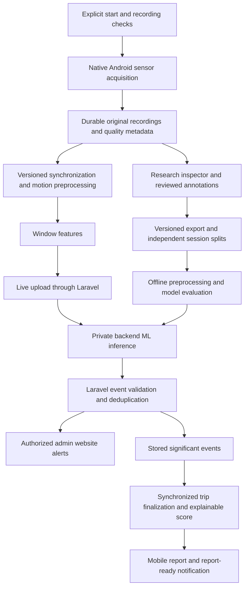

# Telematics and RC Research: central implementation guide

Last reconciled: **2026-10-24**. Scope: Laravel, the Next.js management website,
and the Android-only Expo application. This consolidation changes documentation
only; it does not implement the target pipeline or change existing contracts.

## Authority and status

This is the active reference for telematics, RC research, calibration, collection,
fleet monitoring, and their AI roadmap. Read the applicable source files before
editing. Laravel Form Requests, Resources, services, migrations, and the installed
native adapter establish what the current application actually does.

Use these distinctions in code reviews, documentation, and defense claims:

- **Implemented:** present in the inspected code; not necessarily physically verified.
- **Agreed target:** selected in the planning discussion, but still requires implementation.
- **Experimental:** a setting or approach to select using development recordings.
- **Historical evidence:** an attributed result from an earlier check, not a fresh verification.
- **Pending:** no applicable completed verification is established.

The target design below replaces earlier planning exclusions of native research
recording, AI alerts, and a behavior score. It does not make those features exist,
remove authorization, or permit silently changing rental release rules. Preserve
existing data and implemented behavior unless the scoped implementation requires
a documented change. Do not request repeated approval for an already agreed
direction; clarify genuinely unresolved requirements before implementing them.

The [documentation index](README.md) covers other domains. The [project roadmap](project-status-and-roadmap.md)
provides project-wide status. [Archived guides](archive/telematics-2026-10-24/README.md)
are historical evidence only: do not use them as competing implementation instructions.
The external `telematics_blueprint.md` was a proposal reviewed during planning,
not an authoritative description of this codebase or a verified industry standard.

## Agreed scope and requirements

- Rental and booking management continue to represent real cars. RC experiments
  use an identified experimental profile, not unmarked real-customer telemetry.
- The panel suggested RC testing. RC results support claims about the tested RC
  setup only. Real cars need separate collection, calibration, training, and validation.
- User-reported equipment: MN-82S Supertourer; Redmi Note 8 Pro, Android 11
  `RP1A.200720.011`, MIUI 12.5.8; one operator and one sensing phone. A teammate
  observes and annotates controlled trials. These are reported setup facts, not
  independently verified hardware specifications.
- Use one rigid, repeatable mount initially. The user confirmed position A:
  screen upward, approximately 10° above horizontal, with the phone's top toward
  the RC front. The angle is an estimate, not a measured calibration constant;
  measure the mounted gravity reference and verify rigidity before collection.
  Do not assume arbitrary-mount support.
- The RC has user-reported gradual throttle and steering, slight straight-line
  drift, a braking action before reverse, and some coasting from higher speed.
- Use **harsh**, not abrupt, in maneuver labels: harsh acceleration, harsh braking,
  harsh cornering, and swerving. Ordinary steering corrections and reversing
  belong in normal examples.
- During a drive, AI-based event alerts should reach the admin website. After a
  drive, provide an evaluated report and explainable behavior score, with a mobile
  report-ready notification. Actual phone push delivery is distinct from the
  currently implemented in-app notification feed.
- Collection must support screen lock/minimizing through a native Android recording
  service, retain measurements through network loss, and recover uploads. Force-stop,
  reboot, and runtime loss must not be described as uninterrupted collection.
- Direction handling must be automatic during operation. Observer direction labels
  are training/evaluation annotations, never a required live Forward/Reverse switch.
- Prioritize a reliable recorder and inspection UI before training. Retain original
  measurements so filtering and feature experiments can be repeated.
- Working-prototype target: October 31, 2026. Checking: October 26; mock defense:
  second week of November; defense: first week of December. Dates are user goals,
  not promises of accuracy or completed physical validation.

## Current implementation baseline

| Area | Inspected implementation | Outstanding boundary |
| --- | --- | --- |
| Mobile stack | Expo SDK 54 (`~54.0.37`), React Native 0.81.5, `expo-sensors ~15.0.8`, development client, Android-only configuration | No custom native motion-recording module found |
| Builds | Generated Android project; development and standalone preview APK profiles | A successful build does not prove device reliability |
| Research capture | Manual foreground DeviceMotion recording, requested 20 ms updates, live numerical summaries | Memory-only, background cancellation, no durable drafts or continuous-drive capture |
| Research storage | Admin/owner-bound sessions/trials, immutable encrypted private files, bounded validation, idempotent save, explicit deletion | No waveform/sample-read API, export, annotation revisions, or web research workspace |
| Calibration | Six readiness checks and five supervised foreground exercises, summary-only evidence | Provisional settings; moving RC/reference accuracy not established |
| Released rental GPS | Explicit foreground/background latest-location sharing, consent, pause/resume, server eligibility | No continuous rental motion collector, offline recording queue, or route-history collection in this flow |
| Fleet website | Ongoing rentals, latest-location map, private Reverb invalidations and authorized rereads | No connected AI driving-event dashboard |
| Notifications | Customer/Driver in-app records, unread counts, booking activity | No implemented report-ready flow or remote phone push delivery |
| ML and score | Harsh-event enum values and data foundations | No trained model, training/inference pipeline, or behavior-score/report implementation found |

Existing enum values and old mock presentation components do not establish AI
functionality. Research `eligible_for_training` is a provisional quality/annotation
flag, not proof of correct axes, sound labels, independent splits, or model accuracy.

## Existing rental and handover boundaries

Keep these implemented business rules while extending research:

- Self Drive operator: owning Customer. With Assigned Driver operator: currently
  assigned Driver. Entry/navigation does not establish eligibility.
- Laravel determines eligibility, validation, authorization, and step outcomes.
  Mobile uses Sanctum bearer tokens; web management uses cookies/session/CSRF.
- Pre-release data belongs to `telematics_setup_sessions` and retryable
  `telematics_setup_steps`, not `booking_assignments`. Retain attempt history.
- Staff starts eligible handover (`setup_required -> in_progress`). The combined
  outgoing-inspection/handover action finalizes required signatures transactionally.
  Existing finalized inspections can continue without replacement.
- Setup mutations normally require a confirmed booking, server time inside
  `[rental_start_at, rental_end_at)`, the applicable operator, and in-progress
  handover; Self Drive also requires verified Customer documents. Reassignment
  requires fresh readiness for the new Driver.
- Standard release requires payment, inspection/signature, vehicle/operator, and
  all eleven effective setup/calibration requirements. Staff's authorized
  **Start Rental** is the only `ready_for_release -> released` action.
- A booking has at most one post-release trip. Pause/resume stays in that trip.
- Active default zones are copied into `booking_geofences` at release; all booking
  geometry and alert settings are then frozen. Zone configuration and containment
  never gate setup or release. See [geofence monitoring](geofence-monitoring.md).
- Local/testing `RENTAL_EARLY_START_TEST_MODE` permits same-start-date early
  preparation while preserving other gates. The broader
  `TELEMATICS_HANDOVER_TEST_MODE` has separate documented test exceptions in source,
  including Self Drive readiness relaxation with real mount evidence. Neither flag
  applies to production/staging, changes booked times, or fabricates passed checks.
  Do not enable either as a shortcut to collect research recordings.
- Research trials do not need customer bookings or rental release. Preserve their
  separate session/trial storage and access boundary.

Current entry points include `GET /api/mobile/telematics/rentals`,
`GET /api/mobile/telematics/setup`,
`GET /api/mobile/bookings/{booking}/telematics-setup`, and
`POST /api/mobile/bookings/{booking}/telematics-setup/steps/{step}/attempt`.
Use [routes](../backend/routes/api.php), [setup services](../backend/app/Services/TelematicsSetupService.php),
and the [booking lifecycle](booking-rental-lifecycle.md) for exact contracts.
Returned/Completed owning-booking setup reads can be read-only history; they do
not reopen mutation or collection eligibility.

## Existing calibration and sensor conventions

Readiness order: `device_check`, `motion_permission`, `location_permission`,
`background_location`, `gps_check`, `phone_mount`. These checks do not start
continuous recording. A fresh setup GPS fix is quality evidence, not route history.

Calibration order: stationary, forward, braking, left turn, right turn. Captures
are explicitly consented, supervised, foreground-only, and bounded. Cancel,
navigation, or backgrounding stops capture. Laravel receives bounded summaries,
not sample streams, and evaluates fresh context, order, consent, quality, and
profile. A local success animation cannot replace server acceptance.

Current geometry uses a gravity reference, horizontal acceleration projection,
a learned forward reference, and projected angular motion. It is not a custom
continuous Kalman/complementary/PCA fusion estimator or a speed/gear detector.
Current profiles retain the first qualifying Forward sample at 3 m/s², subject
to other quality gates. That single sample does not demonstrate sustained
direction consistency. Stationary is six seconds; other configured maximums and
RC overrides are in [configuration](../backend/config/telematics.php).
The active profile is standard revision 4 or local/testing RC revision 5;
profile/settings fingerprints bind attempts. These are operational demonstration
settings, **not learned harsh-event thresholds or training labels**.

Important existing adapter details, verified by source inspection:

- Current Expo linear acceleration is platform-processed, in m/s².
- Installed Android DeviceMotion exports `accelerationIncludingGravity` as
  raw accelerometer minus twice the native gravity value. Do not assume that
  field is identical to direct `SensorManager` accelerometer output.
- The application derives its current gravity vector from including-gravity
  minus linear acceleration. Reference signs therefore depend on that adapter.
- Expo exports rotation rate in degrees/second; direct Android gyroscope values
  use radians/second. `rotationAxes` maps Android alpha/beta/gamma to XYZ.
- Current research's `gravity_timestamp_s` identifies the including-gravity
  measurement timestamp, not an independently retained native gravity event.
- Screen orientation is not full three-dimensional attitude.

Preserve original source conventions and conversion versions. Physically check
signs/reference orientation before reusing geometry with native channels. Never
silently reinterpret old records or edit installed dependency sources to change
their meaning. Research reference capture should reuse suitable pure mathematics,
not customer setup attempts, release thresholds, or mutable released calibration.

Sources: [installed Android adapter](../mobile-frontend/node_modules/expo-sensors/android/src/main/java/expo/modules/sensors/modules/DeviceMotionModule.kt),
[calibration math](../mobile-frontend/lib/telematics/calibration.ts),
[foreground capture](../mobile-frontend/services/telematics/calibration-capture.ts),
[server evaluation](../backend/app/Services/TelematicsCalibrationService.php).

## Existing RC Research v1

### Access and lifecycle

An active Admin signs in through normal mobile login when the local/testing
`rc_demo` profile is active. The server issues an eight-hour research-only token;
ordinary Customer/Driver mobile access and web cookies cannot substitute for it.
Reads and mutations are owner-bound. The token cannot use ordinary mobile
features; revocation remains available after research access is disabled.

Current API:

- `GET /api/mobile/rc-research`
- `POST /api/mobile/rc-research/sessions`
- `POST /api/mobile/rc-research/sessions/{session}/trials`
- `GET /api/mobile/rc-research/trials`
- `DELETE /api/mobile/rc-research/trials/{trial}`

Current screen: Data / Collect / Logout. Collect contains session setup,
manual recording, and review/save. Navigation is restricted during capture/save.
Unsaved recordings exist only in memory; failed uploads can be retried in the
same runtime using the same trial ID. Backgrounding cancels capture; reopening
does not restore recording or unsaved samples.

### Capture and storage contract

Protocol 1 requests a fixed 20 ms interval (nominal 50 Hz), minimum one second
and eight accepted snapshots, at most 10,000 snapshots and 4,000,000 JSON bytes.
Capacity exhaustion fails the recording; there is no automatic completion/save.
The three-second startup deadline and 200 ms warmup are stream-health checks.
They do not establish a stable 50 Hz independent native acquisition rate.

Each accepted snapshot retains relative callback time, three exported channel
timestamps, linear XYZ, including-gravity XYZ, rotation XYZ, and screen orientation.
Incomplete, nonfinite, nonadvancing, or sufficiently misaligned snapshots can
be skipped. This is not a lossless archive of independent sensor events.

Session context includes name, surface, slope, mount orientation, battery
condition, platform/app version, and consent. Legacy phone/RC/mount/configuration
fields are optional and absent from the current setup form. No extra load is
recorded (`added_load_g = 0`); this does not mean the phone/mount has zero mass.

Trial validation currently requires intended/observed movement and intensity,
certainty, quality, event bounds, capture times, and a bounded multipart
`samples_json` string. Laravel validates and recomputes summaries, then stores
samples in an immutable, encrypted private file. Database rows hold metadata
and summaries, not raw streams. API Resources do not expose sample paths/files.
Matching retries are idempotent; changed content or deleted IDs produce conflict.

Provisional flags: average rate below 8 Hz, gap over 250 ms, or sensor span below
85% of wall duration. Confirmed labels plus usable quality and no flags set the
current eligibility flag. Do not promote these provisional checks to scientific
acceptance limits without pilot evidence.

Saved records remain until explicit owner deletion. Deletion removes ciphertext,
notes, and summaries while retaining a minimal tombstone to prevent upload
resurrection. Failed file deletion remains visible/retryable. Protect the server
encryption key; deletion cannot promise erasure of external backups or exports.

Current movements are stationary, steady movement, acceleration, braking, left
turn, right turn, with normal/harsh or not-applicable intensity. Swerving,
direction annotations, comparison conditions, pending labels, and annotation
revisions need contract extensions. The current form initially copies intended
labels and selects the full recording interval; the target review must not
silently confirm those defaults as observed ground truth.

Sources: [protocol](../backend/app/Support/RcResearchProtocol.php),
[research service](../backend/app/Services/RcResearchService.php),
[session request](../backend/app/Http/Requests/Research/StoreRcResearchSessionRequest.php),
[trial request](../backend/app/Http/Requests/Research/StoreRcResearchTrialRequest.php),
[mobile recorder](../mobile-frontend/services/telematics/rc-research-capture.ts),
[mobile schemas](../mobile-frontend/validation/research/rc-research.ts),
[research screen](../mobile-frontend/screens/research/RcResearchScreen.tsx).

## Existing released GPS and mobile activity

The current released-rental collector is latest-location GPS only. It is separate
from research and calibration. Its foreground mode uses an app-wide watch;
explicit foreground/background mode uses the separate
`jamjade-rental-latest-location` native location task and visible service
notification. The setup readiness task remains inert. A location task is not a
continuous motion recorder.

Current API base: `/api/mobile/bookings/{bookingCode}/location-monitoring` with
GET state and POST `/start`, `/location`, `/pause`. Requests use the existing
mobile service and Form Requests. Start requires current accepted consent and
`sharing_mode = foreground | foreground_background`. Current consent version is
3; configuration defines a five-second upload interval, maximum 50 m accuracy,
60-second age, 10-second future skew, and 24-hour latest-point retention.

Laravel rechecks operator, ongoing/released rental, no physical receipt, valid
session, and point freshness/accuracy. Overdue ongoing rentals are not stopped
merely because their reserved return time passed. Starts reuse the one trip and
rotate an ephemeral collection token; only its hash is retained server-side.
The latest encrypted point is overwritten, not appended to route history.
Legacy trip/location endpoints are separate and cannot bypass the consented flow.
Accepted reliable latest fixes also drive frozen-zone evaluation and enabled
named in-app crossing alerts; see [geofence monitoring](geofence-monitoring.md).

Foreground mode stops when backgrounded; background mode is explicitly selected
with appropriate native permission. Current runtime consent/session state and
collection tokens are in memory. Stop, interruption, sign-out, runtime loss, and
cold tasks do not silently restart sharing. There is no persistent GPS route queue.
Receipt/expiry clears retained location and invalidates collection as implemented.

The shared mobile drawer has Full details, Device setup, and Activity. Explicit
setup agreement can prepare one GPS start after fresh server-confirmed release
while the same screen/runtime remains active. Saved consent preferences alone
do not start collection. Existing-trip resume uses an explicitly started local
Stationary check, valid for 60 seconds and consumed once; it does not update
released setup or upload raw motion. The map does not create another watcher.

Activity reuses account-owned notification records with optional booking filtering,
cursor pagination, unread counts, and existing read actions. Current GPS lifecycle
and enabled zone alerts create in-app records; no remote phone push is implemented.

Sources: [location service](../backend/app/Services/LocationMonitoringService.php),
[mobile API](../mobile-frontend/services/api/location-monitoring.service.ts),
[background collector](../mobile-frontend/services/telematics/background-location-collector.ts),
[mobile screen](../mobile-frontend/screens/telematics/TelematicsHandoverScreen.tsx),
[notification guide](mobile-notifications.md).

## Existing fleet monitoring

`GET /admin/fleet-tracker` uses stateful web authorization and `view fleet tracker`.
It lists ongoing rentals, including overdue and no-trip cases, with bounded
search/filter/pagination and tracking status. Its map receives authorized,
unexpired latest points; it is implemented, not an unavailable placeholder.
Statuses and stale points do not prove the phone is currently connected.

Current transport: latest-point transaction commits -> queued empty `fleet.changed`
notice -> private `fleet-monitoring` channel -> authorized HTTP reread -> map update.
Socket notices contain no GPS, samples, model, or rental payload. Authorization
uses `POST /admin/broadcasting/auth`, the web guard, and repeated permission checks.
Reads reconcile on notices/reconnect and periodically while visible. The native
collector does not depend on keeping a WebSocket open.

Reverb and its queue worker need reachable deployment configuration and running
processes; HTTPS sites need a reachable TLS WebSocket endpoint. The existing
Google Maps singleton remains the only loader. Reuse chart/table primitives and
installed Recharts for research; do not revive mock driving-log components as
real measurements or replace the JamJade visual identity.

Sources: [fleet service](../backend/app/Services/FleetTrackerService.php),
[publisher](../backend/app/Services/FleetMonitoringPublisher.php),
[event](../backend/app/Events/FleetMonitoringChanged.php),
[module](../web-frontend/src/modules/management/fleet-tracker/FleetTrackerModule.tsx),
[web subscription](../web-frontend/src/services/fleet/fleet-realtime.ts).

## Target pipeline

Everything in this section is the **agreed target**, not an implemented feature.

### Native recording and protocol upgrade

Keep Expo/React Native screens and add an Android-only local Kotlin module/service.
The native service must own sensor capture, durable storage, processing/transmission
needed while locked, and lifecycle state; forwarding every measurement to screen
JavaScript does not establish reliable background collection. Use a visible
notification, explicit start/stop, appropriate service configuration, and measured
power handling. Validate on the Redmi before claiming lock-screen reliability.
Keep custom sources outside disposable generated-project edits; use module
manifests/config plugins as appropriate. Follow the installed SDK 54 documentation
and existing Android build/signing workflow; do not routinely clean generated
projects or uninstall the app and lose installed state.

Introduce a versioned capture contract; preserve readable v1 records with their
source and units. Capture original Android accelerometer and gyroscope events
with individual monotonic timestamps. Retain supporting gravity, linear acceleration,
rotation estimates, sensor accuracy/range, and availability where supported.
Do not fabricate unavailable channels or discard all source events because
another channel did not arrive simultaneously. Record omissions/rejections.

Store recording data in durable, protected files before relying on network delivery.
Separate original measurements from derived datasets. Bounded chunks, checksums,
sequence identifiers, acknowledgments, retry/deduplication, interrupted-file recovery,
and visible pending-upload state need implementation and regression coverage.
Recover saved data without silently restarting capture. Define local retention and
key handling before implementing persistent recordings; do not leave raw files
or auth tokens in public or insecure storage.

### Collection and inspection UI

Keep the mobile Data / Collect navigation and shared controls. Target Collect:
hardware/session profile -> sensor/recording checks -> research reference capture ->
manual Start/Stop -> durable local save/upload -> quality and waveform review ->
annotation review. Saving an unlabeled recording must not require a confirmed
normal/harsh label. Preserve observer trial notes from the first pilot.

Add an Admin web RC Research workspace with authorized owner-scoped reads:

- Session/trial browser, recording/upload/processing states, and quality summary.
- Timestamped acceleration/rotation plots, axis toggles, zoom, and visible gaps.
- Original-versus-processed overlays with processing version/settings.
- Event-interval selection on the timeline and observed labels/uncertainty/notes.
- Reviewed annotation revisions and separation of integrity, label review, and
  dataset inclusion states. Never overwrite the original recording.
- Versioned export with samples, annotation revisions, exclusions, grouping/split
  assignments, units, processing/feature definitions, and checksums.

Use bounded/windowed sample reads and visualization downsampling where necessary;
do not send an unbounded dataset through list APIs or use visual decimation as
the training data. Any live observer markers must map to the recording's time
reference, remain annotations, and never become runtime classifier inputs.

The mobile bearer-only research endpoints deliberately reject web sessions.
Add web research endpoints using normal web session/CSRF and explicit Admin access,
reusing domain services. An internet-accessible demo needs an explicitly enabled
research deployment boundary; do not make `APP_ENV=local` the public access plan.
Keep research streams separate from rental setup evidence, customer records,
location history, and ordinary significant-event lists.

### Preprocessing and sampling

Process original recordings reproducibly: inspect integrity -> align channels
with bounded interpolation -> establish gravity/mount references -> reduce noise
without erasing genuine maneuvers -> generate windows/features. Specify exact
units, axes, timing, warmup, filter behavior, missing-data policy, and versions.
Use filtering appropriate to live operation; offline future-looking processing
must not create a falsely favorable live-inference evaluation. Apply appropriate
anti-alias filtering when reducing sampling frequency.

Requested **50 Hz** is the initial pilot acquisition setting, not an RC or fleet
standard, guaranteed delivered rate, or proven optimum. Compare properly filtered
10 Hz and 20 Hz representations on development recordings. Select the lowest
rate meeting measured requirements; test actual lower-rate acquisition separately
for battery effects. Hz is neither acceleration range nor API/alert frequency.
Do not assume an RC necessarily needs higher rates merely because it is smaller.

Measure per-channel timing, gaps, coverage, clipping, and stationary stability.
Do not fill long gaps with zero, smooth away large values because they look harsh,
normalize each trip so its intensity disappears, or use callback/network arrival
as sensor time. Python and live Kotlin feature implementations must agree on
reference recordings within specified tolerances before deploying a model.

### Maneuvers, reversing, and dataset evaluation

Proposed primary targets: normal motion, harsh acceleration, harsh braking,
harsh cornering, and swerving. Left/right can remain observation attributes;
preserve existing left/right records. Missing or unusable data is not normal.
Define annotation and event-overlap policies before formal collection; isolate
pilot/tuning sessions from final evaluation. Start with isolated maneuvers, then
evaluate mixed maneuvers and deduplication rather than assuming support.

Include normal starts/stops/turns, drift corrections, normal reversing, reverse
turns/stops, direction transitions, bumps, surface vibration, and disturbed-mount
cases. Give confounders explicit quality/observation metadata rather than forcing
them into harsh classes. Phone handling is not evidence of harsh driving.

Reversing must be automatic in operation. Acceleration sign alone cannot distinguish
forward braking from reverse acceleration, or infer constant-velocity direction.
Evaluate temporal context/direction estimation; annotations available only during
research cannot be live model features. Do not promise reliable automatic direction
from phone-only indoor measurements without evidence. Keep ambiguous decisions
explicit and do not turn them into confirmed harsh-braking alerts or unjustified
score deductions. Normal reversing false alerts are an acceptance criterion.

Define repeatable controlled procedures; teammate labels describe actual observed
movement and uncertainty, not merely the intended instruction. Detector thresholds
and model predictions cannot supply their own ground truth. Label event intervals,
not entire recordings as harsh when only a short maneuver occurred.

Start offline with version-pinned Python tools, a simple baseline, and a candidate
Random Forest. More complex models are optional comparisons. Fifty or one hundred
trips do not guarantee accuracy. Keep entire sessions and related windows/augmented
copies together; fit learned transforms on training data only. Reserve final
evaluation from sampling/filter/feature/threshold/model selection.

Report per-class precision/recall/F1, macro-F1, confusion matrix, session/trial counts,
uncertain/excluded data, false alerts on normal/reverse/confounding cases, recording
completeness, and full motion-to-website delay. For continuous detection, measure
event-level matching and duplicates, not just isolated-window accuracy. One
operator/phone supports conclusions about that setup, not unseen drivers/devices.

### Live inference, reporting, and scoring

Initially send features for every valid analysis window through Laravel to a
private backend inference component; a hard threshold gate must not silently
remove examples the ML model is supposed to assess. Retain enough raw research
data to reproduce feature results. No 50-requests-per-second requirement is implied.

Laravel owns validated model/version association, quality/rejection handling,
event identity, occurrence versus receipt times, and aggregation of overlapping
predictions into one maneuver. Client-supplied event names or confidence alone
are not verified AI results. Do not bolt this onto a legacy endpoint that bypasses
current consent/ownership or rejects the current latest-only trip flow.

Reuse authorized Reverb infrastructure for website updates. Backend inference
requires connectivity: record locally while offline, show disconnected status,
and label recovered events delayed with original times. A short measured delay
is the aim; no zero-latency claim. Public HTTPS API and TLS socket reachability
must be tested across Wi-Fi/mobile data; sharing Wi-Fi alone does not prove reachability.

Trip finalization must reconcile outstanding uploads and late events before a
report is final. Distinguish completed and incomplete recording coverage. Existing
ended-trip guards do not automatically support delayed motion ingestion; design
the finalization state and authorization explicitly without reopening rental actions.

The score is an agreed project-defined RC behavior index, not accident probability,
liability, a financial penalty, or proof that a driver is safe. Select transparent
weights, intensity/duration/exposure treatment, and duplicate rules using development
data; freeze them before final evaluation. Model confidence is not event severity.
Do not base indoor RC scoring on unvalidated GPS distance. Explain contributing
events and withhold/qualify scores when coverage is inadequate.

Reuse mobile in-app notifications for report-ready records and an authorized report
link. Actual lock-screen/remote push needs its own delivery implementation and
device testing; the current restricted Admin research token cannot read ordinary
Customer/Driver notifications. Specify the demo report recipient and access in
the report increment without widening research tokens to unrelated mobile APIs.

## Implementation sequence and acceptance gates

| Increment | Deliverable | Evidence required |
| --- | --- | --- |
| 1. Recording contract/service | Versioned native acquisition, durable files, sensor/session metadata, explicit lifecycle | Actual independent timestamps, exportable recordings, screen-lock and interruption tests on Redmi |
| 2. Inspection workflow | Unlabeled save, protected sample reads, mobile upload status and web waveform inspector | Real trial visible and traceable; owner/access failures, gaps, retry and recovery exercised |
| 3. Reproducible processing | Research references, quality reports, synchronization/filtering/features, export manifest | Original data preserved; plots reviewed; live/offline parity and rate comparisons |
| 4. Dataset/model | Reviewed annotations, split sessions, baseline/model evaluation, versioned bundle | Held-out metrics, normal reverse/confounder tests, uncertainty and limits reported |
| 5. Live AI/report | Server-owned event ingestion, admin alerts, deduplication, finalization, score and notification | End-to-end delay, offline recovery, no duplicate deductions, incomplete-report handling, recipient access |

The first end-to-end milestone is: **record on the mounted Redmi -> preserve through
screen lock/network loss -> upload -> inspect the waveform on the website**.
Do not prioritize a polished score screen over this evidence. Exact filters,
window/stride, thresholds, dataset size, automatic direction method, score formula,
and hosting capacity are experimental or implementation decisions, not established facts.

## Verification and historical evidence

- **2026-10-24 source review:** current mobile/backend/web paths were inspected.
  Focused mobile research/calibration checks passed 41 tests; backend research
  access/collection checks passed 47 tests and 192 assertions. Native events in
  those tests are synthetic; no model accuracy or physical RC performance follows.
- **2026-10-24 device availability check:** `adb devices -l` listed no connected
  device. No current native visual, moving-RC, screen-lock, or live phone-to-web
  validation was performed during the review or this documentation consolidation.
- **Historical 2026-10-16 Android smoke record:** the old checklist reports a
  consented six-second stationary DeviceMotion capture on Redmi Note 8 Pro /
  Android 11, using an isolated temporary development bundle: 91 readings over
  5.89 seconds, maximum gap 88 ms, acceleration RMS 0.107 m/s². This is attributed
  historical evidence, not rerun here, not a 50 Hz RC trial, not full handover,
  and not background or direction/classifier validation.
- **Historical Android-only build record (2026-10-24):** the retained
  [Android-only guide](android-only-mobile.md) records lint, type checks, 232 Node
  regressions, diagnostics, export, Prebuild, and offline debug assembly. Those
  results were not rerun for this documentation-only task and do not prove physical behavior.
- Older browser, iOS, backend, and transport results remain attributed in the
  archive. iOS and mobile-browser support are retired; do not restore them as
  current verification requirements. The Next.js website remains supported.

For implementation, run the relevant checks in root/application AGENTS guides.
For documentation-only changes, review claims, source links, active/archive
references, preservation, and `git diff --check`; no application build is required.
Do not report pending native or AI gates as passed based on code/tests/docs alone.

## Scope limits and maintenance

Video/audio recording, video sending/upload/auditing, dashcam offerings, LLM-based
cleansing/classification, regional weekly rankings, arbitrary mounting, and
unvalidated real-car AI deployment are outside the first prototype. GPS/geofences
remain useful existing rental features; they are not required to label an indoor
RC maneuver or establish a valid distance-based score.

Never put raw motion streams in setup evidence, ordinary event metadata, logs,
public files, or high-volume database JSON. Keep research file storage, metadata,
derived artifacts, and significant occurrences distinct. Preserve consent,
access control, server validation, encryption, deletion, and provenance across
exports/model versions. A checksum proves file integrity, not truthful labels.

When implementation changes, update this guide's baseline, target status, source
references, and evidence together. Update the project roadmap/index summaries
without copying the detailed contracts back into competing documents. Amend
Form Requests, Resources, schemas, services, native adapters, tests, and affected
client mapping together for contract changes. Preserve release snapshots and
existing historical recordings. Ask about material uncertainty; do not invent
thresholds, accuracy, completed work, permissions, or an approval requirement.
